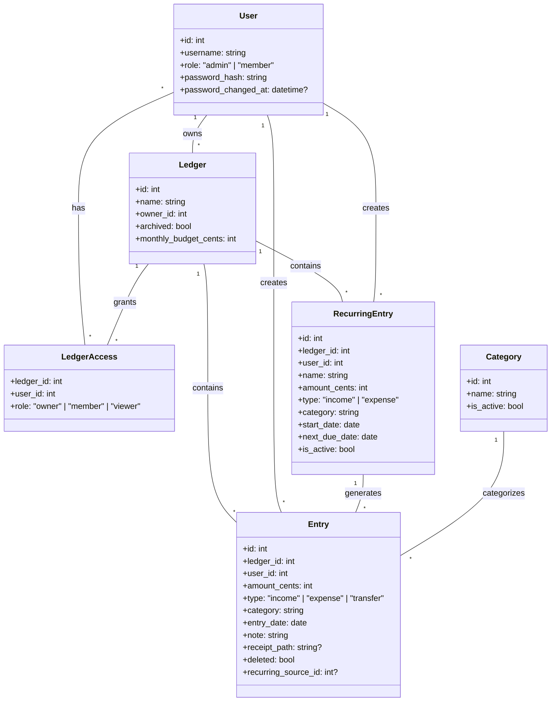
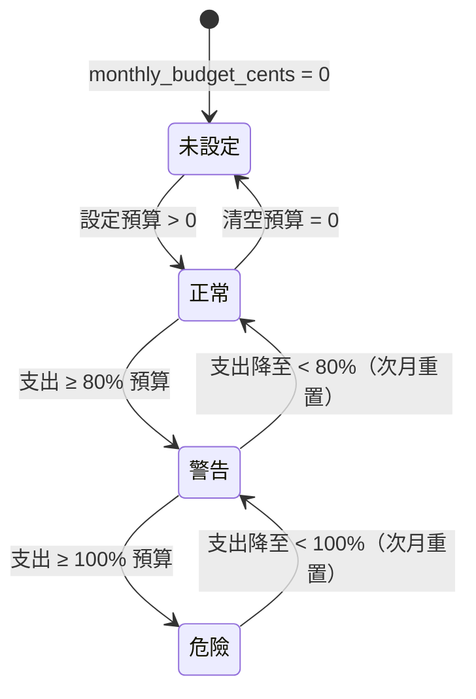
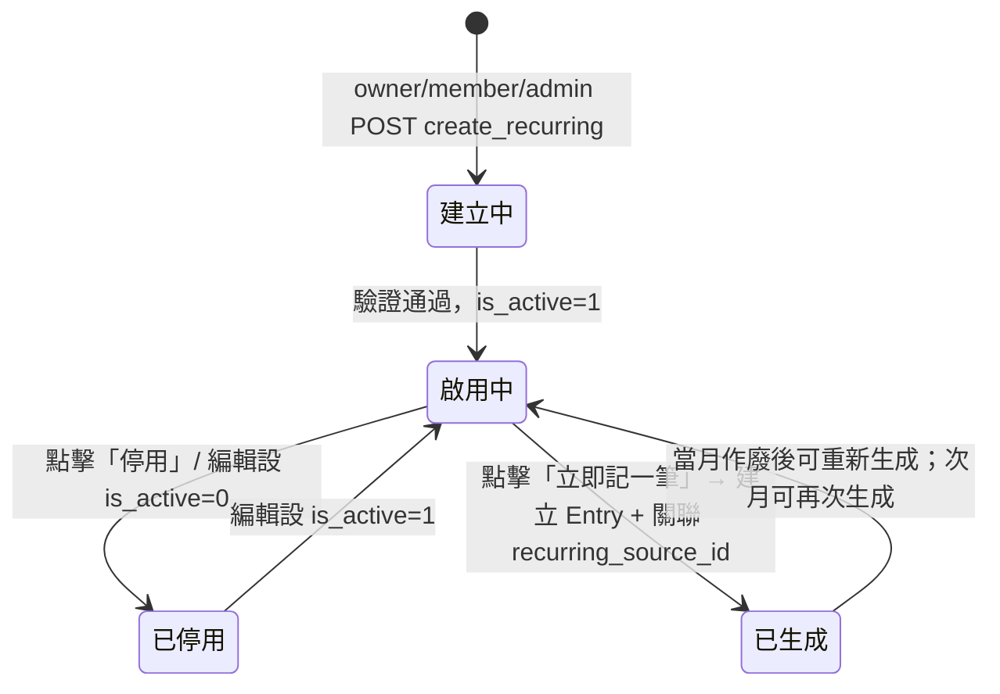
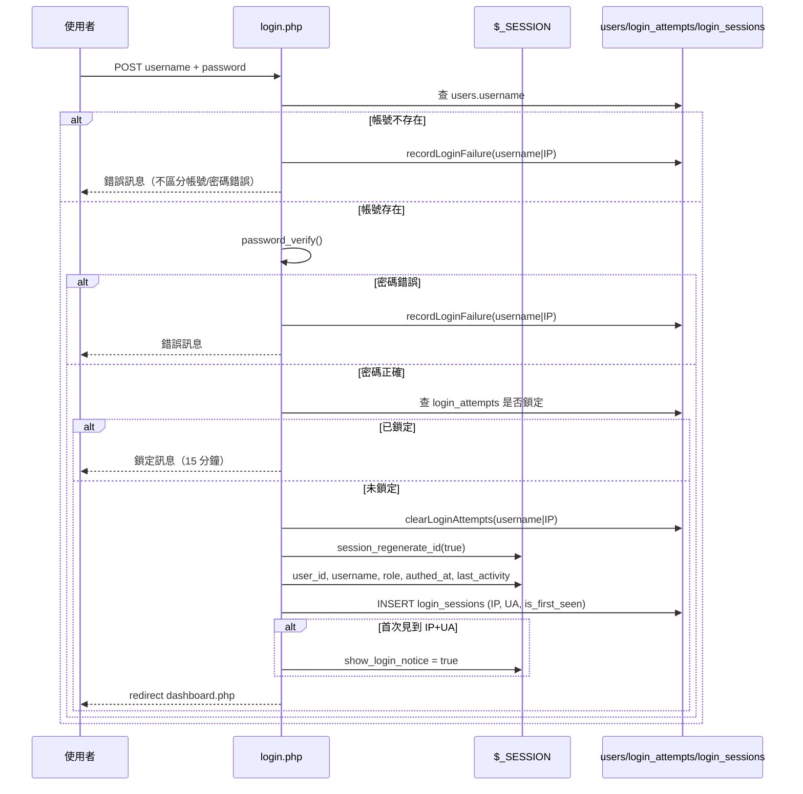
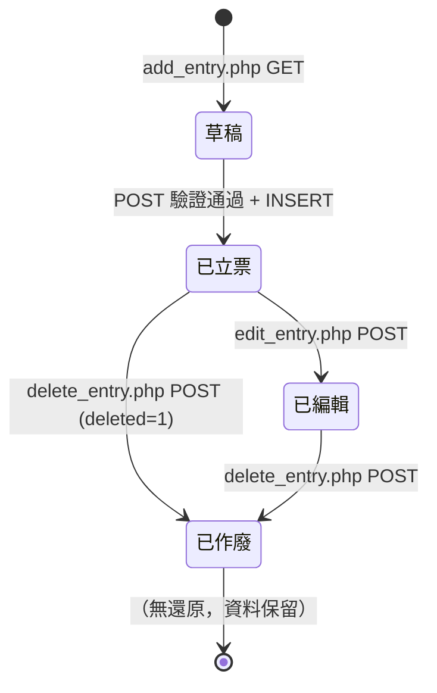
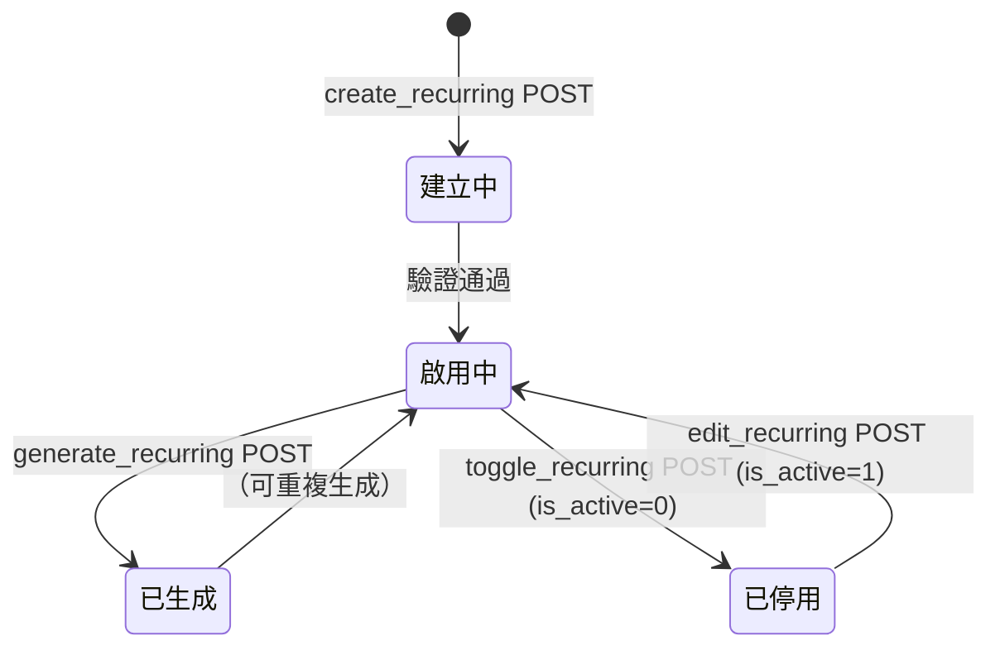
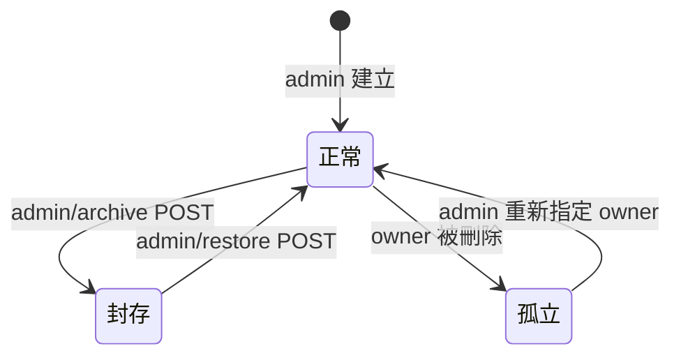

# 業務邏輯與核心規則

> 記錄系統核心業務規則、狀態機、計算邏輯、邊界條件與例外處理。

---

## 核心領域模型



---

## 核心業務規則

### 1. 金額處理（整數分制）

| 規則 | 實作 | 範例 |
|------|------|------|
| **儲存** | `amount_cents` INTEGER，正整數 | 123.45 元 → 12345 |
| **解析** | `toCents('123.45')` → 12345 | 正則 `/^(\d{1,10})(?:\.(\d{1,2}))?$/` |
| **格式化** | `formatCents(12345)` → `'1,234.50'` | `number_format` + 千分位 |
| **運算** | 全程整數加減乘除 | 比較用交叉相乘避免浮點 |
| **顯示前綴** | 收入 `+`、支出 `-`、轉帳無前綴 | `+1,234.50` / `-1,234.50` |

**交叉相乘比較範例**（預算判定）：
```php
// 支出 ≥ 預算 100% → danger
if ($expenseCents * 100 >= $budgetCents * 100) { $status = 'danger'; }
// 支出 ≥ 預算 80% → warn
elseif ($expenseCents * 100 >= $budgetCents * 80) { $status = 'warn'; }
```

---

### 2. 傳票編號規則

| 類型 | 前綴 | 格式 | 來源 |
|------|------|------|------|
| 收入 | `收-` | `收-008` | `entries.id` 零補齊 3 碼 |
| 支出 | `支-` | `支-012` | `entries.id` 零補齊 3 碼 |
| 轉帳 | `轉-` | `轉-005` | `entries.id` 零補齊 3 碼 |

> **關鍵**：編號由資料庫 `id` 推導，**不另建欄位**，確保唯一且不斷號。

---

### 3. 記帳類型語意

| 類型 | 代碼 | 收支影響 | 結餘計算 | 顏色 | 適用場景 |
|------|------|----------|----------|------|----------|
| **收入** | `income` | + | 結餘增加 | 朱紅 (#c0392b) | 薪資、紅包、利息 |
| **支出** | `expense` | - | 結餘減少 | 鐵藍 (#1f4e79) | 食、衣、住、行、育、樂 |
| **轉帳** | `transfer` | 0 | 不計入結餘 | 墨黑 (#23272b) | 帳戶間轉帳、信用卡繳款 |

> **規則**：轉帳**不計入**收入/支出/結餘，僅單獨統計顯示。

---

### 4. 預算邏輯



**判定時機**：
- 僅**當月**（Asia/Taipei 時區）顯示預算狀態
- 跨月查詢（`ym` 參數非本月）不顯示預算進度條/橫幅
- 預算針對**支出** 計算，收入不影響
- 單日篩選只改分錄與收支小計；「本月預算」仍按同一帳本的台北整月有效支出（含其他成員、排除轉帳及作廢）計算。來源：`ledger.php`；驗收見 `docs/[#33]_monthly-budget-date-filter/Design.md`。
- 帳本層級的完整提醒在儀表板及帳本詳情每帳本各最多一則。達上限仍是紅色但不稱超支；須以整數分判斷，不能以已向下取整的顯示百分比判斷。只有進度條寬度上限 100%，使用率顯示可超過 100%。來源：`dashboard.php`、`ledger.php`；驗收見 `docs/[#32]_ledger-budget-notices/Design.md`。

---

### 5. 重複記錄生命週期



**生成規則**：
- 僅 `is_active=1` 可生成
- 生成時 `entry_date = 今日`、`note = '來自重複記錄：' + name`
- `recurring_source_id` 關聯回來源
- 同一 Taipei 月份已有未作廢的來源分錄時不得重複生成；作廢分錄不阻止重新生成（[#34-E]）。
- 生成後依 `start_date` 的日數逐月推進 `next_due_date` 至嚴格晚於今日；日數超過當月長度時收斂至月底（[#34-E]）。
- **幣別限制（[#29]）**：僅支援台幣（TWD）。`recurring_entries` 表無 `currency`、`exchange_rate`、`original_amount_cents` 欄位；生成分錄時自動填入 `currency='TWD'`、`exchange_rate=10000`（basis points，即 1.0000）、`original_amount_cents=amount_cents`。未來若需支援多幣別重複記錄，才於 `recurring_entries` 表補加三欄位並修改生成邏輯。

---

### 6. 帳本封存/還原

| 狀態 | 代碼 | 可見性 | 可操作性 |
|------|------|--------|----------|
| **正常** | `archived=0` | 全部成員可見 | 所有權限操作正常 |
| **封存** | `archived=1` | **僅 owner/admin 可見** | **禁止**新增/編輯/作廢/匯入/設定預算/重複記錄 |

> **規則**：封存帳本導向 `ledgers.php?error=1&msg=此帳本已封存`，不可進入 `ledger.php`。

---

### 7. 軟刪除（作廢）規則

| 實體 | 欄位 | 作廢效果 | 可恢復性 |
|------|------|----------|----------|
| **記帳分錄** | `entries.deleted=1` | 隱藏於所有列表、統計、匯出 | **不可恢復**（無還原介面，資料保留供審計） |
| **使用者** | `DELETE FROM users` + `entries.deleted=1` | 刪除帳號、移除存取權、作廢其記錄 | **不可恢復** |
| **重複記錄** | `recurring_entries.is_active=0` | 停用，不再顯示於列表 | **可恢復**（編輯設 `is_active=1`） |
| **分類** | `categories.is_active=0` | 隱藏於下拉選單，既有記錄保留分類名 | **可恢復** |

> **原則**：資料**絕不物理刪除**，保留審計追溯性。

---

### 8. 登入與 Session 安全



**Session 失效條件**：
1. 登出（`logout.php`：`session_destroy()`）
2. 密碼變更（`password_changed_at > authed_at`）
3. 閒置超過 30 分鐘（`last_activity` 檢查）
4. 瀏覽器關閉（`session.cookie_lifetime=0`）

---

### 9. 異常登入偵測

| 比對條件 | 觸發提醒 | 記錄位置 |
|----------|----------|----------|
| **IP + User-Agent** 組合首次出現 | 登入後儀表板顯示「偵測到新登入來源」 | `login_sessions.is_first_seen=1` |
| 同 IP 不同 User-Agent | 觸發提醒 | `login_sessions` 新增記錄 |
| 同 User-Agent 不同 IP | 觸發提醒 | `login_sessions` 新增記錄 |

> **目的**：家庭成員共用帳號時，異裝置/異地點登入即通知。

---

### 10. 匯入 CSV 業務規則

| 規則 | 說明 |
|------|------|
| **編碼** | UTF-8（含 BOM 自動去除） |
| **欄位順序** | 日期、類型、金額、分類、記錄者、備註 |
| **類型對應** | 收入→income、支出→expense、轉帳→transfer |
| **記錄者** | 未提供 → 目前登入使用者 |
| **錯誤處理** | 逐行獨立驗證，失敗跳過並記錄行號+原因，不中斷整體 |
| **重複檢查** | **不檢查重複**，直接匯入（可產生重複記錄） |
| **權限** | 僅 owner/member 可匯入，viewer 不顯示按鈕 |

---

### 11. 匯出規則

| 匯出類型 | 範圍 | 格式 | 權限 |
|----------|------|------|------|
| **CSV 明細** | 單一帳本、指定月份、篩選後結果 | CSV（UTF-8 BOM） | 所有可存取角色 |
| **月結單／傳票列印** | 未封存帳本的月份或日期區間，或該帳本的單筆傳票 | HTML 列印預覽，不提供伺服器 PDF 下載 | 所有可存取角色 |
| **年/季報表** | 可存取所有帳本、跨月統計 | HTML（可列印存 PDF） | 所有可存取角色 |

---

## 狀態機總覽

### Entry 狀態



### RecurringEntry 狀態



### Ledger 狀態



---

## 邊界條件與例外處理

| 場景 | 處理方式 | 使用者回饋 |
|------|----------|------------|
| **金額超大** | `toCents()` 限制 10 位整數（99,999,999.99 元） | 驗證失敗：金額格式不正確 |
| **日期無效** | `isValidDate()` 檢查 Y-m-d 真實曆日 | 驗證失敗：日期格式不正確 |
| **分類過長** | `mb_strlen > 50` 截斷/拒絕 | 驗證失敗：分類長度超過 50 字元 |
| **並發寫入** | SQLite WAL + `busy_timeout=5000` | 等待 5 秒，超時拋出例外 → 通用錯誤頁 |
| **CSRF 失效** | `checkCsrf()` 失敗 | Redirect 錯誤頁：安全驗證失敗 |
| **權限不足** | `ledger_access` 查無記錄或角色不符 | Redirect `ledgers.php?error=1` |
| **檔案上傳失敗** | `finfo_file` MIME 不符、>5MB、路徑遍歷 | 友善錯誤訊息，不外洩系統路徑 |
| **資料庫鎖定** | PDO Exception → `error.log` | 通用錯誤頁，不外洩 SQL/堆疊 |
| **審計寫入失敗** | `try-catch` → `logError()` | 不中斷主流程，僅記錄錯誤 |

---

## 計算邏輯驗證清單

| 計算項目 | 公式 | 驗證重點 |
|----------|------|----------|
| **本月收入** | `SUM(amount_cents) WHERE type='income' AND entry_date BETWEEN ms AND me` | 僅未刪除、指定帳本 |
| **本月支出** | `SUM(amount_cents) WHERE type='expense' AND entry_date BETWEEN ms AND me` | 僅未刪除、指定帳本 |
| **本月轉帳** | `SUM(amount_cents) WHERE type='transfer' AND entry_date BETWEEN ms AND me` | 不計入結餘 |
| **本月結餘** | `收入 - 支出` | 整數減法 |
| **總收入/支出/結餘** | 同上但無日期篩選 | 所有未刪除記錄 |
| **預算使用率** | `floor(支出 * 100 / 預算)` | 整數除法、分母為 0 時不計算 |
| **預算剩餘** | `預算 - 支出` | 可為負數（超支顯示） |
| **傳票編號** | `前綴 + str_pad(id, 3, '0', STR_PAD_LEFT)` | id 從 1 開始、零補齊 |
| **分頁總頁數** | `ceil(總筆數 / 50)` | 總筆數為 0 時至少 1 頁 |

---

### 12. 家庭訊息留言板（[#21]）

**業務規則**

| 規則 | 實作方式 | 備註 |
|------|----------|------|
| **留言長度限制** | `mb_strlen(trim($comment), 'UTF-8')` 1~200 字元 | 空白字元拒絕、前端即時字元計數 |
| **留言排序** | `created_at DESC`（最新在上） | SQL `ORDER BY` + PHP 分組保持順序 |
| **權限模型** | `ledger_access.role IN ('owner','member','viewer')` 皆可新增/檢視 | 無額外角色限制 |
| **審計日誌** | `action='entry_comment'`，`detail=json_encode(['entry_id' => $entryId])` | **嚴禁包含留言內容**（隱私保護） |
| **軟刪除** | `entry_comments.deleted` 欄位預留、`ON DELETE CASCADE` 級聯清理 | 目前無刪除介面，分錄作廢時自動清理留言 |
| **XSS 防護** | 所有輸出經 `h()` 轉義 | 留言內容視為不可信輸入 |
| **CSRF 防護** | 表單含 `csrf_token`，`checkCsrf()` 用 `hash_equals()` | PRG 模式、失敗保留查詢參數 |
| **IDOR 防護** | 1. 驗證 `entry_id` 存在、`ledger_id` 吻合、`deleted=0`<br>2. 查詢 `ledger_access` 確認權限 | 雙重驗證 |

**非功能性需求**

| 項目 | 要求 | 實作 |
|------|------|------|
| 效能 | 頁面載入增加 ≤200ms | 單次 LEFT JOIN 查詢、索引優化 |
| 併發 | SQLite WAL + busy_timeout=5000 | 既有 db.php 設定 |
| 資料保留 | 長期保留，與 entries 生命週期一致 | 無物理刪除、級聯清理 |
| 可用性 | 留言功能失敗不影響主帳本 | 錯誤隔離、PRG redirect |

---

## 相關文件

- [資料庫結構](./database-schema.md) — ERD、欄位、索引、約束
- [使用者權限](./user-permissions.md) — 角色矩陣、IDOR 防護
- [系統架構](./system-architecture.md) — 資料流、非功能性需求
- [服務架構](./service-architecture.md) — 頁面對應、前後端歸屬