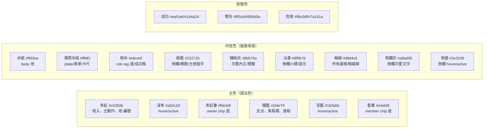

# 設計系統規範

> 摘錄自 `docs/DESIGN.md`，供 AI/開發者快速參考。完整版請見原文件。

---

## 設計靈魂：「傳票總帳」

> 這個系統不是一張漂亮的表單——它是一本全家共用的傳票簿。收入聯紅抬頭、支出聯藍抬頭、編號逐筆裝訂；每一筆家庭開銷都能對上號、月結核對。介面樸實實在，像抽屜裡那本真正被每天翻動的帳冊：不炫技、不粉飾，靠印刷級的分色、格線與騎縫線說話。

### 關鍵特質

- **五種材料**：米紙地、墨黑殼、傳票朱紅（收入）、傳票鐵藍（支出）、等寬 Courier 讀數
- **雙色印刷紀律**：彩色只進有框板塊、編號 chip 與狀態，版面主體維持墨＋紙
- **傳票編號**（`收-008` / `支-012` / `轉-005`）是逐筆分錄的身份證，由資料庫 `id` 推導
- **零漸層、零投影**（登入卡例外一層柔影）；深度靠色頂線與騎縫線呈現
- **標楷體顯示字 ＊ 系統黑體內文 ＊ Courier 等寬數字** 三級字型各自成職

---

## 色彩系統



### 命名規則

| 規則 | 說明 |
|------|------|
| **The Two-Ink Rule** | 彩色只服務「收/支」語法與狀態；正文、表格、側欄一律墨＋紙 |
| **The Red-Is-Action Rule** | 朱紅保留給「改動金錢」的主動作與收入語意；不作裝飾、不當大面積背景 |

---

## 字型系統

| 層級 | 字型堆疊 | 用途 | 規格 |
|------|----------|------|------|
| **Display** | `DFKai-SB, 標楷體, KaiTi, STKaiti, 'Noto Serif TC', PMingLiU, serif` | 頁面 h1、重要標題 | 700 / 1.75rem / lh 1.25 / ls .02em |
| **Title** | 同上 | 區塊 h2/h3 | 700 / 1.375rem / lh 1.35 |
| **Body** | `-apple-system, BlinkMacSystemFont, 'Segoe UI', Roboto, 'Noto Sans TC', 'Microsoft JhengHei', sans-serif` | 內文、表格、表單 | 400 / 1rem / lh 1.55 |
| **Label** | 同上 | 表單標籤 `.label` | 700 / 0.875rem / ls .02em |
| **Mono** | `'Courier New', Courier, ui-monospace, monospace` | 傳票編號、金額、日期、ID | 700 / 1rem / tabular-nums |

### 字型鐵律

| 規則 | 說明 |
|------|------|
| **The Tabular Rule** | 一切數字（金額、編號、日期、ID）都用等寬 Courier 對齊；千分位一律顯示 |
| **The Kai Rule** | 標題只用標楷體；禁止用系統黑體、Impact 或任何「通用粗黑」當顯示字 |

---

## 版面配置

### 雙欄殼架構

```
┌─────────────────────────────────────────────────────────────┐
│ .app                                                        │
│  ┌──────────┐  ┌────────────────────────────────────────┐  │
│  │ .side    │  │ .main                                   │  │
│  │ 232px    │  │ 靈活寬度，.sheet max-width: 1080px 置中  │  │
│  │ 固定     │  │                                         │  │
│  │ 桌機固定 │  │ ≤720px: 側欄變 sticky 頂欄 + 橫向捲動導覽 │  │
│  └──────────┘  └────────────────────────────────────────┘  │
└─────────────────────────────────────────────────────────────┘
```

- **側欄 (`.side`)**：碳墨背景 (`#23272b`)，桌機固定 232px，≤720px 變 sticky 頂欄
- **主區 (`.main`)**：米紙地 (`#f6f3ea`)，內容區 `.sheet` 最大寬 1080px 置中
- **帳本頁側欄**：多一段「這本帳」——帳本編號、名稱、成員角色名單（`ledger_access` 唯讀查詢）

### 節奏與間距

| 基數 | 用途 | 數值 |
|------|------|------|
| `--space-1` | 緊湊組內 | 4px |
| `--space-2` | 組內 | 8px |
| `--space-3` | 組間 | 12px |
| `--space-4` | 區塊間 | 16px |
| `--space-5` | 區塊間大 | 24px |
| `--space-6` | 大區塊 | 32px |
| `--space-7` | 巨大間距 | 48px |
| `--space-8` | 頁級間距 | 64px |

**原則**：成組緊湊（12px 內）、組間寬鬆（24–32px）、標題上方多一拍（24px+）

---

## 高度與深度

### The Flat-Voucher Rule

> **純扁平草紙感。** 無漸層、無投影、無光暈；深度只由四種手法呈現：
> 1. 色頂線＋邊框的 plate 聯票
> 2. dashed 騎縫線 (`.tear`)
> 3. 墨/紙色階差（side vs main）
> 4. 焦點環 (`box-shadow: 0 0 0 3px #1f4e79`)

**唯一例外**：`.login-card` 一層柔影 `0 1px 2px rgba(35,39,43,.12), 0 4px 14px rgba(35,39,43,.07)`

---

## 圓角與邊框

| 元素 | 圓角 | 邊框 | 備註 |
|------|------|------|------|
| Chips (`.vno`, `.role-tag`) | 2px (`--radius-chip`) | 1px 或無 | 編號 chip 無邊框、角色 chip 有邊框 |
| 按鈕/輸入/卡片 | 3px (`--radius`) | 1px `#d8d4c6` | 按鈕無邊框（主色底） |
| Plates (`.plate`) | 0 (方正) | 1px `#d8d4c6` + 頂 5px 色線 | 三聯合計牌核心元件 |
| 登入卡 | 0 | 6px double `#23272b` 頂 | 唯一投影例外 |
| 焦點環 | - | 3px 實色 `#1f4e79` | `outline-offset: 2px` 全站一致 |

---

## 核心元件

### 按鈕

| 類別 | 樣式 | 用途 | 色彩 |
|------|------|------|------|
| `.btn.primary` | 朱紅底 `#c0392b`、白字、700 | 立傳票、儲存、建立、登入 | `hover: #a02c20` |
| `.btn.secondary` | 透明底、1.5px 藍線、藍字 | 次要導航、返回、管理頁互連 | `hover: #e3ebf3` 底 |
| `.btn.danger` | 朱紅底、白字、700 | 作廢、刪除、停用 | 同 primary，永遠帶 `confirm()` |
| `.btn:disabled` | opacity .45、cursor not-allowed | 自刪按鈕、提交中 | - |

**最小高度**：44px（手機 `.btn.sm` 38px）

---

### 晶片

| 類別 | 樣式 | 色彩 | 內容 |
|------|------|------|------|
| `.vno.in` | 2px 圓角、Courier 700、白字 | 朱紅 `#c0392b` | `收-` + 零補齊 3 碼 ID |
| `.vno.out` | 同上 | 鐵藍 `#1f4e79` | `支-` + 零補齊 3 碼 ID |
| `.vno.plain` | 同上 | 墨黑 `#23272b` | `轉-` + 零補齊 3 碼 ID |
| `.role-tag.owner/.admin` | 2px、透明底白字、朱紅線 | `#f6e3df` 底、`#c0392b` 字/線 | 側欄用 `.role-chip.small` (9px) |

---

### 卡片/容器

| 類別 | 樣式 | 用途 |
|------|------|------|
| `.plate` (三聯合計牌) | 0 圓角、頂 5px 色線（墨/紅/藍）、米紙底、1px 邊框、label mono tracked、值 mono 700 1.65rem | 儀表板/帳本頁頂部彙總 |
| `.quick` (快速入口) | 米紙卡、1px 邊框、hover 轉墨邊、首格墨底反襯 | 儀表板底部動作入口 |
| `.login-card` | 雙線墨黑頂 6px double、柔影、窄 400px | 登入頁唯一卡片 |

---

### 表單/輸入框

| 狀態 | 樣式 |
|------|------|
| **預設** | 米紙 2 底 `#fffdf1`、1px `#d8d4c6` 邊框、3px 圓角、min-height 48px |
| **Focus** | 邊線轉 `#1f4e79` + 3px 實色焦點環 |
| **錯誤** | `.alert.error`：朱紅暈 `#f6e3df`、字 `#7a241a`（≥4.5:1）、`role="alert"` |
| **成功** | `.alert.success`：綠暈 `#eaf1e6`、字 `#1d4a24`、`role="status"` |

---

### 導覽

| 狀態 | 樣式 |
|------|------|
| **桌機側欄** | 碳墨殼、FAMILY VOUCHER mono kicker + 標楷體系統名 + 紅藍雙色塊品牌標記、`.nav-item` 左 3px 朱紅 active 線 |
| **手機 ≤720px** | sticky 頂欄、品牌 mono+名（雙色塊隱藏）、橫向捲動導覽、2px 下緣朱紅 active |

---

### 簽名元件：三聯合計牌 (`.plates` / `.plate`)

> 本系統的記憶點。本月收入（+）、支出（−）、結餘三板成「一聯票據」：
> - 頂線色分工：紅/藍/墨
> - 標籤 mono tracked 大寫
> - 數值 tabular 等寬單行、千分位顯示
> - 新增成功後 success alert 顯示：「傳票 支-129 已立，請核對。」

---

## 響應式斷點

| 斷點 | 變化 |
|------|------|
| **≤900px** | `.plates` 轉單欄、`.form-grid` 單欄、登入頁雙欄→單欄 |
| **≤720px** | 側欄→sticky 頂欄+橫向捲動、隱藏 `.hide-m`（備註、記錄數）、表格 `min-width: 0` 縮級字、觸控目標 ≥44px |

---

## 列印樣式 (`@media print`)

```css
@media print {
    .side, .nav, .ctr-actions, .quick, .budget-form, .filters, .pager, .font-size-toggle {
        display: none !important;
    }
    .main { margin: 0; padding: 0; }
    .sheet { width: 100%; max-width: 100%; }
    .plates, .table-wrap { page-break-inside: avoid; }
    body { background: #fff; color: #000; }
    .plate { border: 1px solid #000; }
    .v { color: #000; }
}
```

---

## 無障礙 (a11y) 基線

| 項目 | 標準 |
|------|------|
| **觸控目標** | ≥44×44px（手機 48px 以上） |
| **色彩對比** | 正文 ≥4.5:1、大字 ≥3:1、狀態色 ≥4.5:1 |
| **焦點可見** | 3px 實色 `#1f4e79` outline、offset 2px、全站一致 |
| **語意標記** | `role="alert"/"status"`、`<label for>`、`<th scope="col">` |
| **縮放支援** | 字級切換按鈕 (`.font-size-toggle`)、`rem` 基礎單位 |
| **長輩優先** | 標楷體大字、千分位等寬、明確錯誤訊息、無隱藏資訊 |

---

## CSS 變數速查

```css
:root {
  /* 色彩 */
  --paper: #f6f3ea;
  --paper-2: #fffdf1;
  --paper-3: #efece0;
  --ink: #23272b;
  --ink-2: #6b675a;
  --ink-3: #8f8b7d;
  --line: #d8d4c6;
  --side-2: #2e3338;
  --side-dim: #a9a495;
  --red: #c0392b;
  --red-deep: #a02c20;
  --red-tint: #f6e3df;
  --blue: #1f4e79;
  --blue-deep: #163a5b;
  --blue-tint: #e3ebf3;
  --focus: #1f4e79;
  
  /* 字型 */
  --font-display: "DFKai-SB, 標楷體, KaiTi, STKaiti, 'Noto Serif TC', PMingLiU, serif";
  --font-body: "-apple-system, BlinkMacSystemFont, 'Segoe UI', Roboto, 'Noto Sans TC', 'Microsoft JhengHei', sans-serif";
  --font-mono: "'Courier New', Courier, ui-monospace, monospace";
  
  /* 圓角 */
  --radius-chip: 2px;
  --radius: 3px;
  
  /* 間距 */
  --space-1: 4px;
  --space-2: 8px;
  --space-3: 12px;
  --space-4: 16px;
  --space-5: 24px;
  --space-6: 32px;
  --space-7: 48px;
  --space-8: 64px;
}
```

---

## 相關文件

- `docs/DESIGN.md` — 完整設計系統文件（含 Do's and Don'ts）
- [服務架構](./service-architecture.md) — 前端頁面與元件對應
- [系統架構](./system-architecture.md) — CSS/JS 載入方式
- [業務邏輯](./business-logic.md) — 傳票編號、三聯合計牌業務含義