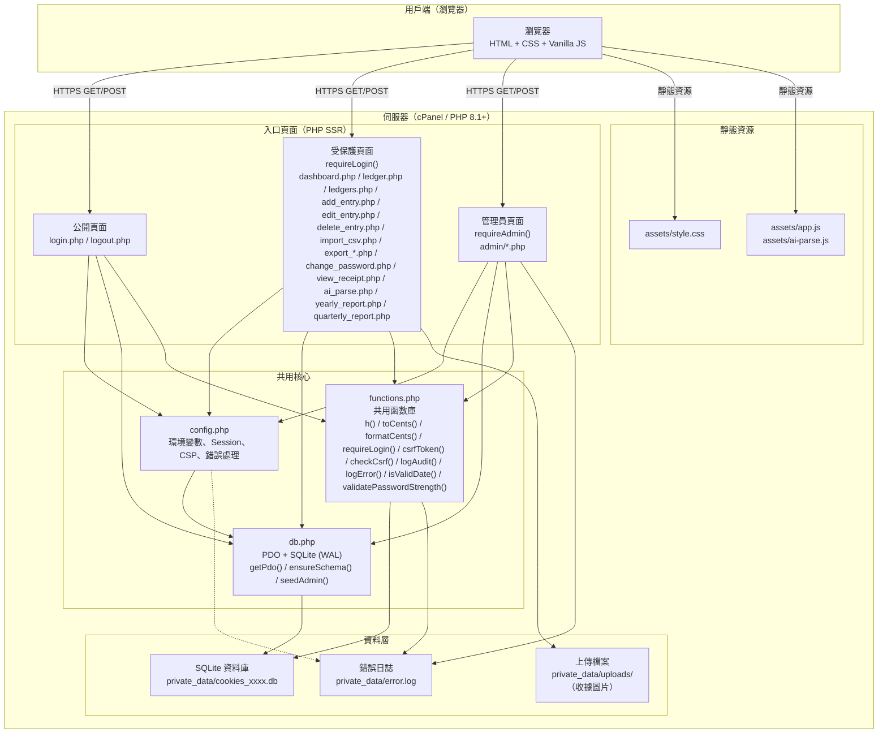

# 服務架構

> 記錄專案的服務邊界、前後端歸屬、API/頁面對應關係與部署拓樸。

---

## 專案定位

**全家人記帳系統** — 純 PHP 伺服端渲染（SSR）應用，無前端框架、無 API 層分離。所有頁面皆為 PHP 檔案直接輸出 HTML，資料存取在同一請求內完成。

---

## 架構圖



---

## 前後端歸屬對照表

| 頁面/功能 | 檔案 | 類型 | 權限 | 說明 |
|-----------|------|------|------|------|
| **登入/登出** | `login.php`, `logout.php` | 公開頁面 | 無需登入 | Session 建立/銷毀、CSRF Token 初始化 |
| **儀表板** | `dashboard.php` | 受保護頁面 | 登入用戶 | 多帳本本月收支總覽、預算警示、重複記錄提醒 |
| **帳本列表** | `ledgers.php` | 受保護頁面 | 登入用戶 | 建立帳本、封存/還原、列出可存取帳本 |
| **帳本詳情** | `ledger.php` | 受保護頁面 | 登入用戶（ledger_access） | 本月彙總、篩選、分頁記錄、預算設定、重複記錄管理 |
| **新增記錄** | `add_entry.php` | 受保護頁面 | owner/member | 立傳票（收入/支出/轉帳）、收據上傳、AI 解析 |
| **編輯記錄** | `edit_entry.php` | 受保護頁面 | owner/member | 修改既有記錄 |
| **作廢記錄** | `delete_entry.php` | 受保護頁面 | owner/member | 軟刪除（`deleted=1`） |
| **匯入 CSV** | `import_csv.php` | 受保護頁面 | owner/member | 批次匯入收支記錄 |
| **匯出 CSV** | `export_csv.php` | 受保護頁面 | 登入用戶 | 匯出帳本明細 |
| **匯出 PDF** | `export_pdf.php` | 受保護頁面 | 登入用戶 | 月結單 PDF |
| **年/季報表** | `yearly_report.php`, `quarterly_report.php` | 受保護頁面 | 登入用戶 | 跨月統計報表 |
| **收據檢視** | `view_receipt.php` | 受保護頁面 | 登入用戶（IDOR 檢查） | 私密收據串流、防路徑遍歷 |
| **AI 解析** | `ai_parse.php` | 受保護頁面 | owner/member | 圖片/文字解析為記帳草稿 |
| **變更密碼** | `change_password.php` | 受保護頁面 | 登入用戶 | 密碼強度驗證、Session 失效 |
| **使用者管理** | `admin/users.php` | 管理員頁面 | admin | 建立/重設密碼/變更角色/刪除使用者 |
| **帳本管理** | `admin/ledgers.php` | 管理員頁面 | admin | 建立帳本、授權存取、擁有者重新指定 |
| **分類管理** | `admin/category_management.php` | 管理員頁面 | admin | 全站分類 CRUD |
| **孤立帳本** | `admin/orphaned_ledgers.php` | 管理員頁面 | admin | 處理擁有者被刪除的帳本 |
| **封存帳本** | `admin/archived_ledgers.php` | 管理員頁面 | admin | 管理已封存帳本 |
| **操作紀錄** | `admin/audit_log.php` | 管理員頁面 | admin | 唯讀審計日誌檢視 |

---

## 靜態資源

| 檔案 | 用途 | 載入方式 |
|------|------|----------|
| `assets/style.css` | 設計系統樣式、響應式版面、印刷樣式 | `<link rel="stylesheet">` |
| `assets/app.js` | 共用互動：字級切換、重複記錄編輯 Modal、語音播報、確認對話框 | `<script src>` defer |
| `assets/ai-parse.js` | AI 解析頁面專用：檔案預覽、解析結果填入表單 | `<script src>` defer |

> **原則**：所有 JS 為漸進增強，核心功能（表單提交、導覽、權限）完全由伺服端完成，JS 僅提供體驗加分。

---

## 部署拓樸

```
cPanel 主機
├── public_html/CookiesAccounting/          # 公開網頁根目錄
│   ├── *.php                               # 所有 PHP 頁面
│   ├── admin/*.php                         # 管理員後台
│   ├── assets/                             # 靜態資源（CSS/JS）
│   ├── .htaccess                           # 封鎖 .env、private_data/、*.log
│   └── .env                                # 環境變數（ADMIN_USERNAME/PASSWORD、GEMINI_API_KEY）
└── private_data/                           # 私密目錄（非公開可讀）
    ├── cookies_xxxx.db                     # SQLite 資料庫
    ├── cookies_xxxx.db-wal                 # WAL 日誌
    ├── cookies_xxxx.db-shm                 # 共享記憶體
    ├── error.log                           # PHP 錯誤日誌
    └── uploads/                            # 收據圖片（亂數檔名、.htaccess 封鎖直接存取）
```

### 必要條件

- PHP 8.1+，啟用 `pdo_sqlite`、`fileinfo`、`mbstring`、`gd`（收據圖片處理）
- HTTPS 必須啟用（`session.cookie_secure=1`）
- `private_data/` 目錄權限 `0770`，擁有者為網頁伺服器使用者
- `.htaccess` 封鎖 `private_data/`、`*.log`、`.env` 直接存取

---

## 資料流向摘要

### 讀取流程（GET）
```
Browser → PHP 頁面 → requireLogin()/requireAdmin()
    → getPdo() → PDO 查詢（Prepared Statements）
    → 資料組裝 → h() 轉義 → 輸出 HTML
```

### 寫入流程（POST）
```
Browser → PHP 頁面 → requireLogin()/requireAdmin()
    → checkCsrf() 驗證
    → 輸入驗證（toCents、isValidDate、長度等）
    → getPdo() → PDO 預備陳述式寫入
    → logAudit() 記錄操作
    → redirect() 回 GET 頁面（PRG 模式）
```

### 檔案上傳流程
```
Browser (multipart/form-data) → PHP 頁面
    → finfo_file() MIME 驗證
    → 亂數重新命名 + chmod 0640
    → 移至 private_data/uploads/
    → 路徑寫入 entries.receipt_path
    → view_receipt.php 串流輸出（IDOR 檢查、Content-Disposition: attachment）
```

---

## 無 API 層設計決策

| 項目 | 決策 | 理由 |
|------|------|------|
| **API 端點** | 無 | 純 SSR，前後端不分離，部署簡單 |
| **前端框架** | 無（Vanilla JS） | 無建置步驟、零依賴、長輩友善 |
| **狀態管理** | Session + 伺服端渲染 | 簡單可靠，符合 cPanel 部署環境 |
| **即時性** | 頁面重新整理 | 功能屬性（記帳）不需 WebSocket/長輪詢 |

---

## 相關文件

- [系統架構](./system-architecture.md) — 技術架構、資料流、基礎設施
- [資料庫結構](./database-schema.md) — ERD、欄位定義、索引
- [業務邏輯](./business-logic.md) — 核心規則、狀態機、計算邏輯
- [使用者權限](./user-permissions.md) — 角色矩陣、權限規則
- [設計系統](./design-system.md) — 色彩、字型、元件、版面規範