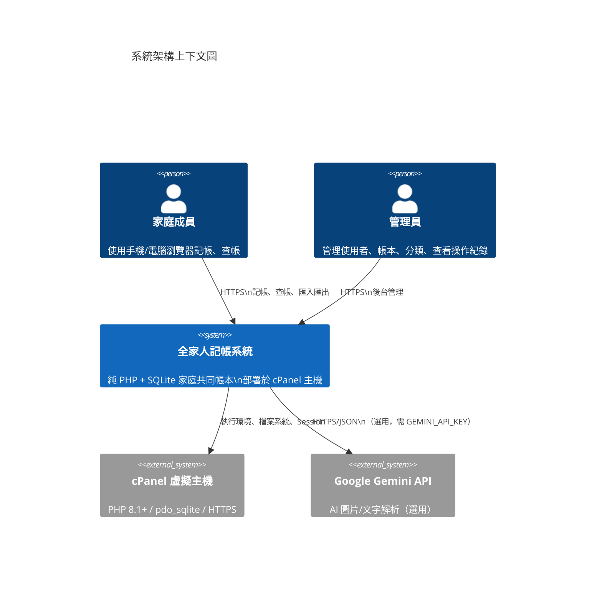
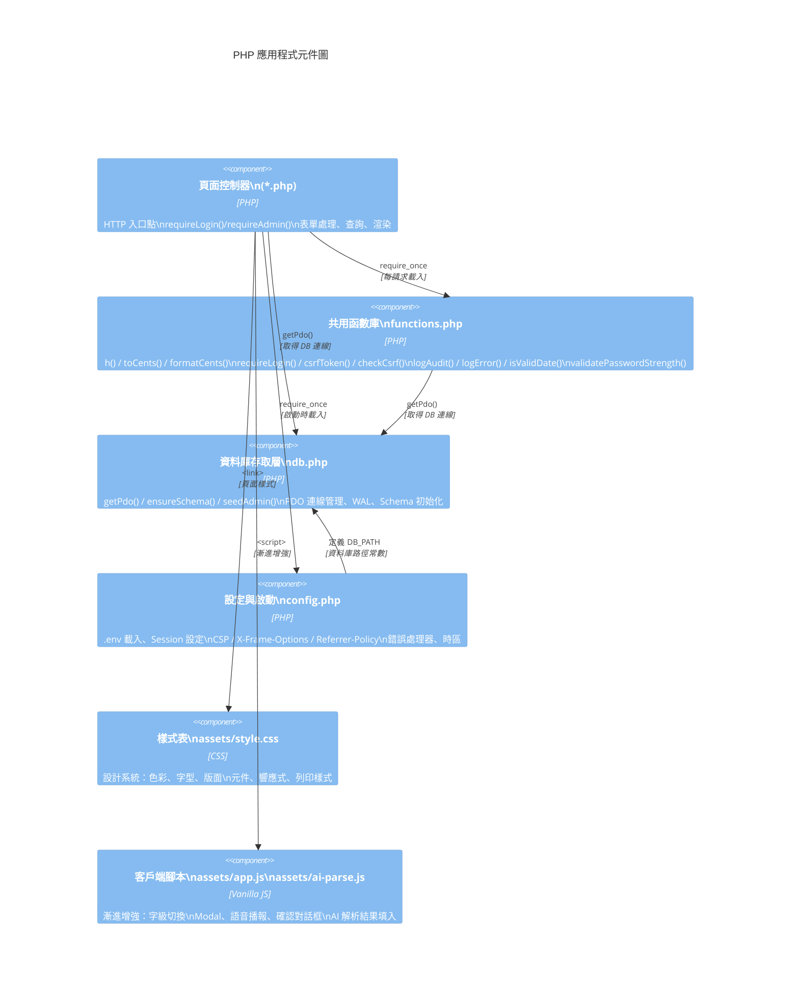
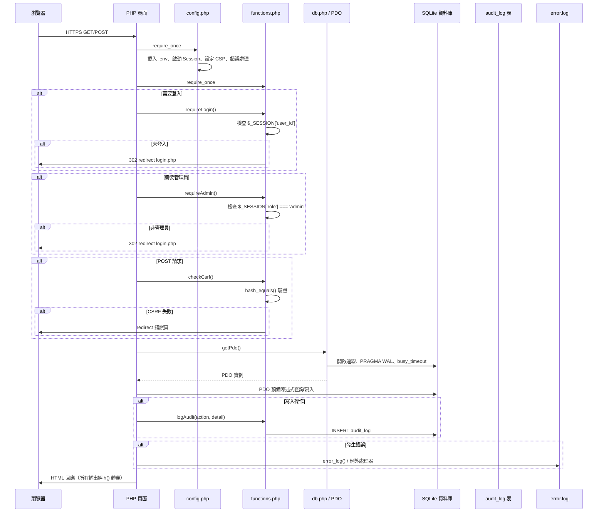

# 系統架構

> 記錄技術架構決策、資料流向、基礎設施、非功能性需求與演進策略。

---

## 架構總覽



---

## 容器架構

```mermaid
C4Container
    title 容器架構圖
    
    Container_Browser(browser, "瀏覽器", "HTML5 / CSS3 / Vanilla JS")
    
    Container_PHP(app, "PHP 應用程式", "PHP 8.1+", "純伺服端渲染（SSR）\n無框架、無建置步驟")
    
    Container_SQLite(db, "SQLite 資料庫", "SQLite 3 (WAL 模式)", "單一 .db 檔案\nprivate_data/cookies_xxxx.db")
    
    Container_FileSystem(fs, "檔案系統", "cPanel 私密目錄", "上傳檔案 / 錯誤日誌 / 環境變數")
    
    Container_AI(ai, "Gemini AI 服務", "Google Generative AI", "選用：收據/語音解析")
    
    Rel(browser, app, "HTTPS GET/POST", "表單提交、頁面導航")
    Rel(app, db, "PDO / SQL", "讀寫 entries、users、ledgers 等")
    Rel(app, fs, "本機 I/O", "上傳檔案、.env 讀取、錯誤日誌")
    Rel(app, ai, "HTTPS/JSON", "選用：AI 解析請求")
```

---

## 元件架構



---

## 部署架構

```mermaid
deployment
    title 部署節點圖
    
    Node(cpanel, "cPanel 虛擬主機", "Linux / Apache / PHP-FPM") {
        Node(public, "public_html/CookiesAccounting/", "公開網頁根目錄") {
            Artifact(php_files, "*.php / admin/*.php", "PHP 頁面")
            Artifact(assets, "assets/", "CSS / JS")
            Artifact(htaccess, ".htaccess", "存取控制")
            Artifact(env, ".env", "環境變數（不進版控）")
        }
        Node(private, "private_data/", "私密目錄（非公開）") {
            Artifact(db, "cookies_xxxx.db", "SQLite 資料庫")
            Artifact(wal, "cookies_xxxx.db-wal", "WAL 日誌")
            Artifact(shm, "cookies_xxxx.db-shm", "共享記憶體")
            Artifact(error_log, "error.log", "PHP 錯誤日誌")
            Artifact(uploads, "uploads/", "收據圖片（亂數檔名）")
            Artifact(htpasswd, ".htaccess", "封鎖直接存取")
        }
    }
    
    Node(browser, "使用者瀏覽器", "Chrome / Safari / Edge") {
        Artifact(html, "HTML / CSS / JS", "渲染頁面")
    }
    
    Rel(browser, public, "HTTPS", "HTTP 請求/回應")
    Rel(public, private, "本機 I/O", "讀寫資料庫、日誌、上傳檔案")
```

---

## 資料流向

### 典型請求生命週期



---

## 非功能性需求

| 類別 | 需求 | 實作方式 |
|------|------|----------|
| **安全性** | SQL Injection 防護 | 所有查詢 PDO Prepared Statements + `ATTR_EMULATE_PREPARES=false` |
| | XSS 防護 | 所有輸出經 `h()` (`htmlspecialchars` + `ENT_QUOTES \| ENT_SUBSTITUTE`) |
| | CSRF 防護 | 所有 POST 表單含 `csrf_token`，`hash_equals()` 恆時比較 |
| | Session 安全 | `HttpOnly`、`SameSite=Lax`、`Secure`、登入後 `session_regenerate_id(true)`、閒置 30 分鐘過期 |
| | 密碼安全 | `password_hash`/`password_verify` (bcrypt)、強度 ≥10 字元含 3 類字符、登入失敗 5 次鎖定 15 分鐘 |
| | 檔案上傳安全 | `finfo_file` MIME 驗證、亂數重新命名、5MB 上限、`chmod 0640`、`.htaccess` 封鎖直接存取 |
| | 收據串流安全 | IDOR 權限檢查、路徑遍歷防護、`Content-Disposition: attachment`、`X-Content-Type-Options: nosniff` |
| | 安全回應標頭 | CSP (`script-src 'self'`)、`X-Frame-Options: DENY`、`Referrer-Policy: strict-origin-when-cross-origin` |
| | 錯誤不外洩 | `display_errors=0`，堆疊寫入 `error.log`，瀏覽器只見通用錯誤頁 |
| **可用性** | 長輩友善 | 標楷體大字、千分位等寬數字、≥44px 觸控目標、明確焦點環、無隱藏資訊 |
| | 響應式 | ≤720px 側欄變頂欄、表格單欄、隱藏非必要欄、單欄佈局 |
| | 列印友善 | `@media print` 隱藏導覽/操作欄、三聯合計牌列印優化 |
| **效能** | 資料庫並發 | SQLite WAL 模式 + `busy_timeout=5000` 支援多讀寫併發 |
| | 查詢效能 | 關鍵欄位建立索引（`ledger_id`、`user_id`、`entry_date`、`type`、`deleted`） |
| | 靜態資源 | CSS/JS 以查詢字串版本號快取控制（`?v=20261115-8`） |
| **可維護性** | 程式碼組織 | 共用函數集中 `functions.php`、DB 層集中 `db.php`、設定集中 `config.php` |
| | 版本控制 | Git，`.gitignore` 排除 `.env`、`private_data/*.db`、`*.log`、IDE 目錄 |
| | 部署簡單 | 無建置步驟、無 Composer/Node.js、直接上傳 PHP 檔案 |
| **資料完整性** | 金額精確 | 整數分儲存（`amount_cents` INT），禁用 FLOAT，`toCents()`/`formatCents()` 處理 |
| | 軟刪除 | `entries.deleted` 標記，不物理刪除，保留審計追溯 |
| | 審計日誌 | `audit_log` 唯新增不刪除，記錄用戶、動作、細節、IP、時間 |
| | Session 失效 | 密碼變更時 `password_changed_at` 更新，既有 Session 自動失效 |

**本機並發驗證：** Docker Apache PHP 8.1／8.4 各以兩個獨立登入 Session 對同一本帳簿發出 8 組成對新增請求。每個版本皆得到 16 筆原始分錄、16 筆對應稽核，兩人身份不混淆，金額合計正好 240 分，且 SQLite 確認為 WAL。這是兩用戶情境驗證，不是正式主機壓測。

---

## 技術債與演進策略

| 領域 | 現狀 | 目標/策略 |
|------|------|-----------|
| **CSS 內聯** | `ledger.php` 含印刷樣式 `<style>` | 移至 `assets/style.css`，移除 CSP `style-src 'unsafe-inline'` |
| **AI 整合** | `ai_parse.php` 直接呼叫 Gemini API | 抽象為服務類，支援多供應商、快取、降級 |
| **搜尋** | `LIKE` 查詢 | 資料量增長時評估 SQLite FTS5 或外部搜尋服務 |
| **多語系** | 僅繁體中文 | 若需支援，引入 `gettext` 或簡單 i18n 陣列 |
| **測試** | 無自動化測試 | 引入 PHPUnit（單元測試）+ Playwright（E2E） |
| **CI/CD** | 手動部署 | GitHub Actions：語法檢查、靜態分析、自動部署到測試環境 |
| **監控** | 僅 `error.log` | 加入健康檢查端點、關鍵指標日誌、錯誤率告警 |

---

## 相關文件

- [服務架構](./service-architecture.md) — 前後端歸屬、頁面對應、部署拓樸
- [資料庫結構](./database-schema.md) — ERD、欄位定義、索引、遷移紀錄
- [業務邏輯](./business-logic.md) — 核心規則、狀態機、計算邏輯
- [使用者權限](./user-permissions.md) — 角色矩陣、權限規則、IDOR 防護
- [設計系統](./design-system.md) — 色彩、字型、元件、版面規範