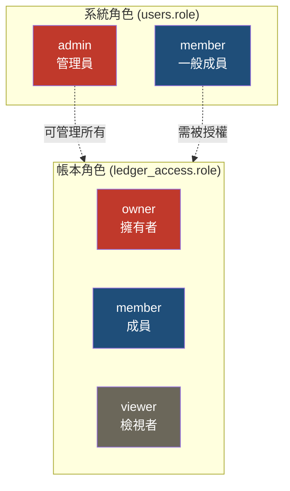

# 使用者權限模型

> 記錄系統角色定義、權限矩陣、IDOR 防護機制、存取控制邏輯。

---

## 角色體系



### 角色層級關係

| 層級 | 角色 | 來源 | 管理方式 |
|------|------|------|----------|
| **系統級** | `admin` | `users.role` | 僅現有 admin 可在後台建立/變更 |
| **系統級** | `member` | `users.role` | admin 在後台建立，預設角色 |
| **帳本級** | `owner` | `ledger_access.role` | 建立帳本自動成為 owner，可轉讓 |
| **帳本級** | `member` | `ledger_access.role` | owner/admin 在帳本詳情/後台授權 |
| **帳本級** | `viewer` | `ledger_access.role` | owner/admin 在帳本詳情/後台授權 |

> **關鍵原則**：系統角色 `admin` **不自動擁有** 所有帳本權限。admin 必須透過 `ledger_access` 被授權才能存取特定帳本。這是為了資料隔離與最小權限原則。

---

## 權限矩陣

### 帳本操作權限

| 操作 | owner | member | viewer | admin (無 ledger_access) | 備註 |
|------|-------|--------|--------|--------------------------|------|
| **檢視帳本詳情** | ✅ | ✅ | ✅ | ❌ | 需 ledger_access 記錄 |
| **新增記錄** | ✅ | ✅ | ❌ | ❌ | `add_entry.php` |
| **編輯記錄** | ✅ | ✅ | ❌ | ❌ | `edit_entry.php`，僅限自己建立的記錄 |
| **作廢記錄** | ✅ | ✅ | ❌ | ❌ | `delete_entry.php`，僅限自己建立的記錄 |
| **匯入 CSV** | ✅ | ✅ | ❌ | ❌ | `import_csv.php` |
| **匯出 CSV** | ✅ | ✅ | ✅ | ❌ | `export_csv.php` |
| **匯出 PDF** | ✅ | ✅ | ✅ | ❌ | `export_pdf.php` |
| **設定每月預算** | ✅ | ❌ | ❌ | ❌ | `ledger.php` POST `set_budget` |
| **設定類別預算** | ✅ | ❌ | ❌ | ❌ | `category_budget.php` POST create/update/disable，僅 owner 可存取頁面（member／viewer 與非成員無法檢視） |
| **建立重複記錄** | ✅ | ❌ | ❌ | ❌ | `ledger.php` POST `create_recurring` |
| **編輯重複記錄** | ✅ | ❌* | ❌ | ❌ | 僅建立者或 owner/admin |
| **停用重複記錄** | ✅ | ❌* | ❌ | ❌ | 僅建立者或 owner/admin |
| **從重複記錄生成** | ✅ | ✅ | ❌ | ❌ | `ledger.php` POST `generate_recurring` |
| **封存帳本** | ✅ | ❌ | ❌ | ✅ | `admin/ledgers.php` 或 `ledgers.php` |
| **還原帳本** | ✅ | ❌ | ❌ | ✅ | `admin/archived_ledgers.php` |
| **管理帳本成員** | ✅ | ❌ | ❌ | ✅ | `admin/ledgers.php` 授權/撤銷 |
| **變更帳本擁有者** | ❌ | ❌ | ❌ | ✅ | `admin/ledgers.php` 重新指定 |
| **新增留言** | ✅ | ✅ | ✅ | ❌ | `entry_comment.php`，需 ledger_access |
| **檢視留言** | ✅ | ✅ | ✅ | ❌ | `ledger.php` 展開區塊，需 ledger_access |

> *：member 若是重複記錄建立者，可編輯/停用自己的重複記錄

---

### 後台管理權限（僅 `users.role = 'admin'`）

| 功能 | 權限 | 說明 |
|------|------|------|
| **使用者管理** | ✅ | `admin/users.php`：建立、重設密碼、變更角色、刪除 |
| **帳本管理** | ✅ | `admin/ledgers.php`：建立、授權、重新指定擁有者、封存/還原 |
| **分類管理** | ✅ | `admin/category_management.php`：全站分類 CRUD |
| **孤立帳本處理** | ✅ | `admin/orphaned_ledgers.php`：擁有者被刪除的帳本重新指定 |
| **封存帳本管理** | ✅ | `admin/archived_ledgers.php`：檢視/還原已封存帳本 |
| **操作紀錄檢視** | ✅ | `admin/audit_log.php`：唯讀，含篩選與分頁 |

---

## IDOR 防護機制

### 核心原則

> **所有涉及帳本資料的查詢與寫入，必須 `INNER JOIN ledger_access` 驗證目前使用者對該帳本的存取權限。**

### 實作模式

```php
// 標準查詢模板：檢視帳本詳情
$stmt = $pdo->prepare('
    SELECT l.name, l.archived, l.monthly_budget_cents, la.role
    FROM ledgers l
    INNER JOIN ledger_access la ON la.ledger_id = l.id
    WHERE l.id = :ledger_id
      AND la.user_id = :user_id
    LIMIT 1
');
$stmt->execute([':ledger_id' => $ledgerId, ':user_id' => $userId]);
$ledger = $stmt->fetch();
if ($ledger === false) {
    redirect('./ledgers.php?error=1'); // 無權限或不存在
}
$accessRole = $ledger['role']; // 取得帳本內角色
```

### 保護範圍

| 頁面/操作 | IDOR 檢查點 | 失敗導向 |
|-----------|-------------|----------|
| `ledger.php` | 開頭查詢 `ledgers` + `ledger_access` | `ledgers.php?error=1` |
| `add_entry.php` | 開頭驗證 `ledger_access` + `role IN ('owner','member')` | `ledgers.php?error=1` |
| `edit_entry.php` | 驗證 `entries.ledger_id` + `ledger_access` + `entries.user_id = :user_id` | `ledger.php?error=1` |
| `delete_entry.php` | 同上 | `ledger.php?error=1` |
| `import_csv.php` | 開頭驗證 `ledger_access` + `role IN ('owner','member')` | `ledgers.php?error=1` |
| `export_csv.php` | 開頭驗證 `ledger_access` | `ledgers.php?error=1` |
| `export_pdf.php` | 開頭驗證 `ledger_access` | `ledgers.php?error=1` |
| `view_receipt.php` | 查詢 `entries` + `ledger_access` + `entries.id = :id` | 403/404 通用錯誤頁 |
| `yearly_report.php` | 查詢 `ledger_access` 取得可存取帳本 IDs → IN 查詢 | 僅顯示授權帳本資料 |
| `quarterly_report.php` | 同上 | 同上 |
| `admin/ledgers.php` | admin 可管理所有，但授權操作仍寫入 `ledger_access` | - |
| `entry_comment.php` | 驗證 `entries` 存在、`ledger_id` 吻合、`deleted=0` + `ledger_access` 任意角色 | `ledger.php?error=1&msg=...`（保留查詢參數） |

---

## 權限檢查函數對照

| 檢查需求 | 使用函數/模式 | 位置 |
|----------|---------------|------|
| **是否登入** | `requireLogin()` | 所有受保護頁面開頭 |
| **是否管理員** | `requireAdmin()` | 所有 `admin/*.php` 開頭 |
| **帳本存取權** | `INNER JOIN ledger_access` 查詢 | `ledger.php`、`add_entry.php` 等開頭 |
| **可寫入權限** | `in_array($accessRole, ['owner','member'])` | 表單顯示、POST 處理前 |
| **可設定預算** | `$accessRole === 'owner'` | `ledger.php` POST `set_budget` |
| **可管理重複記錄** | `$accessRole === 'owner' || $accessRole === 'admin' || $isCreator` | `ledger.php` POST 重複記錄操作 |
| **編輯自己的記錄** | `entries.user_id = :user_id` | `edit_entry.php`、`delete_entry.php` |
| **檢視收據** | `entries.id` + `ledger_access` 驗證 | `view_receipt.php` |

---

## 存取控制流程圖

```mermaid
flowchart TD
    A[使用者請求頁面/操作] --> B{需要登入?}
    B -->|是| C[requireLogin()]
    B -->|否| D[公開頁面 login/logout]
    C --> E{Session 有效?}
    E -->|否| F[redirect login.php]
    E -->|是| G{需要管理員?}
    G -->|是| H[requireAdmin()]
    H --> I{role = admin?}
    I -->|否| J[redirect login.php]
    I -->|是| K[允許存取後台]
    G -->|否| L[一般受保護頁面]
    L --> M{涉及特定帳本?}
    M -->|是| N[查詢 ledger_access\nledger_id + user_id]
    N --> O{找到記錄?}
    O -->|否| P[redirect ledgers.php?error=1]
    O -->|是| Q[取得 access_role]
    Q --> R{操作需要寫入權限?}
    R -->|是| S{access_role IN (owner,member)?}
    S -->|否| T[redirect 錯誤/隱藏按鈕]
    S -->|是| U[允許操作]
    R -->|否| U
    M -->|否| U
    U --> V[執行業務邏輯]
    V --> W[logAudit 記錄]
    W --> X[回應/Redirect]
```

---

## 權限變更觸發審計

| 觸發操作 | action 代碼 | detail 範例 |
|----------|-------------|-------------|
| 管理員建立使用者 | `admin_user_create` | `user_id=5 username=alice role=member` |
| 管理員重設密碼 | `admin_user_reset_password` | `target_user_id=5 username=alice` |
| 管理員變更角色 | `admin_user_change_role` | `target_user_id=5 username=alice member→admin` |
| 管理員刪除使用者 | `admin_user_delete` | `target_user_id=5 username=alice` |
| 管理員建立帳本 | `admin_ledger_create` | `ledger_id=3 name=旅遊基金 owner_id=2` |
| 管理員授權存取 | `admin_ledger_access_grant` | `ledger_id=3 user_id=5 role=member` |
| 管理員撤銷存取 | `admin_ledger_access_revoke` | `ledger_id=3 user_id=5` |
| 管理員重新指定擁有者 | `admin_ledger_reassign_owner` | `ledger_id=3 old_owner=2 new_owner=5` |
| 擁有者設定預算 | `ledger_budget_set` | `ledger_id=3 monthly_budget_cents=500000` |
| 建立重複記錄 | `recurring_create` | `recurring_id=7 ledger_id=3 name=房租 amount=300000` |
| 新增留言 | `entry_comment` | `{"entry_id":123}`（JSON、不含留言內容） |

---

## 常見權限錯誤與排查

| 現象 | 可能原因 | 排查步驟 |
|------|----------|----------|
| 管理員看不到某帳本 | 未在 `ledger_access` 中被授權 | `admin/ledgers.php` 授權該管理員 |
| 成員無法新增記錄 | `ledger_access.role` 為 `viewer` | 確認角色為 `member` 或 `owner` |
| 匯入 CSV 按鈕不見 | 權限檢查 `in_array($accessRole, ['owner','member'])` 失敗 | 檢查 `ledger_access` 記錄 |
| 編輯記錄導向錯誤頁 | `entries.user_id` 不等於目前使用者 | 成員只能編輯自己建立的記錄 |
| 收據無法檢視 | `view_receipt.php` IDOR 檢查失敗 | 確認 `entries.ledger_id` 有 `ledger_access` |

---

## 相關文件

- [資料庫結構](./database-schema.md) — `ledger_access` 表結構、索引
- [業務邏輯](./business-logic.md) — 權限相關業務規則
- [系統架構](./system-architecture.md) — IDOR 防護在資料流中的位置
- [服務架構](./service-architecture.md) — 各頁面權限需求對照