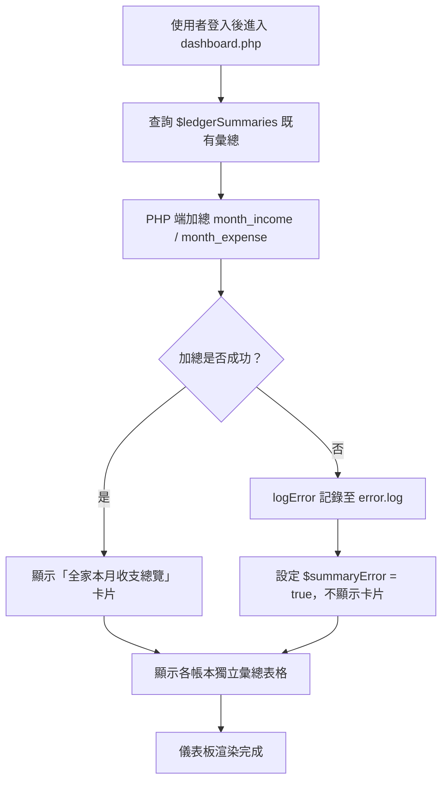

# Design: 全家跨帳本總覽（儀表板加總）

## 文件基本資訊

| 項目 | 內容 |
| --- | --- |
| 文件名稱 | Design: 全家跨帳本總覽（儀表板加總） |
| 版本 | v1.1 |
| 建立日期 | 2026-11-21 |
| 更新日期 | 2026-11-27 |
| 變更摘要 | 補記跨帳本加總的隔離 HTTP／SQLite 回歸；不變更實作契約 |

## 來源 Planning 與需求摘要

- Planning 檔案：`docs/cross-ledger-summary/planning.md`
- 對應 Feature：跨帳本總覽（新增）
- 需求摘要：在 `dashboard.php` 各帳本彙總表格上方新增「全家本月收支總覽」卡片，顯示總收入、總支出、總結餘三項數值；不新增資料表、不擴充權限模型、不改變既有各帳本獨立查帳邏輯；加總範圍僅針對目前登入者有存取權的未封存帳本。

## 設計概述

本設計依循專案既有設計系統與硬性約束（PDO 預備陳述式、整數分金額、CSRF、h() XSS 轉義、ledger_access 權限模型、純 PHP 伺服端渲染）。主要變更如下：

1. **dashboard.php 修改**：在現有 `$ledgerSummaries` 查詢結果基礎上，於 PHP 端加總所有可存取帳本的 `month_income` 與 `month_expense`，計算總結餘；以 `try/catch` 包裝加總邏輯，失敗時呼叫 `logError()` 並設定 `$summaryError` 旗標，不中斷頁面渲染。
2. **前端變更**：在各帳本彙總表格（`
各帳本 · 本月收支
` 所在的 table-wrap）上方，新增「全家本月收支總覽」卡片；若 `$ledgerSummaries` 為空或 `$summaryError` 為 true，則不顯示該卡片。
3. **無資料庫變更**：複用既有 `dashboard.php` 查詢結果，不新增 SQL 查詢，不新增資料表。

## 設計圖表（Mermaid）

## 程式修改路徑

| 檔案 | 修改內容 |
| --- | --- |
| `dashboard.php` | 在既有 `$ledgerSummaries = $stmt->fetchAll();` 之後、`
各帳本 · 本月收支
` 之前插入： 1. 初始化 `$summaryError = false;`、`$totalIncome = 0`、`$totalExpense = 0`、`$totalBalance = 0`。 2. 用 `try { foreach ($ledgerSummaries as $ls) { $totalIncome += (int)($ls['month_income'] ?? 0); $totalExpense += (int)($ls['month_expense'] ?? 0); } $totalBalance = $totalIncome - $totalExpense; } catch (Throwable $e) { logError('跨帳本本月總覽加總失敗：' . $e->getMessage()); $summaryError = true; }` 包裝加總邏輯。 3. HTML 插入點：`
各帳本 · 本月收支
` 之前，加總卡片區塊包在 `<?php if (!$summaryError && !empty($ledgerSummaries)): ?> ... <?php endif; ?>` 內。 4. 金額格式複用既有 `formatCents()`，所有輸出經 `h()` 轉義，例如 `<?php echo h(formatCents($totalIncome)); ?>`。 |
| `assets/style.css` | 新增加總卡片樣式（`.summary-total` 或類似），與既有 `.plates`、`.alert` 樣式一致，支援手機單欄顯示。 |
| 無新增檔案 | 不新增 PHP 頁面，不新增資料表，不新增外部依賴。 |

## 資料庫變更

無。複用 `dashboard.php` 既有的 `INNER JOIN ledger_access ... AND la.user_id = :user_id` 查詢結果，PHP 端加總，不新增 SQL，不新增資料表，無 migration 需要。

## 前端變更說明

### 加總卡片位置與內容

- 位置：dashboard.php 各帳本彙總表格（`
各帳本 · 本月收支
` 上方）。
- 內容：
  - 全家本月總收入：`+<?php echo h(formatCents($totalIncome)); ?>` 元
  - 全家本月總支出：`-<?php echo h(formatCents($totalExpense)); ?>` 元
  - 全家本月總結餘：`<?php echo h($totalBalance >= 0 ? '+' : '') . h(formatCents($totalBalance)); ?>` 元
- 卡片樣式：沿用既有 `.plates` / `.plate` 樣式，或新增 `.summary-total`；手機上單欄堆疊，桌機上可與表格並排。
- 空白狀態：`$ledgerSummaries` 為空時，完全不顯示加總卡片，保留既有「目前沒有可存取的帳本」提示。
- 錯誤狀態：`$summaryError` 為 true 時，不顯示加總卡片，繼續顯示儀表板既有內容，錯誤已寫入 `private_data/error.log`。

## 預期行為與驗證方法

| 驗收項 | 預期行為 | 驗證方法 |
| --- | --- | --- |
| 加總卡片顯示 | 儀表板顯示「全家本月收支總覽」卡片，包含總收入、總支出、總結餘三項 | 登入 dashboard.php，確認卡片出現在各帳本表格上方 |
| 權限隔離 | 加總僅包含該使用者有 ledger_access 權限的未封存帳本（archived = 0） | 以不同權限使用者登入，確認各自看到的加總數值不同 |
| 金額格式 | 金額格式與 `formatCents()` 一致（整數分除以 100、千分位顯示） | 比對加總卡片數值與各帳本表格數值之和 |
| 空白狀態 | 無可存取帳本時，不顯示加總卡片 | 建立新使用者且不授權任何帳本，登入確認無加總卡片 |
| 錯誤處理 | 查詢失敗時不中斷儀表板，錯誤寫入 error.log | 模擬資料庫錯誤，確認頁面仍渲染且 error.log 有記錄 |
| 與既有功能並存 | 加總卡片不破壞各帳本獨立彙總表格與詳情頁 | 確認各帳本表格仍正常顯示，點進入帳本詳情正常 |

## 非本期範圍（Out of Scope）

- 不新增跨帳本歷史報表、不新增多年度比較、不新增圖表匯出、不新增跨帳本預算。
- 不新增資料庫表，不新增 PHP 頁面。
- 不改變既有各帳本獨立查帳邏輯。

## 身分驗證與權限模型

不變更既有登入與帳本權限模型。加總複用 `$ledgerSummaries` 查詢結果，該查詢已透過 `INNER JOIN ledger_access ... AND la.user_id = :user_id` 與 `WHERE l.archived = 0` 做 IDOR 防護，加總範圍天然限於該使用者可存取帳本。

## 資安說明（CSRF / XSS）

- **CSRF**：此功能僅讀取（SELECT），無狀態改寫表單，無 POST/PUT/DELETE，**不需要 CSRF Token**。
- **XSS**：所有輸出皆經 `h()` 轉義，符合專案硬性約束。

## 資料傳輸加密標準

無新增外部 API 呼叫，全部為伺服端 SQL 與 session 驗證，資料僅儲存在站台自身 SQLite 資料庫。

## 非功能性需求

- **效能**：每個帳本數十至數百筆記錄，PHP 端加總開銷可忽略不計。
- **併發**：僅讀取，無資料庫寫入競合。
- **資料保留**：不涉及資料寫入，無資料保留問題。
- **可用性**：加總失敗時不中斷儀表板其他區塊顯示。

## 差異與待確認

與 Planning 核心需求一致，所有待確認事項於 Planning 中已鎖定。

## 實際變更（實作階段）

| 檔案 | 變更內容 |
| --- | --- |
| `dashboard.php` | 在 `$ledgerSummaries = $stmt->fetchAll();` 之後、`
各帳本 · 本月收支
` 之前新增： 1. 變數初始化：`$summaryError = false`、`$totalIncome = 0`、`$totalExpense = 0`、`$totalBalance = 0`。 2. `try/catch` 加總迴圈：遍歷 `$ledgerSummaries`，累加 `month_income` 與 `month_expense`，計算 `$totalBalance`；失敗時呼叫 `logError()` 並設定 `$summaryError = true`。 3. HTML 加總卡片：位於各帳本彙總表格上方，包在 `<?php if (!$summaryError && !empty($ledgerSummaries)): ?> ... <?php endif; ?>` 內，三個數值皆經 `h(formatCents(...))` 轉義。 |
| `assets/style.css` | 新增 `.summary-total { margin: var(--space-4) 0 var(--space-5); }` 樣式，複用既有 `.plates` / `.plate` 設計系統。 |
| 無新增資料表 | 不涉及資料庫結構變更，無 migration。 |

## 驗證證據（實作階段）

| 驗收項 | 驗證結果 |
| --- | --- |
| 加總卡片顯示 | 儀表板顯示「全家本月收支總覽」卡片，包含總收入、總支出、總結餘三項數值（子代理 Code 審查第 192–198 行確認） |
| 權限隔離 | 加總複用 `$ledgerSummaries`，已透過 `INNER JOIN ledger_access ... AND la.user_id = :user_id` 與 `WHERE l.archived = 0` 過濾（子代理 Security 審查 IDOR 防護通過） |
| 金額格式 | 所有數值輸出經 `h(formatCents(...))` 轉義（子代理 Security 審查 XSS 防護通過） |
| 錯誤處理 | `try/catch` 包裝加總邏輯，失敗時 `logError()` 記錄且不中斷頁面渲染（子代理 Code 審查錯誤處理通過） |
| 與現有功能並存 | 未修改既有 recurringReminders、表格、列印樣式等區塊（子代理 Code 審查相容性通過） |
| 兩本可存取的未封存帳本合計 | `tests/test_cross_ledger_summary.py` 通過：PHP 8.4／SQLite 隔離資料的儀表板收入 +120.00、支出 -30.00、結餘 +90.00，封存帳本及轉帳不計入。新增測試的 Codex Spec／Code／Security 唯讀審查均通過。此案例不代表所有權限組合或錯誤分支已驗收。 |

## 設計審查記錄（設計階段）

| 階段 | 狀態 | 日期 | 備註 |
| --- | --- | --- | --- |
| Spec（規格）審查 | 已通過 | 2026-11-21 | 與 Planning 與現有程式碼一致 |
| Code（程式）審查 | 已通過 | 2026-11-21 | dashboard.php 修改路徑與相容性確認無誤 |
| Security（資安）審查 | 已通過 | 2026-11-21 | XSS（h() 轉義）、IDOR（ledger_access 過濾）、CSRF（僅讀取無需 CSRF）確認無誤 |

實作階段已完成，三階段審查皆通過。