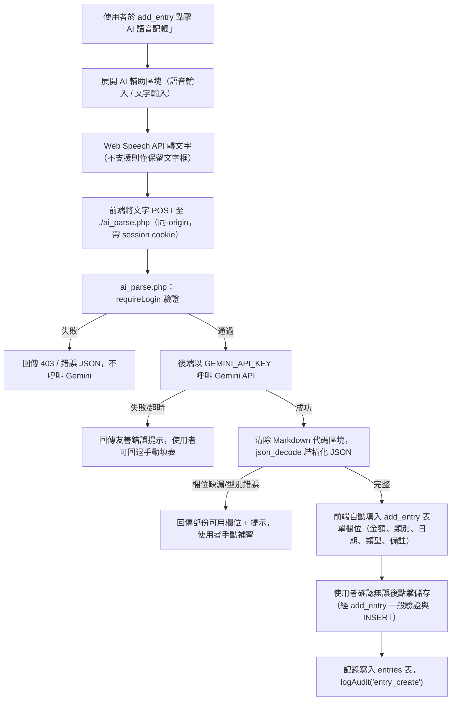

# Design & Implementation: AI 一句話記帳 (Gemini API 整合)

## 文件基本資訊

| 項目 | 內容 |
| --- | --- |
| 名稱 | AI 一句話記帳設計（Gemini API 後端代理） |
| 版本 | v1.0 |
| 建立日期 | 2026-11-21 |
| 更新日期 | 2026-11-21 |
| 變更摘要 | v1.0 初稿。依 Planning 規範與獨立審查 SEC-01（API Key 僅後端持有、後端代理中繼）撰寫。 |

## 1. 變更概述

讓使用者（特別是不擅長點選繁複表單欄位的長輩與家庭成員）能透過手機語音說出一句話，或直接輸入一段文字，系統透過後端 PHP 安全呼叫 Gemini API 解析出記帳欄位（金額、收入/支出、分類、日期、備註），並自動填入新增記錄表單中，使用者確認無誤後再儲存，實現極速隨手記。本功能為非強制擴充，不影響既有純手動記帳流程。

## 2. 資料庫與架構變更

- **無資料庫 schema 變更**：本功能不新增或修改任何資料表，僅在新增記錄表單頁面（add_entry.php）增加 AI 輔助填入 UI 與後端代理 API。
- **設定選項**：在 `config.php` 新增 `GEMINI_API_KEY` 讀取（優先環境變數，否則 `.env`），供後端代理呼叫 Gemini API 使用。
- **新增檔案**：`ai_parse.php`（後端代理 API，接收前端文字，呼叫 Gemini，回傳結構化 JSON）。

## 3. 設定入口與權限（SEC-01）

- **入口**：在 `add_entry.php` 新增「AI 語音記帳」按鈕與文字輸入區，點擊後展開 AI 輔助區塊，支援 Web Speech API 語音轉文字（瀏覽器不支援時平滑降級為純文字輸入框）。
- **驗證**：呼叫 `ai_parse.php` 時須先經 `requireLogin()`，僅登入使用者可使用；不區分角色（member/owner/viewer 均可使用，但最終寫入仍受 add_entry 權限限制）。
- **API Key 管理**：`GEMINI_API_KEY` 僅存於後端 `config.php` / 環境變數，前端絕不接觸金鑰；所有 Gemini 請求由後端 PHP 代理中繼，前端僅與 `ai_parse.php` 通訊。
- **CSRF**：`ai_parse.php` 作為 JSON API 端點，採用 session 驗證（`requireLogin` 已綁定 session），不另外發 CSRF token；前端呼叫時帶同-origin session cookie 即可。

## 4. 資料流與實作路徑（Mermaid）



- **後端代理（ai_parse.php）**：
  1. `requireLogin()` 確認使用者已登入。
  2. 接收 POST JSON `{ "text": "..." }`，驗證 text 非空、長度上限（例如 500 字）。
  3. 組建 Gemini prompt，要求回傳純 JSON（包含 `type`, `amount`, `category`, `date`, `description`），並指示不要包含 Markdown 代碼區塊。
  4. 呼叫 Gemini API（HTTP POST 至 `https://generativelanguage.googleapis.com/v1beta/models/gemini-...:generateContent?key=...`，key 來自 `GEMINI_API_KEY`）。
  5. 收到回應後，以正規表達式清除 Markdown 代碼區塊（```json ... ```），再 `json_decode`。
  6. 驗證解析結果：`type` 必須為 `income` 或 `expense`，`amount` 必須為正數（至多小數點後兩位），`date` 為合法 Y-m-d；缺漏欄位標記為 null，前端自行補齊。
  7. 回傳 JSON `{ "ok": true, "data": {...} }` 或 `{ "ok": false, "error": "..." }`。
- **前端填入**：收到回傳後自動填入表單對應欄位，**不直接寫入資料庫**，使用者仍須點擊「儲存記錄」才正式生效。
- **失敗處理**：API Key 未設定、網路失敗、JSON 解析失敗時，顯示友善提示，不中斷一般手動記帳流程。

## 5. 安全控管（SEC-01）

| 控管點 | 實作方式 |
| --- | --- |
| API Key 不外洩 | `GEMINI_API_KEY` 僅於後端 `config.php` / 環境變數，前端不取得、不記錄於前端日誌 |
| 後端代理中繼 | 前端僅呼叫同-origin 的 `./ai_parse.php`，不直接連 Google Gemini 端點 |
| 使用者身份綁定 | `ai_parse.php` 呼叫 `requireLogin()`，未登入拒絕 |
| 輸入長度限制 | 前端與後端皆限制 text 長度（例如 ≤500 字），防止 prompt 注入與濫用 |
| 輸出解析嚴格 | 以正規表達式清除 Markdown 區塊後 `json_decode`，欄位型別嚴格驗證，非法輸入拒絕 |
| 不自動寫入 | 解析結果僅填入表單，使用者確認後才經 add_entry 驗證與 INSERT，避免 AI 幻覺直接寫帳 |

## 6. 驗證與測試計畫

- **語音輸入**：支援 Web Speech API 的瀏覽器可語音輸入；不支援瀏覽器平滑降級為純文字框，功能不中斷。
- **後端代理**：`ai_parse.php` 未登入時回傳 403；`GEMINI_API_KEY` 未設定時回傳友善錯誤（不外洩內部細節）。
- **Gemini 回應處理**：回應含 Markdown 代碼區塊時可正確清除並 json_decode；回應欄位缺漏時顯示部份結果並提示使用者補齊。
- **型別驗證**：`type` 非 `income`/`expense`、`amount` 負數或非數字、`date` 非法時，後端回傳錯誤，前端不填入表單。
- **手動記帳不受影響**：不使用 AI 功能時，add_entry 表單與行為與既有完全一致。
- **確認後儲存**：AI 填入後使用者修改欄位並點擊儲存，資料正確寫入 entries 表並產生 `entry_create` 審計紀錄。

## 7. 設計審查紀錄

| 項目 | 內容 |
| --- | --- |
| 第 1 次審查（v1.0） | 待執行（預期檢查 SEC-01 API Key 外洩風險、前後端介面契約、降級行為） |

## 8. 實作紀錄（2026-11-21）

| 檔案 | 變更內容 |
| --- | --- |
| `config.php` | 無需修改（`env()` 已支援從環境變數或 `.env` 讀取 `GEMINI_API_KEY`） |
| `.env.example` | 新增 `GEMINI_API_KEY` 選填設定範本，註明僅用於 AI 功能，未設定時一般手動記帳不受影響 |
| `ai_parse.php`（新） | 後端代理 API：`requireLogin` 驗證、接收文字、呼叫 Gemini API、清除 Markdown 代碼區塊、`json_decode`、嚴格欄位驗證、回傳 JSON；錯誤時回傳友善訊息不中斷主流程 |
| `add_entry.php` | 新增「AI 一句話記帳」輔助區塊（展開/摺疊、文字輸入框、Web Speech API 語音輸入、「解析並填入表單」按鈕、清除按鈕、狀態回饋）；前端以 `fetch` 呼叫 `./ai_parse.php`，解析成功後自動填入金額、分類、日期、類型、備註欄位；不直接寫入資料庫，使用者確認後才儲存 |
| `assets/style.css` | 新增 `.ai-assist`、`.ai-head`、`.ai-toggle`、`.ai-panel`、`.ai-input-group`、`.ai-textarea`、`.ai-voice-btn`、`.ai-actions`、`.ai-status` 等樣式，含 720px 手機版調整 |
