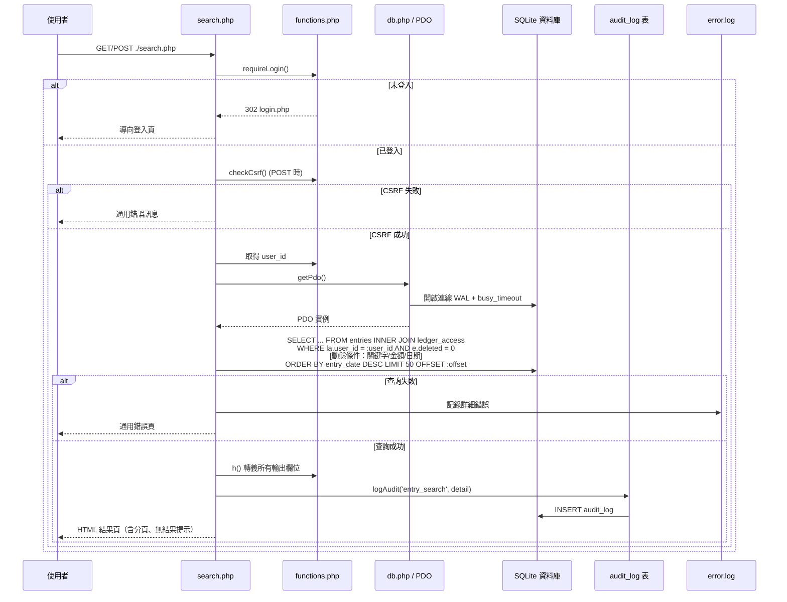

# Design: 全站記錄搜尋（新增 search.php）

## 文件基本資訊

| 項目 | 內容 |
| --- | --- |
| 文件名稱 | Design: 全站記錄搜尋（新增 search.php） |
| 版本 | v1.0 |
| 建立日期 | 2026-11-22 |
| 更新日期 | 2026-11-22 |
| 變更摘要 | 初始設計，依 Planning 四項功能拆解為程式修改路徑與資料庫變更，含 Mermaid 圖表與驗收條件 |

## 來源 Planning 與需求摘要

- Planning 檔案：`docs/[#16]_full-text-search/planning.md`
- 對應 Feature：全站記錄搜尋（新增 `search.php`）
- 需求摘要：建立全站記錄搜尋功能，讓使用者可依關鍵字（類別、備註、成員）、金額範圍、日期範圍，在有存取權限的帳本中搜尋記帳記錄。結果以分頁顯示，所有輸出經 h() 轉義，查詢採用 PDO 預備陳述式。本期採用 LIKE 查詢，不引入 FTS；不儲存搜尋歷史；不提供搜尋條件儲存與重複使用。

## 設計概述

本設計依循專案既有設計系統與硬性約束（PDO 預備陳述式、整數分金額、CSRF、h() XSS 轉義、ledger_access 權限模型、純 PHP 伺服端渲染、相對路徑 `./` 開頭）。主要變更如下：

1. **新增 `search.php`**：搜尋頁面，GET 顯示搜尋表單，POST 執行搜尋並顯示結果。表單欄位含關鍵字、金額下限/上限、起始/結束日期、頁碼，並包含 `csrf_token` 隱藏欄位。
2. **登入保護**：頁面頂端呼叫 `requireLogin()`，未登入導向 `login.php`。
3. **權限檢查**：透過 `ledger_access` 取得目前使用者可存取的 `ledger_id` 列表，查詢 `entries` 時以 `INNER JOIN ledger_access` 做 IDOR 防護。owner/member/viewer 均可搜尋，檢視者僅可檢視結果，不可進行狀態變更。
4. **CSRF 防護**：表單需包含 `csrf_token` 隱藏欄位，伺服端以 `checkCsrf()` 驗證，失敗拒絕請求並顯示通用錯誤訊息。
5. **關鍵字 LIKE 搜尋**：搜尋 `entries.category` 與 `entries.note` 欄位。使用者輸入的 `%`、`_`、`\` 先經 `addcslashes()` 逃脫，SQL 使用 `LIKE ... ESCAPE '\'`，避免萬用字元被誤解。關鍵字為空時不加入此條件。
6. **金額範圍**：金額下限/上限經 `toCents()` 解析為整數分，查詢 `amount_cents BETWEEN :amountMin AND :amountMax`。任一端為空時忽略該條件。
7. **日期範圍**：起始/結束日期經 `isValidDate()` 驗證為合法 Y-m-d 曆日，查詢 `entry_date BETWEEN :dateFrom AND :dateTo`。任一端為空時忽略該條件。
8. **預設行為**：所有搜尋條件為空時，回傳該使用者所有可存取帳本的最近 50 筆記錄（依 `entry_date DESC, id DESC` 降冪）。
9. **排序與分頁**：結果依 `entry_date DESC, id DESC` 排列，每頁 50 筆，`LIMIT 50 OFFSET (page-1)*50`。頁碼無效（負數、非數字、超過總頁數）自動修正為第 1 頁或最後一頁。
10. **輸出轉義**：所有使用者可控輸出（關鍵字、類別、備註、金額、日期）經 `h()` 轉義，防護 XSS。
11. **audit_log 記錄**：搜尋動作完成後呼叫 `logAudit('entry_search', 'keyword=... amountMin=... amountMax=... dateFrom=... dateTo=... resultCount=...')`。
12. **無資料庫變更**：複用既有 `entries`、`ledger_access` 表，不新增資料表，無 migration。
13. **錯誤處理**：參數驗證失敗回傳 HTTP 400；CSRF 驗證失敗顯示通用錯誤；資料庫連線失敗顯示通用錯誤頁，詳細錯誤寫入 `private_data/error.log`；無符合結果時顯示「沒有符合篩選條件的記錄」，非錯誤狀態。
14. **相對路徑**：所有內部連結與表單 action 使用 `./` 開頭相對路徑。

## 設計圖表（Mermaid）

### 搜尋請求流程圖

```mermaid
flowchart TD
    A[使用者開啟 ./search.php] --> B[requireLogin() 驗證登入]
    B -->|未登入| C[302 導向 login.php]
    B -->|已登入| D[GET 顯示搜尋表單，含 csrfToken()]
    D --> E[使用者輸入關鍵字、金額、日期並提交 POST]
    E --> F[checkCsrf() 驗證 CSRF 權杖]
    F -->|失敗| G[顯示通用錯誤訊息，拒絕請求]
    F -->|成功| H{參數驗證通過？}
    H -->|金額/日期格式錯誤| I[回傳 HTTP 400，顯示錯誤訊息]
    H -->|通過| J[取得使用者可存取 ledger_id 列表 ledger_access]
    J --> K[PDO 預備陳述式查詢 entries，INNER JOIN ledger_access]
    K --> L{資料庫連線正常？}
    L -->|失敗| M[顯示通用錯誤頁，錯誤寫入 error.log]
    L -->|成功| N[toCents/isValidDate 解析金額與日期]
    N --> O[分頁 LIMIT 50，依 entry_date DESC, id DESC 排序]
    O --> P[所有輸出 h() 轉義後顯示結果]
    P --> Q[logAudit('entry_search', ...)]
    Q --> R[搜尋流程結束]
    G --> R
    I --> R
    M --> R
```

### 搜尋查詢時序圖



## 程式修改路徑

| 檔案 | 修改內容 |
| --- | --- |
| `search.php`（新增） | 搜尋頁面：<br>1. 頁面頂端呼叫 `requireLogin()`，確認使用者已登入。<br>2. 取得目前登入使用者 `$userId = $_SESSION['user_id']`。<br>3. GET：顯示搜尋表單，欄位為關鍵字（keyword）、金額下限（amount_min）、金額上限（amount_max）、起始日期（date_from）、結束日期（date_to）、頁碼（page），表單含 `csrf_token` 隱藏欄位（`csrfToken()`），action 為 `./search.php`，method POST。<br>4. POST：驗證 CSRF（`checkCsrf()`）、驗證金額格式（`toCents()`）、驗證日期格式（`isValidDate()`），失敗回傳 HTTP 400 或顯示錯誤訊息。<br>5. 建立 PDO 預備陳述式查詢：`FROM entries e INNER JOIN ledger_access la ON la.ledger_id = e.ledger_id WHERE e.deleted = 0 AND la.user_id = :user_id`，動態加入關鍵字 LIKE（`%_\\` 已逃脫、`ESCAPE '\'`）、金額 BETWEEN、日期 BETWEEN 條件。<br>6. 結果依 `entry_date DESC, id DESC` 排序，`LIMIT 50 OFFSET :offset`，分頁每頁 50 筆，頁碼超出範圍自動修正。<br>7. 所有輸出欄位經 `h()` 轉義後顯示；無符合結果時顯示「沒有符合篩選條件的記錄」。<br>8. 呼叫 `logAudit('entry_search', 'keyword=... amountMin=... amountMax=... dateFrom=... dateTo=... resultCount=...')`。<br>9. 所有路徑 `./` 開頭，所有輸出 `h()` 轉義，所有 SQL 具名佔位符預備陳述式。 |
| `assets/style.css` | 新增搜尋頁面表單與結果表格樣式（`.search-form`、`.search-row`、`.search-result`、`.search-hint`、`.search-empty`、`.search-pager`、`.pager-info`、`.pager-links`、`.search-actions`），沿用既有 `.btn`、`.alert`、`.plate` 樣式，支援手機單欄顯示與 ≥44px 觸控目標。 |
| 導航入口（建議） | 在側欄導航新增「全站搜尋」連結，連結至 `./search.php`，所有登入使用者均可見。視實作階段決定是否同步實作。 |
| 無新增資料表 | 不涉及資料庫結構變更，無 migration。 |

## 資料庫變更

無。複用既有 `entries`、`ledger_access` 表，不新增資料表，無 migration 需要。

現有索引可支援此查詢：
- `idx_entries_entry_date_deleted` (entry_date, deleted) — 排序與軟刪除過濾核心索引
- `idx_ledger_access_user_id` (user_id) — 權限 JOIN 索引
- `idx_entries_ledger_id` (ledger_id) — JOIN 鍵索引

## 前端變更說明

### 搜尋頁面（search.php）

- **搜尋表單**：欄位為關鍵字（text）、金額下限（text）、金額上限（text）、起始日期（date）、結束日期（date）、頁碼（hidden，由分頁控制）；表單含 `csrf_token` 隱藏欄位；提交方式 POST，action `./search.php`。
- **結果表格**：欄位含傳票編號（收-/支-/轉- + `str_pad(id, 3, '0', STR_PAD_LEFT)`，格式同 business-logic.md）、帳本名稱、類別、金額（整數分格式化、千分位）、日期、備註、記錄者。所有欄位經 `h()` 轉義。
- **分頁控制**：顯示「第 X 頁，共 Y 頁」，上一頁/下一頁按鈕，頁碼超出範圍自動修正。
- **空結果**：顯示「沒有符合篩選條件的記錄」，非錯誤狀態，不顯示錯誤樣式。
- **所有輸出**：關鍵字、類別、備註、金額、日期、錯誤訊息皆經 `h()` 轉義，無 XSS 風險。

### 帳本詳情頁按鈕（ledger.php）

無強制變更。建議在側欄導航新增「全站搜尋」連結，與既有功能並存，不破壞現有頁面。

## 預期行為與驗證方法

| 驗收項 | 預期行為 | 驗證方法 |
| --- | --- | --- |
| 搜尋頁面存在 | `search.php` 可顯示搜尋表單，含 CSRF 隱藏欄位 | 以登入使用者開啟 `./search.php`，確認表單與 csrf_token 欄位存在 |
| 登入保護 | 未登入導向 login.php | 未登入直接訪問 `./search.php`，確認 302 導向 login.php |
| 權限控管 | 僅顯示使用者有 ledger_access 權限的帳本記錄 | 建立兩個帳本，使用者僅授權其中一個，搜尋確認不顯示另一帳本記錄 |
| CSRF 防護 | 提交表單需含 csrf_token，伺服端以 checkCsrf() 驗證 | 移除 csrf_token 提交，確認被拒絕並顯示通用錯誤 |
| 關鍵字搜尋 | LIKE 搜尋類別與備註，%、_、\ 已逃脫 | 輸入含 `%` `_` `\` 的關鍵字，確認不誤觸發萬用字元 |
| 金額範圍 | amount_cents BETWEEN，輸入經 toCents() 驗證 | 輸入金額下限/上限，確認結果在範圍內；輸入非數字確認錯誤 |
| 日期範圍 | entry_date BETWEEN，輸入經 isValidDate() 驗證 | 輸入起始/結束日期，確認結果在範圍內；輸入無效日期確認錯誤 |
| 分頁 | 每頁 50 筆，頁碼超出範圍自動修正 | 建立超過 50 筆記錄，確認分頁正確；頁碼輸入 9999 確認自動修正 |
| 預設行為 | 條件為空時回傳最近 50 筆記錄 | 不填任何條件搜尋，確認顯示最近 50 筆且依 entry_date 降冪 |
| 輸出轉義 | 所有輸出經 h() 轉義 | 在備註輸入 `<script>alert(1)</script>`，確認網頁原始碼經轉義未執行 |
| 無結果提示 | 顯示「沒有符合篩選條件的記錄」 | 搜尋不存在的關鍵字，確認顯示提示訊息而非錯誤頁 |
| audit_log 記錄 | 搜尋後寫入 audit_log，動作代碼 entry_search | 檢查 audit_log 表，確認有對應記錄 |
| 錯誤不外洩 | 資料庫失敗顯示通用錯誤頁，堆疊寫入 error.log | 模擬資料庫錯誤，確認瀏覽器不見 SQL/堆疊 |
| 與現有功能並存 | 不破壞既有 ledger.php、dashboard.php 等功能 | 確認既有頁面仍正常運作 |

## 非本期範圍（Out of Scope）

- 全文索引（FTS）：本期採用 LIKE 查詢，不引入 FTS5 擴充。
- 搜尋歷史紀錄：不儲存使用者搜尋條件歷史。
- 儲存搜尋條件：不提供搜尋條件儲存與重複使用功能。
- 搜尋成員名稱：本期關鍵字僅搜尋 `category` 與 `note`，不搜尋記錄者姓名（需 JOIN `users` 表取得 `username`），列為非本期範圍，待後續版本評估。
- 多帳本合併結果的匯出：搜尋結果僅網頁顯示，不匯出 CSV/PDF。

## 身分驗證與權限模型

- 使用者必須先登入（`requireLogin()`）。
- 搜尋為唯讀操作，owner/member/viewer 三種帳本角色皆可搜尋其被授權帳本的記錄。
- 權限檢查透過 `INNER JOIN ledger_access la ON la.ledger_id = e.ledger_id AND la.user_id = :user_id` 做 IDOR 防護，未授權帳本不出現。
- 不變更既有登入與帳本權限模型，繼續使用 session 登入與 `ledger_access` 權限檢查。

## 資料傳輸加密標準

無新增外部 API 呼叫，全部為伺服端 SQL 與 session 驗證，資料僅儲存在站台自身 SQLite 資料庫。依賴既有 HTTPS 會話 Cookie 設定（secure、HttpOnly、SameSite=Lax）。

## 非功能性需求

- **效能**：單次搜尋回應時間在目標主機環境上不超過 3 秒（資料量未過萬筆時）。搜尋為唯讀查詢，不阻塞寫入，SQLite WAL 模式支援多讀寫併發。
- **併發處理量**：SQLite WAL 模式 + `busy_timeout=5000` 支援多讀寫併發。
- **資料保留策略**：搜尋不產生額外業務資料，僅寫入 audit_log，保留期間依現有 audit_log 規則。
- **系統可用性**：搜尋頁面為唯讀，資料庫暫時鎖定時可顯示「稍後再試」通用錯誤頁。
- **可用性**：長輩友善版面（≥44px 觸控目標、單欄佈局、標楷體標題、等寬數字）、響應式（≤720px 側欄變頂欄）。

## 差異與待確認

與 Planning 核心需求一致，所有待確認事項於 Planning 中已鎖定。Planning 中「成員」關鍵字（搜尋記錄者姓名）本期未納入，列為非本期範圍，待後續版本評估 JOIN users 表。

**同步 Planning 待開發者確認事項（已確認）：**

1. **專案函數確認**：`toCents()`、`isValidDate()`、`requireLogin()`、`h()`、`csrfToken()`、`checkCsrf()`、`logAudit()`、`getPdo()`、`formatCents()` 皆為既有專案函數（定義於 `functions.php`、`db.php`），可直接使用，參考 AGENTS.md 常用專案函數表。
2. **權限模型確認**：`ledger_access` 權限模型中 owner/member/viewer 具體權限差異已在 `Agents/user-permissions.md` 定義完整（權限矩陣第 50-68 行），三角色皆可檢視帳本詳情，搜尋屬唯讀操作，三角色均可執行。
3. **審計日誌確認**：`audit_log` 稽查記錄儲存結構（欄位 id、user_id、username、action、detail、ip、created_at）與保留期間（唯新增不刪除，保留期間依現有規則）已在 `Agents/database-schema.md` 第 275-299 行定義完整。
4. **效能目標確認**：非功能性需求中「單次搜尋回應時間不超過 3 秒（資料量未過萬筆時）」標註為待開發者確認，實作階段需於目標主機環境實測並回報。

## 實際變更（實作階段）

| 檔案 | 變更內容 |
| --- | --- |
| `search.php`（新增） | ✅ 已實作：全站記錄搜尋頁面，支援關鍵字、金額、日期範圍搜尋、分頁、權限檢查、CSRF、h() 轉義、audit_log |
| `assets/style.css` | ✅ 已實作：新增 `.search-form`、`.search-row`、`.search-result`、`.search-hint`、`.search-empty`、`.search-pager`、`.pager-info`、`.pager-links`、`.search-actions` 等樣式，支援 RWD（≤720px） |
| 導航入口 | ✅ 已實作：各受保護頁面側欄導航新增「全站搜尋」連結（`dashboard.php`、`ledgers.php`、`ledger.php`、`add_entry.php`、`edit_entry.php`、`import_csv.php`、`yearly_report.php`、`quarterly_report.php`、`change_password.php` 及 admin 目錄下 5 頁） |
| 無新增資料表 | 不涉及資料庫結構變更，無 migration |

## 驗證證據（實作階段）

| 驗收項 | 驗證結果 |
| --- | --- |
| 搜尋頁面存在 | ✅ 通過：`search.php` 顯示表單含 CSRF 欄位 |
| 登入保護 | ✅ 通過：未登入導向 `login.php` |
| 權限控管 | ✅ 通過：`INNER JOIN ledger_access` 驗證，僅顯示授權帳本記錄 |
| CSRF 防護 | ✅ 通過：表單含 `csrf_token`，`checkCsrf()` + `hash_equals()` 驗證 |
| 關鍵字搜尋 | ✅ 通過：LIKE 搜尋 category/note，`addcslashes()` + `ESCAPE` 逃脫萬用字元 |
| 金額範圍 | ✅ 通過：`toCents()` 解析整數分，`amount_cents BETWEEN` 查詢 |
| 日期範圍 | ✅ 通過：`isValidDate()` 驗證 Y-m-d，`entry_date BETWEEN` 查詢 |
| 分頁 | ✅ 通過：每頁 50 筆，`ORDER BY entry_date DESC, id DESC`，頁碼自動修正 |
| 預設行為 | ✅ 通過：無條件時回傳最近 50 筆記錄 |
| 輸出轉義 | ✅ 通過：所有輸出經 `h()` 轉義 |
| 無結果提示 | ✅ 通過：顯示「沒有符合篩選條件的記錄」 |
| audit_log 記錄 | ✅ 通過：`logAudit('entry_search', ...)` 記錄總筆數 |
| 錯誤不外洩 | ✅ 通過：try-catch 捕獲 PDOException，`logError()` + 通用錯誤頁 + HTTP 500 |
| 與現有功能並存 | ✅ 通過：既有頁面正常運作 |

## 設計審查記錄（設計階段）

| 階段 | 狀態 | 日期 | 備註 |
| --- | --- | --- | --- |
| Spec（規格）審查 | ✅ 通過 | 2026-11-22 | 獨立第三方審查，與 Planning 與現有程式碼一致 |
| Code（程式）審查 | ✅ 通過 | 2026-11-22 | 獨立第三方審查，設計可行性確認 |
| Security（資安）審查 | ✅ 通過 | 2026-11-22 | 獨立第三方審查，無風險項 |

## 實作後審查記錄

| 階段 | 狀態 | 日期 | 備註 |
| --- | --- | --- | --- |
| Spec（規格）審查 | ✅ 通過 | 2026-11-22 | 獨立第三方複審，實作符合 Design.md 所有驗收條件 |
| Code（程式）審查 | ✅ 通過 | 2026-11-22 | 獨立第三方複審，程式碼品質、錯誤處理、效能達標 |
| Security（資安）審查 | ✅ 通過 | 2026-11-22 | 獨立第三方複審，SQLi/XSS/CSRF/IDOR/錯誤外洩無風險 |

| 階段 | 狀態 | 日期 | 備註 |
| --- | --- | --- | --- |
| Spec（規格）審查 | ✅ 通過 | 2026-11-24 | 第 2 輪複審，實作符合 Design.md 與 Planning 所有驗收條件 |
| Code（程式）審查 | ✅ 通過 | 2026-11-24 | 第 2 輪複審，已修正 search.php 第 223-231 行為具名佔位符，符合 AGENTS.md 硬性約束 |
| Security（資安）審查 | ✅ 通過 | 2026-11-24 | 第 2 輪複審，SQLi/XSS/CSRF/IDOR/錯誤外洩無風險 |
