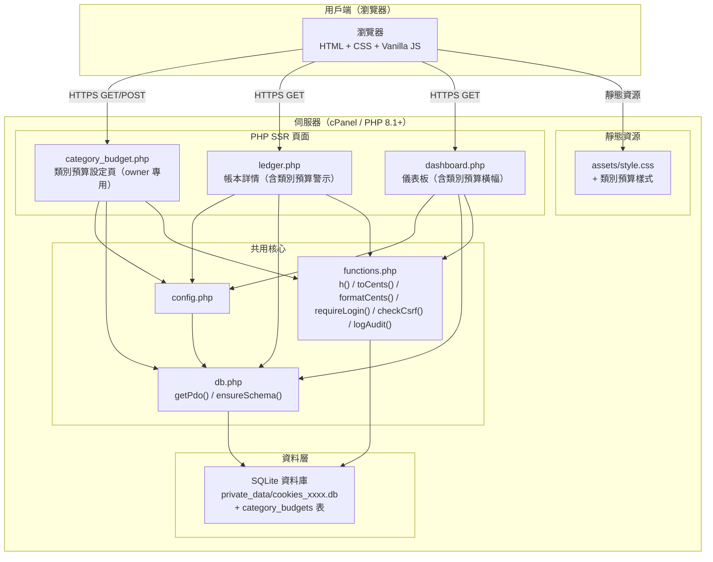
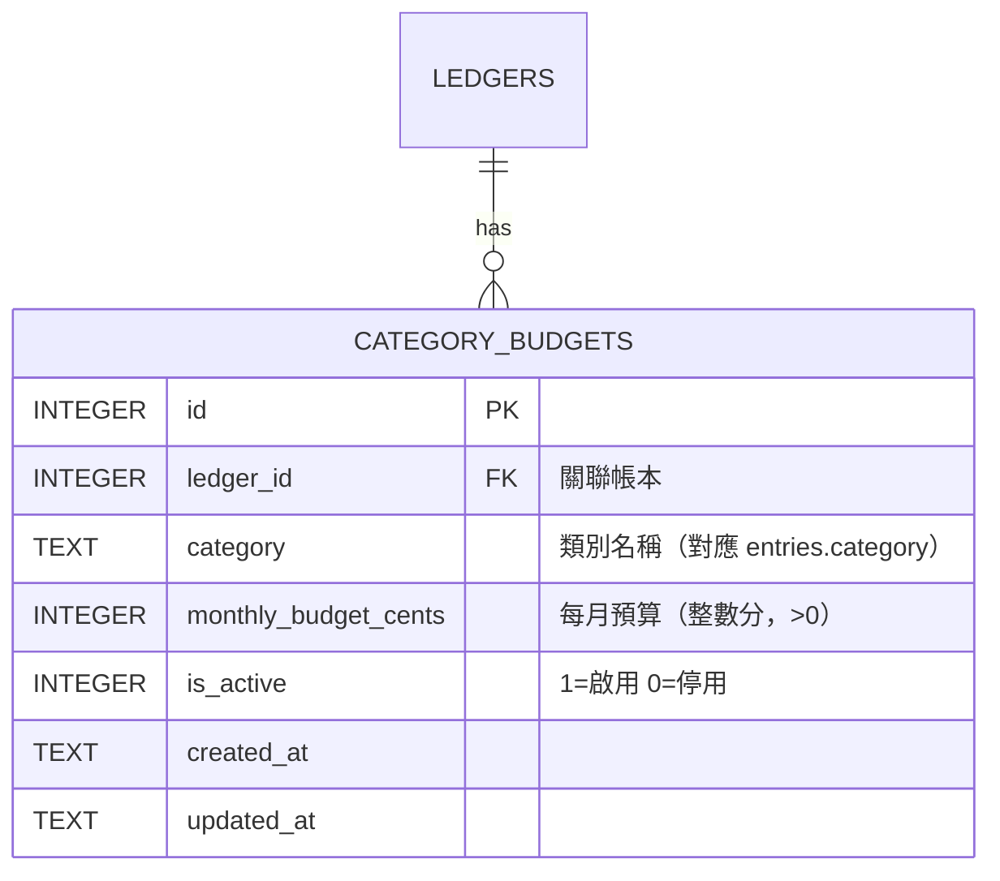
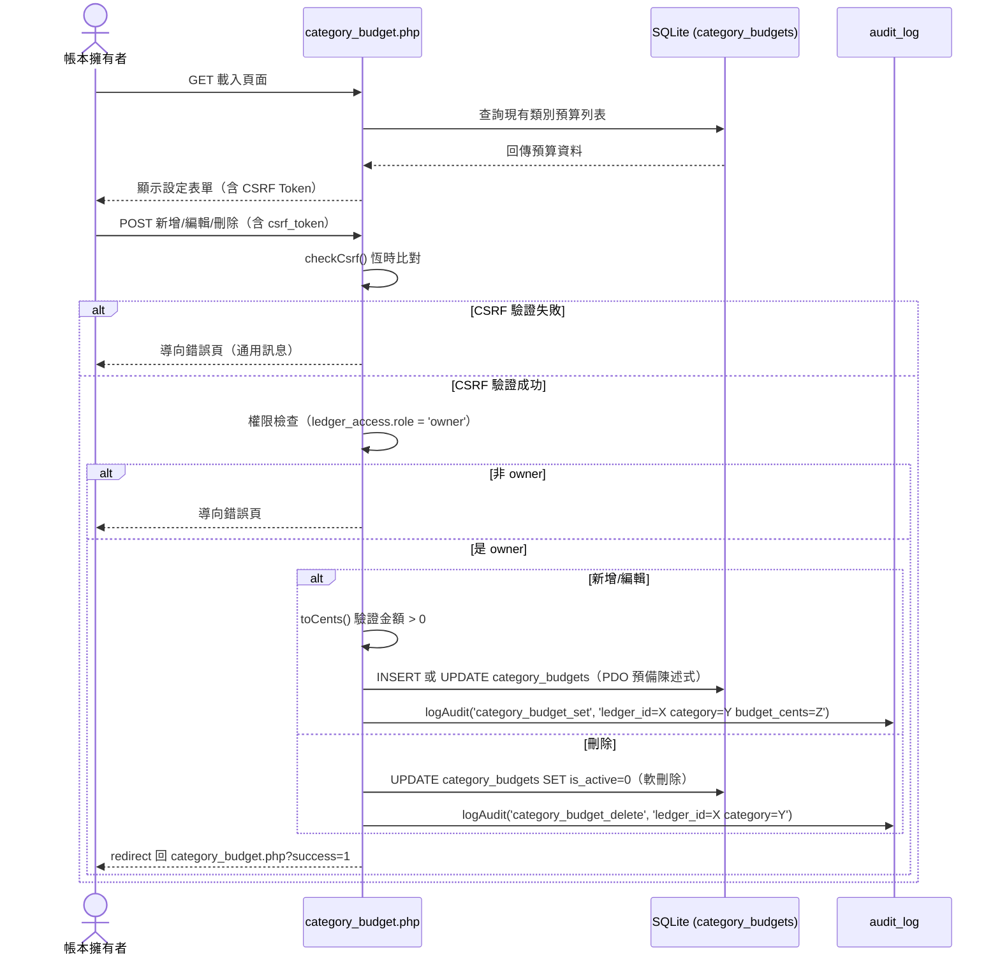
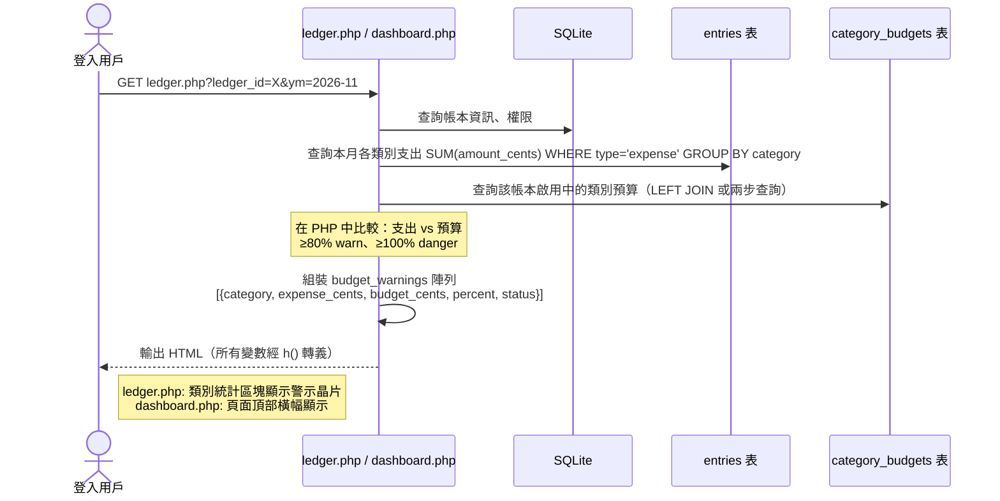
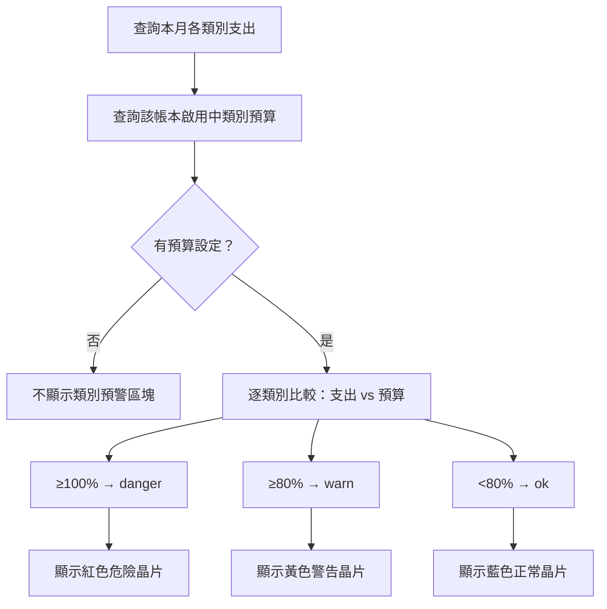
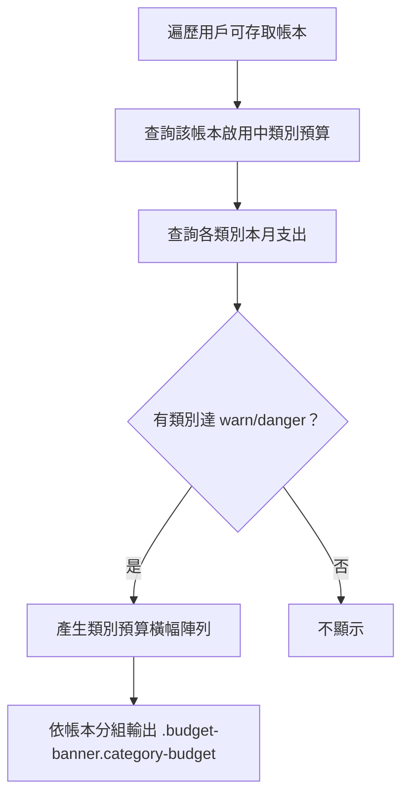

# 類別預算功能 — Design.md

> 合併 Implementation.md，不再另存。本文件依開發流程規範完成後需經 **Spec / Code / Security** 三階段第三方審查。

---

## 1. 功能概覽

| 項目 | 說明 |
|------|------|
| **功能名稱** | 類別預算（Category Budget） |
| **核心目標** | 擴充既有帳本層級每月預算，新增類別層級預算（如「餐費月預算 6000 元」），超過時在 `ledger.php` 與 `dashboard.php` 顯示警告 |
| **權限模型** | 僅帳本擁有者（`ledger_access.role = 'owner'`）可新增/編輯/刪除類別預算；member / viewer 僅可檢視 |
| **預算門檻** | 支出 ≥ 80% 顯示「警告」（amber），≥ 100% 顯示「危險」（red），與既有帳本預算邏輯一致 |
| **資料儲存** | 整數分（`monthly_budget_cents`），顯示時除以 100 格式化 |

---

## 2. 架構設計

### 2.1 系統架構圖



### 2.2 頁面對應表

| 頁面/功能 | 檔案 | 類型 | 權限 | 說明 |
|-----------|------|------|------|------|
| 類別預算設定 | `category_budget.php` | 受保護頁面 | owner | 新增/編輯/刪除類別預算 |
| 帳本詳情（含類別預警） | `ledger.php` | 受保護頁面 | 登入用戶（ledger_access） | 本月彙總、分頁記錄、類別預算警示 |
| 儀表板（含類別預警橫幅） | `dashboard.php` | 受保護頁面 | 登入用戶 | 多帳本總覽、類別預算橫幅 |

---

## 3. 資料庫設計

### 3.1 新增資料表：`category_budgets`



### 3.2 欄位定義

| 欄位 | 型別 | 約束 | 說明 |
|------|------|------|------|
| `id` | INTEGER | PK, AUTOINCREMENT | 主鍵 |
| `ledger_id` | INTEGER | NOT NULL, FK→ledgers.id | 所屬帳本 |
| `category` | TEXT | NOT NULL | 類別名稱（對應 `entries.category`） |
| `monthly_budget_cents` | INTEGER | NOT NULL CHECK (>0) | 每月預算金額（整數分） |
| `is_active` | INTEGER | NOT NULL DEFAULT 1 CHECK IN (0,1) | 1=啟用、0=停用 |
| `created_at` | TEXT | NOT NULL DEFAULT (datetime('now','localtime')) | 建立時間 |
| `updated_at` | TEXT | NOT NULL DEFAULT (datetime('now','localtime')) | 更新時間 |

### 3.3 索引

```sql
-- 查詢特定帳本的類別預算（啟用中）
CREATE INDEX IF NOT EXISTS idx_category_budgets_ledger_active 
    ON category_budgets(ledger_id, is_active);

-- 查詢特定帳本特定類別的預算
CREATE INDEX IF NOT EXISTS idx_category_budgets_ledger_category 
    ON category_budgets(ledger_id, category);
```

### 3.4 唯一約束

```sql
-- 一個帳本同一類別只能有一筆記錄（含停用），應用層保證「啟用中同類別僅一筆」
CREATE UNIQUE INDEX IF NOT EXISTS uq_category_budgets_ledger_category 
    ON category_budgets(ledger_id, category);
```

> **設計決策**：不使用 Partial Unique Index（`WHERE is_active = 1`），因 SQLite 3.38+ 才支援，專案不鎖定最低版本。改用一般唯一索引 + 應用層檢查（INSERT 前 SELECT 確認無啟用中同類別預算），參考現有 `db.php` 遷移腳本模式。

### 3.5 遷移腳本（在 `db.php` 的 `ensureSchema()` 中新增）

```php
// 新增 category_budgets 表
$pdo->exec(<<<'SQL'
CREATE TABLE IF NOT EXISTS category_budgets (
    id                    INTEGER PRIMARY KEY AUTOINCREMENT,
    ledger_id             INTEGER NOT NULL,
    category              TEXT    NOT NULL,
    monthly_budget_cents  INTEGER NOT NULL CHECK (monthly_budget_cents > 0),
    is_active             INTEGER NOT NULL DEFAULT 1 CHECK (is_active IN (0,1)),
    created_at            TEXT    NOT NULL DEFAULT (datetime('now','localtime')),
    updated_at            TEXT    NOT NULL DEFAULT (datetime('now','localtime')),
    FOREIGN KEY (ledger_id) REFERENCES ledgers(id)
);
SQL);

$pdo->exec(<<<'SQL'
CREATE INDEX IF NOT EXISTS idx_category_budgets_ledger_active 
    ON category_budgets(ledger_id, is_active);
CREATE INDEX IF NOT EXISTS idx_category_budgets_ledger_category 
    ON category_budgets(ledger_id, category);
SQL);

// 唯一約束：一帳本一類別僅一筆啟用中預算（應用層也要檢查）
$pdo->exec(<<<'SQL'
CREATE UNIQUE INDEX IF NOT EXISTS uq_category_budgets_ledger_category_active 
    ON category_budgets(ledger_id, category) WHERE is_active = 1;
SQL);
```

---

## 4. 資料流設計

### 4.1 類別預算設定流程（寫入）



### 4.2 類別預算查詢與警示顯示流程（讀取）



---

## 5. 介面設計

### 5.1 `category_budget.php` — 類別預算設定頁

#### 頁面結構

```
┌─────────────────────────────────────────────────────────────┐
│ .app                                                         │
│  ┌──────────┐  ┌────────────────────────────────────────┐  │
│  │ .side    │  │ .main                                   │  │
│  │ 232px    │  │  .sheet (max-width: 1080px)            │  │
│  └──────────┘  │  ┌──────────────────────────────────┐  │  │
│                │  │ .page-head                       │  │  │
│                │  │   h1: 類別預算設定 - {帳本名稱}    │  │  │
│                │  │   返回 ledger.php 連結            │  │  │
│                │  └──────────────────────────────────┘  │  │
│                │  ┌──────────────────────────────────┐  │  │
│                │  │ 新增類別預算表單                   │  │  │
│                │  │  ├─ 類別：select（從 entries 取得）│  │  │
│                │  │  ├─ 每月預算：input[type=text]     │  │  │
│                │  │  └─ [設定] 按鈕                    │  │  │
│                │  └──────────────────────────────────┘  │  │
│                │  ┌──────────────────────────────────┐  │  │
│                │  │ 現有類別預算列表                   │  │  │
│                │  │  表格：類別 | 預算 | 狀態 | 操作    │  │  │
│                │  │  每列：編輯按鈕、停用按鈕          │  │  │
│                │  └──────────────────────────────────┘  │  │
│                │                                        │  │
│                └────────────────────────────────────────┘  │
└─────────────────────────────────────────────────────────────┘
```

#### 表單規格

| 欄位 | 類型 | 驗證規則 |
|------|------|----------|
| `category` | `<select>` | 必填，選項來自該帳本 `entries` 表出現過的類別（DISTINCT） |
| `monthly_budget` | `<input type="text" inputmode="decimal">` | 必填，`toCents()` 解析成功且 > 0 |
| `csrf_token` | `<input type="hidden">` | `checkCsrf()` 驗證 |

#### 互動規格

- **新增**：POST `action=create` → 驗證 → INSERT → redirect 回本頁
- **編輯**：按「編輯」將該列資料填入表單（改為編輯模式，顯示「更新」按鈕）→ POST `action=update&id=X` → UPDATE → redirect
- **停用**：POST `action=toggle&id=X` → UPDATE `is_active=0` → redirect（軟刪除，保留歷史）
- **CSRF**：所有表單含 `csrf_token`，`checkCsrf()` 驗證失敗導向錯誤頁
- **權限**：開頭 `requireLogin()` + 查詢 `ledger_access` 確認 `role='owner'`

### 5.2 `ledger.php` — 類別預算警示整合

#### 新增顯示區塊：類別預算狀態列表

在「本月類別支出統計」SVG 圖表上方或下方，新增類別預算狀態摘要：



#### 顯示規格

| 狀態 | 門檻 | 晶片樣式 | 文字 |
|------|------|----------|------|
| `ok` | 支出 < 80% | `.budget-chip.ok`（藍底藍字） | 預算尚充足 |
| `warn` | 支出 ≥ 80% | `.budget-chip.warn`（黃底黃字） | 接近預算上限 |
| `danger` | 支出 ≥ 100% | `.budget-chip.danger`（紅底紅字） | 已超過預算 |

每個類別顯示：類別名稱、本月支出、預算金額、使用率%、狀態晶片。

### 5.3 `dashboard.php` — 類別預算橫幅

在既有帳本預算橫幅（`.budget-banner`）下方，新增類別預算橫幅：



#### 樣式區隔

- **帳本整體預算**：既有 `.budget-banner.warn/danger`（左側 5px 條）
- **類別預算**：新增 `.budget-banner.category-budget.warn/danger`（左側 5px 條 + 類別標籤）

---

## 6. 程式碼設計

### 6.1 `category_budget.php` 核心邏輯

```php
<?php
// category_budget.php
declare(strict_types=1);

require_once __DIR__ . '/functions.php';

requireLogin();
$user = currentUser();
$pdo  = getPdo();
$userId = (int) $user['id'];

// 解析 ledger_id
$ledgerIdRaw = $_GET['ledger_id'] ?? null;
$ledgerId = filter_var($ledgerIdRaw, FILTER_VALIDATE_INT);
if ($ledgerId === false || $ledgerId === null) {
    redirect('./ledgers.php?error=1');
}

// 驗證存取權限 + owner 角色（含 archived 檢查，參考 ledger.php 第 23 行）
$stmt = $pdo->prepare('
    SELECT l.name, la.role
    FROM ledgers l
    INNER JOIN ledger_access la ON la.ledger_id = l.id
    WHERE l.id = :ledger_id AND la.user_id = :user_id AND l.archived = 0
    LIMIT 1
');
$stmt->execute([':ledger_id' => $ledgerId, ':user_id' => $userId]);
$ledger = $stmt->fetch();
if ($ledger === false || $ledger['role'] !== 'owner') {
    redirect('./ledger.php?ledger_id=' . $ledgerId . '&error=1&msg=' . urlencode('僅帳本擁有者可管理類別預算。'));
}
$accessRole = $ledger['role'];

// POST 處理：新增/編輯/停用
if (($_SERVER['REQUEST_METHOD'] ?? 'GET') === 'POST') {
    $action = $_POST['action'] ?? '';
    $csrfRaw = $_POST['csrf_token'] ?? '';
    if (!checkCsrf(is_string($csrfRaw) ? $csrfRaw : '')) {
        redirect('./category_budget.php?ledger_id=' . $ledgerId . '&error=1&msg=' . urlencode('安全驗證失敗，請重新操作。'));
    }

    if ($action === 'create' || $action === 'update') {
        $category = trim($_POST['category'] ?? '');
        $budgetRaw = trim($_POST['monthly_budget'] ?? '');
        $budgetCents = toCents($budgetRaw);
        if ($category === '' || $budgetCents === false || $budgetCents <= 0) {
            redirect('./category_budget.php?ledger_id=' . $ledgerId . '&error=1&msg=' . urlencode('類別與預算金額皆為必填，金額需大於 0。'));
        }

        if ($action === 'create') {
            // 檢查是否已存在啟用中同類別預算
            $chk = $pdo->prepare('SELECT id FROM category_budgets WHERE ledger_id = :ledger_id AND category = :category AND is_active = 1 LIMIT 1');
            $chk->execute([':ledger_id' => $ledgerId, ':category' => $category]);
            if ($chk->fetch()) {
                redirect('./category_budget.php?ledger_id=' . $ledgerId . '&error=1&msg=' . urlencode('該類別已有啟用中的預算，請編輯現有記錄。'));
            }
            $stmt = $pdo->prepare('
                INSERT INTO category_budgets (ledger_id, category, monthly_budget_cents, is_active)
                VALUES (:ledger_id, :category, :budget, 1)
            ');
            $stmt->execute([':ledger_id' => $ledgerId, ':category' => $category, ':budget' => $budgetCents]);
            logAudit('category_budget_create', 'ledger_id=' . $ledgerId . ' category=' . $category . ' budget_cents=' . $budgetCents);
        } else { // update
            $id = filter_var($_POST['id'] ?? '', FILTER_VALIDATE_INT);
            if ($id === false || $id === null) {
                redirect('./category_budget.php?ledger_id=' . $ledgerId . '&error=1&msg=' . urlencode('無效的預算編號。'));
            }
            $stmt = $pdo->prepare('
                UPDATE category_budgets
                SET monthly_budget_cents = :budget, updated_at = datetime("now","localtime")
                WHERE id = :id AND ledger_id = :ledger_id
            ');
            $stmt->execute([':budget' => $budgetCents, ':id' => $id, ':ledger_id' => $ledgerId]);
            logAudit('category_budget_update', 'ledger_id=' . $ledgerId . ' id=' . $id . ' budget_cents=' . $budgetCents);
        }
        redirect('./category_budget.php?ledger_id=' . $ledgerId . '&success=1&msg=' . urlencode('類別預算已儲存。'));
    }

    if ($action === 'toggle') {
        $id = filter_var($_POST['id'] ?? '', FILTER_VALIDATE_INT);
        if ($id === false || $id === null) {
            redirect('./category_budget.php?ledger_id=' . $ledgerId . '&error=1&msg=' . urlencode('無效的預算編號。'));
        }
        $stmt = $pdo->prepare('
            UPDATE category_budgets
            SET is_active = 0, updated_at = datetime("now","localtime")
            WHERE id = :id AND ledger_id = :ledger_id
        ');
        $stmt->execute([':id' => $id, ':ledger_id' => $ledgerId]);
        logAudit('category_budget_delete', 'ledger_id=' . $ledgerId . ' id=' . $id);
        redirect('./category_budget.php?ledger_id=' . $ledgerId . '&success=1&msg=' . urlencode('類別預算已停用。'));
    }
}

// GET：查詢現有類別預算列表
$budgetStmt = $pdo->prepare('
    SELECT id, category, monthly_budget_cents, is_active, created_at, updated_at
    FROM category_budgets
    WHERE ledger_id = :ledger_id AND is_active = 1
    ORDER BY category
');
$budgetStmt->execute([':ledger_id' => $ledgerId]);
$budgets = $budgetStmt->fetchAll();

// 查詢全站啟用中的分類（供 select 選項；參考 categories 表、db.php 第 138-150 行）
$catStmt = $pdo->prepare('SELECT name FROM categories WHERE is_active = 1 ORDER BY name');
$catStmt->execute();
$categories = $catStmt->fetchAll(PDO::FETCH_COLUMN);

// 編輯模式：若有 edit_id 參數，預填表單
$editBudget = null;
$editIdRaw = $_GET['edit_id'] ?? null;
$editId = filter_var($editIdRaw, FILTER_VALIDATE_INT);
if ($editId !== false && $editId !== null) {
    $editStmt = $pdo->prepare('SELECT id, category, monthly_budget_cents FROM category_budgets WHERE id = :id AND ledger_id = :ledger_id LIMIT 1');
    $editStmt->execute([':id' => $editId, ':ledger_id' => $ledgerId]);
    $editBudget = $editStmt->fetch();
}
?>
<!DOCTYPE html>
<html lang="zh-TW">
<head>
    <meta charset="UTF-8">
    <meta name="viewport" content="width=device-width, initial-scale=1.0">
    <title>類別預算設定 - 全家人記帳系統</title>
    <link rel="stylesheet" href="./assets/style.css?v=20261122-1">
</head>
<body>
    <div class="app">
        <!-- 側欄（同 ledger.php） -->
        <aside class="side">...</aside>

        <div class="main">
            <main class="sheet">
                <div class="page-head">
                    <div>
                        <h1>類別預算設定</h1>
                        <p class="sub"><?php echo h($ledger['name']); ?>　·　<a href="./ledger.php?ledger_id=<?php echo h((string) $ledgerId); ?>">← 返回帳本詳情</a></p>
                    </div>
                </div>

                <?php if (($_GET['success'] ?? '') === '1'): ?>
                    <p class="alert success" role="status"><?php echo h($_GET['msg'] ?? '操作成功完成。'); ?></p>
                <?php endif; ?>
                <?php if (($_GET['error'] ?? '') === '1'): ?>
                    <p class="alert error" role="alert"><?php echo h($_GET['msg'] ?? '操作失敗。'); ?></p>
                <?php endif; ?>

                <!-- 新增/編輯表單 -->
                <div class="recurring-card">
                    <h3><?php echo $editBudget ? '編輯類別預算' : '新增類別預算'; ?></h3>
                    <form method="POST" action="./category_budget.php?ledger_id=<?php echo h((string) $ledgerId); ?>" class="form">
                        <input type="hidden" name="csrf_token" value="<?php echo h(csrfToken()); ?>">
                        <input type="hidden" name="action" value="<?php echo $editBudget ? 'update' : 'create'; ?>">
                        <?php if ($editBudget): ?>
                            <input type="hidden" name="id" value="<?php echo h((string) $editBudget['id']); ?>">
                        <?php endif; ?>
                        <div class="form-grid">
                            <div class="field field-full">
                                <label for="category" class="label">類別</label>
                                <?php if ($editBudget): ?>
                                    <select name="category" id="category" class="select" required disabled>
                                        <option value="<?php echo h($editBudget['category']); ?>" selected><?php echo h($editBudget['category']); ?></option>
                                    </select>
                                    <input type="hidden" name="category" value="<?php echo h($editBudget['category']); ?>">
                                    <p class="meta">編輯模式下類別不可變更，請停用後重新新增。</p>
                                <?php else: ?>
                                    <select name="category" id="category" class="select" required>
                                        <option value="">請選擇類別</option>
                                        <?php foreach ($categories as $cat): ?>
                                            <option value="<?php echo h($cat); ?>"><?php echo h($cat); ?></option>
                                        <?php endforeach; ?>
                                    </select>
                                <?php endif; ?>
                            </div>
                            <div class="field field-full">
                                <label for="monthly_budget" class="label">每月預算（元）</label>
                                <input type="text" name="monthly_budget" id="monthly_budget" class="input mono" inputmode="decimal" pattern="\d+(\.\d{1,2})?" placeholder="例：6000" required
                                    value="<?php echo $editBudget ? h(formatCents((int) $editBudget['monthly_budget_cents'])) : ''; ?>">
                            </div>
                        </div>
                        <button type="submit" class="btn primary"><?php echo $editBudget ? '更新' : '設定'; ?></button>
                        <?php if ($editBudget): ?>
                            <a href="./category_budget.php?ledger_id=<?php echo h((string) $ledgerId); ?>" class="btn secondary" style="margin-left: var(--space-2);">取消編輯</a>
                        <?php endif; ?>
                    </form>
                </div>

                <!-- 現有類別預算列表 -->
                <?php if ($budgets): ?>
                <div class="recurring-card">
                    <h3>現有類別預算</h3>
                    <div class="table-wrap">
                        <table class="table">
                            <thead>
                                <tr>
                                    <th>類別</th>
                                    <th class="num">每月預算</th>
                                    <th class="ctr">狀態</th>
                                    <th class="ctr">操作</th>
                                </tr>
                            </thead>
                            <tbody>
                                <?php foreach ($budgets as $b): ?>
                                <tr>
                                    <td><?php echo h($b['category']); ?></td>
                                    <td class="num mono"><?php echo h(formatCents((int) $b['monthly_budget_cents'])); ?> 元</td>
                                    <td class="ctr"><span class="budget-chip ok">啟用中</span></td>
                                    <td class="ctr">
                                        <div class="ctr-actions">
                                            <a href="./category_budget.php?ledger_id=<?php echo h((string) $ledgerId); ?>&edit_id=<?php echo h((string) $b['id']); ?>" class="btn secondary sm">編輯</a>
                                            <form method="POST" action="./category_budget.php?ledger_id=<?php echo h((string) $ledgerId); ?>" onsubmit="return confirm('確定要停用這個類別預算嗎？');" style="display:inline;">
                                                <input type="hidden" name="csrf_token" value="<?php echo h(csrfToken()); ?>">
                                                <input type="hidden" name="action" value="toggle">
                                                <input type="hidden" name="id" value="<?php echo h((string) $b['id']); ?>">
                                                <button type="submit" class="btn danger sm">停用</button>
                                            </form>
                                        </div>
                                    </td>
                                </tr>
                                <?php endforeach; ?>
                            </tbody>
                        </table>
                    </div>
                </div>
                <?php else: ?>
                <p class="empty">尚無類別預算。請上方新增第一筆。</p>
                <?php endif; ?>
            </main>
        </div>
    </div>
    <script src="./assets/app.js"></script>
</body>
</html>
```

### 6.2 `ledger.php` 修改重點

在現有「本月類別支出統計」區塊（約第 700-754 行）附近新增類別預算查詢與顯示邏輯：

```php
// === 類別預算查詢（新增） ===
// 權限已在檔案開頭驗證（$ledger 含 role、archived=0），此處直接用 $ledgerId 查詢
$categoryBudgets = [];
$budgetStmt = $pdo->prepare('
    SELECT category, monthly_budget_cents
    FROM category_budgets
    WHERE ledger_id = :ledger_id AND is_active = 1
');
$budgetStmt->execute([':ledger_id' => $ledgerId]);
while ($row = $budgetStmt->fetch()) {
    $categoryBudgets[$row['category']] = (int) $row['monthly_budget_cents'];
}

// 類別統計查詢時一併取得支出（現有邏輯擴充）
$categoryStats = [];
$categoryBudgetStatus = []; // ['category' => ['expense_cents', 'budget_cents', 'percent', 'status']]
if (!$isFiltered && $typeSel !== 'income') {
    $catStmt = $pdo->prepare('
        SELECT e.category, SUM(e.amount_cents) AS total_cents
        FROM entries e
        INNER JOIN ledger_access la ON la.ledger_id = e.ledger_id AND la.user_id = :user_id
        WHERE e.ledger_id = :ledger_id
          AND e.deleted = 0
          AND e.type = :type
          AND e.entry_date BETWEEN :ms AND :me
        GROUP BY e.category
        ORDER BY total_cents DESC
    ');
    $catStmt->execute([
        ':user_id' => $userId,
        ':ledger_id' => $ledgerId,
        ':type' => 'expense',
        ':ms' => $monthStart,
        ':me' => $monthEnd,
    ]);
    while ($catRow = $catStmt->fetch()) {
        $cents = (int) $catRow['total_cents'];
        $cat = $catRow['category'];
        $categoryStats[] = ['category' => $cat, 'cents' => $cents];
        
        // 類別預算比較（新增）
        if (isset($categoryBudgets[$cat])) {
            $budgetCents = $categoryBudgets[$cat];
            if ($budgetCents > 0) {
                $percent = (int) floor($cents * 100 / $budgetCents);
                if ($cents * 100 >= $budgetCents * 100) {
                    $status = 'danger';
                } elseif ($cents * 100 >= $budgetCents * 80) {
                    $status = 'warn';
                } else {
                    $status = 'ok';
                }
                $categoryBudgetStatus[$cat] = [
                    'expense_cents' => $cents,
                    'budget_cents' => $budgetCents,
                    'percent' => $percent,
                    'status' => $status,
                ];
            }
        }
    }
}
```

在 SVG 圖表後新增類別預算狀態顯示區塊：

```php
<?php if (!empty($categoryBudgetStatus)): ?>
<div class="category-budget-status" aria-label="類別預算狀態">
    <h3>類別預算狀態</h3>
    <div class="table-wrap">
        <table class="table">
            <thead>
                <tr>
                    <th>類別</th>
                    <th class="num">本月支出</th>
                    <th class="num">預算金額</th>
                    <th class="num">使用率</th>
                    <th class="ctr">狀態</th>
                </tr>
            </thead>
            <tbody>
                <?php foreach ($categoryBudgetStatus as $cat => $bs): ?>
                <tr>
                    <td><?php echo h($cat); ?></td>
                    <td class="num amt-out mono">-<?php echo h(formatCents($bs['expense_cents'])); ?></td>
                    <td class="num mono"><?php echo h(formatCents($bs['budget_cents'])); ?></td>
                    <td class="num mono"><?php echo h((string) $bs['percent']); ?>%</td>
                    <td class="ctr">
                        <span class="budget-chip <?php echo h($bs['status']); ?>">
                            <?php 
                                echo $bs['status'] === 'danger' ? '已超過預算' : 
                                     ($bs['status'] === 'warn' ? '接近預算上限' : '預算尚充足'); 
                            ?>
                        </span>
                    </td>
                </tr>
                <?php endforeach; ?>
            </tbody>
        </table>
    </div>
</div>
<?php endif; ?>
```

### 6.3 `dashboard.php` 修改重點

在既有帳本預算橫幅（約第 214-234 行）之後新增類別預算橫幅：

```php
// === 類別預算橫幅（新增）===
// 批次查詢避免 N+1：先收集所有可存取帳本 ID，再單次查詢類別預算與支出
$accessibleLedgerIds = array_column($ledgerSummaries, 'id');
$categoryBudgetBanners = [];

if ($accessibleLedgerIds) {
    $placeholders = implode(',', array_fill(0, count($accessibleLedgerIds), '?'));
    
    // 查詢所有帳本的啟用中類別預算（單次查詢）
    $cbStmt = $pdo->prepare("
        SELECT ledger_id, category, monthly_budget_cents
        FROM category_budgets
        WHERE ledger_id IN ($placeholders) AND is_active = 1
    ");
    $cbStmt->execute($accessibleLedgerIds);
    $allCatBudgets = [];
    while ($row = $cbStmt->fetch()) {
        $lid = (int) $row['ledger_id'];
        $allCatBudgets[$lid][$row['category']] = (int) $row['monthly_budget_cents'];
    }

    // 查詢所有帳本各類別本月支出（單次查詢）
    $catExpStmt = $pdo->prepare("
        SELECT ledger_id, category, COALESCE(SUM(amount_cents), 0) AS expense_cents
        FROM entries
        WHERE ledger_id IN ($placeholders)
          AND deleted = 0
          AND type = 'expense'
          AND entry_date BETWEEN :ms AND :me
        GROUP BY ledger_id, category
    ");
    $catExpStmt->execute(array_merge($accessibleLedgerIds, [':ms' => $monthStart, ':me' => $monthEnd]));
    $allCatExpenses = [];
    while ($row = $catExpStmt->fetch()) {
        $lid = (int) $row['ledger_id'];
        $allCatExpenses[$lid][$row['category']] = (int) $row['expense_cents'];
    }

    // 建立 ledger_id -> name 對照
    $ledgerNames = [];
    foreach ($ledgerSummaries as $ls) {
        $ledgerNames[(int) $ls['id']] = $ls['name'];
    }

    // 比較並產生橫幅資料
    foreach ($allCatBudgets as $lid => $catBudgets) {
        $catExpenses = $allCatExpenses[$lid] ?? [];
        $ledgerName = $ledgerNames[$lid] ?? '';
        foreach ($catBudgets as $cat => $budgetCents) {
            $expenseCents = $catExpenses[$cat] ?? 0;
            if ($budgetCents > 0) {
                if ($expenseCents * 100 >= $budgetCents * 100) {
                    $categoryBudgetBanners[] = [
                        'ledger_name' => $ledgerName,
                        'category' => $cat,
                        'status' => 'danger',
                        'percent' => 100,
                        'expense' => $expenseCents,
                        'budget' => $budgetCents,
                    ];
                } elseif ($expenseCents * 100 >= $budgetCents * 80) {
                    $categoryBudgetBanners[] = [
                        'ledger_name' => $ledgerName,
                        'category' => $cat,
                        'status' => 'warn',
                        'percent' => (int) floor($expenseCents * 100 / $budgetCents),
                        'expense' => $expenseCents,
                        'budget' => $budgetCents,
                    ];
                }
            }
        }
    }
}
```

輸出橫幅（在既有 `$budgetBanners` 迴圈之後）：

```php
<?php foreach ($categoryBudgetBanners as $cbb): ?>
<div class="budget-banner budget-banner-<?php echo h($cbb['status']); ?> category-budget" role="alert">
    <strong><?php echo h($cbb['ledger_name']); ?></strong>：
    <span class="category-tag"><?php echo h($cbb['category']); ?></span>
    類別預算已使用 <strong class="num"><?php echo h((string) $cbb['percent']); ?>%</strong>：
    <?php echo $cbb['status'] === 'danger' ? '已超過預算' : '接近預算上限'; ?>
    （預算 <?php echo h(formatCents($cbb['budget'])); ?> 元，已支出 <strong class="num"><?php echo h(formatCents($cbb['expense'])); ?></strong> 元）
</div>
<?php endforeach; ?>
```

---

## 7. 樣式設計（CSS）

在 `assets/style.css` 末尾新增：

```css
/* ============================================
   類別預算狀態（Category Budget Status）
   ============================================ */

.category-budget-status {
    margin: var(--space-6) 0;
}
.category-budget-status h3 {
    margin: 0 0 var(--space-3) 0;
    font-size: var(--text-lg);
}

/* 類別標籤（dashboard 橫幅用） */
.category-tag {
    display: inline-block;
    font-family: var(--font-mono);
    font-size: 11px;
    letter-spacing: 0.08em;
    border-radius: var(--radius-chip);
    padding: 1px 6px;
    margin: 0 var(--space-2);
    border: 1px solid var(--line);
    background: var(--paper-3);
    color: var(--ink-2);
}
/* 使用現有狀態色變數（style.css 已定義 --amber #8a6d1a, --amber-tint #f3ead0, --red-tint #f6e3df, --red #c0392b） */
.budget-banner.warn .category-tag   { border-color: var(--amber); background: var(--amber-tint); color: var(--amber); }
.budget-banner.danger .category-tag { border-color: var(--red);   background: var(--red-tint);   color: var(--red); }

/* 預算狀態晶片（復用既有 .budget-chip.ok/.warn/.danger） */
/* 已在 style.css 定義：
.budget-chip.ok     { border-color: var(--blue); color: var(--blue); background: var(--blue-tint); }
.budget-chip.warn   { border-color: var(--amber); color: var(--amber); background: var(--amber-tint); }
.budget-chip.danger { border-color: var(--red); color: var(--red); background: var(--red-tint); }
*/

/* 類別預算專用橫幅樣式調整 */
.budget-banner.category-budget {
    margin-top: var(--space-2);
    font-size: var(--text-sm);
}
.budget-banner.category-budget strong { color: var(--ink); }

/* 手機版調整 */
@media (max-width: 720px) {
    .category-budget-status { margin: var(--space-5) 0; }
    .budget-banner.category-budget { padding: var(--space-3); font-size: var(--text-xs); }
}
```

---

## 8. 權限控管矩陣

| 操作 | owner | member | viewer | admin（非成員） |
|------|-------|--------|--------|-----------------|
| 檢視類別預算設定頁 | ✅ | ❌ | ❌ | ❌ |
| 新增類別預算 | ✅ | ❌ | ❌ | ❌ |
| 編輯類別預算 | ✅ | ❌ | ❌ | ❌ |
| 停用類別預算 | ✅ | ❌ | ❌ | ❌ |
| `ledger.php` 檢視類別預警 | ✅ | ✅ | ✅ | ❌（無存取權） |
| `dashboard.php` 檢視類別預警橫幅 | ✅ | ✅ | ✅ | ❌（無存取權） |

> **實作細節**：`category_budget.php` 開頭查詢 `ledger_access`，`role !== 'owner'` 直接導向錯誤頁。`ledger.php`/`dashboard.php` 既有權限檢查（`INNER JOIN ledger_access`）自動套用。

---

## 9. 審計日誌

| Action 代碼 | 觸發時機 | Detail 格式 |
|-------------|----------|-------------|
| `category_budget_create` | 新增類別預算 | `ledger_id=X category=Y budget_cents=Z` |
| `category_budget_update` | 編輯類別預算 | `ledger_id=X id=Y budget_cents=Z` |
| `category_budget_delete` | 停用類別預算 | `ledger_id=X id=Y` |

> 呼叫 `logAudit()`，失敗不中斷主流程（`try-catch` 內寫 `error.log`）。

---

## 10. 錯誤處理與邊界條件

| 情境 | 處理方式 |
|------|----------|
| CSRF Token 驗證失敗 | 導向 `category_budget.php?error=1&msg=安全驗證失敗...`，不洩露技術細節 |
| 金額解析失敗 / ≤ 0 | 導向錯誤頁，提示「金額格式不正確，請輸入大於 0 的金額」 |
| 同類別重複新增 | 應用層檢查，導向錯誤頁提示「該類別已有啟用中的預算」 |
| 資料庫寫入失敗 | `try-catch` 捕獲，`logError()` 記錄詳細錯誤，導向通用錯誤頁 |
| 無類別預算設定 | `ledger.php`/`dashboard.php` 不顯示類別預警區塊，維持原版面 |
| 類別名稱含特殊字符 | 參數化查詢（PDO 預備陳述式）防 SQL 注入；輸出經 `h()` 防 XSS |
| 同時編輯衝突 | 最後寫入者勝出（無樂觀鎖），`audit_log` 記錄變更軌跡。選擇性加入 `WHERE updated_at = :original_updated_at` 做樂觀鎖，失敗提示「資料已被他人修改，請重新整理」。 |

---

## 11. 非功能性需求

| 項目 | 目標 |
|------|------|
| **查詢效能** | 類別預算查詢與既有月份彙總合併執行，單頁 ≤ 2 個額外查詢，不顯著增加載入時間 |
| **併發支援** | SQLite WAL 模式 + `busy_timeout=5000`，單筆寫入無鎖定問題 |
| **資料保留** | `category_budgets` 永久保留（軟刪除 `is_active=0`），與帳本生命週期一致 |
| **容錯性** | 類別預算頁面失敗不影響 `ledger.php`/`dashboard.php` 主功能 |
| **無障礙** | 狀態色對比 ≥ 4.5:1、語意標記 `role="alert"/"status"`、焦點可見 |

---

## 12. 測試案例（驗收依據）

| 編號 | 測試場景 | 預期結果 |
|------|----------|----------|
| TC-01 | Owner 進入 `category_budget.php` | 顯示設定表單與現有列表 |
| TC-02 | Member 嘗試存取 `category_budget.php` | 導向錯誤頁「僅帳本擁有者可管理類別預算」 |
| TC-03 | Owner 新增類別預算（餐費 6000） | 寫入成功，redirect 回列表顯示新增項目 |
| TC-04 | Owner 新增同類別重複預算 | 錯誤提示「該類別已有啟用中的預算」 |
| TC-05 | Owner 編輯既有預算金額 | 更新成功，`audit_log` 記錄 `category_budget_update` |
| TC-06 | Owner 停用類別預算 | `is_active=0`，列表不再顯示，`audit_log` 記錄 |
| TC-07 | `ledger.php` 本月餐費支出 4800/6000 (80%) | 類別預算狀態顯示「warn」黃晶片「接近預算上限」 |
| TC-08 | `ledger.php` 本月餐費支出 6000/6000 (100%) | 顯示「danger」紅晶片「已超過預算」 |
| TC-09 | `dashboard.php` 有類別達 warn | 頁面頂部顯示類別預算橫幅（黃/紅） |
| TC-10 | CSRF Token 缺失/錯誤 | 拒絕請求，導向錯誤頁，不寫入資料庫 |
| TC-11 | 所有輸出含 `<script>` 等惡意字符 | 經 `h()` 轉義，瀏覽器不執行 |
| TC-12 | 金額輸入負數或零 | 驗證失敗，不寫入資料庫 |

---

## 13. 待開發者確認事項

| 事項 | 說明 | 建議 / 現況 |
|------|------|-------------|
| 類別選項來源 | 已改用 `categories` 表（`is_active = 1`），全站共用分類主檔 | 已定案，不再使用 `entries` 表 |
| 編輯模式類別不可改 | 改用 `<select disabled>` + hidden input，語意正確且會隨表單提交 | 已修正 |
| 停用 vs 刪除 | 採軟刪除（`is_active=0`），保留歷史與審計軌跡 | 確認是否需要硬刪除選項 |
| dashboard 橫幅排序 | 目前依帳本順序、類別順序 | 是否需要依「危險度優先」排序？ |
| 類別預算與帳本預算並存顯示 | 兩種橫幅並列，可能版面擁擠 | 確認視覺層級是否需調整 |
| 樂觀鎖 | 同時編輯衝突採「最後寫入者勝出」 | 選擇性加入 `WHERE updated_at = :original`，不阻擋發布 |

---

## 14. 變更摘要

| 檔案 | 變更類型 | 說明 |
|------|----------|------|
| `db.php` | 新增 | `ensureSchema()` 中建立 `category_budgets` 表、索引、一般唯一索引（應用層保證啟用中唯一） |
| `category_budget.php` | 新增 | 類別預算設定頁（CRUD、CSRF、權限含 archived=0、審計、分類來源改用 categories 表） |
| `ledger.php` | 修改 | 查詢類別預算、比較支出、顯示狀態表格（權限已在開頭驗證） |
| `dashboard.php` | 修改 | 批次查詢所有帳本類別預算與支出（避免 N+1）、產生橫幅陣列、輸出 |
| `assets/style.css` | 新增 | `.category-budget-status`、`.category-tag`、響應式調整（使用現有色系變數） |

---

## 15. 部署檢查清單

- [ ] `db.php` 新增 `category_budgets` 建表語句（含冪等守衛）
- [ ] 新增 `category_budget.php` 頁面
- [ ] `ledger.php` 整合類別預算查詢與顯示邏輯
- [ ] `dashboard.php` 整合類別預算橫幅邏輯
- [ ] `assets/style.css` 新增樣式規則
- [ ] 手機版面測試（≥44px 觸控目標、單欄佈局）
- [ ] PHP 語法檢查通過（`php -l`）
- [ ] 既有功能回歸測試（帳本預算、重複記錄、匯入/匯出等）

---