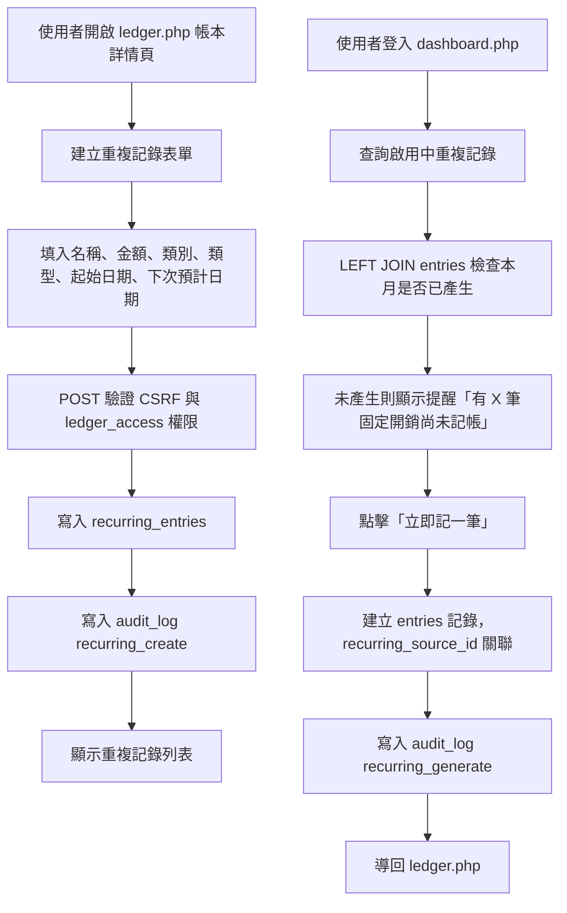
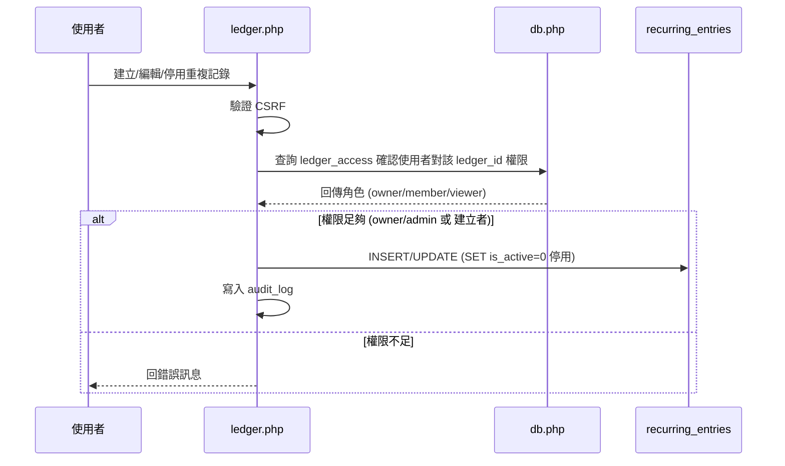

# Design: 重複記錄（固定每月開銷）

## 文件基本資訊

| 項目 | 內容 |
| --- | --- |
| 文件名稱 | Design: 重複記錄（固定每月開銷） |
| 版本 | v1.0 |
| 建立日期 | 2026-11-21 |
| 更新日期 | 2026-11-21 |
| 變更摘要 | 初始設計，依 Planning 四項功能拆解為程式修改路徑與資料庫變更 |

## 來源 Planning 與需求摘要

- Planning 檔案：`docs/recurring-entries/planning.md`
- 對應 Feature：11（重複記錄）
- 需求摘要：新增 `recurring_entries` 資料表與 `entries.recurring_source_id` 欄位；使用者可在帳本詳情頁建立、編輯、停用重複記錄；登入時檢查並提醒「立即記一筆」；點擊後產生一般 `entries` 記錄並記錄 audit_log。

## 設計概述

本設計依循專案既有設計系統與硬性約束（PDO 預備陳述式、整數分金額、CSRF、h() XSS 轉義、ledger_access 權限模型）。四個核心變更：

1. **資料庫變更**（`db.php`）：新增 `recurring_entries` 表（含 `CHECK` 約束）、`entries.recurring_source_id` 欄位，沿用現有 `PRAGMA table_info` + `ALTER TABLE` 舊資料庫遷移範式。
2. **建立／編輯／停用重複記錄**（`ledger.php`）：新增表單與處理邏輯，僅 owner/admin 或建立者可操作，CSRF 防護。
3. **登入提醒與「立即記一筆」**（`dashboard.php`、`ledger.php`）：登入時檢查本月是否有未產生的重複記錄，顯示提醒；點擊後建立 `entries` 記錄並關聯 `recurring_source_id`。
4. **audit_log 記錄**：建立重複記錄動作代碼 `recurring_create`，產生 entries 動作代碼 `recurring_generate`。

## 設計圖表（Mermaid）

### 功能整體流程圖



### 權限控管時序圖



## 程式修改路徑

| 檔案 | 修改內容 |
| --- | --- |
| `db.php` | 在 `ensureSchema()` 的 `CREATE TABLE IF NOT EXISTS audit_log` 區塊之後、`CREATE INDEX` 區塊之前，插入 `recurring_entries` 建表 SQL 與三個索引；新增 `entries.recurring_source_id` 欄位（沿用 `PRAGMA table_info` + `ALTER TABLE` 遷移範式）。 |
| `ledger.php` | 新增「建立重複記錄」表單與 POST 處理（驗證 CSRF 與 owner/admin 權限；建立時 `user_id` 寫入目前登入使用者 ID）；新增「編輯／停用」表單（編輯/停用前先 `SELECT user_id FROM recurring_entries WHERE id = ?`，確認使用者為該建立者或該帳本 owner/admin（透過 `ledger_access` 角色）後才允許 `UPDATE/SET is_active = 0`）；新增「立即記一筆」表單（先透過 `ledger_access` 確認使用者對該 `recurring_entries.ledger_id` 有存取權，再建立 `entries` 記錄，寫入 `recurring_source_id`）；查詢並顯示啟用中重複記錄列表。 |
| `dashboard.php` | 登入後查詢各可存取帳本的啟用中重複記錄，LEFT JOIN entries 檢查本月是否已產生，未產生者顯示提醒「有 X 筆固定開銷尚未記帳」並連結至 ledger.php。 |
| `assets/style.css` | 新增重複記錄表單與列表樣式（`.recurring-list`、`.recurring-item`、`.recurring-btn`），沿用既有 `.btn`、`.alert` 樣式。 |

## 資料庫變更

### 1. 新增 `recurring_entries` 表

需在 `db.php::ensureSchema()` 的 `CREATE TABLE IF NOT EXISTS audit_log` 區塊之後、`CREATE INDEX` 區塊之前插入：

```sql
CREATE TABLE IF NOT EXISTS recurring_entries (
    id             INTEGER PRIMARY KEY AUTOINCREMENT,
    ledger_id      INTEGER NOT NULL,
    user_id        INTEGER NOT NULL,
    name           TEXT    NOT NULL DEFAULT '',
    amount_cents   INTEGER NOT NULL CHECK (amount_cents > 0),
    type           TEXT    NOT NULL CHECK (type IN ('income','expense')),
    category       TEXT    NOT NULL DEFAULT '',
    start_date     TEXT    NOT NULL,
    next_due_date  TEXT    NOT NULL,
    is_active      INTEGER NOT NULL DEFAULT 1 CHECK (is_active IN (0,1)),
    created_at     TEXT    NOT NULL DEFAULT (datetime('now','localtime')),
    updated_at     TEXT    NOT NULL DEFAULT (datetime('now','localtime')),
    FOREIGN KEY (ledger_id) REFERENCES ledgers(id),
    FOREIGN KEY (user_id)   REFERENCES users(id)
);
CREATE INDEX IF NOT EXISTS idx_recurring_entries_ledger_id ON recurring_entries(ledger_id);
CREATE INDEX IF NOT EXISTS idx_recurring_entries_user_id   ON recurring_entries(user_id);
CREATE INDEX IF NOT EXISTS idx_recurring_entries_next_due  ON recurring_entries(next_due_date);
```

### 2. `entries` 表新增 `recurring_source_id` 欄位

舊資料庫遷移沿用現有 `PRAGMA table_info` + `ALTER TABLE` 範式（參照 `db.php` 第 135-171 行）：

```sql
ALTER TABLE entries ADD COLUMN recurring_source_id INTEGER;
```

（新資料庫可直接在建表時加入，或於 `ensureSchema` 中透過 `PRAGMA table_info(entries)` 檢查後補加。）

### 時區處理說明

`created_at` / `updated_at` 預設由 PHP 端以 `date('Y-m-d H:i:s')` 寫入，PHP 端須先以 `date_default_timezone_set('Asia/Taipei')` 設定時區，確保時間戳與專案硬性約束第 10 條（時區 Asia/Taipei）一致；勿單靠 SQLite `datetime('now','localtime')`（後者參考 C 執行環境 TZ 變數，cPanel 共享主機預設常為 UTC，會導致偏移 8 小時）。登入提醒的「本月」判定亦以 Asia/Taipei 為準。

## 前端變更說明

### 建立重複記錄表單

- 欄位：名稱（text）、金額（text，inputmode=decimal）、類別（select＋自訂，參照 quick-entry-assist 設計）、類型（select income/expense）、起始日期（date）、下次預計日期（date）
- 後端驗證：金額以 `toCents()` 解析後額外判斷 `$cents > 0`；起始日期與下次預計日期以 `isValidDate()` 驗證；CSRF 欄位必須存在。
- 錯誤處理：驗證失敗以 `redirect()` 導回表單，保留使用者已輸入欄位值。

### 重複記錄列表

- 顯示啟用中（`is_active = 1`）的重複記錄，包含下次預計日期、金額（`formatCents()` 格式化）、類別、類型。
- 每筆記錄有「編輯」、「停用」、「立即記一筆」按鈕。
- 「立即記一筆」為 POST 表單，含 CSRF token；提交前先透過 `ledger_access` 確認使用者對該 `recurring_entries.ledger_id` 有存取權（owner/member/viewer 均可點擊，但需驗證存取權），再建立 `entries` 記錄，寫入 `recurring_source_id`。

### 編輯／停用權限

- 僅重複記錄建立者（`recurring_entries.user_id`）或帳本 owner／站台 admin 可編輯／停用。
- 編輯時預先回填現有值（經 `h()` 轉義）。
- 停用僅設定 `is_active = 0`，不刪除記錄。

## 預期行為與驗證方法

| 驗收項 | 預期行為 | 驗證方法 |
| --- | --- | --- |
| 建立重複記錄 | 帳本擁有者可建立，儲存至 `recurring_entries`；金額不得為負數或零 | 開啟 `ledger.php`，填寫表單並提交，確認資料庫有對應記錄 |
| 編輯／停用權限 | 僅建立者或 owner/admin 可編輯／停用；member/viewer 無操作按鈕 | 以 member 角色開啟頁面，確認無編輯/停用按鈕 |
| 立即記一筆 | 建立 entries 記錄，`recurring_source_id` 寫入 `recurring_entries.id`，記錄 audit_log | 點擊按鈕後檢查 entries 表與 audit_log 表 |
| 金額負面測試 | 提交金額 0 或負數，應被 `toCents()` + `$cents > 0` 擋回，顯示錯誤訊息 | 輸入 0 或 -100 並提交，確認回錯誤 |
| 日期負面測試 | 提交無效日期（如 2026-13-01），應被 `isValidDate()` 擋回 | 輸入無效日期並提交，確認回錯誤 |
| 登入提醒 | 本月未產生的重複記錄顯示提醒，已產生者不顯示；本月判定以 Asia/Taipei 為準 | 登入 dashboard.php，確認提醒訊息；歷史月份不顯示提醒 |
| 權限隔離 | 無帳本權限者無法建立或檢視重複記錄 | 以未授權使用者存取 ledger.php，確認受阻 |

## 設計審查記錄（設計階段）

| 階段 | 狀態 | 日期 | 備註 |
| --- | --- | --- | --- |
| Spec（規格）審查 | 待審查 | — | 將本 Design 與 `planning.md` 並排核對範圍、驗收條件 |
| Code（程式）審查 | 待審查 | — | 檢查 `db.php`、`ledger.php`、`dashboard.php` 修改路徑與相容性 |
| Security（資安）審查 | 待審查 | — | 檢查 IDOR（ledger_access 權限）、XSS（`h()` 轉義）、SQL 注入（PDO 預備陳述式） |

> 設計審查三階段皆通過後方可進入實作。實作階段完成後，需在同一份 Design.md 補上「實際變更」與「驗證證據」，並執行實作審查（Spec → Code → Security）。

## 非本期範圍（Out of Scope）

- 不新增完全自動化的背景排程（cron）。
- 不支援重複記錄的自動扣款或與銀行串接。
- 不新增重複記錄的刪除入口（刪除列為後續版本）。
- 不支援每週或每季週期（本期僅每月）。

## 身分驗證與權限模型

不變更既有登入與帳本權限模型。所有查詢與修改皆透過 `ledger_access` 做 IDOR 防護：

- 建立重複記錄：僅該帳本 owner 或站台 admin。
- 編輯／停用：僅重複記錄建立者（`recurring_entries.user_id`）或帳本 owner／站台 admin。
- 檢視列表：member 與 viewer 僅可檢視，不可建立、編輯、停用。
- 所有修改皆需透過 `ledger_access` 驗證該使用者對該 `ledger_id` 的存取權，並比對 `recurring_entries.user_id`。

## 資料傳輸加密標準

無新增外部 API 呼叫。全部為伺服端 SQL 與 session 驗證，資料僅儲存在站台自身 SQLite 資料庫。

## 非功能性需求

- **效能**：`recurring_entries` 表預期資料量極小（每個帳本數十筆以內），查詢效能不成問題。
- **併發**：無資料庫寫入競合，單一使用者操作。
- **資料保留**：重複記錄為長期保留資料，不設自動刪除；刪除功能列為後續版本。
- **可用性**：資料庫寫入失敗時顯示錯誤訊息，不靜默忽略。

## 差異與待確認

與 Planning 核心需求一致，所有待確認事項於 Planning 中已鎖定：

- 僅顯示提醒，由使用者手動點擊「立即記一筆」產生 entries 記錄。
- 不預設 cron job，僅依賴登入時檢查。
- 本期僅支援每月週期，不支援每週或每季。