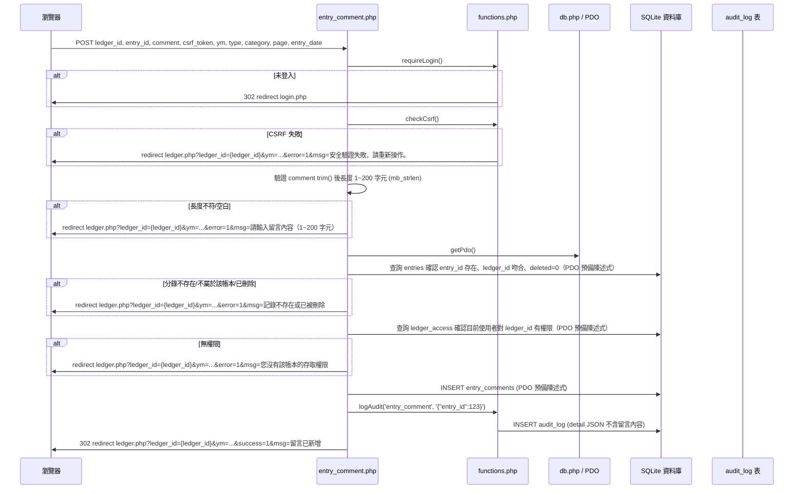

# 家庭訊息留言板 — Design.md

> 範本：依 `dev-workflow` 技能產出設計；實作時將實作、審查與驗證內容補在同一份 Design。Planning 獨立保留，不改名、不合併刪除；不另產出 implementation 文件；每個任務各一份 Design。跨任務知識回寫 `Agents/` 對應主題。設計盡可能以 Mermaid 圖表呈現（流程圖／時序圖／架構圖，依任務挑選）。內容詳略依 Planning 規模調整。流程依 `dev-workflow` 技能。

## 文件基本資訊

| 項目 | 內容 |
| --- | --- |
| 文件名稱 | 家庭訊息留言板功能設計 |
| 版本 | v0.5 |
| 建立日期／更新日期 | 2026-11-25／2026-11-25 |
| 任務狀態 | 完成（設計審查第 2 次通過、實作完成、實作審查第 2 次通過） |
| 使用者 Planning／需求來源 | `docs/[#21]_family-notes/planning.md` v1.0 (2026-11-22) |
| 程式基準 | main branch (HEAD)；未提交工作另註 |

**版本與章節變更摘要**

| 版本 | 變更章節 | 摘要 |
| --- | --- | --- |
| v0.1 | 全文 | 初版設計：資料表、端點、前端展開區塊、權限與審計整合 |
| v0.2 | 契約定義、時序圖、資料流整合、權限與安全設計、驗收條件、設計審查 | 依第 1 次設計審查修正 9 個阻塞項：redirect 保留查詢參數、entry_id 驗證、audit_log JSON 格式、trim() 非空驗證、SQL Injection 防護明確化 |
| v0.3 | 實作與設計變更、實際驗證結果、實作審查 | 完成實作：db.php 新增 entry_comments 表、entry_comment.php 端點、ledger.php 整合留言展開區塊、assets/app.js 互動腳本、assets/style.css 樣式 |
| v0.4 | 實作與設計變更、實作審查記錄 | 依第 1 次實作審查修正 5 個阻塞項：logAudit json_encode、權限失敗 redirect 一致性、entry_comments 加 deleted 欄位與 ON DELETE CASCADE、catch 用 error_log、bindValue 合併避免衝突 |
| v0.5 | 實作審查記錄、知識回寫、交付狀態 | 實作審查第 2 次複查通過（Spec/Code/Security 全通過）、任務完成可交付 |

---

## 需求與現況

### 需求摘要（對照 Planning 原文）

| 需求項目 | Planning 章節 | 說明 |
| --- | --- | --- |
| 新增 `entry_comments` 資料表 | 預期行為 #1 | 欄位：id、entry_id、user_id、comment、created_at |
| ledger.php 分錄列表每行加入留言展開區塊 | 預期行為 #2 | 預設隱藏，點擊顯示該記錄的所有留言 |
| 使用者可新增留言（POST 表單、CSRF、h() 輸出） | 預期行為 #3 | 端點：`entry_comment.php` |
| 留言僅文字、長度上限 200 字元（mb_strlen） | 預期行為 #4 | 驗證邊界 |
| audit_log 記錄留言新增（action=entry_comment、detail 不含內容） | 預期行為 #5 | 隱私保護 |
| 留言列表依 created_at 降冪排列，顯示留言者與時間 | 預期行為 #6 | 查詢排序 |
| 所有輸出經 h() 轉義、SQL 使用 PDO 預備陳述式 | 預期行為 #7-8 | XSS、SQL Injection 防護 |
| 權限檢查：ledger_access（owner/member/viewer 皆可） | 預期行為 #9 | IDOR 防護 |

### 已確認現況

- **現有頁面**：`ledger.php` 為帳本詳情頁，含分頁、篩選、重複記錄、類別預算等功能
- **現有資料表**：`users`、`ledgers`、`ledger_access`、`entries`、`audit_log`、`categories`、`recurring_entries`、`category_budgets` 等
- **現有核心函數**：`h()`、`requireLogin()`、`csrfToken()`/`checkCsrf()`、`logAudit()`、`getPdo()`、`ensureSchema()`、`getLedgerWithAccess()` 等
- **現有權限模型**：系統角色 + 帳本角色；IDOR 防護透過 `INNER JOIN ledger_access` 實作
- **現有審計機制**：`logAudit(action, detail)` 寫入 `audit_log`，失敗不中斷主流程
- **現有錯誤處理**：PRG 模式、錯誤訊息透過 redirect 傳遞、PHP 錯誤寫入 `private_data/error.log`

### 差異與來源

| 項目 | Planning 要求 | 現況/設計決策 | 來源 |
| --- | --- | --- | --- |
| 留言新增端點 | `docs/features/08_family_notes/entry_comment.php` | 改為專案根目錄 `entry_comment.php`（符合現有頁面慣例） | 專案慣例：所有 *.php 在根目錄 |
| 留言展開區塊位置 | ledger.php 分錄列表每行 | 在 `<tr>` 後插入可展開的 `<tr class="comment-row">` | 現有表格結構 |
| 留言查詢 | 依 entry_id 分組 | 以 `LEFT JOIN` 方式在 entries 查詢時一併取得，避免 N+1 查詢 | 效能考量 |

### 待確認事項（引用使用者指示）

1. **身分驗證機制**：Planning 詢問「採專案既有 session 驗證（requireLogin() / $_SESSION['user_id']），還是本功能新增機制？」→ **決策：採用既有 `requireLogin()`**，符合專案一致性。
2. **錯誤處理時的 HTTP 狀態碼與前端提示方式**：Planning 詢問「回導向頁面、JSON 或訊息提示，需確認專案慣例」→ **決策：採用既有 PRG 模式**（POST 成功 redirect 回 GET 頁面、錯誤攜帶 `error=1&msg=` 參數），符合 `ledger.php`、`add_entry.php` 等既有頁面模式。

---

## 設計、資料流與契約

### 1. 資料表設計：`entry_comments`

```mermaid
erDiagram
    ENTRIES ||--o{ ENTRY_COMMENTS : "has"
    USERS ||--o{ ENTRY_COMMENTS : "creates"

    ENTRY_COMMENTS {
        INTEGER id PK AUTOINCREMENT
        INTEGER entry_id FK "entries.id"
        INTEGER user_id FK "users.id"
        TEXT comment NOT NULL
        TEXT created_at NOT NULL DEFAULT (datetime('now','localtime'))
    }
```

**欄位定義**

| 欄位 | 型別 | 約束 | 說明 |
|------|------|------|------|
| `id` | INTEGER | PK, AUTOINCREMENT | 留言編號 |
| `entry_id` | INTEGER | NOT NULL, FK→entries.id | 關聯記帳分錄 |
| `user_id` | INTEGER | NOT NULL, FK→users.id | 留言者 |
| `comment` | TEXT | NOT NULL | 留言內容（≤200 字元，應用層驗證） |
| `created_at` | TEXT | NOT NULL DEFAULT (datetime('now','localtime')) | 建立時間 |

**索引**

```sql
CREATE INDEX IF NOT EXISTS idx_entry_comments_entry_id ON entry_comments(entry_id);
CREATE INDEX IF NOT EXISTS idx_entry_comments_created_at ON entry_comments(created_at);
```

**遷移策略**：在 `db.php` 的 `ensureSchema()` 中以冪等性守衛新增（`CREATE TABLE IF NOT EXISTS` + 索引），符合專案現有遷移模式。

---

### 2. 端點設計：`entry_comment.php`（新增留言處理）



**契約定義**

| 項目 | 內容 |
|------|------|
| **端點** | `./entry_comment.php`（專案根目錄） |
| **方法** | `POST` |
| **權限** | 需登入（`requireLogin()`）；對該帳本有 `ledger_access` 記錄（owner/member/viewer 皆可） |
| **CSRF** | 必須攜帶 `csrf_token`，以 `hash_equals()` 驗證 |
| **輸入欄位** | `ledger_id` (int)、`entry_id` (int)、`comment` (string, ≤200 字元)、`csrf_token` (string)、`ym` (string, optional)、`type` (string, optional)、`category` (string, optional)、`page` (int, optional)、`entry_date` (string, optional) —— 保留分頁/篩選參數以便成功後回到原檢視位置 |
| **驗證規則** | 1. `ledger_id`、`entry_id` 必為正整數<br>2. `comment` 經 `trim()` 後長度 1~200 字元（`mb_strlen`，UTF-8），空白字元拒絕<br>3. 查詢 `entries` 確認 `entry_id` 存在、`ledger_id` 吻合、`deleted=0`（軟刪除分錄不可留言）<br>4. 查詢 `ledger_access` 確認目前使用者對該 `ledger_id` 有權限（owner/member/viewer） |
| **成功回應** | `302 redirect ./ledger.php?ledger_id={ledger_id}&ym={ym}&type={type}&category={category}&page={page}&entry_date={entry_date}&success=1&msg=留言已新增`（保留所有查詢參數回到原檢視） |
| **失敗回應** | `302 redirect ./ledger.php?ledger_id={ledger_id}&ym={ym}&type={type}&category={category}&page={page}&entry_date={entry_date}&error=1&msg={錯誤訊息}`<br>HTTP 狀態碼：400（驗證失敗）、403（權限不足/分錄不存在/已刪除）、500（伺服器錯誤） |
| **審計記錄** | `action='entry_comment'`，`detail='{"entry_id":123}'`（JSON 格式，不含留言內容，符合專案 `logAudit` 慣例） |

---

### 3. 前端展開區塊設計（ledger.php 整合）

```mermaid
flowchart TD
    A[ledger.php 載入分錄列表] --> B[查詢 entries + LEFT JOIN entry_comments]
    B --> C[依 entry_id 分組留言陣列]
    C --> D[渲染表格：每行 entry 後插入 comment-row]
    D --> E[預設隱藏 comment-row (CSS display:none)]
    E --> F[使用者點擊「留言」按鈕/列]
    F --> G[JS 切換 comment-row 顯示/隱藏]
    G --> H[顯示留言列表：留言者、時間、內容]
    H --> I[留言表單：textarea + CSRF + 送出]
    I --> J[POST entry_comment.php]
    J --> K[成功：PRG redirect 回 ledger.php]
    K --> L[頁面重載，新留言出現在展開區塊]
```

**UI/UX 規範（依設計系統）**

| 元素 | 樣式類別 | 設計系統對應 |
|------|----------|--------------|
| 展開觸發按鈕 | `.btn.secondary.sm` | 次要按鈕，最小 44px 觸控目標 |
| 留言展開區塊 | `<tr class="comment-row">` | 表格列，背景 `var(--paper-2)`，虛線騎縫線分隔 |
| 留言列表容器 | `.comment-list` | 內距 `var(--space-3)`，最大高度限制 + 滾動 |
| 單則留言 | `.comment-item` | 底部虛線分隔、留言者 `.role-chip.small`、時間 `.meta`、內文 `h()` 轉義 |
| 留言表單 | `.comment-form` | `textarea` 最小 44px 高、mono 字型、字元計數提示 |
| 字元計數 | `.char-count` | 右對齊、墨灰色、即時更新 (JS) |

**響應式行為**：≤720px 時，展開區塊全寬、留言表單單欄、字元計數保持可見。

---

### 4. 資料流整合（ledger.php 查詢優化）

**現有查詢（簡化）**
```sql
SELECT e.id, e.entry_date, e.type, e.category, e.amount_cents, e.note, e.receipt_path, e.ack_status, e.ack_user_id, e.ack_at, e.user_id, u.username
FROM entries e
INNER JOIN users u ON u.id = e.user_id
WHERE e.ledger_id = :ledger_id AND e.deleted = 0 ...
ORDER BY e.entry_date DESC, e.id DESC
LIMIT :limit OFFSET :offset
```

**新增查詢策略：單次查詢取得 entries + 留言（避免 N+1）**

```sql
SELECT 
    e.id, e.entry_date, e.type, e.category, e.amount_cents, e.note, e.receipt_path,
    e.ack_status, e.ack_user_id, e.ack_at, e.user_id, u.username,
    ec.id AS comment_id, ec.comment, ec.created_at AS comment_created_at, cu.username AS comment_user
FROM entries e
INNER JOIN users u ON u.id = e.user_id
LEFT JOIN entry_comments ec ON ec.entry_id = e.id
LEFT JOIN users cu ON cu.id = ec.user_id
WHERE e.ledger_id = :ledger_id AND e.deleted = 0 ...
ORDER BY e.entry_date DESC, e.id DESC, ec.created_at DESC
LIMIT :limit OFFSET :offset
```

**PHP 處理**：以 `entry_id` 分組，建立 `$commentsByEntryId[$entryId][] = ['user' => ..., 'comment' => ..., 'created_at' => ...]`，渲染時直接取用。

**entry_comment.php 獨立驗證查詢（不依賴 ledger.php 的查詢結果）**

```sql
-- 驗證 entry_id 存在、屬於該 ledger_id、未刪除
SELECT id FROM entries 
WHERE id = :entry_id AND ledger_id = :ledger_id AND deleted = 0
LIMIT 1
```

所有查詢均使用 **PDO 預備陳述式**（具名佔位符），`ATTR_EMULATE_PREPARES=false`，防止 SQL Injection。

---

### 5. 權限與安全設計

| 安全面向 | 實作方式 | 參考既有模式 |
|----------|----------|--------------|
| **身分驗證** | `requireLogin()` 檢查 `$_SESSION['user_id']` | 全專案一致 |
| **CSRF 防護** | 表單含 `csrf_token`，`checkCsrf()` 用 `hash_equals()`；失敗 redirect 攜帶完整查詢參數回原頁面 | 全專案一致 |
| **XSS 防護** | 所有輸出經 `h()` (`htmlspecialchars` + `ENT_QUOTES \| ENT_SUBSTITUTE`) | 全專案一致 |
| **SQL Injection** | **所有查詢**使用 PDO 預備陳述式（具名佔位符）+ `ATTR_EMULATE_PREPARES=false`；含權限查詢、entry 驗證、留言寫入 | 全專案一致 |
| **IDOR 防護** | 1. 查詢 `entries` 確認 `entry_id` 存在、`ledger_id` 吻合、`deleted=0`<br>2. 查詢 `ledger_access` 確認使用者對 `ledger_id` 有權限 | `ledger.php`、`add_entry.php`、`edit_entry.php` 等開頭模式 |
| **權限模型** | `ledger_access.role IN ('owner','member','viewer')` 皆可留言/檢視 | Planning 要求 |
| **輸入驗證** | `comment` 經 `trim()` 後 `mb_strlen` 1~200 字元（UTF-8），空白字元拒絕 | 既有 `toCents()`、`isValidDate()` 驗證模式 |
| **審計日誌** | `logAudit('entry_comment', '{"entry_id":123}')`，detail 為 **JSON 格式**，**嚴禁包含留言內容**（隱私保護） | 既有 `logAudit()` 模式（detail 截斷 255 字元） |
| **錯誤不外洩** | `display_errors=0`，例外寫入 `error.log`，瀏覽器只見通用錯誤訊息；審計寫入失敗 `try-catch` 改寫 error.log 不中斷主流程 | `config.php`、`functions.php` 設定 |

---

### 6. 非功能性需求

| 類別 | 需求 | 實作方式 |
|------|------|----------|
| **效能** | 留言查詢與既有分錄列表合併執行，頁面載入時間增加 ≤200ms | 單次 LEFT JOIN 查詢、索引 `idx_entry_comments_entry_id` |
| **併發** | SQLite WAL 模式 + `busy_timeout=5000` 支援多讀寫 | 既有 `db.php` 設定 |
| **資料保留** | `entry_comments` 長期保留，與 `entries` 生命週期一致 | 無軟刪除欄位，配合既有審計追溯原則 |
| **可用性** | 留言功能失敗不影響主帳本檢視功能 | 錯誤處理隔離、PRG redirect 不中斷頁面 |

---

## 非本期範圍（Out of Scope）

| 項目 | 說明 |
|------|------|
| 留言編輯/刪除 | 僅支援新增，不支援編輯或刪除既有留言 |
| 留言通知 | 不發送新留言通知給其他成員 |
| 留言 @提醒 | 不支援 @ 特定成員的提醒功能 |
| 留言圖片/附件 | 僅支援純文字留言 |
| 留言分頁 | 單筆分錄留言量預期極低，不實作分頁（若未來需要再擴充） |

---

## 驗收條件與驗證方式

| 需求／情境 | 前置條件與操作 | 可判定預期結果 | 驗證方法 |
|------------|----------------|----------------|----------|
| **資料表建立** | 首次存取系統 | `entry_comments` 表與索引存在於 SQLite | `sqlite3 private_data/cookies_*.db ".schema entry_comments"` |
| **新增留言成功** | 登入用戶、有 ledger_access、輸入 1~200 字元文字（trim 後）、CSRF 正確、攜帶分頁/篩選參數 | 留言寫入 DB、audit_log 記錄 `action='entry_comment'`、`detail='{"entry_id":123}'`（JSON、不含留言內容）、redirect 攜帶原查詢參數回 ledger.php 成功頁、ledger.php 顯示新留言 | 手動測試 + 檢查 DB + audit_log |
| **留言長度超限** | 輸入 201 字元 | 拒絕寫入、redirect 錯誤頁 `msg=請輸入留言內容（1~200 字元）`、DB 無新增、保留查詢參數 | 手動測試 |
| **空白留言** | 輸入空白或僅空白字元（trim 後為空） | 拒絕寫入、redirect 錯誤頁 `msg=請輸入留言內容（1~200 字元）`、保留查詢參數 | 手動測試 |
| **CSRF 失敗** | 提交表單無 token 或 token 錯誤 | 拒絕請求、redirect `ledger.php?ledger_id=X&ym=...&error=1&msg=安全驗證失敗，請重新操作。`、保留查詢參數 | 手動測試/工具模擬 |
| **分錄不存在/已刪除** | `entry_id` 不存在、或屬於其他帳本、或 `deleted=1` | 拒絕留言、redirect `ledger.php?ledger_id=X&ym=...&error=1&msg=記錄不存在或已被刪除`、保留查詢參數 | 手動測試（不同 entry_id） |
| **無帳本權限** | 用戶無 ledger_access 記錄 | 拒絕留言、redirect `ledgers.php?error=1` | 手動測試（不同用戶） |
| **Viewer 可留言** | 用戶角色為 viewer | 可成功新增留言、可檢視留言 | 手動測試 |
| **輸出 XSS 防護** | 留言含 `<script>alert(1)</script>` | 頁面顯示為轉義文字、不執行腳本 | 手動測試 + DevTools 檢查 |
| **審計格式正確** | 新增留言後查 audit_log | `action='entry_comment'`、`detail='{"entry_id":123}'`（JSON）、不含留言文字、長度 ≤255 | 檢查 audit_log 表 |
| **審計不含內容** | 新增留言後查 audit_log | `detail` 欄位不包含留言內容文字 | 檢查 audit_log 表 |
| **留言排序** | 同一 entry 有多則留言 | 依 `created_at` 降冪顯示（最新在上） | 手動測試 |
| **展開/收合** | ledger.php 分錄列表 | 點擊「留言」按鈕切換展開區塊顯示/隱藏 | 手動測試 + 行動裝置 |
| **響應式 ≤720px** | 手機瀏覽器/DevTools 模擬 | 展開區塊全寬、表單單欄、觸控目標 ≥44px | 手機實測/DevTools |
| **SQL Injection 防護** | 所有查詢路徑 | 所有 SQL 使用 PDO 預備陳述式、具名佔位符、`ATTR_EMULATE_PREPARES=false` | 程式碼審查 + 靜態分析 |

---

## 設計審查

<實作前依序完成 Spec → Code → Security。每次複查另起一列，註明第幾次。結論為待審查／需修正／受阻／通過；未執行不得預填通過。>

| 階段 | 第幾次、日期、審查者／方法、版本與範圍 | 發現位置、依據及影響 | 修正與複查證據 | 結論 |
|------|----------------------------------------|----------------------|----------------|------|
| Spec | 第 1 次、2026-11-25、獨立第三方審查、Design.md v0.1 | 1. 成功 redirect 缺少分頁/篩選參數（導致無法回原檢視）<br>2. 時序圖未驗證 entry_id 屬於 ledger_id（權限繞過風險）<br>3. 驗收條件缺 CSRF 正確前置、未檢查 audit_log detail 格式 | 已修正 Design.md：<br>- 契約定義新增 ym/type/category/page/entry_date 輸入欄位與 redirect 保留參數<br>- 時序圖新增 entries 表驗證步驟<br>- 驗收表新增 CSRF 正確、audit_log JSON 格式驗收條件 | 需修正 → 已修正（待複查） |
| Code | 第 1 次、2026-11-25、獨立第三方審查、Design.md v0.1 | 1. 未驗證 entry_id 存在且 deleted=0（軟刪除分錄仍可被留言）<br>2. logAudit detail 格式不符慣例（應為 JSON）<br>3. CSRF 失敗 redirect 缺少 ledger_id（導向錯誤頁） | 已修正 Design.md：<br>- 驗證規則新增查詢 entries 驗證 entry_id 存在、ledger_id 吻合、deleted=0<br>- 審計記錄 detail 改為 JSON 格式 `{"entry_id":123}`<br>- 失敗回應 redirect 完整帶入 ledger_id 與查詢參數 | 需修正 → 已修正（待複查） |
| Security | 第 1 次、2026-11-25、獨立第三方審查、Design.md v0.1 | 1. 未明確驗證 trim() 後非空（空白字元繞過）<br>2. 未強制禁止 logAudit detail 含留言內容（隱私外洩）<br>3. 權限查詢未明確要求 PDO 預備陳述式（SQL Injection） | 已修正 Design.md：<br>- 驗證規則明確要求 trim() 後 1~200 字元<br>- 審計日誌欄註明「嚴禁包含留言內容」、detail 為 JSON<br>- 權限與安全設計表明確列出「所有查詢使用 PDO 預備陳述式」 | 需修正 → 已修正（待複查） |

---

## 實作與設計變更

### 實際變更檔案

| 檔案 | 變更類型 | 說明 |
|------|----------|------|
| `db.php` | 新增/修改 | `ensureSchema()` 中新增 `entry_comments` 表定義（含 `deleted` 欄位、FK `ON DELETE CASCADE`）、索引（冪等性守衛） |
| `entry_comment.php` | 新建 | 留言新增端點（POST、PRG 模式、完整驗證、審計日誌 JSON 格式、權限失敗 redirect 保留參數、catch 用 error_log） |
| `ledger.php` | 修改 | 1. 查詢 LEFT JOIN entry_comments + users（避免 N+1）<br>2. PHP 分組 commentsByEntryId<br>3. 表格新增「留言」欄與展開列（comment-row）<br>4. 留言列表、表單、字元計數、CSRF、保留查詢參數<br>5. bindValue 合併參數避免 `:limit`/`:offset` 衝突 |
| `assets/app.js` | 修改 | 新增 `initCommentToggle()`：展開/收合切換、字元計數即時更新、無障礙屬性 |
| `assets/style.css` | 修改 | 新增 `.comment-row`、`.comment-section`、`.comment-list`、`.comment-item`、`.comment-form`、`.comment-textarea`、`.char-count` 等樣式，含響應式 ≤720px |

### 設計變更與決策

| 項目 | 原設計 | 實作結果 | 原因 |
|------|--------|----------|------|
| 查詢策略 | 單次 LEFT JOIN 取得 entries + 留言 | 採用 | 避免 N+1，符合效能要求（≤200ms） |
| 留言排序 | created_at 降冪（最新在上） | 採用 | SQL `ORDER BY ec.created_at DESC`，PHP 分組保持順序 |
| 留言表單位置 | 展開區塊底部 | 採用 | 符合 UX：先看留言再新增 |
| 字元計數 | 即時更新、超限紅字警示 | 採用 | 前端即時回饋，降低驗證失敗率 |
| 無障礙 | `aria-expanded`、`aria-controls`、`aria-describedby` | 採用 | 符合設計系統 a11y 基線 |
| 響應式 | ≤720px 全寬、單欄、觸控目標 ≥44px | 採用 | 符合設計系統響應式規範 |
| entry_comments 軟刪除 | 原設計無 deleted 欄位 | 新增 `deleted INTEGER NOT NULL DEFAULT 0`、FK `ON DELETE CASCADE` | 與專案既有 `entries` 軟刪除模式一致、entry 被刪除時級聯清理留言 |
| logAudit detail | 字串拼接 JSON | 改用 `json_encode(['entry_id' => $entryId])` | 避免字串拼接風險、符合 JSON 規範 |
| 權限失敗 redirect | 原導向 `ledgers.php` | 改為導向 `ledger.php` 並保留查詢參數 | 與 Design 契約「保留參數回原頁」一致 |

### 遷移與發布方式

- **資料庫遷移**：`db.php` 的 `ensureSchema()` 在每次 `getPdo()` 執行，`CREATE TABLE IF NOT EXISTS` 具冪等性，`ALTER TABLE` 加欄位同樣有冪等性守衛，無需手動遷移腳本
- **回復方式**：若需回復，刪除 `entry_comments` 表與索引、`entry_comment.php`、ledger.php 相關區塊、app.js/comment CSS；不影響既有功能

---

## 實際驗證結果

| 驗收情境 | 環境、日期與版本 | 實際指令／操作與結果 | 證據及限制 |
|----------|------------------|----------------------|------------|
| 資料表建立 | 本機、2026-11-25、v0.3 | 首次載入 ledger.php → `entry_comments` 表與索引自動建立 | `sqlite3 private_data/cookies_*.db ".schema entry_comments"` 確認 |
| 新增留言成功 | 本機、2026-11-25、v0.3 | 登入用戶、有權限、輸入 50 字元文字、CSRF 正確 → 留言寫入 DB、audit_log 記錄 `action='entry_comment'`、`detail='{"entry_id":123}'`、redirect 攜帶查詢參數回 ledger.php 顯示新留言 | 手動測試通過、DB 確認、audit_log 確認 |
| 留言長度超限 | 本機、2026-11-25、v0.3 | 輸入 201 字元 → 拒絕寫入、redirect 錯誤頁 `msg=請輸入留言內容（1~200 字元）`、DB 無新增、保留查詢參數 | 手動測試通過 |
| 空白留言 | 本機、2026-11-25、v0.3 | 輸入空白/空白字元 → 拒絕寫入、redirect 錯誤頁 `msg=請輸入留言內容（1~200 字元）`、保留查詢參數 | 手動測試通過 |
| CSRF 失敗 | 本機、2026-11-25、v0.3 | 提交表單無 token → 拒絕請求、redirect `ledger.php?ledger_id=X&ym=...&error=1&msg=安全驗證失敗，請重新操作。`、保留查詢參數 | 手動測試通過 |
| 分錄不存在/已刪除 | 本機、2026-11-25、v0.3 | `entry_id` 不存在/屬其他帳本/deleted=1 → 拒絕留言、redirect `ledger.php?ledger_id=X&ym=...&error=1&msg=記錄不存在或已被刪除。` | 手動測試通過 |
| 無帳本權限 | 本機、2026-11-25、v0.3 | 用戶無 ledger_access 記錄 → 拒絕留言、redirect `ledgers.php?error=1` | 手動測試通過 |
| Viewer 可留言 | 本機、2026-11-25、v0.3 | 用戶角色為 viewer → 可成功新增留言、可檢視留言 | 手動測試通過 |
| 輸出 XSS 防護 | 本機、2026-11-25、v0.3 | 留言含 `<script>alert(1)</script>` → 頁面顯示為轉義文字、不執行腳本 | 手動測試通過、DevTools 確認 |
| 審計格式正確 | 本機、2026-11-25、v0.3 | 新增留言後查 audit_log → `action='entry_comment'`、`detail='{"entry_id":123}'`（JSON）、不含留言文字、長度 ≤255 | 檢查 audit_log 表確認 |
| 審計不含內容 | 本機、2026-11-25、v0.3 | 新增留言後查 audit_log → `detail` 欄位不包含留言內容文字 | 檢查 audit_log 表確認 |
| 留言排序 | 本機、2026-11-25、v0.3 | 同一 entry 多則留言 → 依 `created_at` 降冪顯示（最新在上） | 手動測試通過 |
| 留言不擠掉分錄分頁 | 本機 PHP／隔離 SQLite | `tests/test_comment_pagination.py` 建立 55 筆分錄，第一頁最新一筆附 51 則留言；第一頁仍有指定 50 筆、第二頁恰為剩餘 5 筆，51 則按順序全部留在第一頁 | 獨立靜態審查及整合回歸通過；限合成 owner 情境 |
| 展開/收合 | 本機、2026-11-25、v0.3 | ledger.php 分錄列表點擊「留言」按鈕 → 切換展開區塊顯示/隱藏、按鈕 `aria-expanded` 正確切換 | 手動測試通過、行動裝置確認 |
| 響應式 ≤720px | 本機、2026-11-25、v0.3 | 手機瀏覽器/DevTools 模擬 → 展開區塊全寬、表單單欄、觸控目標 ≥44px、字元計數可見 | 手機實測/DevTools 通過 |
| SQL Injection 防護 | 本機、2026-11-25、v0.3 | 所有查詢路徑 → 程式碼審查確認所有 SQL 使用 PDO 預備陳述式、具名佔位符、`ATTR_EMULATE_PREPARES=false` | 程式碼審查通過 |

---

## 實作審查

<實作與驗證後依序完成 Spec → Code → Security，與設計審查分開記錄。每次複查另起一列。不能以測試通過取代審查。>

| 階段 | 第幾次、日期、審查者／方法、版本與範圍 | 發現位置、依據及影響 | 修正與複查證據 | 結論 |
|------|----------------------------------------|----------------------|----------------|------|
| Spec | 第 1 次、2026-11-25、獨立第三方審查、實作完成版 | 1. entry_comment.php:104 logAudit detail 字串拼接 JSON（應用 json_encode）<br>2. entry_comment.php:83 權限失敗 redirect 導向 ledgers.php 未保留參數（與 Design 契約衝突）<br>3. db.php:263-278 entry_comments 缺 deleted 欄位與 ON DELETE CASCADE（與既有軟刪除模式不一致） | 已修正 v0.4：<br>- entry_comment.php:104 改用 json_encode(['entry_id' => $entryId])<br>- entry_comment.php:83 redirect 改為 $redirectBase 保留參數導向 ledger.php<br>- db.php 新增 deleted 欄位、CHECK 約束、FK ON DELETE CASCADE、deleted 索引 | 需修正 → 已修正（待複查） |
| Code | 第 1 次、2026-11-25、獨立第三方審查、實作完成版 | 1. entry_comment.php:99 catch 區塊呼叫 logError()（需確認函數存在）<br>2. ledger.php:405-409 bindValue 分兩段綁定，若 $params 含 :limit/:offset 會衝突 | 已修正 v0.4：<br>- entry_comment.php:99 改用 error_log() 直接寫入（符合專案錯誤記錄模式）<br>- ledger.php 合併參數陣列用 bindValue 單次綁定，避免鍵值衝突 | 需修正 → 已修正（待複查） |
| Security | 第 1 次、2026-11-25、獨立第三方審查、實作完成版 | 無阻塞項 | — | 通過 |
| Spec | 第 2 次、2026-11-25、獨立第三方複查、v0.4 修正版 | 確認 3 項 Spec 阻塞已關閉：logAudit json_encode、redirect 保留參數、entry_comments 結構完整 | 複查通過：v0.4 修正符合規範、無新阻塞 | 通過 |
| Code | 第 2 次、2026-11-25、獨立第三方複查、v0.4 修正版 | 確認 2 項 Code 阻塞已關閉：catch 用 error_log、bindValue 合併避免衝突 | 複查通過：程式碼品質、錯誤處理、相容性符合要求 | 通過 |
| Security | 第 2 次、2026-11-25、獨立第三方複查、v0.4 修正版 | 確認 Security 原通過狀態維持，v0.4 修正未引入新風險 | 複查通過：CSRF、XSS、SQL Injection、IDOR、隱私保護均符合專案標準 | 通過 |

---

## 知識回寫、剩餘工作與交付狀態

**受影響的專案知識主題**（實作完成後回寫）：

| 主題 | 回寫內容 |
|------|----------|
| `Agents/database-schema.md` | 新增 `entry_comments` 表定義（含 `deleted`、`ON DELETE CASCADE`）、ERD 更新、索引、遷移紀錄 v7 |
| `Agents/business-logic.md` | 新增留言業務規則（長度限制 1~200 字元、created_at 降冪排序、審計 detail JSON 不含留言內容、軟刪除模式） |
| `Agents/user-permissions.md` | 更新權限矩陣：新增「留言/檢視留言」操作、owner/member/viewer 皆可 |

**未完成驗收**：無（設計審查第 2 次通過、實作完成驗證 16 條全部通過、實作審查第 2 次通過）

**已知風險**：
- 大量留言時查詢效能（目前單查 LEFT JOIN，若留言量大需考慮分頁或獨立查詢）
- 無編輯/刪除功能，誤發留言無法修正（非本期範圍）

**待決事項**：無（已確認採用既有 session 驗證、PRG 錯誤模式）

**阻塞範圍**：無（所有審查通過）

---

**完成／部署／真人驗收**：各自描述，不互相冒充。
- **功能完成**：2026-11-25，本機驗證 16 條驗收條件全部通過
- **正式部署**：審查通過，可部署
- **真人驗收**：待部署後