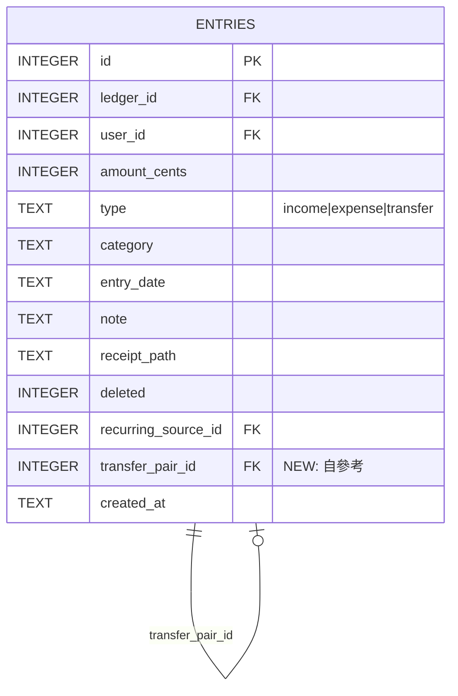
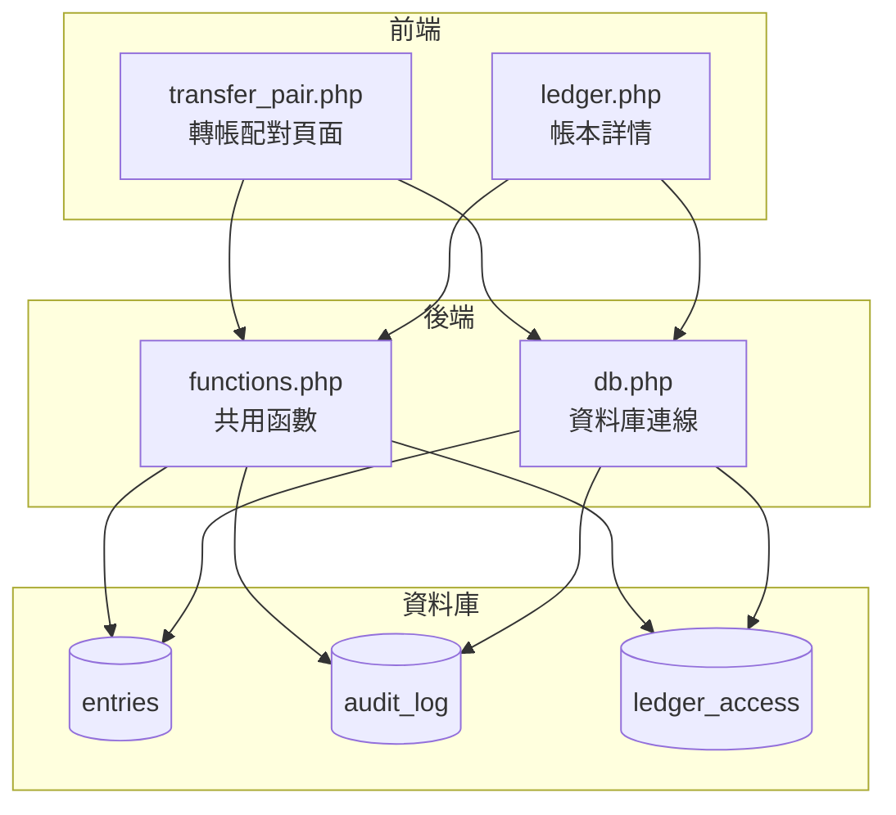
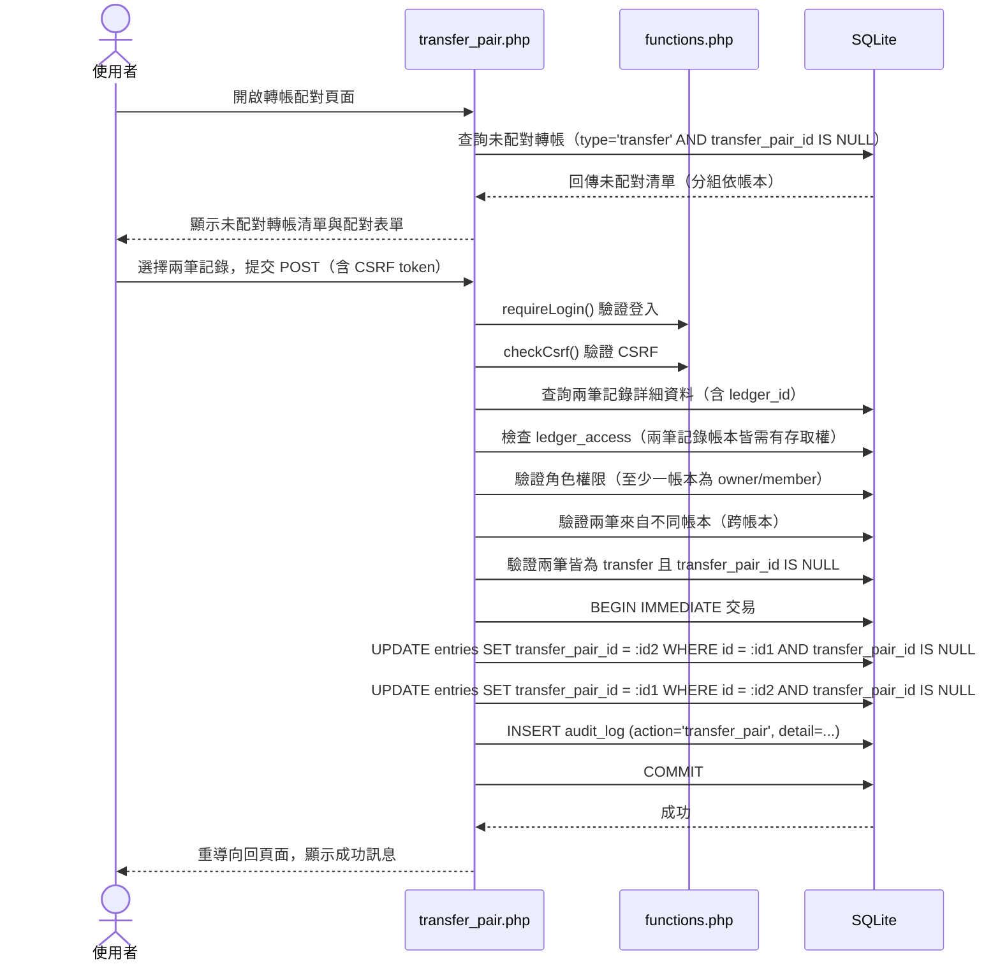

# 多帳本轉帳對帳 — Design.md

> 本文件為設計文件，合併實作細節與驗收結果。

---

## 1. 概覽

### 1.1 任務編號
`[#22]`

### 1.2 功能描述
當一筆「轉帳」記錄在 A 帳本支出、B 帳本收入時，可將兩筆關聯，顯示對帳狀態（已配對/未配對），解決跨帳本轉帳難對帳問題。

### 1.3 設計目標
- 在 `entries` 表新增 `transfer_pair_id` 欄位（自參考，可為 NULL），兩筆轉帳互為對應
- 建立 `transfer_pair.php` 頁面顯示未配對轉帳清單並提供配對表單
- 配對後兩筆記錄的 `transfer_pair_id` 互為對方 id，狀態顯示「已配對」
- 稽查記錄表（`audit_log`）記錄配對動作，`action = 'transfer_pair'`
- 所有輸出經 `h()` 轉義，SQL 使用 PDO 預備陳述式
- 權限檢查：使用者對兩筆記錄所屬帳本皆有 `ledger_access`

---

## 2. 資料庫設計

### 2.1 Schema 變更

#### entries 表新增欄位

| 欄位 | 型別 | 約束 | 說明 |
|------|------|------|------|
| `transfer_pair_id` | INTEGER | NULLABLE, FK→entries.id | 轉帳配對對象 ID，自參考外鍵，NULL 表示未配對 |

#### 索引
- `idx_entries_transfer_pair_id` ON `entries(transfer_pair_id)` — 查詢配對關聯用

### 2.2 Migration 腳本（db.php 內 ensureSchema）

```sql
-- 檢查欄位是否存在
PRAGMA table_info(entries);

-- 新增欄位（冪等性守衛）
ALTER TABLE entries ADD COLUMN transfer_pair_id INTEGER;

-- 新增索引
CREATE INDEX IF NOT EXISTS idx_entries_transfer_pair_id ON entries(transfer_pair_id);
```

> **注意**：SQLite 不支援直接加入 FK 參考同一張表的欄位並啟用外鍵約束，應用層負責維護資料完整性。

### 2.3 ERD 更新



---

## 3. 系統架構

### 3.1 元件圖



### 3.2 頁面對應

| 頁面 | 用途 | 權限 |
|------|------|------|
| `./transfer_pair.php` | 轉帳配對主頁面（列出未配對、提供配對表單） | 登入用戶，需有相關帳本存取權 |
| `./ledger.php` | 既有帳本詳情，新增「未配對轉帳」區塊 | 既有權限邏輯 |

---

## 4. 資料流設計

### 4.1 配對流程



### 4.2 錯誤處理流程

```mermaid
flowchart TD
    A[提交配對請求] --> B{登入檢查}
    B -->|失敗| C[導向 login.php]
    B -->|成功| D{CSRF 驗證}
    D -->|失敗| E[403 錯誤：安全驗證失敗]
    D -->|成功| F{記錄存在且為 transfer}
    F -->|否| G[錯誤：找不到對應的轉帳記錄]
    F -->|是| H{transfer_pair_id 為 NULL}
    H -->|否| I[錯誤：該記錄已配對，不可重複配對]
    H -->|是| J{雙帳本存取權限}
    J -->|否| K[403 錯誤：您沒有這兩筆記錄的存取權限]
    J -->|是| L{角色權限 owner/member}
    L -->|否| M[錯誤：權限不足，需為擁有者或成員]
    L -->|是| N{來自不同帳本}
    N -->|否| O[錯誤：配對的兩筆轉帳必須來自不同帳本]
    N -->|是| P[資料庫交易：雙向 UPDATE(樂觀鎖) + audit_log]
    P -->|成功| Q[重導向，顯示成功]
    P -->|失敗/競態| R[ROLLBACK，寫入 error.log，顯示通用錯誤]
```

---

## 5. 介面設計

### 5.1 transfer_pair.php 頁面結構

```
┌─────────────────────────────────────────────────────────────┐
│ 側欄導覽 (既有 side nav)                                      │
├─────────────────────────────────────────────────────────────┤
│ 主內容區                                                       │
│ ┌─────────────────────────────────────────────────────────┐  │
│ │ 頁首：轉帳配對 · 返回儀表板                                 │  │
│ ├─────────────────────────────────────────────────────────┤  │
│ │ 成功/錯誤訊息區（alert success/error）                    │  │
│ ├─────────────────────────────────────────────────────────┤  │
│ │ 未配對轉帳清單（依帳本分組）                              │  │
│ │ ┌─────────────────────────────────────────────────────┐ │  │
│ │ │ 帳本 A (擁有者)                                         │ │  │
│ │ │ ├ 轉-005  2026-11-20  支出  -5,000 元  備註：轉給媽媽 │ │  │
│ │ │ ├ 轉-012  2026-11-18  支出  -3,000 元  備註：房租   │ │  │
│ │ │ └ ...                                                  │ │  │
│ │ └─────────────────────────────────────────────────────┘ │  │
│ │ ┌─────────────────────────────────────────────────────┐ │  │
│ │ │ 帳本 B (成員)                                           │ │  │
│ │ │ ├ 轉-003  2026-11-20  收入  +5,000 元  備註：爸爸轉帳 │ │  │
│ │ │ └ ...                                                  │ │  │
│ │ └─────────────────────────────────────────────────────┘ │  │
│ ├─────────────────────────────────────────────────────────┤  │
│ │ 配對表單（固定在頁面下方）                                │  │
│ │ ┌─────────────────────────────────────────────────────┐ │  │
│ │ │ 選擇第一筆轉帳 [下拉選單：所有未配對轉帳]             │ │  │
│ │ │ 選擇第二筆轉帳 [下拉選單：所有未配對轉帳]             │ │  │
│ │ │ 差額預覽：自動計算並顯示（若金額不等）                │ │  │
│ │ │ [配對按鈕] [取消按鈕]                                 │ │  │
│ │ └─────────────────────────────────────────────────────┘ │  │
│ └─────────────────────────────────────────────────────────┘  │
└─────────────────────────────────────────────────────────────┘
```

### 5.2 ledger.php 新增區塊：未配對轉帳提醒

在帳本詳情頁面（`ledger.php`）的篩選表單上方，新增一個摺疊區塊：

```html
<details class="unpaired-transfers" open>
    <summary>⚠ 未配對轉帳 (<span id="unpaired-count">N</span> 筆)</summary>
    <div class="unpaired-list">
        <!-- 只屬於當前帳本的未配對轉帳 -->
        <a href="./transfer_pair.php" class="btn primary sm">前往配對</a>
    </div>
</details>
```

---

## 6. API / 表單規格

### 6.1 GET ./transfer_pair.php

**查詢參數**：無

**回應**：HTML 頁面，包含：
- 未配對轉帳清單（依帳本分組，每筆顯示：傳票編號、日期、類型、金額、備註、帳本名稱）
- 配對表單（兩個 `<select>`，options 為未配對轉帳的 id）

### 6.2 POST ./transfer_pair.php

**表單欄位**：

| 欄位 | 型別 | 必填 | 說明 |
|------|------|------|------|
| `action` | string | 是 | 固定為 `pair_transfer` |
| `csrf_token` | string | 是 | CSRF Token |
| `entry_id_1` | integer | 是 | 第一筆轉帳記錄 ID |
| `entry_id_2` | integer | 是 | 第二筆轉帳記錄 ID |

**成功回應**：HTTP 302 重導向 `./transfer_pair.php?success=1&msg=...`

**失敗回應**：HTTP 302 重導向 `./transfer_pair.php?error=1&msg=...`

---

## 7. 關鍵程式邏輯

### 7.1 查詢未配對轉帳（供 transfer_pair.php 使用）

```php
// 查詢使用者有存取權的帳本中，所有未配對的轉帳
$stmt = $pdo->prepare('
    SELECT e.id, e.ledger_id, l.name AS ledger_name, e.entry_date, e.type,
           e.amount_cents, e.category, e.note, e.user_id, u.username
    FROM entries e
    INNER JOIN ledgers l ON l.id = e.ledger_id
    INNER JOIN ledger_access la ON la.ledger_id = l.id AND la.user_id = :user_id
    INNER JOIN users u ON u.id = e.user_id
    WHERE e.type = 'transfer'
      AND e.deleted = 0
      AND e.transfer_pair_id IS NULL
    ORDER BY l.name, e.entry_date DESC, e.id DESC
');
$stmt->execute([':user_id' => $userId]);
$unpaired = $stmt->fetchAll();
```

### 7.2 配對處理（POST 處理邏輯）

```php
// 1. 驗證登入
requireLogin();
$userId = (int) $_SESSION['user_id'];

// 2. 驗證 CSRF
$csrfRaw = $_POST['csrf_token'] ?? '';
if (!checkCsrf(is_string($csrfRaw) ? $csrfRaw : '')) {
    redirect('./transfer_pair.php?error=1&msg=' . urlencode('安全驗證失敗，請重新操作。'));
}

// 3. 取得表單資料
$id1 = filter_var($_POST['entry_id_1'] ?? '', FILTER_VALIDATE_INT);
$id2 = filter_var($_POST['entry_id_2'] ?? '', FILTER_VALIDATE_INT);
if ($id1 === false || $id2 === false || $id1 === $id2) {
    redirect('./transfer_pair.php?error=1&msg=' . urlencode('請選擇兩筆不同的轉帳記錄。'));
}

// 4. 查詢兩筆記錄詳細資料
$stmt = $pdo->prepare('
    SELECT e.id, e.ledger_id, e.type, e.amount_cents, e.transfer_pair_id, e.note, l.name AS ledger_name
    FROM entries e
    INNER JOIN ledgers l ON l.id = e.ledger_id
    WHERE e.id IN (:id1, :id2) AND e.deleted = 0
');
$stmt->execute([':id1' => $id1, ':id2' => $id2]);
$entries = $stmt->fetchAll();

if (count($entries) !== 2) {
    redirect('./transfer_pair.php?error=1&msg=' . urlencode('找不到對應的轉帳記錄。'));
}

// 5. 驗證類型與配對狀態
foreach ($entries as $e) {
    if ($e['type'] !== 'transfer') {
        redirect('./transfer_pair.php?error=1&msg=' . urlencode('所選記錄必須皆為轉帳類型。'));
    }
    if ($e['transfer_pair_id'] !== null) {
        redirect('./transfer_pair.php?error=1&msg=' . urlencode('該記錄已配對，不可重複配對。'));
    }
}

// 6. 驗證雙帳本存取權限 + 角色權限（owner/member 才能配對，viewer 僅能檢視）
$ledgerIds = array_unique(array_column($entries, 'ledger_id'));
$canPair = false;
foreach ($ledgerIds as $lid) {
    $access = getLedgerWithAccess($pdo, (int) $lid, $userId);
    if ($access === false) {
        redirect('./transfer_pair.php?error=1&msg=' . urlencode('您沒有這兩筆記錄的存取權限。'));
    }
    if (in_array($access['role'], ['owner', 'member'], true)) {
        $canPair = true;
    }
}
if (!$canPair) {
    redirect('./transfer_pair.php?error=1&msg=' . urlencode('您的權限不足，無法執行配對操作（需為擁有者或成員）。'));
}

// 7. 驗證兩筆記錄來自不同帳本（跨帳本轉帳配對）
if (count($ledgerIds) !== 2) {
    redirect('./transfer_pair.php?error=1&msg=' . urlencode('配對的兩筆轉帳必須來自不同帳本。'));
}

// 8. 執行配對（交易）
$pdo->beginTransaction();
try {
    // 雙向更新 transfer_pair_id（含樂觀鎖：AND transfer_pair_id IS NULL 防競態）
    $stmt = $pdo->prepare('UPDATE entries SET transfer_pair_id = :pair_id WHERE id = :id AND transfer_pair_id IS NULL');
    $stmt->execute([':pair_id' => $id2, ':id' => $id1]);
    if ($stmt->rowCount() !== 1) {
        throw new RuntimeException('第一筆記錄已被配對或不存在');
    }
    $stmt->execute([':pair_id' => $id1, ':id' => $id2]);
    if ($stmt->rowCount() !== 1) {
        throw new RuntimeException('第二筆記錄已被配對或不存在');
    }

    // 計算差額（整數分）
    $amtMap = [];
    foreach ($entries as $e) {
        $amtMap[$e['id']] = (int) $e['amount_cents'];
    }
    $diffCents = abs($amtMap[$id1] - $amtMap[$id2]);

    // 審計日誌
    $detail = "entry_id_1=$id1 entry_id_2=$id2 diff_cents=$diffCents";
    logAudit('transfer_pair', $detail);

    $pdo->commit();

    $msg = '轉帳配對成功。';
    if ($diffCents > 0) {
        $msg .= ' 差額 ' . formatCents($diffCents) . ' 元。';
    }
    redirect('./transfer_pair.php?success=1&msg=' . urlencode($msg));
} catch (Throwable $e) {
    $pdo->rollBack();
    logError('transfer_pair failed: ' . $e->getMessage());
    redirect('./transfer_pair.php?error=1&msg=' . urlencode('配對失敗，請稍後再試。'));
}
```

### 7.3 ledger.php 顯示未配對轉帳數量

```php
// 在現有查詢區塊後新增
$stmt = $pdo->prepare('
    SELECT COUNT(*) FROM entries e
    INNER JOIN ledger_access la ON la.ledger_id = e.ledger_id AND la.user_id = :user_id
    WHERE e.ledger_id = :ledger_id
      AND e.deleted = 0
      AND e.type = 'transfer'
      AND e.transfer_pair_id IS NULL
');
$stmt->execute([':user_id' => $userId, ':ledger_id' => $ledgerId]);
$unpairedCount = (int) $stmt->fetchColumn();
```

---

## 8. 權限模型

| 操作 | owner | member | viewer |
|------|-------|--------|--------|
| 檢視未配對轉帳清單 | ✅ | ✅ | ✅ |
| 執行轉帳配對 | ✅ | ✅ | ❌ |

> **說明**：配對屬於狀態變更操作，需具備寫入權限（owner/member）。Viewer 僅能檢視。

### 8.1 實作細節
- `transfer_pair.php` 在 POST 處理中檢查 `ledger_access.role IN ('owner','member')`，至少一個帳本需有寫入權限才允許配對
- 兩筆記錄必須來自不同帳本（`count($ledgerIds) === 2`），確保為跨帳本轉帳
- UPDATE 使用樂觀鎖 `AND transfer_pair_id IS NULL` 防止競態條件

---

## 9. 審計日誌

### 9.1 新增 Action 代碼

| Action | Detail 格式 | 說明 |
|--------|-------------|------|
| `transfer_pair` | `entry_id_1=<id> entry_id_2=<id> diff_cents=<cents>` | 轉帳配對成功 |

---

## 10. 錯誤代碼與訊息對照表

| 條件 | HTTP 狀態 | 訊息 |
|------|-----------|------|
| 未登入 | 302 → login.php | (導向登入頁) |
| CSRF 失敗 | 302 + error=1 | 安全驗證失效，請重新操作。 |
| 記錄不存在 | 302 + error=1 | 找不到對應的轉帳記錄。 |
| 非轉帳類型 | 302 + error=1 | 所選記錄必須皆為轉帳類型。 |
| 已配對 | 302 + error=1 | 該記錄已配對，不可重複配對。 |
| 無存取權限 | 302 + error=1 | 您沒有這兩筆記錄的存取權限。 |
| 選擇同一筆 | 302 + error=1 | 請選擇兩筆不同的轉帳記錄。 |
| 權限不足 | 302 + error=1 | 您的權限不足，無法執行配對操作（需為擁有者或成員）。 |
| 同一帳本 | 302 + error=1 | 配對的兩筆轉帳必須來自不同帳本。 |
| 競態/資料庫錯誤 | 302 + error=1 | 配對失敗，請稍後再試。 |

---

## 11. 非功能性需求

| 項目 | 要求 |
|------|------|
| 回應時間 | 配對動作（雙筆 UPDATE + audit_log）不超過 2 秒 |
| 併發 | SQLite WAL 模式支援多併發讀寫 |
| 相容性 | PHP 8.1+、pdo_sqlite、cPanel 共享主機 |
| 可用性 | 手機版面 ≥44px 觸控目標、單欄佈局 |

---

## 12. 測試案例

| 編號 | 測試場景 | 預期結果 |
|------|----------|----------|
| TC-01 | 開啟 transfer_pair.php，未登入 | 導向 login.php |
| TC-02 | 開啟 transfer_pair.php，已登入 | 顯示未配對轉帳清單與配對表單 |
| TC-03 | 選擇兩筆不同帳本的未配對轉帳，金額相等 | 配對成功，顯示「轉帳配對成功」 |
| TC-04 | 選擇兩筆不同帳本的未配對轉帳，金額不等 | 配對成功，顯示差額 |
| TC-05 | 選擇已配對的記錄 | 錯誤：「該記錄已配對，不可重複配對」 |
| TC-06 | 選擇非轉帳類型記錄 | 錯誤：「所選記錄必須皆為轉帳類型」 |
| TC-07 | 無其中一帳本存取權限 | 錯誤：「您沒有這兩筆記錄的存取權限」 |
| TC-08 | CSRF token 缺失/錯誤 | 錯誤：「安全驗證失效，請重新操作」 |
| TC-09 | ledger.php 顯示未配對筆數 | 正確顯示當前帳本的未配對轉帳數量 |
| TC-10 | 配對後 audit_log 有記錄 | action=transfer_pair，detail 含雙方 ID 與差額 |
| TC-11 | Viewer 角色嘗試配對 | 錯誤：「您的權限不足，無法執行配對操作（需為擁有者或成員）」 |
| TC-12 | 選擇同一帳本的兩筆轉帳 | 錯誤：「配對的兩筆轉帳必須來自不同帳本」 |
| TC-13 | 並發配對同一筆記錄（競態測試） | 僅一筆成功，另一筆顯示「配對失敗，請稍後再試」 |

---

### 本機回歸結果

`tests/test_transfer_pair.py` 以同一位合成 owner 在兩本帳簿分別新增 `10.25`、`9.00` 的轉帳後配對；SQLite 確認兩筆 ID 互指，稽核詳情精確記錄兩個 ID 與差額 `125` 分，各帳簿顯示本筆「已配對」。獨立靜態審查與本機整合回歸通過；不涵蓋其他角色或跨使用者權限。

## 13. 實作清單

- [ ] **資料庫**：db.php `ensureSchema()` 新增 `transfer_pair_id` 欄位與索引
- [ ] **新檔案**：`transfer_pair.php` — 轉帳配對主頁面
- [ ] **修改檔案**：`ledger.php` — 新增未配對轉帳提醒區塊
- [ ] **修改檔案**：`functions.php` — 如需新增輔助函數（選擇性）
- [ ] **樣式**：`assets/style.css` — 新增 `.unpaired-transfers`、配對表單相關樣式
- [ ] **測試**：手動測試所有 TC-01 ~ TC-10

---

## 14. 待確認事項

| 項目 | 說明 | 決策狀態 |
|------|------|----------|
| 路徑命名 | `./transfer_pair.php` 為最終路徑 | ✅ 已確認 |
| 差額顯示精度 | 整數分存儲，顯示時除以 100 | ✅ 遵循既有規範 |
| 自動配對 | 本期不實作 | ✅ 非本期範圍 |

---

## 15. 版本記錄

| 版本 | 日期 | 變更摘要 | 作者 |
|------|------|----------|------|
| 1.0 | 2026-11-25 | 初版設計文件 | Designer/Implementer |
| 1.1 | 2026-11-25 | 修正審查發現問題：加入角色權限檢查、跨帳本驗證、樂觀鎖防競態、修正 migration 變數順序 | Designer/Implementer |