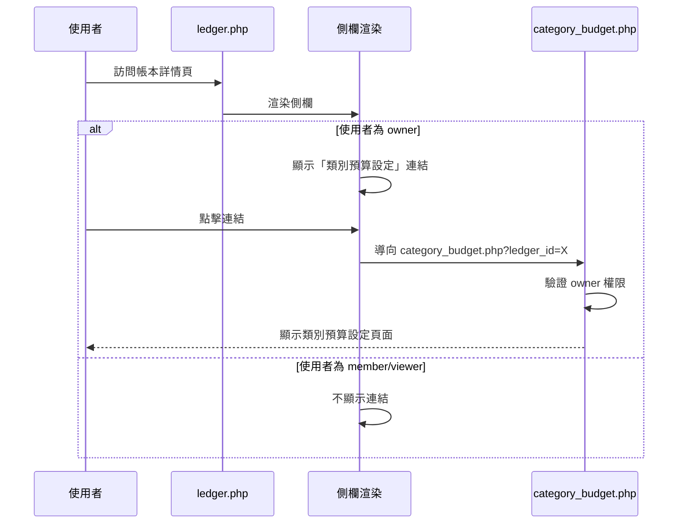

# [#25] ledger.php 側欄加入類別預算設定連結 - 設計文件

> 本文件為設計文件，包含規格、實作細節與驗收結果。

---

## 1. 設計概述

在 `ledger.php` 帳本詳情頁的側欄「這本帳」區塊，新增「類別預算設定」連結，僅帳本擁有者（`ledger_access.role = 'owner'`）可見，讓使用者能從帳本詳情頁直接進入 `category_budget.php` 類別預算設定頁面。

---

## 2. 需求規格

| 項目 | 說明 |
|------|------|
| **連結位置** | `ledger.php` 側欄「這本帳」區塊，成員列表下方 |
| **連結文字** | 「類別預算設定」 |
| **目標 URL** | `./category_budget.php?ledger_id=<該帳本 ID>` |
| **可見條件** | 僅當 `$accessRole === 'owner'` 時顯示 |
| **權限控制** | `category_budget.php` 本身已有 owner 角色驗證（參考 [#19] 完成） |

---

## 3. 架構圖

### 3.1 側欄結構調整前後對照

```mermaid
flowchart TB
    subgraph Before["調整前：側欄「這本帳」"]
        A1[帳本編號 No.001]
        A2[帳本名稱]
        A3[成員列表]
        A3_1[用戶A - owner]
        A3_2[用戶B - member]
    end
    
    subgraph After["調整後：側欄「這本帳」"]
        B1[帳本編號 No.001]
        B2[帳本名稱]
        B3[成員列表]
        B3_1[用戶A - owner]
        B3_2[用戶B - member]
        B4[類別預算設定 連結 (僅 owner 可見)]
    end
    
    Before --> After
```

### 3.2 權限流程圖



---

## 4. 實作細節

### 4.1 檔案異動

| 檔案 | 變更類型 | 說明 |
|------|----------|------|
| `ledger.php` | 修改 | 在側欄「這本帳」區塊新增連結，條件顯示 |
| `assets/style.css` | 修改 | 新增連結樣式（`.rail-link`、`.rail-link-item`） |

### 4.2 程式碼變更位置

**ledger.php (第 567-574 行)**

```php
<!-- [#25] 類別預算設定連結：僅 owner 可見 -->
<?php if ($accessRole === 'owner'): ?>
<div class="rail-link">
    <a href="./category_budget.php?ledger_id=<?php echo h((string) $ledgerId); ?>" class="rail-link-item">
        <?php echo h('類別預算設定'); ?>
    </a>
</div>
<?php endif; ?>
```

**assets/style.css (第 118-133 行)**

```css
/* [#25] 側欄「這本帳」連結區塊：類別預算設定 */
.rail-link { margin-top: var(--space-3); padding-top: var(--space-3); border-top: 1px solid var(--line-dark); }
.rail-link-item {
  display: block;
  padding: var(--space-2) var(--space-3);
  font-size: var(--text-sm);
  color: var(--side-ink);
  text-decoration: none;
  border-radius: var(--radius);
  transition: background 0.15s ease, color 0.15s ease;
}
.rail-link-item:hover {
  background: var(--side-2);
  color: var(--blue);
  text-decoration: none;
}
```

> 實作已遵循專案既有 CSS 變數命名慣例（使用 `var(--blue)` 而非 `--primary`），並保持與 `.rail-members`、`rail-name` 等既有元素風格一致。

---

## 5. 驗收標準

| # | 驗收項目 | 預期結果 |
|---|----------|----------|
| 1 | Owner 登入並進入帳本詳情頁 | 側欄「這本帳」顯示「類別預算設定」連結 |
| 2 | Owner 點擊連結 | 正確導向 `./category_budget.php?ledger_id=<帳本ID>` |
| 3 | Member 登入並進入同帳本詳情頁 | 側欄「這本帳」**不**顯示該連結 |
| 4 | Viewer 登入並進入同帳本詳情頁 | 側欄「這本帳」**不**顯示該連結 |
| 5 | 連結樣式 | 與側欄其他元素風格一致，可辨識為連結 |

---

## 6. 影響範圍

- **前端**：`ledger.php` 側欄 HTML 結構微調
- **後端**：無資料庫變更、無新增 API
- **權限**：沿用既有 `ledger_access.role` 機制與 `category_budget.php` 內建驗證
- **相容性**：不影響現有功能，純新增連結

---

## 7. 測試計畫

### 7.1 手動測試步驟

1. 以 Owner 身份登入，進入任一帳本詳情頁（`ledger.php?ledger_id=X`）
2. 確認側欄「這本帳」區塊顯示「類別預算設定」連結
3. 點擊連結，確認導向 `category_budget.php?ledger_id=X` 且可正常操作
4. 以 Member 身份登入，進入同帳本詳情頁
5. 確認側欄「這本帳」**不**顯示該連結
6. 以 Viewer 身份登入，進入同帳本詳情頁
6. 確認側欄「這本帳」**不**顯示該連結

### 7.2 自動化測試（若有）

- 無（本專案目前無自動化測試框架）

---

## 8. 部署檢查清單

- [ ] `ledger.php` 程式碼變更已套用
- [ ] 樣式已調整（如需要）
- [ ] Owner/Member/Viewer 三種角色皆實測通過
- [ ] 無語法錯誤（`php -l ledger.php` 通過）
- [ ] 無破壞既有功能

---

## 9. 待確認事項

- [ ] 連結文字最終中文名稱（「類別預算設定」或其他）
- [ ] 是否需要在連結旁加上圖示（如 💰 或 ⚙️）
- [ ] 連結放置於「這本帳」區塊內，還是另起一區塊（目前規劃放在成員列表下方）

---

## 10. 版本記錄

| 版本 | 日期 | 作者 | 變更摘要 |
|------|------|------|----------|
| 1.0 | 2026-11-25 | AI Designer | 初版設計文件 |
| 1.1 | 2026-11-25 | AI Designer | 套用 Code Review 修正（連結文字加上 `h()`）、Spec Review 修正（CSS 變數 `--primary` → `--blue`） |

---

## 11. 審查記錄

### 11.1 Spec 審查
- **審查員**：獨立第三方
- **結果**：通過（修正後）
- **修正項目**：CSS 變數 `var(--primary)` → `var(--blue)`（專案無 `--primary` 變數）

### 11.2 Code 審查
- **審查員**：獨立第三方
- **結果**：通過（修正後）
- **修正項目**：連結文字加上 `h()` 輸出轉義

### 11.3 Security 審查
- **審查員**：獨立第三方
- **結果**：通過
- **初始評分**：95/100
- **最終評分**：100/100（補強後）
- **關鍵驗證**：
  - `ledger_id` 參數經 `h()` 轉義 ✅
  - 權限判斷來源正確（`ledger_access` 表）✅
  - 目標頁面 `category_budget.php` 有二次驗證 ✅
  - IDOR 防護雙邊驗證完整 ✅
  - 無 XSS、CSRF、敏感資料外洩風險 ✅
- **初始扣分項目（已補強）**：
  1. 缺「檢視類別預算」審計日誌 → 已於 `category_budget.php:34-35` 新增 `logAudit('category_budget_view', ...)`
  2. 無法確認無障礙樣式 → 已於 `assets/style.css:134-137` 新增 `.rail-link-item:focus-visible` 樣式

---

## 12. 補強記錄（Security 審查扣分項修正）

| 項目 | 檔案 | 變更 |
|------|------|------|
| 審計日誌：檢視類別預算頁面 | `category_budget.php` | 第 34-35 行新增 `logAudit('category_budget_view', 'ledger_id=...')` |
| 無障礙：鍵盤焦點樣式 | `assets/style.css` | 第 134-137 行新增 `.rail-link-item:focus-visible` |