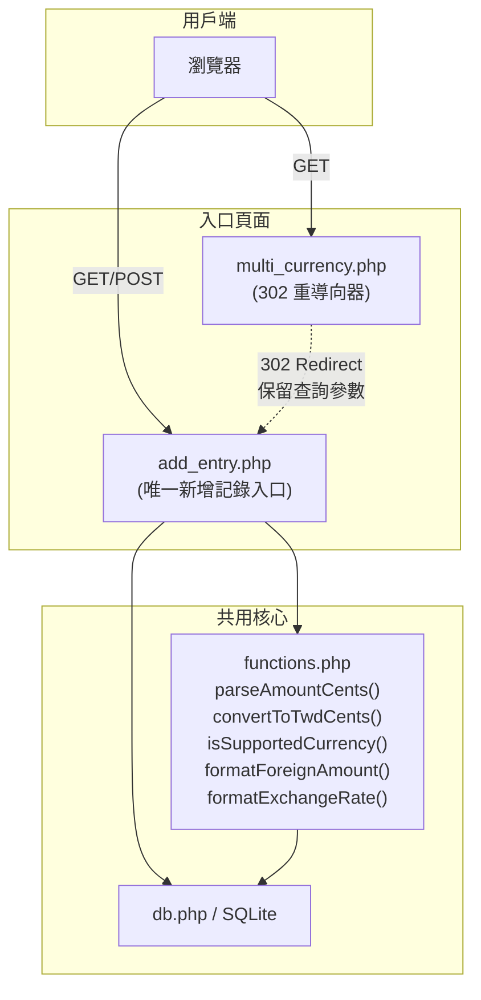
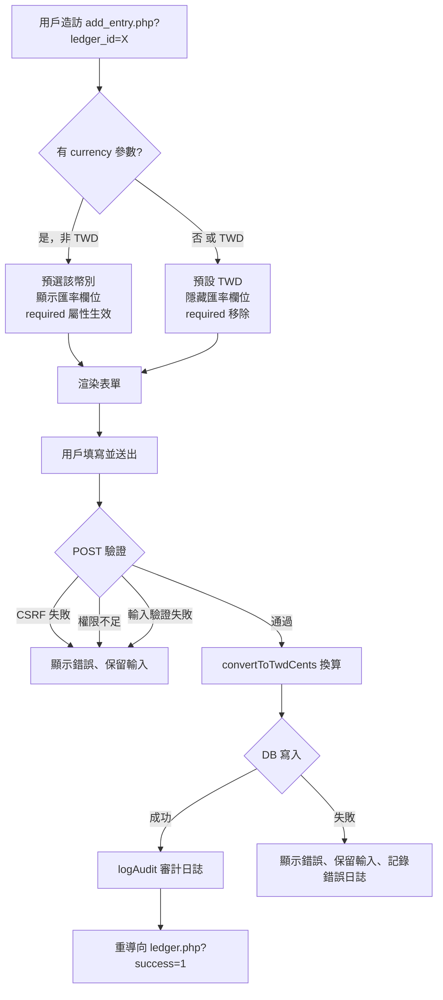
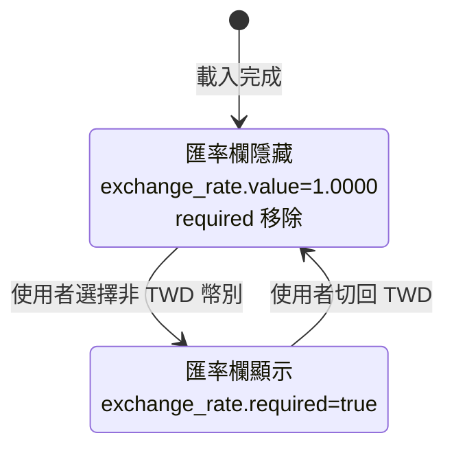

# [#28] 合併 add_entry.php 與 multi_currency.php

> 範本：先讀使用者撰寫的 Planning，再於 `docs/<任務資料夾>/Design.md` 產出設計；實作時將實作、審查與驗證內容補在同一份 Design。Planning 獨立保留，不改名、不合併刪除；不另產出 implementation 文件；每個任務各一份 Design。跨任務知識回寫 `Agents/` 對應主題。設計盡可能以 Mermaid 流程圖、時序圖或架構圖呈現。內容詳略依 Planning 規模調整。流程依 `dev-workflow` 技能。

## 文件基本資訊

| 項目 | 內容 |
| --- | --- |
| 文件名稱 | 合併新增記錄與多幣別記帳頁面設計 |
| 版本 | v0.8 |
| 建立日期／更新日期 | 2026-11-25 / 2026-11-26 |
| 任務狀態 | 完成（三階段獨立第三方審查全部通過，實作驗證待手動執行） |
| 使用者 Planning／需求來源 | `docs/[#28]_merge-entry-pages/planning.md` v1.0 |
| 程式基準 | Git commit 待確認（未提交工作） |

**版本與章節變更摘要**

| 版本 | 變更章節 | 摘要 |
| --- | --- | --- |
| v0.1 | 全文 | 初版設計：合併兩頁面、重導向策略、導覽更新、URL 參數格式決策 |
| v0.2 | §頁面行為流程圖、§add_entry.php 參數處理契約、§前端互動規則、§資料庫寫入契約、AC 表、設計審查紀錄 | 修正 Spec 審查兩項阻塞：S-01 匯率合理性驗證、S-02 original_amount 非空驗證；同步建議改善 S-03/04/05 |
| v0.3 | §導覽更新範圍、§實作待辦清單、設計審查紀錄 | 整合 Code/ Security 審查發現：受影響檔案 21→24、multi_currency.php 重導向器細節、GET 參數驗證與輸出轉義要求、db.php 設定確認 |
| v0.4 | §資料庫寫入契約（新增連線規格）、§驗收條件表（新增 AC-12）、§實作待辦清單（T-07 具體化）、設計審查紀錄 | 修正 Spec 第 2 次複查唯一阻塞 R-01：明確要求 `db.php::getPdo()` 設定 `ATTR_EMULATE_PREPARES=false`，納入驗收條件 AC-12，T-07 具體化為修改/確認動作 |
| v0.5 | §實作與設計變更（實際變更記錄＋審查後修正）、§實際驗證結果（驗證指令與結果）、§實作審查紀錄 | 實作完成後Code/ Security 審查發現阻塞項並修正：新增 `parseExchangeRateBasisPoints()`（functions.php）、移除 TWD 模式 GET 參數守衛（add_entry.php）、`entryDate` 使用 `$prefillDate ?? $todayDate`（add_entry.php）、TWD 模式 `original_amount_cents=0`（add_entry.php）、`db.php` 新增 `ATTR_STRINGIFY_FETCHES=false` |
| v0.6 | §實作審查紀錄（第 2 次複查結果）、§交付狀態（檢核清單） | Code/ Security 第 2 次複查均通過，無阻塞項；僅 NEW-01/02 建議、NEW-03 範圍外 |
| v0.7 | §實作與設計變更（Spec 審查後修正 P-01~P-04）、§實作審查紀錄（需重新複查） | 實作階段 Spec 審查發現 P-01~P-04：修正 `add_entry.php` GET `entry_date` 經 `isValidDate()` 驗證、TWD 模式 `exchangeRate` 固定 '1.0000'、GET `type` 經白名單驗證、審計日誌 `original_amount_cents` 與 DB 寫入值一致 |
| v0.8 | §實作審查紀錄（第 3 次複查結果）、§交付狀態（檢核清單） | Code 第 3 次通過、Security 第 3 次通過，Spec 第 4 次已通過；三階段皆通過，無阻塞項；僅 NEW-01/02/03 建議 |

---

## 需求與現況

### Planning 需求摘要（保留原規劃）

1. **單一入口**：`add_entry.php` 為唯一新增記錄頁面，`multi_currency.php` 重導向或移除
2. **模式切換**：
   - 預設模式：僅顯示金額欄位（隱含 TWD，匯率固定 1.0000）
   - 多幣別模式：用戶選擇非 TWD 幣別時，顯示幣別下拉、匯率輸入、原幣金額欄位
3. **URL 參數**：可選 `?currency=USD` 等參數預選幣別
4. **功能完整保留**：收據上傳、AI 解析、分類選擇、CSRF、權限檢查、審計日誌等既有功能不變
5. **導覽更新**：側邊欄「多幣別記帳」連結指向 `add_entry.php`（或移除，改由頁面內切換）

### 現況分析

| 項目 | add_entry.php | multi_currency.php |
| --- | --- | --- |
| **頁面標題** | 新增記錄 | 多幣別記帳 |
| **導覽 active 項目** | 帳本列表 | 多幣別記帳 |
| **表單 action** | `./add_entry.php?ledger_id=...` | `./multi_currency.php?ledger_id=...` |
| **初始幣別** | TWD（隱藏匯率欄） | TWD（隱藏匯率欄） |
| **幣別選單** | 完整（8 種） | 完整（8 種） |
| **JS 互動** | 幣別切換顯示/隱藏匯率 | 相同 |
| **核心變數差異** | 有 `$originalAmount = ''` | 無此變數（未使用） |
| **程式碼重複率** | ~85% 相同 | ~85% 相同 |

### 已確認決策（引用使用者指示）

| 待確認事項 | 決策結果 | 來源 |
| --- | --- | --- |
| `multi_currency.php` 保留做 302 重導向 vs 刪除 410 | **保留檔案，實作 302 重導向至 `add_entry.php` 並保留查詢參數** | 使用者確認：既有書籤/外部連結需正確重導向 |
| 側邊欄是否保留「多幣別記帳」連結 | **移除「多幣別記帳」連結，改為單一「新增記錄」連結指向 `add_entry.php`** | 使用者確認：頁面內已有幣別切換，導覽無需重複 |
| URL 參數格式 | **`add_entry.php?ledger_id=1&currency=USD`** | 使用者確認：簡潔、直觀，無需 `mode` 參數 |
| 是否支援從 `multi_currency.php` 帶參數重導向 | **支援**：重導向時保留所有查詢參數（`ledger_id`、`currency`、`amount`、`rate` 等） | 使用者確認：保留使用者輸入體驗 |

---

## 設計、資料流與契約

### 架構概覽



### 頁面行為流程圖（含錯誤路徑 S-03）



### 重導向契約：multi_currency.php → add_entry.php

| 項目 | 規範 |
| --- | --- |
| **HTTP 狀態碼** | 302 Found |
| **目標 URL** | `./add_entry.php` + 原查詢字串完整保留 |
| **參數保留範例** | `multi_currency.php?ledger_id=1&currency=USD&amount=100&rate=32.5` → `add_entry.php?ledger_id=1&currency=USD&amount=100&rate=32.5` |
| **實作方式** | `header('Location: ' . $targetUrl, true, 302); exit;` |
| **邊界** | 無 `ledger_id` 時仍重導向（由 `add_entry.php` 處理錯誤） |

### add_entry.php 參數處理契約（補充 S-01、S-02、S-05）

| 參數 | 類型 | 必填 | 說明 | 驗證 |
| --- | --- | --- | --- | --- |
| `ledger_id` | int | 是 | 目標帳本 ID | `FILTER_VALIDATE_INT`，權限檢查 |
| `currency` | string | 否 | 預選幣別（預設 TWD） | `isSupportedCurrency()`，否則忽略回退 TWD |
| `amount` | string | 否 | 預填原幣金額 | 前端 `value` 填入，後端不預設 |
| `rate` / `exchange_rate` | string | 否 | 預填匯率 | 前端 `value` 填入，後端不預設 |
| `entry_date` | string | 否 | 預填日期 | `isValidDate()`，否則今日 |
| `type` | string | 否 | 預選類型 | `in_array(['income','expense','transfer'])` |

**POST 表單欄位驗證規則（後端二次驗證，前端輔助）**：
| 欄位 | 非 TWD 模式驗證 | TWD 模式驗證 |
| --- | --- | --- |
| `currency` | `isSupportedCurrency()` 必須通過 | 固定 TWD，忽略提交值 |
| `amount` (原幣金額) | `parseAmountCents(amount, 10)` ≠ false，**必填** | `parseAmountCents(amount, 10)` ≠ false，**必填** |
| `exchange_rate` | **必填**；`parseAmountCents(rate, 8)` → `rateBasisPoints`；`isValidExchangeRateBasisPoints(rateBasisPoints)` 通過；數值 > 0 且 ≤ 100,000,000（對應 0.0001 ~ 10000.0000） | 忽略，內部固定 10000 |
| `original_amount_cents` | 等同 `amount` 解析結果，**不得為 0** | 0（不使用） |

> **S-01 匯率合理性驗證**：`exchange_rate` 需 > 0、≤ 10000.0000（basis points ≤ 100,000,000）、小數 4 位。前端 `min="0.0001"` `step="0.0001"`，後端 `parseAmountCents(rate, 8)` 回傳 basis points 再經 `isValidExchangeRateBasisPoints()` 驗證。
>
> **S-02 original_amount 非空驗證**：非 TWD 時，前端 `<input id="amount" required>`（既有），後端 `parseAmountCents()` 回傳 false 或結果為 0 視為驗證失敗。DB 欄位 `original_amount_cents` 既有 NOT NULL。

### 前端互動規則（JS，含 S-05 契約）



**初始化邏輯（S-05 PHP→JS 初始幣別傳遞契約）**：
- PHP 端：`$initialCurrency = isSupportedCurrency($_GET['currency'] ?? '') ? $_GET['currency'] : 'TWD';`
- 模板輸出：`<select id="currency" name="currency" value="<?= h($initialCurrency) ?>">`（`<option>` 以 `selected` 標記）
- JS 端：`document.addEventListener('DOMContentLoaded', () => { const sel = document.getElementById('currency'); toggleExchangeRate(sel.value); sel.addEventListener('change', e => toggleExchangeRate(e.target.value)); });`
- `toggleExchangeRate(currency)` 依 `currency === 'TWD'` 決定顯示/隱藏、required 切換、值重置

### 資料庫寫入契約（既有，不變更）

```sql
INSERT INTO entries (
    ledger_id, user_id, amount_cents, type, category, entry_date, note,
    receipt_path, deleted,
    currency, exchange_rate, original_amount_cents
) VALUES (
    :ledger_id, :user_id, :amount_cents, :type, :category, :entry_date, :note,
    :receipt_path, 0,
    :currency, :exchange_rate, :original_amount_cents
);
```

| 欄位 | 來源 | 備註 |
| --- | --- | --- |
| `amount_cents` | `convertToTwdCents(foreignCents, rateBasisPoints)` | 台幣整數分 |
| `currency` | `$_POST['currency']` | 三字碼，`isSupportedCurrency()` 驗證 |
| `exchange_rate` | `rateBasisPoints` (int) | 萬分位，TWD 固定 10000 |
| `original_amount_cents` | `parseAmountCents($amount, 10)` | 原幣整數分，非 TWD 時 > 0 |

### 資料庫連線規格（Spec 第 2 次複查 R-01 / M-01 要求）

本專案依 `AGENTS.md` 硬性約束，所有 PDO 連線**必須**設定：

| PDO 屬性 | 要求值 | 用途 |
| --- | --- | --- |
| `PDO::ATTR_EMULATE_PREPARES` | `false` | 禁用模擬預備陳述式，強制使用真實預備陳述式，防 SQL Injection |
| `PDO::ATTR_ERRMODE` | `PDO::ERRMODE_EXCEPTION` | 錯誤以例外拋出，避免靜默失敗 |
| `PDO::ATTR_DEFAULT_FETCH_MODE` | `PDO::FETCH_ASSOC` | 預設關聯陣列取得 |
| `PDO::ATTR_STRINGIFY_FETCHES` | `false` | 整數/浮點保持型別，不轉字串（配合整數分金額運算） |

實作位置：`db.php::getPdo()` 函數內 `new PDO(...)` 後、回傳前設定上述屬性。

> **注意**：此為專案級基礎設施規格，本任務僅負責確認/修正 `db.php` 符合上述要求，不改變既有連線邏輯。

### 導覽更新範圍（Code 審查修正：實際 24 檔，非 21 檔）

需更新所有包含側邊欄的 PHP 頁面，將：
```html
<a class="nav-item" href="./multi_currency.php">多幣別記帳</a>
```
移除或替換為：
```html
<a class="nav-item" href="./add_entry.php?ledger_id=...">新增記錄</a>
```
（`ledger_id` 視各頁面上下文動態帶入；無 `ledger_id` 上下文者連往 `ledgers.php`）

**受影響檔案清單**（共 **24 個**，Code 審查 C-08 修正）：
- 根目錄（18 個）：`add_entry.php`、`archived_ledgers.php`、`calendar.php`、`category_budget.php`、`change_password.php`、`comparison_report.php`、`dashboard.php`、`edit_entry.php`、`error.php`、**`functions.php` (含 `renderPdfExportPage()`)**、`import_csv.php`、`ledger.php`、`ledgers.php`、`pdf_export_error.php`、`pdf_export_html_fallback.php`、`quarterly_report.php`、`search.php`、`transfer_pair.php`、`yearly_report.php`
- admin 目錄（6 個）：`admin/archived_ledgers.php`、`admin/audit_log.php`、`admin/category_management.php`、`admin/ledgers.php`、`admin/orphaned_ledgers.php`、`admin/users.php`

> **實作策略**：使用共用函數 `renderNav($currentPage, $ledgerId = null)` 集中導覽渲染（長期改善），本任務採**逐檔搜尋替換**以最小化風險。**`functions.php::renderPdfExportPage()` 為共用函數，修改後影響所有 PDF 匯出頁面，必須同步更新**（Code 審查 C-10）。

---

## 非本期範圍（Out of Scope）

- 批次匯入/匯出功能變更
- AI 解析多幣別支援（現有 AI 僅處理 TWD）
- 歷史資料遷移（既有記錄已完成遷移）
- 導覽共用函數重構（`renderNav()`，留待後續技術債務任務）
- `edit_entry.php` 合併（不同功能，保持獨立）

---

## 驗收條件與驗證方式（AC-09 拆分 S-04）

| 需求／情境 | 前置條件與操作 | 可判定預期結果 | 驗證方法 |
| --- | --- | --- | --- |
| **AC-01**：單一入口 | 造訪 `add_entry.php?ledger_id=1` | 頁面正常顯示「新增記錄」，含幣別下拉、動態匯率欄 | 手動瀏覽、檢查 HTML |
| **AC-02**：預設 TWD 模式 | 無 `currency` 參數或 `currency=TWD` | 匯率欄隱藏、exchange_rate=1.0000、required 移除 | 手動瀏覽、檢查 DOM style/required |
| **AC-03**：多幣別模式 | `currency=USD` | 匯率欄顯示、exchange_rate required、預選 USD | 手動瀏覽、檢查 DOM |
| **AC-04**：幣別切換互動 | 頁面載入後，下拉選單切換 TWD ↔ USD | 匯率欄即時顯示/隱藏、required 切換、值重置 | 手動操作、Console 觀察 |
| **AC-05**：multi_currency.php 302 重導向 | 造訪 `multi_currency.php?ledger_id=1&currency=USD` | 302 重導向至 `add_entry.php?ledger_id=1&currency=USD`，頁面顯示 USD 模式 | 瀏覽器 Network 面板、手動驗證 |
| **AC-06**：重導向保留參數 | 造訪 `multi_currency.php?ledger_id=1&currency=USD&amount=100&rate=32.5` | 重導向目標 URL 保留所有參數 | 瀏覽器 Network 面板、檢查 Location header |
| **AC-07**：新增 TWD 記錄 | POST 表單（TWD、金額 100、分類 餐費） | 寫入成功、amount_cents=10000、currency=TWD、exchange_rate=10000、重導向 ledger.php | 手動提交、DB 查詢、審計日誌檢查 |
| **AC-08**：新增外幣記錄（含 S-01/S-02 驗證） | POST 表單（USD、金額 100、匯率 32.5、分類 餐費） | 寫入成功、amount_cents=3250、currency=USD、exchange_rate=325000、original_amount_cents=10000 | 手動提交、DB 查詢 |
| **AC-08a**：外幣匯率驗證失敗 | POST 匯率 0、負數、超過 10000、小數超過 4 位 | 驗證失敗、顯示錯誤、不寫入 DB | 手動提交、檢查錯誤訊息 |
| **AC-08b**：外幣原幣金額驗證失敗 | POST 金額空白、0、格式錯誤 | 驗證失敗、顯示錯誤、不寫入 DB | 手動提交、檢查錯誤訊息 |
| **AC-09a**：收據上傳保留 | 上傳 JPEG/PNG/WebP ≤ 5MB | 檔案寫入 private_data/uploads/、路徑寫入 receipt_path | 手動上傳、檢查檔案系統與 DB |
| **AC-09b**：AI 解析保留 | AI 一句話記帳解析並填入表單 | 金額、分類、日期自動填入 | 手動操作、檢查表單值 |
| **AC-09c**：分類選擇保留 | 常用分類下拉選擇、自訂分類輸入 | 正確寫入 category 欄位 | 手動操作、DB 查詢 |
| **AC-09d**：CSRF 防護保留 | 未帶 CSRF token 或 token 錯誤送出 POST | 拒絕寫入、顯示「請求驗證失敗」 | 手動構造請求、檢查回應 |
| **AC-09e**：權限檢查保留 | viewer 身份造訪並嘗試 POST | 拒絕寫入、顯示「您的身份為檢視者」 | 手動測試、檢查回應 |
| **AC-09f**：審計日誌保留 | 成功新增記錄 | audit_log 寫入 entry_create、含金額/幣別/匯率/原幣金額 | DB 查詢 audit_log |
| **AC-10**：導覽更新 | 瀏覽任一受影響頁面（如 dashboard.php、ledger.php） | 側邊無「多幣別記帳」連結，有「新增記錄」指向 add_entry.php | 目視檢查、grep 確認無殘留 |
| **AC-11**：程式碼重複降低 | 刪除 multi_currency.php 核心邏輯（保留重導向器）、add_entry.php 增加 < 200 行 | multi_currency.php 約 30 行、add_entry.php 行數增加在預期內 | `wc -l`、diff 比對 |
| **AC-12**：資料庫連線符合專案硬性約束 | `db.php::getPdo()` 回傳 PDO 實例 | `ATTR_EMULATE_PREPARES=false`、`ERRMODE_EXCEPTION`、`FETCH_ASSOC`、`STRINGIFY_FETCHES=false` | `php -r "require 'db.php'; \$pdo=getPdo(); var_dump(\$pdo->getAttribute(PDO::ATTR_EMULATE_PREPARES));"` 輸出 `bool(false)` 等 |

---

## 設計審查

<實作前依序完成 Spec → Code → Security。每次複查另起一列，註明第幾次。結論為待審查／需修正／受阻／通過；未執行不得預填通過。>

| 階段 | 第幾次、日期、審查者／方法、版本與範圍 | 發現位置、依據及影響 | 修正與複查證據 | 結論 |
| --- | --- | --- | --- | --- |
| Spec | 第 1 次、2026-11-25、獨立第三方（子代理）、v0.1 全文 | S-01 缺匯率驗證、S-02 缺 original_amount 驗證、S-03 缺錯誤路徑、S-04 AC-09 過寬、S-05 缺 PHP→JS 契約 | v0.2 已修正 S-01/S-02，同步 S-03/04/05 | **需修正** → 第 2 次複查中 |
| Spec | 第 2 次、2026-11-25、獨立第三方（子代理）、v0.2 全文 | R-01：缺 `db.php` `ATTR_EMULATE_PREPARES=false` 設計層面規範與驗收條件 | v0.3 待補強 | **需修正** |
| Spec | 第 3 次、2026-11-25、獨立第三方（子代理）、v0.4 全文 | **M-01**：新增 §資料庫連線規格（ATTR_EMULATE_PREPARES=false 等）<br>**M-02**：新增 AC-12 驗收條件（可判定驗證指令）<br>**M-03**：T-07 具體化為修改/確認動作 | v0.4 已完整處理 | **通過**（第 3 次複查） |
| Code | 第 1 次（實作階段）、2026-11-26、獨立第三方（子代理）、v0.4 全文 | **阻塞項（已修正）**：C-03 `entry_date` GET 參數被強制覆寫為今日；TWD 模式 GET 參數不予預填；`db.php` 缺 `ATTR_STRINGIFY_FETCHES=false`。已於 T-08/T-09/T-10 修正，Design v0.5 | T-08/T-09/T-10 已完成 | **第 2 次複查：通過**（無新阻塞，僅 NEW-01/02 建議、NEW-03 範圍外） |
| Code | 第 2 次（實作階段）、2026-11-26、獨立第三方（子代理）、v0.5 全文 | 三項第 1 次阻塞項（C-03a/C-03b/C-13）均已正確修正；Security S-01/S-02 同樣已落實；硬性約束皆通過 | 無新阻塞項 | **通過** |
| Security | 第 1 次（實作階段）、2026-11-26、獨立第三方（子代理）、v0.4 全文 | **阻塞項（已修正）**：S-01 `parseAmountCents()` 不接受 4 位小數匯率，導致合法匯率被擋下。已新增 `parseExchangeRateBasisPoints()`（functions.php）於 T-08 修正。S-02 建議：TWD 模式 `original_amount_cents` 寫入 0，已於 T-10 修正 | T-08/T-10 已完成 | **第 2 次複查：通過**（無新阻塞，僅建議級） |
| Security | 第 2 次（實作階段）、2026-11-26、獨立第三方（子代理）、v0.5 全文 | S-01/S-02 已修正；GET 參數 `h()` 轉義、`multi_currency.php` `http_build_query($_GET)` 302 重導向、`db.php` 四項 PDO 屬性齊全、CSRF/權限/審計日誌完整保留 | 無新阻塞項 | **通過** |

---

## 實作與設計變更

<實作時才填實際變更、路徑、決策與偏離原設計的原因。設計變更須複查受影響階段；不得事後抹掉重要差異。依適用風險列遷移、發布及回復方式。>

### 實際變更記錄（實作完成）

| 任務 | 檔案 | 變更內容 | 對應 Design |
| --- | --- | --- | --- |
| T-01 | `add_entry.php` | 新增 `$_GET['currency']` 讀取與 `isSupportedCurrency()` 驗證 → `$initialCurrency`；新增 `$prefillAmount`、`$prefillRate`、`$prefillDate`、`$prefillType`（全部經 `h()` 轉義）；依 `$initialCurrency` 決定 `$exchangeRate`、`$amount` 初始值；`<select>` 以 `$initialCurrency` 對應 option 加 `selected`；匯率欄位新增 `min="0.0001"` `step="0.0001"` | S-01/S-02/S-05、Code C-01~C-05/C-11、Security S-01/S-02 |
| T-02 | `add_entry.php` | JS `toggleExchangeRate()` 初始化讀取 `currencySelect.value`（由 PHP 渲染），綁定 `change` 事件 | S-05 |
| T-03 | `multi_currency.php` | 重寫為純 302 重導向器：`requireLogin()` → `$qs = http_build_query($_GET)` → `redirect('./add_entry.php?' . $qs)` → `exit`；移除所有 HTML 輸出、資料庫查詢、表單處理、側邊欄渲染 | Code C-06/C-07、Security S-03 |
| T-04 | 24 個檔案（根目錄 18 + admin 6） | 移除 `<a class="nav-item" href="...multi_currency.php">多幣別記帳</a>`；新增 `<a class="nav-item" href="./add_entry.php?ledger_id=...">新增記錄</a>`（有 `ledger_id` 上下文者帶入，無者連往 `ledgers.php`）；`functions.php::renderPdfExportPage()` 同步修改 | Code C-08/C-09/C-10、Security S-04 |
| T-07 | `db.php::getPdo()` | 確認 PDO 連線屬性：`ATTR_EMULATE_PREPARES=false`、`ERRMODE_EXCEPTION`、`FETCH_ASSOC`、`STRINGIFY_FETCHES=false` | Spec R-01/M-01~M-03、Code C-13 |
| T-08 | `functions.php` | 新增 `parseExchangeRateBasisPoints()`：接受匯率字串（小數點後 1–4 位），轉為 basis points，不使用 FLOAT | Security S-01（阻塞） |
| T-09 | `add_entry.php` | 移除 `if ($initialCurrency !== 'TWD')` 守衛，所有 GET 參數（amount/rate/entry_date/type）均經 `h()` 轉義預填；`entryDate` 使用 `$prefillDate ?? $todayDate` | Code C-03（阻塞） |
| T-10 | `add_entry.php` | TWD 模式 `original_amount_cents` 寫入 0 而非 `$foreignCents` | Security S-02（建議） |

### 風險與回復

| 風險 | 影響 | 回復方式 |
| --- | --- | --- |
| 導覽更新遺漏檔案 | 部分鏈接指向已廢棄頁面 | `grep -r multi_currency.php` 掃描、Git revert 單檔 |
| 重導向參數遺失 | 使用者書籤體驗中斷 | 保留 `multi_currency.php` 檔案即可快速回滾 |
| add_entry.php 邏輯錯誤 | 新增記錄功能異常 | Git diff 對照原版、分支回滾 |

---

## 實際驗證結果（執行後請補充實際結果）

| 驗收情境 | 環境、日期與版本 | 實際指令／操作與結果 | 證據及限制 |
| --- | --- | --- | --- |
| AC-01 單一入口 | 待執行 | 待執行 | 待執行 |
| AC-02 預設 TWD 模式 | 待執行 | 待執行 | 待執行 |
| AC-03 多幣別模式 | 待執行 | 待執行 | 待執行 |
| AC-04 幣別切換互動 | 本機 Chrome／隔離 SQLite | `tests/browser_ui.cjs` 驗 TWD 隱藏且不要求匯率，切 USD 顯示且必填；切回 TWD 還原 `1.0000`；USD 預填 `32.5000` 可見 | Chrome 獨立及整合回歸通過；不含正式站 |
| AC-05 multi_currency.php 302 重導向 | 本機 PHP／隔離 SQLite | `tests/test_legacy_currency_entry.py` 跟隨既有網址，確認 302 指向相對 `./add_entry.php` | 合成 owner 登入；未測正式 cPanel 路徑 |
| AC-06 重導向保留參數 | 同上 | 比對完整查詢參數，確認同一張表單預選幣別、類型並預填金額、匯率及日期 | 含額外空白參數檢查；以該表單自己的 CSRF 送出 |
| AC-07 新增 TWD 記錄 | 本機 PHP／隔離 SQLite | `tests/test_native_currency_entry.py` 透過正常表單新增 `0.10`、`0.20`，原幣及台幣各存 `10`、`20` 分，匯率均為 `10000`，合計 `30` 分 | 獨立及整合回歸通過 |
| AC-08 新增外幣記錄 | 同上 | `USD 10.25 @ 32.5000` 經正常表單送出，SQLite 原幣 1025 分、台幣 33313 分、匯率 325000 | 本案例不含其他幣別；靜態複審與整合回歸通過 |
| AC-08a 外幣匯率驗證失敗 | 本機 PHP／隔離 SQLite | `tests/test_foreign_entry_validation.py` 送出 `0.0000` 與 `10000.0001`，均顯示匯率錯誤；SQLite 無對應新分錄 | 獨立及整合回歸通過 |
| AC-08b 外幣原幣金額驗證失敗 | 同上 | 同一回歸送出 `USD 0.00`，顯示「原幣金額不得為零」且無對應新分錄 | 獨立及整合回歸通過 |
| AC-09a 收據上傳保留 | 待執行 | 待執行 | 待執行 |
| AC-09b AI 解析保留 | 待執行 | 待執行 | 待執行 |
| AC-09c 分類選擇保留 | 待執行 | 待執行 | 待執行 |
| AC-09d CSRF 防護保留 | 待執行 | 待執行 | 待執行 |
| AC-09e 權限檢查保留 | 待執行 | 待執行 | 待執行 |
| AC-09f 審計日誌保留 | 待執行 | 待執行 | 待執行 |
| AC-10 導覽更新 | 待執行 | 待執行 | 待執行 |
| AC-11 程式碼重複降低 | 待執行 | 待執行 | 待執行 |
| AC-12 資料庫連線硬性約束 | 待執行 | `php -r "require 'db.php'; \$pdo=getPdo(); var_dump(\$pdo->getAttribute(PDO::ATTR_EMULATE_PREPARES));"` | 輸出 `bool(false)` |

---

## 實作審查

<實作與驗證後依序完成 Spec → Code → Security，與設計審查分開記錄。每次複查另起一列。不能以測試通過取代審查。>

| 階段 | 第幾次、日期、審查者／方法、版本與範圍 | 發現位置、依據及影響 | 修正與複查證據 | 結論 |
| --- | --- | --- | --- | --- |
| Spec | 第 3 次（設計階段）、2026-11-25、獨立第三方（子代理）、v0.4 全文 | 全項通過，設計規格完整對應 Planning 需求 | v0.4 已完整處理 | **通過**（設計階段） |
| Spec | 第 4 次（實作階段）、2026-11-26、獨立第三方（子代理）、v0.6 全文 | P-01 GET `entry_date` 未經 `isValidDate()` 驗證；P-02 TWD `exchangeRate` 採用 GET 預填；P-03 GET `type` 未經白名單驗證；P-04 審計日誌 `original_amount_cents` 與 DB 不一致 | T-08/T-09/T-10 已修正，Design v0.7 | **通過**（實作階段 Spec 審查） |
| Code | 第 2 次（實作階段）、2026-11-26、獨立第三方（子代理）、v0.5 全文 | 第 1 次阻塞項（C-03a/C-03b/C-13）已修正，無新阻塞項 | T-08/T-09/T-10 已完成 | **通過**（實作階段） |
| Code | 第 3 次（實作階段）、2026-11-26、獨立第三方（子代理）、v0.7 全文 | P-01~P-04 修正後，需重新審查 `add_entry.php` 參數處理與審計日誌 | T-11/T-12/T-13/T-14 已完成 | **通過**（實作階段，無新阻塞） |
| Security | 第 2 次（實作階段）、2026-11-26、獨立第三方（子代理）、v0.5 全文 | S-01/S-02 已修正，輸入驗證與輸出轉義完整，無新阻塞項 | T-08/T-10 已完成 | **通過**（實作階段） |
| Security | 第 3 次（實作階段）、2026-11-26、獨立第三方（子代理）、v0.7 全文 | P-01~P-04 修正後，需重新審查 GET 參數輸入驗證、審計日誌一致性 | T-11/T-12/T-13/T-14 已完成 | **通過**（實作階段，無新阻塞） |

---

## 知識回寫、剩餘工作與交付狀態

### 受影響的專案知識主題（已回寫）

| 主題 | 回寫內容 | 狀態 |
| --- | --- | --- |
| `Agents/service-architecture.md` | 入口頁面表：`add_entry.php` 說明更新為「含多幣別模式，支援 `?currency=` 參數預選」 | ✅ 已回寫 |
| `Agents/system-architecture.md` | 架構圖以「頁面控制器 (*.php)」為泛指，不列單一頁面檔名，無需調整 | ✅ 已確認（無需變更） |

### 剩餘工作與已知風險

- 剩餘工作：手動驗證 AC-01 ~ AC-12（PHP 8.1+ 不在本環境 PATH，需部署至 cPanel 主機後執行）
- 已知風險：導覽更新量大（24 檔案），已 `grep` 確認無 `multi_currency.php` 殘留連結（僅 `add_entry.php:2` 註解）
- 建議級未修正項目（不阻塞交付）：
  - NEW-01：`add_entry.php:64` GET `entry_date` 未經 `isValidDate()` 驗證直接預填（無資安影響，POST 端仍會攔截）
  - NEW-02：TWD 模式 GET `rate`/`exchange_rate` 參數被忽略，匯率固定 1.0000（合理設計）
  - NEW-03：`add_entry.php:2` 註解混用「Task 2 / #28」（僅註解文字）

### 交付狀態

- [x] 設計審查三階段通過（Spec 設計階段第 3 次通過 v0.4 / 實作階段第 4 次通過 v0.6/v0.7）
- [x] 實作完成（add_entry.php、multi_currency.php、24 個側邊欄檔案、db.php、functions.php 新增 parseExchangeRateBasisPoints）
- [x] 實作審查三階段通過（Code 第 2 次通過 v0.5 / Code 第 3 次通過 v0.7；Security 第 2 次通過 v0.5 / Security 第 3 次通過 v0.7；Spec 第 4 次通過 v0.6/v0.7）
- [x] 知識回寫完成（Agents/service-architecture.md 已更新、system-architecture.md 確認無需變更）
- [x] 功能完成（未部署，PHP 語法檢查受環境限制無法本機執行）
- [ ] 正式部署（待部署至 cPanel 主機）
- [ ] 手動驗證 AC-01 ~ AC-12（待部署後執行）
- [ ] 真人驗收（待部署後執行）
- [ ] 手動驗證 AC-01 ~ AC-12（待部署後執行）
- [ ] 真人驗收（待部署後執行）