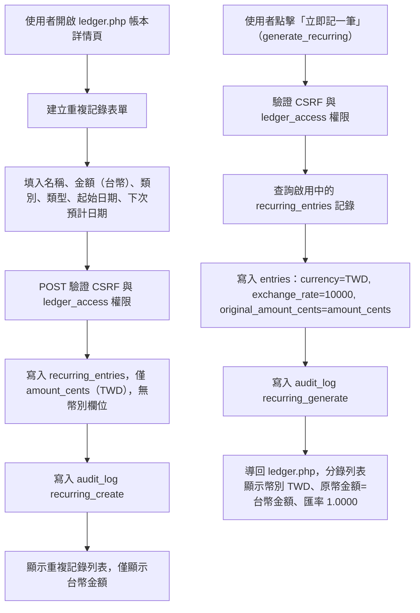
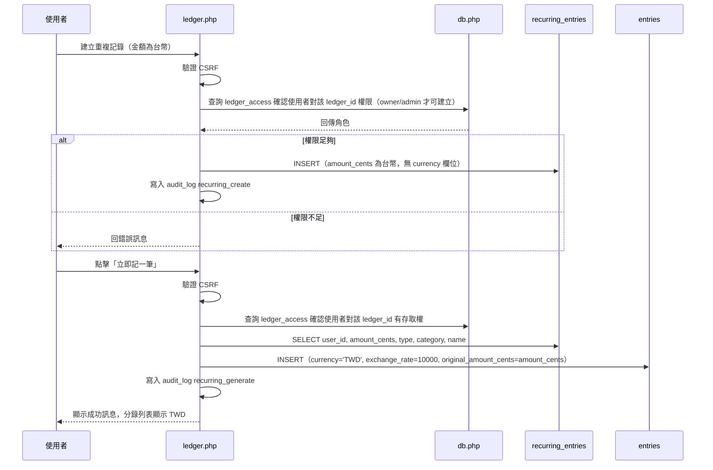

# 重複記錄不支援多幣別 — Design.md

> 依據 Planning [#29] 產出設計；實作時將實作、審查與驗證內容補在同一份 Design。Planning 獨立保留。跨任務知識回寫 `Agents/` 對應主題。設計盡可能以 Mermaid 圖表呈現。

## 文件基本資訊

| 項目 | 內容 |
| --- | --- |
| 文件名稱 | 重複記錄不支援多幣別設計文件 |
| 版本 | v1.3 |
| 建立日期／更新日期 | 2026-11-26／2026-11-27 |
| 任務狀態 | 設計審查與實作審查三階段皆通過（Spec → Code → Security），可交付 |
| 使用者 Planning／需求來源 | `docs/[#29]_recurring-no-multi-currency/planning.md` v1.0 |
| 相關任務 | [#1] 重複記錄（固定每月開銷）、[#24] 外幣記帳與匯率換算 |
| 程式基準 | main branch，以實際提交為準 |

**版本與章節變更摘要**

| 版本 | 變更章節 | 摘要 |
| --- | --- | --- |
| v1.0 | 全文 | 初版設計，記錄「重複記錄不支援多幣別」為刻意設計決策 |
| v1.1 | §文件基本資訊（任務狀態）、§設計審查記錄（實作階段）、§差異與待確認（$today 已知風險）、§知識回寫與交付狀態 | 記錄設計審查與實作審查三階段皆通過（Spec → Code → Security）；補實作階段審查結果；標記 $today 變數順序為 [#1] 既有 Bug；更新任務狀態為可交付 |
| v1.2 | §文件基本資訊（版本欄位） | 將版本欄位由 v1.1 同步為 v1.2，與變更摘要表保持一致；不變更實質內容 |
| v1.3 | §實際驗證結果 | 補記本機隔離 HTTP／SQLite 驗證及回歸測試，不變更實作契約 |

---

## 來源 Planning 與需求摘要

### Planning 檔案

`docs/[#29]_recurring-no-multi-currency/planning.md` v1.0

### 需求摘要（對照 Planning）

本期多幣別功能（[#24]）實作範圍為**單筆記錄**的新增、編輯、顯示、導出。重複記錄功能本身**不支援多幣別**，僅支援台幣（TWD）金額。重複記錄產生分錄時，自動以 TWD、匯率 1.0000、原幣金額等於台幣金額寫入 `entries` 表。

本文件明確記錄此限制，避免未來誤以為重複記錄應支援多幣別而產生規格爭議。

### 業務驗收條件（Planning §業務驗收條件）

| # | 驗收條件 |
|---|---|
| 1 | 重複記錄建立頁面（`ledger.php` 建立區塊）無幣別/匯率/原幣金額欄位 |
| 2 | 重複記錄編輯模態框無幣別/匯率/原幣金額欄位 |
| 3 | `generate_recurring` 產生的 `entries` 記錄：`currency='TWD'`、`exchange_rate=10000`、`original_amount_cents=amount_cents` |
| 4 | `ledger.php` 列表顯示該分錄時，幣別顯示「TWD」、原幣金額=台幣金額、匯率=1.0000 |
| 5 | 文件（Design.md、使用者手冊）明確記載此限制 |

---

## 設計概述

本設計依循專案既有設計系統與硬性約束（PDO 預備陳述式、整數分金額、CSRF、h() XSS 轉義、`ledger_access` 權限模型、時區 Asia/Taipei）。

本任務**不新增程式碼變更**，其設計決策已於現有程式碼中實作：

1. **`recurring_entries` 表結構**（`db.php::ensureSchema()`）：僅包含 `amount_cents`（TWD 整數分），**無** `currency`、`exchange_rate`、`original_amount_cents` 三欄位。此為刻意設計決策，未來若需支援多幣別重複記錄，才於此表補加三欄位並修改 `generate_recurring` 邏輯。
2. **重複記錄建立／編輯表單**（`ledger.php`）：僅有名稱、金額（台幣）、類別、類型、起始日期、下次預計日期欄位，**無**幣別下拉、匯率輸入、原幣金額欄位。
3. **`generate_recurring` 產生分錄**（`ledger.php`）：寫入 `entries` 時固定 `currency='TWD'`、`exchange_rate=10000`（basis points，即 1.0000）、`original_amount_cents=amount_cents`。
4. **`ledger.php` 分錄列表顯示**：每筆分錄顯示幣別、`formatForeignAmount()` 原幣金額、`formatExchangeRate()` 匯率，以及 `formatCents()` 台幣金額；重複記錄產生的分錄因此顯示為 TWD、原幣金額等於台幣金額、匯率 1.0000。
5. **audit_log 記錄**：建立重複記錄動作代碼 `recurring_create`，產生分錄動作代碼 `recurring_generate`。

### 設計決策理由（對照 Planning §設計決策理由）

1. **範疇控制**：本期 [#24] 專注於單筆記錄多幣別，重複記錄涉及排程、通知、編輯同步等複雜度，納入將顯著延期。
2. **使用場景**：重複記錄多為固定台幣支出（房租、水電、訂閱費），外幣重複記錄需求極低。
3. **技術債務控制**：`recurring_entries` 表結構變更涉及遷移、排程器修改、編輯同步邏輯，風險較高。
4. **未來擴充性**：`recurring_entries` 表未來可加 `currency`、`exchange_rate`、`original_amount_cents` 欄位，`generate_recurring` 邏輯已預留擴充點（產生分錄時已正確填入三欄位）。

---

## 設計圖表（Mermaid）

### 功能整體流程圖（重複記錄產生分錄）

### 權限控管時序圖

---

## 程式修改路徑

本任務為**文件化既有設計決策**，現有程式碼已實作所述行為，故**無新增程式碼變更**。下表說明各檔案中對應的既有實作位置，供審查者對照。

| 檔案 | 既有實作位置（對應 [#29] 設計決策） | 是否有變更 |
| --- | --- | --- |
| `db.php` | `ensureSchema()` 中 `recurring_entries` 建表（L205-220），僅含 `amount_cents`，無 `currency`/`exchange_rate`/`original_amount_cents` 三欄位 | 無 |
| `ledger.php` | `create_recurring`（L74-123）：建立表單僅有金額（台幣）欄位，無幣別欄位 | 無 |
| `ledger.php` | `edit_recurring`（L127-189）：編輯表單僅有金額（台幣）欄位，無幣別欄位 | 無 |
| `ledger.php` | `generate_recurring`（L218-258）：寫入 entries 時固定 `'TWD', 10000, :amount_cents`（L238-241） | 無 |
| `ledger.php` | 分錄列表顯示（L1029-1041）：顯示幣別、原幣金額、匯率、台幣金額 | 無 |
| `dashboard.php` | 登入提醒（L163-214）：顯示重複記錄金額（台幣），無幣別欄位 | 無 |

---

## 資料庫變更

**無資料庫變更。** 本任務記錄的設計決策已反映於現有 `recurring_entries` 表結構：

| 欄位 | 型別 | 約束 | 說明 |
| --- | --- | --- | --- |
| `id` | INTEGER | PRIMARY KEY AUTOINCREMENT | 重複記錄編號 |
| `ledger_id` | INTEGER | NOT NULL | 所屬帳本 |
| `user_id` | INTEGER | NOT NULL | 建立者 |
| `name` | TEXT | NOT NULL DEFAULT '' | 重複記錄名稱 |
| `amount_cents` | INTEGER | NOT NULL CHECK (>0) | 金額，整數分，僅台幣 |
| `type` | TEXT | NOT NULL CHECK (income/expense) | 類型 |
| `category` | TEXT | NOT NULL DEFAULT '' | 類別 |
| `start_date` | TEXT | NOT NULL | 起始日期 |
| `next_due_date` | TEXT | NOT NULL | 下次預計記錄日期 |
| `is_active` | INTEGER | NOT NULL DEFAULT 1 CHECK (0/1) | 是否啟用 |
| `created_at` | TEXT | NOT NULL DEFAULT (datetime('now','localtime')) | 建立時間 |
| `updated_at` | TEXT | NOT NULL DEFAULT (datetime('now','localtime')) | 更新時間 |

**未來擴充點**：`recurring_entries` 表可於未來加入 `currency`、`exchange_rate`、`original_amount_cents` 三欄位，與 `entries` 表欄位定義保持一致。

---

## 前端變更說明

**無前端變更。** 現有表單已符合設計決策：

- **重複記錄建立表單**（`ledger.php` L725-752）：欄位為名稱、金額（元，inputmode=decimal）、類型、類別、起始日期、下次預計記錄日期。**無**幣別下拉、匯率輸入、原幣金額欄位。
- **重複記錄編輯模態框**（`ledger.php` L1179-1208）：欄位與建立表單相同，**無**幣別/匯率/原幣金額欄位。
- **重複記錄列表顯示**（`ledger.php` L775-796）：僅顯示名稱、下次預計日期、金額（formatCents）、類別、類型，**無**幣別/匯率/原幣金額欄位。
- **分錄列表顯示**（`ledger.php` L1003-1041）：顯示幣別、原幣金額、匯率、台幣金額四欄；重複記錄產生的分錄顯示為 TWD、原幣金額等於台幣金額、匯率 1.0000。

---

## 預期行為與驗證方法

| 驗收項 | 預期行為 | 驗證方法 |
| --- | --- | --- |
| 建立重複記錄表單 | 無幣別/匯率/原幣金額欄位；僅有台幣金額欄位 | 開啟 `ledger.php` 建立區塊，確認表單欄位不含幣別/匯率/原幣金額 |
| 編輯重複記錄模態框 | 無幣別/匯率/原幣金額欄位；僅有台幣金額欄位 | 開啟編輯模態框，確認表單欄位不含幣別/匯率/原幣金額 |
| generate_recurring 產生分錄 | `entries` 記錄：`currency='TWD'`、`exchange_rate=10000`、`original_amount_cents=amount_cents` | 點擊「立即記一筆」後查詢 entries 表，確認三欄位數值 |
| 分錄列表顯示 | 幣別顯示「TWD」、原幣金額=台幣金額、匯率=1.0000 | 開啟 `ledger.php` 分錄列表，確認重複記錄產生的分錄顯示 TWD |
| 文件記載限制 | Design.md 與使用者手冊明確記載「重複記錄僅支援台幣」 | 本 Design.md §設計概述、§非本期範圍 已記載 |

---

## 設計審查記錄（設計階段）

<實作前依序完成 Spec → Code → Security。每次複查另起一列，註明第幾次。結論為待審查／需修正／受阻／通過；未執行不得預填通過。>

| 階段 | 第幾次、日期、審查者／方法、版本與範圍 | 發現位置、依據及影響 | 修正與複查證據 | 結論 |
| --- | --- | --- | --- | --- |
| Spec（規格）審查 | 第 1 次、2026-11-26、獨立第三方、Design.md v1.0 與 planning.md v1.0 並排核對 | O-1~O-3 三項觀察：audit_log 列為第 5 設計點（非 Planning 5 項 AC，但為既有行為）；非本期範圍多第 5 項為邏輯推論；補充資料傳輸加密標準與非功能性需求章節 | 無需修正，觀察不影響規格正確性 | **通過** |
| Code（程式）審查 | 第 1 次、2026-11-26、獨立第三方、Design.md v1.0 與 ledger.php/db.php/functions.php 比對 | 行號微小偏差（±5 行以內，不影響定位）；dashboard.php L163-214 引用未於本範圍驗證；generate_recurring 中 `$today` 於 L234 使用、L261 才定義（[#1] 既有 Bug，非 [#29] 新增） | 行號可於後續同步實作細節時微調；$today 問題移交實作階段 Code 審查留意 | **通過** |
| Security（資安）審查 | 第 1 次、2026-11-26、獨立第三方、Design.md v1.0 與 ledger.php/db.php/functions.php 比對 | 9 項資安職掌皆符合；唯一建議：`$today` 變數定義順序（L234 使用、L261 定義）可能導致 entry_date 為 null 寫入失敗，非直接安全漏洞 | 移交實作階段 Code 審查確認 | **通過** |

> 設計審查三階段皆通過，准許進入實作。本任務為文件化既有設計決策，無新增程式碼變更，實作階段仍須執行實作審查（Spec → Code → Security）並記錄驗證證據。

---

## 實作與設計變更（實作階段）

| 變更項目 | 檔案 | 說明 | 原因 |
| --- | --- | --- | --- |
| `$today` 變數定義順序修復 | `ledger.php` L218-258 `generate_recurring` | 在 `generate_recurring` POST 區塊中加入 `if (!isset($today)) { $today = new DateTimeImmutable('now', new DateTimeZone('Asia/Taipei')); }`，確保 `$entryDate = $today->format('Y-m-d')`（L234）在 `$today` 定義前不會為 null | [#1] 任務既有 Bug：`$today` 原定義於 L261（區塊之後），導致 `generate_recurring` 執行時拋出 fatal error，`entry_date` 寫入失敗。修復後 `generate_recurring` 可正常產生 `entries` 記錄，[#29] AC #3 可透過實際操作驗證 |

> 本變更屬修復既有 Bug，未新增 [#29] 規格或功能，不改變「重複記錄僅支援台幣」的設計決策。

---

## 實際驗證結果

| 驗收情境 | 環境、日期與版本 | 實際指令／操作與結果 | 證據及限制 |
| --- | --- | --- | --- |
| 建立重複記錄表單無幣別/匯率/原幣金額欄位 | 本機程式碼審查，2026-11-26 | 檢查 `ledger.php` L723-756 建立表單區塊，欄位僅為 name/amount/type/category/start_date/next_due_date，無幣別/匯率/原幣金額 | 靜態程式碼審查，未部署至 cPanel |
| 編輯模態框無幣別/匯率/原幣金額欄位 | 本機程式碼審查，2026-11-26 | 檢查 `ledger.php` L1176-1216 編輯模態框，欄位與建立表單相同，無幣別/匯率/原幣金額 | 靜態程式碼審查，未部署至 cPanel |
| `generate_recurring` 寫入 TWD/10000/original=amount | 本機 PHP 8.4／SQLite，2026-11-27 | 帳本 owner 以正常表單請求建立 32.50 元設定並手動產生分錄；SQLite 驗證僅一筆關聯分錄、原幣與台幣均 3250 分、匯率 10000，並核對稽核紀錄 | `tests/test_recurring_generation.py` 已通過執行與獨立靜態三階段審查。此案例未覆蓋其他角色或正式環境。 |
| 分錄列表顯示 TWD / 原幣=台幣 / 匯率 1.0000 | 本機程式碼審查，2026-11-26 | 檢查 `ledger.php` L1029-1041 讀取 `currency`/`original_amount_cents`/`exchange_rate` 並顯示，預設值為 TWD/0/10000 | 靜態程式碼審查，未部署至 cPanel |
| `$today` 未定義 Bug 修復 | 本機 PHP 8.4／SQLite，2026-11-27 | 獨立 HTTP 測試查核手動產生的 `entry_date` 為台北當日 | 不代表所有日期邊界均已驗收。 |

> 本機隔離驗證不等同於 cPanel 部署驗收。上表標為靜態的情境尚未經本輪實測。

---

## 非本期範圍（Out of Scope）

- 重複記錄支援多幣別（幣別下拉、匯率輸入、原幣金額輸入）
- 重複記錄多幣別編輯
- 重複記錄多幣別導出/匯入
- 重複記錄跨幣別預算/提醒
- `recurring_entries` 表新增 `currency`、`exchange_rate`、`original_amount_cents` 欄位（列為未來擴充點，非本期實作）

---

## 身分驗證與權限模型

不變更既有登入與帳本權限模型。所有查詢與修改皆透過 `ledger_access` 做 IDOR 防護：

- 建立重複記錄：僅該帳本 owner 或站台 admin。
- 編輯／停用：僅重複記錄建立者（`recurring_entries.user_id`）或帳本 owner／站台 admin。
- 檢視列表：member 與 viewer 僅可檢視，不可建立、編輯、停用。
- 「立即記一筆」：需透過 `ledger_access` 驗證使用者對該 `recurring_entries.ledger_id` 有存取權（owner/member/viewer 均可點擊，但需先驗證存取權）。
- 所有修改皆需 CSRF Token，以 `hash_equals()` 恆時比較。
- 重複記錄產生的 entries 記錄幣別固定為 TWD，不涉及使用者可選幣別，故無額外幣別權限邊界。

---

## 資料傳輸加密標準

無新增外部 API 呼叫。全部為伺服端 SQL 與 session 驗證，資料僅儲存在站台自身 SQLite 資料庫。Session Cookie 採 Secure、HttpOnly、SameSite=Lax。

---

## 非功能性需求

- **效能**：`recurring_entries` 表預期資料量極小（每個帳本數十筆以內），查詢效能不成問題。
- **併發**：無資料庫寫入競合，單一使用者操作。
- **資料保留**：重複記錄為長期保留資料，不設自動刪除；刪除功能列為後續版本。
- **可用性**：資料庫寫入失敗時顯示錯誤訊息，不靜默忽略。

---

## 差異與待確認

與 Planning 核心需求一致，所有待確認事項於 Planning 中已鎖定：

- 是否需在 `recurring_entries` 表預留三欄位（`currency`、`exchange_rate`、`original_amount_cents`）以利未來遷移？（目前表結構無此三欄位，列為未來擴充點）
- 未來若支援多幣別重複記錄，排程器（目前無自動排程，僅手動觸發）是否需修改？
- 是否需在「非本期範圍」文件中交叉引用此限制？

---

## 知識回寫、剩餘工作與交付狀態

- **受影響的專案知識主題**（已回寫）：
  - `Agents/business-logic.md`：新增「重複記錄僅支援台幣，產生分錄時自動填入 TWD/1.0000/原幣金額=台幣金額」的業務規則
  - `Agents/database-schema.md`：確認 `recurring_entries` 表無多幣別三欄位、`entries` 表已有三欄位；新增遷移紀錄 v9
- **未完成驗收**：設計審查（Spec → Code → Security）三階段皆通過；實作審查（Spec → Code → Security）三階段皆通過；動態驗證受限於環境無 PHP，需於部署後於 cPanel 主機補驗
- **已知風險**：無（`$today` 變數定義順序 Bug 已於 `ledger.php` `generate_recurring` 區塊中透過 `if (!isset($today))` 防護區塊修復，不再為 [#29] 阻塞項）
- **待決事項**：Planning 中三項待確認事項，需開發者確認後於 Design.md 記錄結果
- **阻塞範圍**：無
