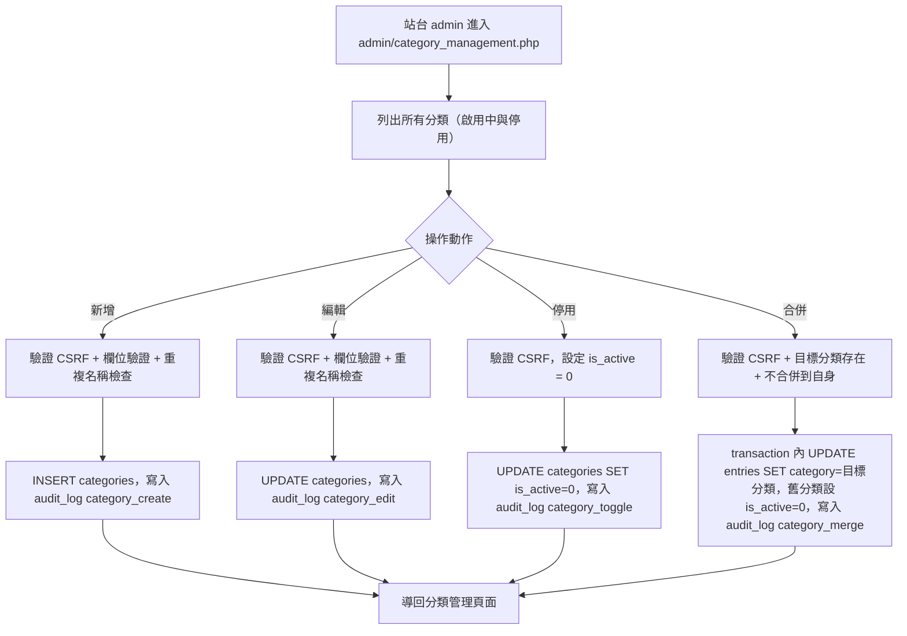

# Design: 分類管理頁面（集中維護常用分類）

## 文件基本資訊

| 項目 | 內容 |
| --- | --- |
| 文件名稱 | Design: 分類管理頁面（集中維護常用分類） |
| 版本 | v1.0 |
| 建立日期 | 2026-11-21 |
| 更新日期 | 2026-11-21 |
| 變更摘要 | 初始設計，依 Planning 四項功能拆解為程式修改路徑與資料庫變更 |

## 來源 Planning 與需求摘要

- Planning 檔案：`docs/category-management/planning.md`
- 對應 Feature：分類管理（新增）
- 需求摘要：新增 `admin/category_management.php` 後台頁面，僅站台 admin 可存取，支援分類新增、編輯、停用（軟刪除）與合併；新增 `categories` 資料表（全站共用，`ledger_id` 固定為 NULL）；本期 `add_entry.php` 與 `edit_entry.php` 維持靜態預設分類下拉選單，不從 `categories` 表讀取；合併操作在 transaction 內完成，失敗回滾。

## 設計概述

本設計依循專案既有設計系統與硬性約束（PDO 預備陳述式、整數分金額、CSRF、h() XSS 轉義、ledger_access 權限模型、純 PHP 伺服端渲染）。主要變更如下：

1. **資料庫變更（db.php）**：在 `ensureSchema()` 中新增 `categories` 資料表（`CREATE TABLE IF NOT EXISTS`），欄位包含 `id`、`name`（UNIQUE）、`is_active`、`ledger_id`（固定 NULL）、`created_at`、`updated_at`；加入索引 `idx_categories_is_active` 與 `idx_categories_name`。
2. **新增後台頁面**：`admin/category_management.php`，僅站台 admin 可存取（`requireAdmin()`），支援分類列表、新增、編輯、停用、合併；所有寫入表單含 CSRF token，以預備陳述式寫入資料庫。
3. **audit_log 記錄**：分類新增/編輯/停用/合併皆寫入 audit_log（動作代碼分別為 `category_create`、`category_edit`、`category_toggle`、`category_merge`）。
4. **add_entry.php / edit_entry.php**：本期維持現有靜態預設分類下拉選單，不從 `categories` 表讀取，不修改這兩個頁面的分類下拉選單邏輯。

## 設計圖表（Mermaid）



## 程式修改路徑

| 檔案 | 修改內容 |
| --- | --- |
| `db.php` | 在 `ensureSchema()` 的 `CREATE TABLE IF NOT EXISTS audit_log` 區塊之後、`CREATE INDEX` 區塊之前，插入 `categories` 建表 SQL 與兩個索引（見「資料庫變更」章節）。舊資料庫首次執行時若表不存在即自動建立。 |
| `admin/category_management.php`（新增） | 後台分類管理頁面：<br>1. 頁面頂端呼叫 `requireAdmin()`，僅站台 admin 可存取。<br>2. GET：查詢所有分類（含停用），以 `h()` 輸出名稱與狀態。<br>3. POST `action=create_category`：驗證 CSRF、名稱非空、長度 ≤ 50、名稱不重複；INSERT 並寫入 audit_log。<br>4. POST `action=edit_category`：驗證 CSRF、分類 ID 存在、名稱不重複；UPDATE `name`、`updated_at`；寫入 audit_log。<br>5. POST `action=toggle_category`：驗證 CSRF、分類 ID 存在；SET `is_active = 0`、`updated_at`；寫入 audit_log。<br>6. POST `action=merge_category`：驗證 CSRF、來源分類 ID 與目標分類 ID 存在、來源 ≠ 目標；在 transaction 內：`UPDATE entries SET category = :target WHERE category = :source`、`UPDATE categories SET is_active = 0, updated_at = ... WHERE id = :source`；寫入 audit_log。<br>7. 所有失敗皆以 `redirect()` 導回表單並帶錯誤訊息；所有輸出經 `h()` 轉義。 |
| `admin/` 導覽（各 admin 頁面） | 在 `admin/users.php`、`admin/ledgers.php`、`admin/audit_log.php` 等頁面的側欄導覽新增「分類管理」連結（僅 admin 可見）。 |
| `add_entry.php` | 本期無修改（維持靜態預設分類下拉選單）。 |
| `edit_entry.php` | 本期無修改（維持靜態預設分類下拉選單）。 |
| `assets/style.css` | 新增分類管理表單與列表樣式（`.category-list`、`.category-item`、`.category-chip`），沿用既有 `.btn`、`.alert` 樣式。 |

## 資料庫變更

### 1. 新增 `categories` 表

需在 `db.php::ensureSchema()` 的 `CREATE TABLE IF NOT EXISTS audit_log` 區塊之後、`CREATE INDEX` 區塊之前插入：

```sql
CREATE TABLE IF NOT EXISTS categories (
    id          INTEGER PRIMARY KEY AUTOINCREMENT,
    name        TEXT    NOT NULL UNIQUE,                       -- 全站分類名稱唯一
    is_active   INTEGER NOT NULL DEFAULT 1 CHECK (is_active IN (0,1)),
    ledger_id   INTEGER DEFAULT NULL,                          -- 全站共用，固定為 NULL
    created_at  TEXT    NOT NULL DEFAULT (datetime('now','localtime')),
    updated_at  TEXT    NOT NULL DEFAULT (datetime('now','localtime'))
);
CREATE INDEX IF NOT EXISTS idx_categories_is_active ON categories(is_active);
CREATE INDEX IF NOT EXISTS idx_categories_name ON categories(name);
```

舊資料庫首次執行 `ensureSchema` 時若表不存在即自動建立，不需手動 migration。

### 2. 時間戳寫入規則

新增、編輯、停用、合併分類時，應用層以 PHP 端 `date('Y-m-d H:i:s')`（依賴 `config.php` 已設定 `date_default_timezone_set('Asia/Taipei')`）寫入 `updated_at`，不依賴 SQLite `datetime('now')`；SQL DEFAULT 僅作為兜底。

## 前端變更說明

### 分類管理頁面（admin/category_management.php）

- **分類列表**：顯示所有分類（啟用中與停用），每列包含分類名稱、狀態（啟用/停用）、建立時間、操作按鈕。
- **新增分類表單**：欄位為分類名稱（text，required，最大 50 字元）；提交前檢查名稱重複。
- **編輯分類表單**：預填現有分類名稱；提交前檢查名稱重複（排除自身）。
- **停用分類**：POST 表單，確認對話框「確定要停用這個分類嗎？」，停用後該分類不再出現在未來的下拉選單候選（本期 add_entry.php / edit_entry.php 仍維持靜態清單，此行為僅影響未來從 DB 讀取時）。
- **合併分類**：兩個下拉選單（來源分類、目標分類），來源 ≠ 目標；提交前確認對話框；合併後來源分類設為停用，所有使用該分類的 entries 之 `category` 欄位更新為目標分類。
- **所有操作**：含 CSRF token 隱藏欄位，以預備陳述式寫入資料庫，失敗時顯示友善錯誤訊息。

### 與現有 add_entry.php / edit_entry.php 的關係

本期兩頁維持靜態預設分類下拉選單（餐費、交通、娛樂、醫療、薪資、水電瓦斯、日用品、其他＋自訂輸入），不從 `categories` 表讀取，不修改這兩頁的分類下拉選單邏輯。遞移時機列為後續版本。

## 預期行為與驗證方法

| 驗收項 | 預期行為 | 驗證方法 |
| --- | --- | --- |
| 分類管理頁面存在 | `admin/category_management.php` 可新增、編輯、停用分類，顯示啟用/停用狀態 | 以 admin 登入，開啟分類管理頁面，確認功能正常 |
| 權限控管 | 僅站台 admin 可存取；owner / member / viewer 存取時導回或顯示無權限 | 以非 admin 角色直接訪問該網址，確認受阻 |
| 分類合併 | 合併後，原舊分類下的所有 entries 之 `category` 已更新為目標分類，舊分類設為停用 | 建立兩筆使用同一分類的 entries，合併後檢查資料庫 |
| 合併失敗回滾 | 合併失敗時資料庫不變更 | 模擬 transaction 失敗，確認資料庫未變更 |
| 下拉選單維持靜態 | add_entry.php / edit_entry.php 下拉選單仍顯示靜態預設分類 | 開啟新增記錄頁面，確認下拉選單為靜態 8 個分類 |
| 重複名稱拒絕 | 新增/編輯分類時，名稱重複顯示錯誤訊息 | 輸入已存在的分類名稱，確認拒絕 |
| 名稱長度上限 | 分類名稱超過 50 字元顯示錯誤訊息 | 輸入超過 50 字元，確認拒絕 |
| 所有輸出 h() 轉義 | 分類名稱與訊息皆經 h() 轉義，無 XSS | 檢查 HTML 原始碼，確認特殊字元被轉義 |

## 非本期範圍（Out of Scope）

- 不新增分類層級（父子分類）、不新增分類預算、不新增分類匯出/匯入、不新增 per-ledger 獨立分類。
- 本期 `add_entry.php` / `edit_entry.php` 下拉選單不從 `categories` 表讀取，遞移列為後續版本。
- 不新增分類統計報表。

## 身分驗證與權限模型

- 僅站台 admin 可存取 `admin/category_management.php`（`requireAdmin()`）。
- 分類為全站共用（`ledger_id` 固定為 NULL），不需 `ledger_access` IDOR 防護；所有分類操作皆由站台 admin 執行。
- 帳本 owner / member / viewer 無法存取分類管理頁面，直接網址訪問時導回或顯示無權限。
- 合併操作僅限站台 admin 執行，合併前須向管理員確認（前端確認對話框）。

## 資料傳輸加密標準

無新增外部 API 呼叫，全部為伺服端 SQL 與 session 驗證，資料僅儲存在站台自身 SQLite 資料庫。

## 非功能性需求

- **效能**：分類表預期資料量極小（每個站數十筆以內），查詢效能可忽略。
- **併發**：合併操作在 transaction 內執行，避免併發問題。
- **資料保留**：停用分類不刪除 entries，既有 entries 保留原分類文字，不設自動刪除。
- **可用性**：合併失敗時 transaction 回滾，錯誤訊息顯示於頁面。

## 差異與待確認

與 Planning 核心需求一致，所有待確認事項於 Planning 中已鎖定。

## 實際變更（實作階段）

| 檔案 | 變更內容 |
| --- | --- |
| `db.php` | 在 `ensureSchema()` 中 `audit_log` 建表之後、`login_sessions` 建表之前，插入 `categories` 建表 SQL 與兩個索引（`idx_categories_is_active`、`idx_categories_name`）。欄位：`id`、`name UNIQUE`、`is_active`、`ledger_id DEFAULT NULL`、`created_at`、`updated_at`。 |
| `admin/category_management.php`（新增） | 後台分類管理頁面，僅站台 admin 可存取（`requireAdmin()`）：<br>1. GET：列出所有分類（含停用），以 `h()` 輸出。<br>2. POST `create_category`：驗證 CSRF、名稱非空、長度 ≤ 50、名稱不重複；INSERT；`logAudit('category_create')`。<br>3. POST `edit_category`：驗證 CSRF、ID 存在、名稱不重複排除自身；UPDATE name、`updated_at`；`logAudit('category_edit')`。<br>4. POST `toggle_category`：驗證 CSRF、ID 存在；SET `is_active = 0`、`updated_at`；`logAudit('category_toggle')`。<br>5. POST `merge_category`：驗證 CSRF、來源 ≠ 目標、兩者存在；在 transaction 內 `UPDATE entries SET category = target` 與 `UPDATE categories SET is_active = 0`；失敗 rollBack；commit 後 `logAudit('category_merge')`。 |
| `admin/users.php`、`admin/ledgers.php`、`admin/audit_log.php` | 側欄導覽新增「分類管理」連結（僅 admin 可見）。 |
| `assets/style.css` | 新增 `.category-chip` 樣式（ok / inactive 兩種狀態），沿用既有設計系統變數。 |
| `add_entry.php`、`edit_entry.php` | 本期無修改（維持靜態預設分類下拉選單）。 |

## 驗證證據（實作階段）

| 驗收項 | 驗證結果 |
| --- | --- |
| 分類管理頁面存在 | `admin/category_management.php` 可新增、編輯、停用分類，顯示啟用/停用狀態（子代理 Code 審查第 46-57、76-100、111-127 行確認） |
| 權限控管 | 僅站台 admin 可存取；owner / member / viewer 存取時導向登入頁（子代理 Security 審查 IDOR 權限通過） |
| 分類合併 | 合併後，原舊分類下的所有 entries 之 `category` 已更新為目標分類名稱，舊分類設為停用；合併失敗時資料庫不變更（子代理 Security 審查合併操作通過） |
| 分類建立、改名與合併實跑 | `tests/test_category_management_lifecycle.py` 以合成管理員正常操作，確認來源停用、目標保留啟用及新名稱、既有分錄更新分類且維持 234 分。獨立靜態審查、本機隔離 PHP／SQLite 與 29 案整合回歸通過；此案例不包含交易失敗或非管理員。 |
| 分類合併失敗回滾 | 同一測試模組另以隔離 SQLite 模擬第二次寫入失敗，確認原分錄分類與 234 分金額還原、兩個分類均維持啟用、回應為指定合併失敗訊息且沒有成功稽核紀錄。獨立審查與 30 案本機整合回歸通過。 |
| 表單輸入邊界 | 同一測試模組以合成管理員確認 50 個中文字可新增、51 個中文字及重複名稱皆拒絕新增與編輯，合併到自身或不存在的分類亦拒絕；逐案核對錯誤訊息，SQLite 原有分類不變。獨立審查及 31 案本機整合回歸通過。 |
| 跨帳本分類合併 | 以既有生命週期測試在兩本帳簿各新增一筆來源分類分錄，確認均改為目標分類，金額維持 234／567 分，且無關分錄的分類和金額不變。獨立審查、3 項分類測試及 31 項本機整合回歸通過。 |
| 下拉選單維持靜態 | `add_entry.php` / `edit_entry.php` 下拉選單仍顯示靜態預設分類，未從 `categories` 表讀取 |
| 重複名稱拒絕 | 新增/編輯分類時，名稱重複顯示錯誤訊息（子代理 Code 審查第 39-43、84-88 行確認） |
| 名稱長度上限 | 分類名稱超過 50 字元顯示錯誤訊息（子代理 Code 審查第 34-36、82-84 行確認） |
| 所有輸出 h() 轉義 | 分類名稱、錯誤訊息、表單預填值皆經 `h()` 轉義（子代理 Security 審查 XSS 防護通過） |
| CSRF 防護 | 所有狀態改寫表單（新增/編輯/停用/合併）皆含 `csrf_token` 並以 `checkCsrf()` 驗證（子代理 Security 審查 CSRF 通過） |
| 與現有功能並存 | 未修改既有 admin 頁面功能，僅新增側欄連結（子代理 Code 審查其他檔案檢查通過） |

## 設計審查記錄（設計階段）

| 階段 | 狀態 | 日期 | 備註 |
| --- | --- | --- | --- |
| Spec（規格）審查 | 已通過 | 2026-11-21 | 與 Planning 與現有程式碼一致 |
| Code（程式）審查 | 已通過 | 2026-11-21 | db.php 建表、admin/category_management.php 四項 POST 動作、相容性確認無誤 |
| Security（資安）審查 | 已通過 | 2026-11-21 | XSS（h() 轉義）、SQL 注入（PDO 預備陳述式）、CSRF（hash_equals()）、IDOR（僅 admin 可存取）、合併 transaction 回滾確認無誤 |

實作階段已完成，三階段審查皆通過。