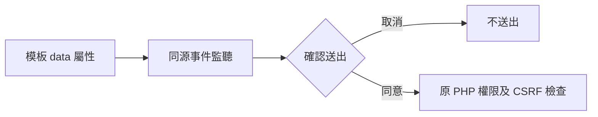

# Design: [#30] 修復前端操作與部署驗證

## 需求與實作

維持原後端路由、表單欄位、CSRF、角色檢查與 CSP。把應用程式模板的行內事件改為 `assets/app.js` 的同源事件監聽：表單 `submit` 依 submitter 或表單的 `data-confirm` 提示，取消呼叫 `preventDefault()`；多重記錄表單與轉帳重置使用各自同源監聽；管理頁需載入共用 JS。動態確認文字經 `h()` 輸出到屬性，不執行該字串。不篡改既有角色/確認語意。以 UTC 當作日曆運算容器計算伺服器傳來的台北日期字串與日差，不依賴使用者時區。

## 多幣別編輯回歸

Docker 實測新增美元記錄成功，但送出同樣格式的 `32.5000` 匯率編輯時被拒絕。原編輯程式誤用兩位小數的金額解析器，且以分取代萬分位。改用新增頁已使用的匯率解析與範圍驗證，不改資料表或換算規則。

## 驗證方式

使用隔離 SQLite 資料，Node 測日曆與事件、Chrome 測實際點擊及取消送出，Docker Apache 以子目錄測試既有 `.htaccess` 防止存取私密資料；HTTP 測試以資料庫結果驗證寫入，不以 200 代替功能驗收。Docker/Node 不屬於正式部署依賴。原 [#8] 列印預覽不變。

## 實測結果（2026-11-27）

| 測試 | 已核對行為 | 結果 |
| --- | --- | --- |
| `python3 tests/run_browser_ui.py` | 兩個瀏覽器時區的台北快捷日期、重複記錄編輯視窗、取消作廢、無 Gemini 金鑰提示及模擬解析後手動儲存；SQLite 核對儲存金額與原分錄未作廢 | 實機 Chrome 通過。本地頁面請求限測試站同來源；不是網路沙箱，也未連線真實 Gemini。 |
| Node、HTTP 回歸 | 現有 Node 測試及隔離 PHP／SQLite HTTP 流程 | 7 項 Node、11 項 HTTP 通過。 |
| Docker Apache | PHP 8.1.34／8.4 下以子目錄啟動；含登入、Secure Cookie 標頭、私密路徑封鎖、匯入匯出及主要帳務操作 | 兩版通過；未驗正式 cPanel HTTPS。 |

瀏覽器測試另經獨立 Spec／Code／Security 靜態複查通過。執行端需 Node 24、Chrome、PHP 與 PDO SQLite；可透過 `CHROME_BIN`、`PHP_BIN` 指定執行檔。
