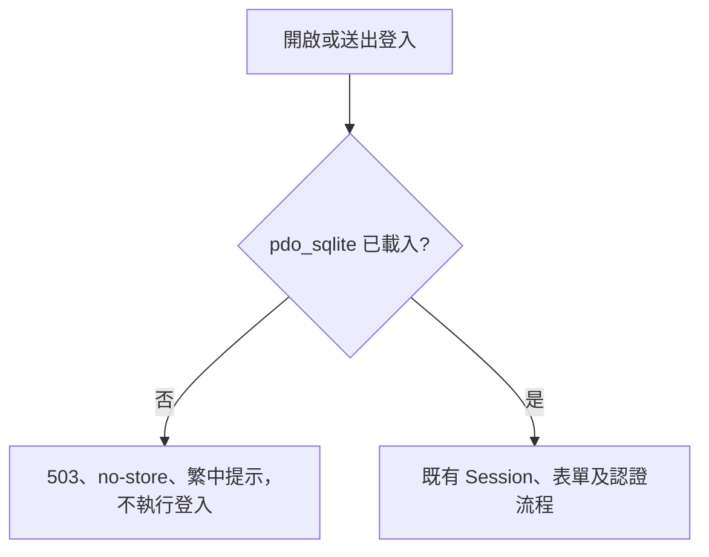

# [#31] Design：登入安裝診斷

| 項目 | 內容 |
| --- | --- |
| 版本 | v1.1 |
| 需求 | [planning.md](./planning.md)、[部署驗收第 9 項](../FINAL_NOTES.md) |
| 影響 | `login.php`、`tests/test_missing_sqlite_driver.py`；不變更 `db.php` 與 API 格式 |

`login.php` 在 Session 轉址及 POST 前以 `extension_loaded('pdo_sqlite')` 判斷。缺少擴充時沿用登入卡片及 `h()` 輸出提示、隱藏表單，不進入認證，不顯示原始例外。`index.php` 原有相對轉址不改。已登入時直接存取其他業務路由的故障格式不在本項變更範圍。

## 驗證
使用隔離 `php -n` 伺服器且 `display_errors=0`，確認登入 GET／POST 均回 503、`Cache-Control: no-store`、提示及無表單／資料庫。另以已載入擴充的本機 PHP 與 Apache 回歸正常與錯誤登入。

## 第三方審查
設計及實作的獨立 Spec／Code／Security 審查均無阻塞，詳見 [Review.md](./Review.md)。

## 本機驗收結果
基線缺少擴充時為 GET 200、帶有效 CSRF 的 POST 500。新增 `tests/test_missing_sqlite_driver.py`，先確認舊版因 GET 200 失敗，再驗修正後 GET／POST 均為 503、`no-store`、顯示提示且無登入表單、無 SQLite 檔，根入口維持 `./login.php` 相對轉址。本機 34 項 HTTP 回歸與 7 項 Node 測試皆通過；含擴充的 Apache PHP 8.1 子目錄登入另已實測。不是正式 cPanel 驗收。
