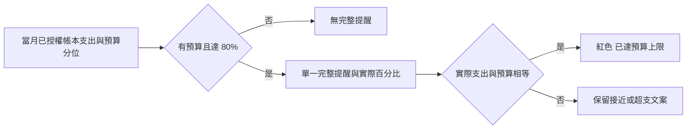

# Design: [#32] 每月帳本預算提醒

| 版本 | 狀態 |
| --- | --- |
| v1.1 | 已本機修正與驗證；單日篩選的聚合問題另由 [#33] 處理 |

## 需求與現況

- R1：`dashboard.php` 有一般 `alert`、專用 `budget-banner` 及表格小標籤；兩個完整提示重複，danger 路徑硬設 100%。
- R2：`ledger.php` 有專用橫幅、進度盒及另外一個一般 `alert`；兩個完整提醒重複，進度盒已區分剩餘與超支金額。
- R3：延續 [#5] 使用者已確認的門檻：≥80% 黃色、≥100% 紅色，完全用分位比較；沒有改變寫入條件的需求。

## 詳細設計

1. `dashboard.php`：移除較早且重複的普通 `alert` 區塊，保留既有專用 `budget-banner`、類別預算及表格晶片。用既有 `calcBudgetStatus()` 和 `getBudgetPercent()` 作帳本橫幅的門檻與百分比；表格晶片維持同一門檻。橫幅與晶片以整數分完全相等時顯示「已達預算上限」，比上限高仍使用原超支文案。79.99% 不出現橫幅或表格晶片；150% 顯示 150%。
2. `ledger.php`：移除較後且重複的普通 `alert`；保留專用警示與既有進度盒。以支出分位等於預算分位決定紅色文案，不能比較已取整的百分比（100.01 元仍超支）。實際百分比與上限 100% 的進度條保留其各自原意。
3. 不改 SQL、SQLite 結構、權限、CSRF、查詢範圍、會話、任何寫入、路由、CSS 或外部服務。以原 `h()` 轉義保護資料，保留單一 `role=alert`、摘要晶片、原進度盒與個別類別提示。

## 驗證計畫

- 新增 `tests/test_ledger_budget_notices.py` 使用原 HTTP fixture 真實設定 100.00 元、逐筆寫入支出；保留原 `tests/test_ledger_budget_thresholds.py`。測 79.99、80.00、100.00、100.01、150.00 元；對兩頁確認完整警示文字及數量、每帳本晶片／進度盒、精確餘額與 CSS 寬度。100.01 元的百分比顯示 100%，仍因整數分位已超過預算而顯示超支。歷史月份與清除預算仍無警示。
- 同一份測試先對 `ea6aa4a` 見紅（同一帳本兩個完整提醒或錯誤百分比／文案），再對候選見綠。整合前另跑 PHP lint、HTTP 套件及實作階段獨立複審。不以靜態判讀宣稱正式站或瀏覽器版型已驗。

## 實作與驗收結果

- OpenCode 修改 `dashboard.php` 與 `ledger.php` 共兩處畫面；未改帳務查詢或任何寫入。保留各自摘要標籤和帳本進度盒。
- 同一永久回歸在舊版因提醒重複、使用率與文案錯誤而失敗，修正版通過。隔離候選兩個 PHP 檔通過語法檢查，完整 HTTP 套件 35 項通過；Codex 的獨立設計及實作審查均通過（見 [Review.md](./Review.md)）。
- 當時未納入的單日篩選問題：月支出 90.00 元，篩選只有 2.00 元支出的日期時，「本月預算」會誤用 2.00 元。本項不改資料聚合，另見 [#33](../%5B%2333%5D_monthly-budget-date-filter/Design.md) 的修正與實測。
