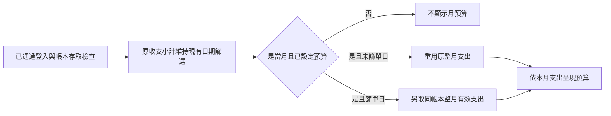

# Design: [#33] 本月預算與單日小計分離

| 版本 | 狀態 |
| --- | --- |
| v1.1 | OpenCode 已修正；設計、實作審查與隔離回歸通過 |

## 範圍與資料流

[#5] 要求月預算使用該帳本的本月支出。`ledger.php` 的單日彙總應保留給收支小計，但目前月預算也借用同一個支出金額。唯讀修正不改路由、表單、權限、資料庫結構或其他報表。

## 實作契約

只改 `ledger.php`。新增月預算專用整數分變數。只有當月、已設定正數預算且有已驗證之單日篩選時，執行一次針對已授權帳本的唯讀 `COALESCE(SUM(e.amount_cents), 0)`。用具名參數綁定帳本、使用者、支出類型、台北年月起迄；`INNER JOIN ledger_access` 以帳本與使用者篩選，排除 `deleted` 分錄。其他有效的當月請求不新增查詢；歷史月份及未設定預算沿用既有無橫幅行為。

專用月支出變數同時用於警報門檻、使用率、餘額、兩個紅色狀態文案，以及橫幅與預算盒的支出文字；不得替換單日小計或分錄清單所用的 `$expenseCents`。維持原精確分位、輸出轉義、80%／100% 門檻與 UI。查詢不寫入，無新外部依賴。

## 驗證

隔離回歸的原實作跑出 `day: expected one 90% warning with 90.00 monthly spent`，但整月與儀表板相同斷言已通過。驗證修正版同一個測試：同月支出 2.00＋88.00 元，月預算 100.00 元，選第一日只顯當日分錄與 2.00 元小計，月支出仍為 90.00 元、警告 90%、剩 10.00 元。不計收入、轉帳、作廢、前月資料；前月不出現當月預算。通過後保留自動回歸，重跑 PHP lint、HTTP 套件。

實作使用 `$monthlyBudgetExpenseCents`，只有當月的單日檢視且已設預算時才另查整月支出。`tests/test_monthly_budget_date_filter.py` 同一測試修正前失敗、修正後通過。額外隔離探針確認另一名成員的支出計入，同一登入者能存取的另一帳本仍不計。候選通過 PHP lint、36 項 HTTP、7 項 Node；不代表已部署正式站。
