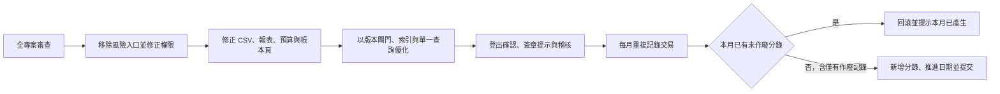

# Design: [#34] 全專案審查與修正

| 版本 | 狀態 |
| --- | --- |
| v1.0 | OpenCode 已修正；設計、實作審查與隔離回歸通過 |

## 範圍與資料流

依開發者全專案審查要求，OpenCode 以 `7cdcfb1`、`7d48cf0` 完成 11 項修正。沿用原生 PHP、PDO 預備陳述式、整數分與 Session／`ledger_access`，避免為修正引入新依賴或改變部署方式。

## 實作契約

| 項目 | 修正與實作契約 |
| --- | --- |
| 1. 風險檔案 | 刪除未登入可讀取原始碼並改寫 `db.php` 的 `fix_db.php`；一併移除 `temp_check.txt`、`nul` 與未被引用的 `lib/tcpdf`。 |
| 2. 分錄所有權 | `delete_entry.php`、`edit_entry.php` 的載入與寫入條件均加入 `entries.user_id` 限制：member 僅能修改／作廢自己的記錄，owner 不受記錄建立者限制。 |
| 3. 重複記錄權限 | `ledger.php` 的 `generate_recurring` 在 CSRF 驗證後只允許 owner／member，viewer 不得新增記錄。 |
| 4. CSV 匯入 | `import_csv.php` 支援系統匯出的 9 欄 CSV，並修正 `logError` 參數數量，消除由此造成的 HTTP 500。 |
| 5. 比較報表 | `comparison_report.php` 以整數分計算「本期－上期」及總差額，以 `formatSignedCents()` 顯示正負號；306.00－200.00 顯示 `+106.00`，不再顯示 494。 |
| 6. 類別預算與帳本頁 | `category_budget.php` 改為可自由輸入類別；`functions.php` 新增 `ledgerBudgetCategories()` 提供建議清單。帳本頁顯示轉帳合計及帶 `ledger_id` 的行事曆連結。 |
| 7. 效能 | `db.php` 以 `PRAGMA user_version` 讓同一結構版本只升級一次，新增 `idx_entries_ledger_deleted_date`、`idx_entries_recurring_source_date` 兩個複合索引；儀表板重複記錄提醒由 N+1 改為單一 GROUP BY 查詢。 |
| 8. 登出 | `logout.php` 的 GET 只顯示確認頁，不終止 Session；只有 POST 且通過 CSRF 驗證才登出。 |
| 9. 提示簽章 | `redirect()` 對 `msg` 自動附加 `msg_sig`，以 Session CSRF token 為金鑰計算 HMAC-SHA256；`signedNotice()` 以恆時比較驗證後才回傳文字，15 個讀取點改用它，輸出仍經 `h()` 轉義。 |
| 10. 帳本稽核 | 封存／還原帳本分別補 `logAudit('ledger_archive')`／`logAudit('ledger_restore')`，保留操作者與帳本識別資訊。 |
| 11. 每月重複記錄 | 開發者核准由 `nextMonthlyDueDate()` 依 `start_date` 日數逐月推進到今日之後，日數超過當月長度時夾到月底（1/31 → 2/28 → 3/31）。`BEGIN IMMEDIATE` 交易內檢查本月來源分錄，已作廢者不計；重複則回滾並提示「本月已產生過此重複記錄。」，否則新增分錄、更新 `next_due_date` 後一起提交。 |

## 驗證

新增 `tests/test_permission_boundaries.py`、`tests/test_csv_import_roundtrip.py`、`tests/test_schema_version.py`、`tests/test_budget_categories_and_ledger_links.py`、`tests/test_logout_notice_audit.py`、`tests/test_recurring_cycle.py`，每個測試檔均在修正前基準失敗、修正後通過。`tests/apache_smoke.py` 更新登出步驟；`tests/test_comparison_report.py`、`tests/test_category_management_lifecycle.py` 調整為有號差額與提示簽章等新契約。

Reviewer 實跑：32 個 Python 測試檔全部通過，Node 7/7、Chrome UI 7 項檢查通過，所有 PHP 檔 `php -l` 通過；`php:8.4-apache` 與 `php:8.1-apache` 的 Apache 子目錄 smoke 各 9 步皆 OK，兩版本的 `.htaccess` 探針均封鎖 `.git`、`.env*`、`docs/`、`tests/`、`private_data` 等 18 個敏感路徑。
