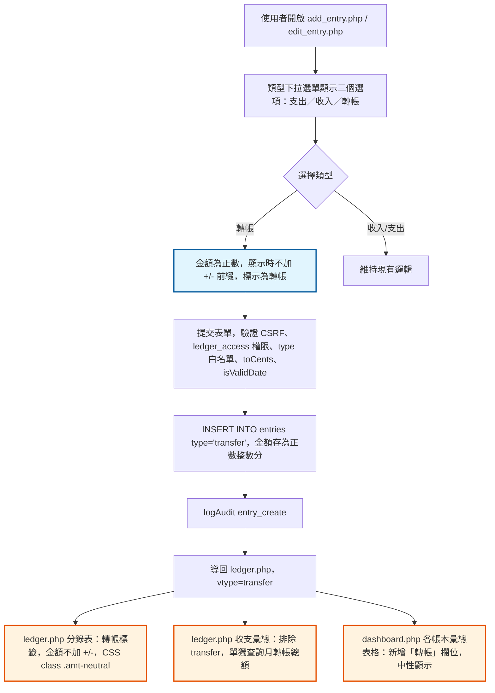
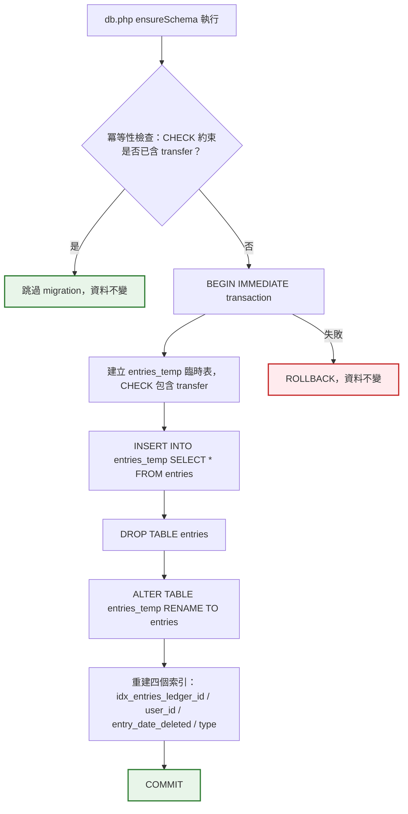

# Design: 轉帳記錄（第三種記帳類型）

## 文件基本資訊

| 項目 | 內容 |
| --- | --- |
| 文件名稱 | Design: 轉帳記錄（第三種記帳類型） |
| 版本 | v1.0 |
| 建立日期 | 2026-11-21 |
| 更新日期 | 2026-11-21 |
| 變更摘要 | 初始設計，依 Planning 四項功能拆解為程式修改路徑與資料庫變更 |

## 來源 Planning 與需求摘要

- Planning 檔案：`docs/transfer-entry/planning.md`
- 對應 Feature：轉帳記錄（第二階段第 5 項）
- 需求摘要：新增「轉帳」記帳類型，作為「收入」與「支出」之外的第三種類型；不新增資料庫表，僅擴充 `entries.type` CHECK 約束；轉帳不計入收入/支出彙總，單獨顯示；所有修改維持專案硬性約束。

## 設計概述

本設計依循專案既有設計系統與硬性約束（PDO 預備陳述式、整數分金額、CSRF、h() XSS 轉義、ledger_access 權限模型、純 PHP 伺服端渲染）。主要變更如下：

1. **資料庫變更（db.php）**：在 `ensureSchema()` 中，透過表重建方式將 `entries.type` CHECK 約束從 `('income','expense')` 擴充為 `('income','expense','transfer')`；包在 `BEGIN IMMEDIATE` transaction 內，加入冪等性守衛，失敗則 `ROLLBACK`。
2. **新增記錄表單（add_entry.php / edit_entry.php）**：類型下拉選單新增「轉帳」option（中性色）；型別驗證白名單加入 `'transfer'`；語音回饋改為三元判斷；轉帳不顯示「傳票 XX-XXX 已立」。
3. **收支彙總（ledger.php / dashboard.php）**：收入/支出彙總排除 `type='transfer'`；新增轉帳總額查詢；dashboard 各帳本彙總表格新增「轉帳」欄位。
4. **查帳篩選（ledger.php）**：類型篩選下拉新增「轉帳」選項；`$typeSel` 白名單加入 `'transfer'`。
5. **匯出 CSV（export_csv.php）**：類型欄位改為三元判斷，轉帳顯示為「轉帳」。
6. **ai_parse.php**：無需修改（現有已嚴格限定 `['income','expense']`，AI 不回傳 `'transfer'`）。
7. **作廢記錄（delete_entry.php）**：無需修改（軟刪除對轉帳同樣適用）。

## 設計圖表（Mermaid）





## 程式修改路徑

| 檔案 | 修改內容 |
| --- | --- |
| `db.php` | 在 `ensureSchema()` 中，`audit_log` 建表之後、`login_sessions` 建表之前，插入 `entries.type` CHECK 約束擴充 migration：<br>1. 冪等性檢查：查詢 `sqlite_master` 確認 `entries.sql` 是否已含 `'transfer'`；若已含，跳過。<br>2. `BEGIN IMMEDIATE` via `$pdo->exec('BEGIN IMMEDIATE')`。<br>3. `DROP TABLE IF EXISTS entries_temp`。<br>4. 建立 `entries_temp`（CHECK 包含 `'transfer'`）。<br>5. `INSERT INTO entries_temp SELECT * FROM entries`。<br>6. `DROP TABLE entries`。<br>7. `ALTER TABLE entries_temp RENAME TO entries`。<br>8. 重建索引：`idx_entries_ledger_id`、`idx_entries_user_id`、`idx_entries_entry_date_deleted`、`idx_entries_type`。<br>9. `COMMIT`；失敗則 `ROLLBACK`。 |
| `ledger.php` | 1. `$typeSel` 白名單（現為 `['', 'income', 'expense']`）：擴充為 `['', 'income', 'expense', 'transfer']`。<br>2. 收入／支出彙總 SQL（現用 `GROUP BY type`，迴圈僅判斷 income/expense）：防禦性加上 `AND e.type != 'transfer'`；新增轉帳總額查詢 `SELECT COALESCE(SUM(amount_cents), 0) FROM entries WHERE ledger_id = :ledger_id AND deleted = 0 AND entry_date BETWEEN :ms AND :me AND type = 'transfer'`，結果存入新變數 `$transferCents` 並傳至模板顯示。<br>3. 類型篩選下拉選單（現只有 expense/income 兩個 option）：新增「轉帳」option。<br>4. 類型標籤（現為 `$entry['type'] === 'income' ? '收' : '支'`）：改為三元判斷（income → 收，expense → 支，transfer → 轉帳）。<br>5. 金額前綴（現為 `$entry['type'] === 'income' ? '+' : '-'`）：改為三元判斷（income → +，expense → -，transfer → 空字串）。<br>6. CSS class（現為 `'amt-in' : 'amt-out'`）：改為三元判斷（income → `amt-in`，expense → `amt-out`，transfer → `amt-neutral`）。<br>7. **vno chip（傳票編號標籤，現為 `<span class="vno <?php echo $entry['type'] === 'income' ? 'in' : 'out'; ?>"><?php echo $entry['type'] === 'income' ? '收' : '支'; ?>`）**：改為三元判斷（income → `in` / 收，expense → `out` / 支，transfer → `plain` / 轉），複用既有 `.vno.plain` 中性樣式（style.css 第 220 行已定義墨色背景）。<br>8. 傳票訊息條件（現為 `in_array($voucherType, ['income', 'expense'], true)`）：維持不變，轉帳（`vtype=transfer`）不滿足條件，不顯示「傳票 XX-XXX 已立」。 |
| `dashboard.php` | 1. 各帳本 `month_income` / `month_expense` 子查詢（現用 `e.type = 'income'` / `e.type = 'expense'`）：加上 `AND e.type != 'transfer'`（防禦性）；新增 `month_transfer` 子查詢（`WHERE type = 'transfer'`）。<br>2. 各帳本彙總表格 `<thead>`：在「本月」群組（收入、支出、結餘）之後新增一欄「轉帳」，中性顯示。<br>3. `<tbody>`：新增對應 `<td>` 輸出 `month_transfer` 數值，中性顯示。 |
| `add_entry.php` | 1. 型別驗證白名單（現為 `['income', 'expense']`）：改為 `['income', 'expense', 'transfer']`。<br>2. 類型下拉選單（現只有 expense/income 兩個 option）：新增「轉帳」option（中性色）。<br>3. 語音回饋文字（現為 `($type === 'income' ? '收入' : '支出')`）：改為三元判斷，具體語法為 `($type === 'income' ? '收入' : ($type === 'expense' ? '支出' : '轉帳')) . ' ' . formatCents($cents) . ' 元已儲存'`（income → 收入，expense → 支出，transfer → 轉帳）。 |
| `edit_entry.php` | 1. 型別驗證白名單（現為 `['income', 'expense']`）：改為 `['income', 'expense', 'transfer']`。<br>2. 類型下拉選單（現只有 expense/income 兩個 option）：新增「轉帳」option（中性色）。<br>3. 語音回饋文字（現為 `($type === 'income' ? '收入' : '支出')`）：改為三元判斷，具體語法為 `($type === 'income' ? '收入' : ($type === 'expense' ? '支出' : '轉帳')) . ' ' . formatCents($cents) . ' 元已儲存'`（income → 收入，expense → 支出，transfer → 轉帳）。 |
| `export_csv.php` | 匯出 CSV 時，`type` 欄位顯示由 `$type === 'income' ? '收入' : '支出'` 改為三元判斷（income → 收入，expense → 支出，transfer → 轉帳）。 |
| `ai_parse.php` | 無需修改（現有第 168 行已嚴格限定 `['income', 'expense']`）。 |
| `delete_entry.php` | 無需修改（軟刪除對轉帳同樣適用）。 |
| `assets/style.css` | 新增 `.amt-neutral` CSS class（中性色，不使用紅/藍），沿用既有設計系統變數。 |
| `admin/users.php`、`admin/ledgers.php`、`admin/audit_log.php` | 無需修改（分類管理頁面已新增，轉帳不涉及後台權限變更）。 |
| 無新增檔案 | 不新增 PHP 頁面，不新增資料表，不新增外部依賴。 |

## 資料庫變更

### 1. `entries.type` CHECK 約束擴充

需在 `db.php::ensureSchema()` 中，**在 `entries` 表已 CREATE 之後**、**所有 `CREATE INDEX` 之前**插入 migration（建議位置：`audit_log` 建表之後、`login_sessions` 建表之前，或任何 `entries` 表已存在且尚未建立索引的位置）：


```php
// 冪等性檢查：查詢 sqlite_master 確認 entries.sql 是否已包含 'transfer'
// 避免插入測試記錄觸發外鍵約束失敗，導致誤判並每次請求都嘗試表重建
$row = $pdo->query("SELECT sql FROM sqlite_master WHERE type='table' AND name='entries'")->fetch();
$currentSql = $row === false ? '' : (string) ($row['sql'] ?? '');
$migrationNeeded = !str_contains($currentSql, "'transfer'");

if ($migrationNeeded) {
    $pdo->exec('BEGIN IMMEDIATE');
    try {
        $pdo->exec('DROP TABLE IF EXISTS entries_temp');
        $pdo->exec('CREATE TABLE entries_temp (
            id            INTEGER PRIMARY KEY AUTOINCREMENT,
            ledger_id     INTEGER NOT NULL,
            user_id       INTEGER NOT NULL,
            amount_cents  INTEGER NOT NULL,
            type          TEXT    NOT NULL CHECK (type IN (''income'',''expense'',''transfer'')),
            category      TEXT    NOT NULL DEFAULT '''',
            entry_date    TEXT    NOT NULL,
            note          TEXT    NOT NULL DEFAULT '''',
            receipt_path  TEXT    NOT NULL DEFAULT '''',
            deleted       INTEGER NOT NULL DEFAULT 0,
            created_at    TEXT    NOT NULL DEFAULT (datetime(''now'',''localtime'')),
            FOREIGN KEY (ledger_id) REFERENCES ledgers(id),
            FOREIGN KEY (user_id)   REFERENCES users(id)
        )');
        $pdo->exec('INSERT INTO entries_temp SELECT * FROM entries');
        $pdo->exec('DROP TABLE entries');
        $pdo->exec('ALTER TABLE entries_temp RENAME TO entries');
        $pdo->exec('CREATE INDEX IF NOT EXISTS idx_entries_ledger_id ON entries(ledger_id)');
        $pdo->exec('CREATE INDEX IF NOT EXISTS idx_entries_user_id ON entries(user_id)');
        $pdo->exec('CREATE INDEX IF NOT EXISTS idx_entries_entry_date_deleted ON entries(entry_date, deleted)');
        $pdo->exec('CREATE INDEX IF NOT EXISTS idx_entries_type ON entries(type)');
        $pdo->exec('COMMIT');
    } catch (Throwable $e) {
        $pdo->exec('ROLLBACK');
        logError('entries.type migration failed: ' . $e->getMessage());
    }
}
```

注意：`$pdo->exec('BEGIN IMMEDIATE')` 而非 `$pdo->beginTransaction()`，因為 PDO 在 SQLite 預設為 `BEGIN DEFERRED`。

### 2. 索引重建

`DROP TABLE entries` 會連同索引一併刪除，migration 結尾必須重建以下四個索引：
- `idx_entries_ledger_id`
- `idx_entries_user_id`
- `idx_entries_entry_date_deleted`
- `idx_entries_type`

### 3. 無新增資料表

不新增資料庫表，僅擴充 `entries.type` CHECK 約束。`recurring_entries.type` 本期不擴充。

## 前端變更說明

### 轉帳顯示規則（ledger.php 分錄表）

| 欄位 | 收入 (income) | 支出 (expense) | 轉帳 (transfer) |
| --- | --- | --- | --- |
| 類型標籤 | 收 | 支 | 轉帳 |
| 金額前綴 | + | - | （無） |
| CSS class | amt-in | amt-out | amt-neutral |
| 顏色 | 紅色 | 藍色 | 墨色（中性） |

### CSS 類別 `.amt-neutral`（assets/style.css）

```css
.amt-neutral {
    color: var(--ink);
    font-weight: 700;
}
```

與既有 `.amt-in`（紅色）與 `.amt-out`（藍色）並存，不使用紅/藍色，避免僅靠顏色傳達狀態（符合長輩友善原則）。

### 表單下拉選單（add_entry.php / edit_entry.php）

類型下拉選單新增第三個 option：
```html
<option value="transfer">轉帳</option>
```
不套用紅/藍色，中性顯示。

## 預期行為與驗證方法

| 驗收項 | 預期行為 | 驗證方法 |
| --- | --- | --- |
| CHECK 約束包含 transfer | 資料庫可接受轉帳記錄 | 插入一筆 `type='transfer'` 記錄，確認無錯誤 |
| Migration 冪等性 | 第二次執行 `ensureSchema` 不會重複插入資料或毀損資料 | 重複載入頁面，確認 entries 資料筆數不變 |
| 下拉選單三個選項 | 支出聯（藍）、收入聯（紅）、轉帳（中性色） | 開啟 add_entry.php / edit_entry.php，確認三個選項 |
| 轉帳不計入月收入/支出 | 轉帳記錄不影響月收入、月支出彙總 | 建立一筆轉帳記錄，確認總收入/總支出不變 |
| 轉帳總額單獨顯示 | dashboard 各帳本彙總表格顯示「本月轉帳總額」欄位 | 開啟 dashboard.php，確認有轉帳欄位且數值正確 |
| 分錄表顯示規則 | 轉帳標籤「轉帳」，金額不加 +/-，CSS class `.amt-neutral` | 開啟 ledger.php，確認轉帳記錄顯示正確 |
| 查帳類型篩選 | 下拉選單有「轉帳」選項，可單獨檢視轉帳記錄 | 選擇「轉帳」篩選，確認只顯示轉帳記錄 |
| 語音回饋 | 「轉帳 [金額] 元已儲存」 | 儲存轉帳記錄，確認語音內容正確 |
| 不顯示傳票訊息 | 轉帳儲存後不顯示「傳票 XX-XXX 已立」 | 儲存轉帳記錄，確認無傳票訊息 |
| 作廢記錄 | 轉帳記錄可軟刪除，作廢後不出現在彙總與列表 | 作廢一筆轉帳記錄，確認不再顯示 |
| export_csv 類型顯示 | 轉帳記錄類型欄位顯示為「轉帳」 | 匯出 CSV，確認轉帳記錄類型為「轉帳」 |
| 權限檢查 | viewer / 無帳本權限者無法新增或編輯轉帳記錄 | 以 viewer 角色開啟頁面，確認受阻 |
| 所有輸出 h() 轉義 | 分類名稱、訊息皆經 h() 轉義 | 檢查 HTML 原始碼，確認特殊字元被轉義 |

## 非本期範圍（Out of Scope）

- 不新增跨帳本轉帳、不新增轉帳對象欄位、不新增轉帳報表、不新增轉帳預算。
- 不新增轉帳重複記錄（recurring_entries.type 不擴充）。
- AI 一句話記帳不回傳 `'transfer'` 類型。

## 身分驗證與權限模型

不變更既有登入與帳本權限模型。繼續使用 session 登入與 `ledger_access` 權限檢查（owner/member 可寫入，viewer 僅檢視）。轉帳記錄的新增/編輯/作廢繼續使用現有權限檢查，與收入/支出記錄一致。

## 資料傳輸加密標準

無新增外部 API 呼叫，全部為伺服端 SQL 與 session 驗證，資料僅儲存在站台自身 SQLite 資料庫。

## 非功能性需求

- **效能**：轉帳記錄為單一筆寫入，查詢時多一個 `WHERE type = 'transfer'` 的 SUM 查詢，資料量極小，效能影響可忽略。
- **併發**：SQLite WAL 模式已啟用，migration 表重建包在 `BEGIN IMMEDIATE` 內，寫入競合可接受。
- **資料保留**：轉帳記錄與收入/支出記錄同樣保留，軟刪除後不顯示但不刪除實體資料。
- **可用性**：migration 失敗時 `ROLLBACK`，資料不損毀；錯誤寫入 `error.log`，不影響頁面渲染。

## 差異與待確認

與 Planning 核心需求一致，所有待確認事項於 Planning 中已鎖定。

### 待釐清事項（非阻塞）

1. **migration 冪等性守衛的測試記錄與外鍵約束**：planning 採用嘗試插入 `ledger_id=0, user_id=0` 的測試記錄，若 SQLite 啟用外鍵約束（`PRAGMA foreign_keys=ON`），此 INSERT 可能因外鍵失敗而拋出異常，導致冪等性檢查誤判。建議在實作時採用更可靠的守衛條件，例如查詢 `sqlite_master.sql` 是否包含 `'transfer'`，或使用現有合法的 `ledger_id` / `user_id` 作為測試模板。
2. **ledger.php 行號參考**：planning 大量參考絕對行號（第 266-269 行、第 755 行等），實作時請以程式碼內容而非行號為準，因為後續修改可能導致行號漂移。
3. **dashboard 預算紅線**：planning AC #5 說轉帳不計入月收入/支出彙總，dashboard 預算紅線僅以 `month_expense` 判斷，轉帳不影響，此點無需變更，planning 已正確說明。
4. **Migration 後驗證（選擇性）**：建議在 migration `COMMIT` 後加入簡單查詢確認 `entries` 表可正常存取（例如 `SELECT COUNT(*) FROM entries`），失敗則記錄 `error.log`，不影響頁面渲染。

## 設計審查記錄（設計階段）

| 階段 | 狀態 | 日期 | 備註 |
| --- | --- | --- | --- |
| Spec（規格）審查 | 已通過 | 2026-11-21 | 與 Planning 與現有程式碼一致 |
| Code（程式）審查 | 待審查 | — | 檢查 db.php migration、ledger.php / dashboard.php / add_entry.php / edit_entry.php / export_csv.php 修改路徑與相容性 |
| Security（資安）審查 | 待審查 | — | 檢查 XSS（h() 轉義）、SQL 注入（PDO 預備陳述式）、CSRF、IDOR（ledger_access 權限）、migration 冪等性 |

實作階段完成後，需在同一份 Design.md 補上「實際變更」與「驗證證據」，並執行實作審查（Spec → Code → Security）。