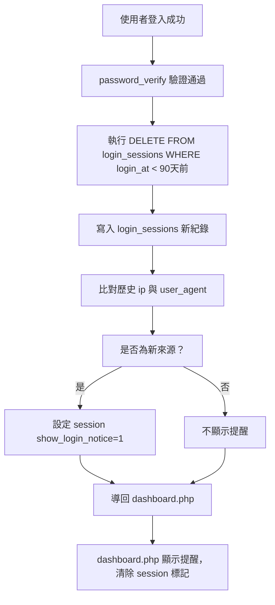

# Design: 登入異常通知（新裝置／新 IP 登入提醒）

## 文件基本資訊

| 項目 | 內容 |
| --- | --- |
| 文件名稱 | Design: 登入異常通知（新裝置／新 IP 登入提醒） |
| 版本 | v1.0 |
| 建立日期 | 2026-11-21 |
| 更新日期 | 2026-11-21 |
| 變更摘要 | 初始設計，依 Planning 四項功能拆解為程式修改路徑與資料庫變更 |

## 來源 Planning 與需求摘要

- Planning 檔案：`docs/login-anomaly-notice/planning.md`
- 對應 Feature：14（登入異常通知）
- 需求摘要：新增 `login_sessions` 資料表記錄每次成功登入的 IP 與 User-Agent；下次登入時比對歷史紀錄，若 IP 或 User-Agent 任一為新來源，於儀表板顯示提醒；90 天資料保留，登入時自動清理過期紀錄。

## 設計概述

本設計依循專案既有設計系統與硬性約束（PDO 預備陳述式、整數分金額、CSRF、h() XSS 轉義、session 登入、ledger_access 權限模型）。五個核心變更：

1. **資料庫變更**（`db.php`）：新增 `login_sessions` 表（含 `CHECK` 約束），沿用現有 `PRAGMA table_info` + `ALTER TABLE` 舊資料庫遷移範式。
2. **登入來源記錄**（`login.php`）：`password_verify` 成功後，寫入 `login_sessions`（ip、user_agent、login_at、is_first_seen），記錄失敗不阻擋登入，改寫 `error.log`。
3. **90 天資料保留**（`login.php`）：登入成功後、寫入 `login_sessions` 之前，單獨執行 `DELETE FROM login_sessions WHERE login_at < :cutoff`（cutoff = 90 天前，Asia/Taipei），不放入 `getPdo()`。
4. **異常判定與提醒**（`login.php`、`dashboard.php`）：以 IP 為主要判定依據。IP 為空字串時不視為異常，不寫入紀錄也不顯示提醒。若目前 IP 與該使用者歷史 `login_sessions` 的 ip 不同，視為「新登入來源」，於 session 設定 `show_login_notice=1` 並存入新來源資訊（ip、login_at）；`dashboard.php` 檢查 session 並顯示提醒，顯示後清除標記。User-Agent 寫入 `login_sessions` 僅供參考，不參與異常判定。
5. **audit_log 與 login_sessions 分工**：audit_log 記錄登入動作（action = 'login'，detail 為空），login_sessions 記錄登入來源，兩表分離存放。

## 設計圖表（Mermaid）

### 登入異常判定時序圖

```mermaid
sequenceDiagram
    participant 使用者
    participant login.php
    participant db.php
    participant dashboard.php
    participant login_sessions

    使用者->>login.php: 提交帳密
    login.php->>login.php: password_verify 驗證
    login.php->>db.php: 寫入 audit_log (action='login')
    login.php->>login.php: 登入成功前，執行 90 天清理 DELETE
    login.php->>login_sessions: 查詢該使用者歷史 ip
    alt 目前 IP 與歷史 ip 不同（新來源）
        login.php->>login.php: 設定 session show_login_notice=1
        login.php->>login.php: 存入新來源資訊 (ip, login_at)
        login.php->>login_sessions: INSERT (ip, user_agent, login_at, is_first_seen=1)
        login.php->>dashboard.php: 導回，攜帶 session 標記
        dashboard.php->>dashboard.php: 檢查 session，顯示提醒
        dashboard.php->>dashboard.php: 清除 session 標記
    else IP 已使用過
        login.php->>login_sessions: INSERT (ip, user_agent, login_at, is_first_seen=0)
        login.php->>dashboard.php: 導回，不顯示提醒
    end
        login.php->>login.php: 設定 session show_login_notice=1
        login.php->>login.php: 存入新來源資訊 (ip, login_at)
        login.php->>dashboard.php: 導回，攜帶 session 標記
        dashboard.php->>dashboard.php: 檢查 session，顯示提醒
        dashboard.php->>dashboard.php: 清除 session 標記
    else IP 已使用過
        login.php->>dashboard.php: 導回，不顯示提醒
    end
```

### 90 天資料保留清理



## 程式修改路徑

| 檔案 | 修改內容 |
| --- | --- |
| `db.php` | 在 `ensureSchema()` 中，將 `login_sessions` 建表 SQL 與兩個 `CREATE INDEX` 作為一個完整的 `$pdo->exec` 塊，插在 `CREATE TABLE IF NOT EXISTS audit_log` 建表語句結束（第 120 行附近）與第二個 `CREATE INDEX` exec 塊開始（第 122 行附近）之間，不與既有索引混在一起。 |
| `login.php` | `password_verify` 成功後、`logAudit('login', ...)` 之後、`redirect('./dashboard.php')` 之前插入：(1) 執行 90 天清理 `DELETE FROM login_sessions WHERE login_at < :cutoff`；(2) 寫入 `login_sessions`（ip、user_agent 寫入前以 `mb_substr($ua, 0, 255)` 截斷、login_at、is_first_seen=1；User-Agent 僅供參考，不參與判定）；(3) 比對歷史 ip，若目前 IP 與歷史不同，設定 `$_SESSION['show_login_notice']=1` 並存入新來源資訊（ip、login_at）；(4) 記錄失敗以 `logError()` 寫入 `error.log`，不阻擋登入。 |
| `dashboard.php` | 在 `.page-head` 內、h1 標題下方、`<a class="btn primary">` 之前檢查 `$_SESSION['show_login_notice']`，若為 1 則以 `h()` 轉義後顯示提醒訊息（IP 與登入時間），顯示後 `unset` 該標記。 |
| `assets/style.css` | 不新增樣式，複用既有 `.alert` 樣式顯示提醒。 |

## 資料庫變更

### 新增 `login_sessions` 表

需在 `db.php::ensureSchema()` 的 `CREATE TABLE IF NOT EXISTS audit_log` 區塊之後、`CREATE INDEX` 區塊之前插入：

```sql
CREATE TABLE IF NOT EXISTS login_sessions (
    id           INTEGER PRIMARY KEY AUTOINCREMENT,
    user_id      INTEGER NOT NULL,
    ip           TEXT    NOT NULL DEFAULT '',
    user_agent   TEXT    NOT NULL DEFAULT '',
    login_at     TEXT    NOT NULL,
    is_first_seen INTEGER NOT NULL DEFAULT 1 CHECK (is_first_seen IN (0,1)),
    FOREIGN KEY (user_id) REFERENCES users(id)
);
CREATE INDEX IF NOT EXISTS idx_login_sessions_user_id  ON login_sessions(user_id);
CREATE INDEX IF NOT EXISTS idx_login_sessions_login_at ON login_sessions(login_at);
```

`is_first_seen` 語義：該筆紀錄本身是否為該使用者首次見到此（ip, user_agent）組合。寫入新紀錄時若比對結果為「新來源」，設為 1；若為既有來源，設為 0。欄位僅供審計參考，不影響提醒顯示邏輯（提醒僅依 session 標記顯示）。

舊資料庫首次執行 `ensureSchema` 時若表不存在即自動建立，不需手動 migration；若未來需新增欄位，沿用現有 `PRAGMA table_info` + `ALTER TABLE` 範式（參照 `db.php` 第 135-171 行）。

## 前端變更說明

### 登入異常提醒橫幅

- 於 `dashboard.php` 頁面頂部顯示，複用既有 `.alert` 樣式（`.alert.warn` 或 `.alert.info`）。
- 提醒內容：`偵測到新登入來源：IP {ip}，時間 {login_at}，若非本人操作請立即變更密碼。` 顯示時 IP 與登入時間必須經 `h()` 轉義後輸出，符合專案「所有輸出經 h() 轉義」硬性約束。User-Agent 僅供參考，不顯示於提醒訊息中。
- 僅本次 session 顯示一次，顯示後清除 `$_SESSION['show_login_notice']` 標記。
- 不同裝置／瀏覽器各自顯示一次（session 隔離）。

### 無新增頁面

- 不建立獨立的帳戶安全設定頁面（非本期範圍）。
- 管理員查看登入來源歷史檢視列為後續版本，本期僅保留儀表板提醒。

## 預期行為與驗證方法

| 驗收項 | 預期行為 | 驗證方法 |
| --- | --- | --- |
| 登入來源記錄 | 成功登入後，系統記錄使用者 IP 與 User-Agent 至 `login_sessions` | 檢查 `login_sessions` 表是否有對應記錄 |
| 新來源提醒 | 從新 IP 登入時，儀表板顯示登入來源提醒（以 IP 為主要判定，User-Agent 變更不觸發） | 從不同 IP 登入，確認 dashboard.php 顯示提醒；同一 IP 不同裝置登入，確認不顯示提醒 |
| 已使用來源不提醒 | 從已使用過的 IP 登入時，不顯示提醒 | 重複從同一 IP 登入，確認無提醒 |
| 提醒內容 | 包含 IP 位址與登入時間，繁體中文，且 IP 與登入時間經 `h()` 轉義後輸出 | 確認提醒訊息格式；確認頁面原始碼中 IP 與時間經 `h()` 轉義 |
| 記錄失敗不阻擋登入 | 資料庫寫入失敗時，使用者仍可正常登入，錯誤寫入 error.log | 故意觸發資料庫錯誤，確認登入流程不受影響 |
| 權限隔離 | 僅登入者本人可看到自身的登入來源提醒 | 以不同使用者登入，確認不會看到他人提醒 |

## 設計審查記錄（設計階段）

| 階段 | 狀態 | 日期 | 備註 |
| --- | --- | --- | --- |
| Spec（規格）審查 | 待審查 | — | 將本 Design 與 `planning.md` 並排核對範圍、驗收條件 |
| Code（程式）審查 | 待審查 | — | 檢查 `db.php`、`login.php`、`dashboard.php` 修改路徑與相容性 |
| Security（資安）審查 | 待審查 | — | 檢查 IDOR 權限、XSS（`h()` 轉義）、敏感資料（IP、User-Agent）處理 |

> 設計審查三階段皆通過後方可進入實作。實作階段完成後，需在同一份 Design.md 補上「實際變更」與「驗證證據」，並執行實作審查（Spec → Code → Security）。

## 非本期範圍（Out of Scope）

- 不新增雙因素驗證。
- 不新增登入封鎖（現有 `login_attempts` 已有 15 分鐘鎖定機制）。
- 不新增密碼重設通知 Email 或簡訊通知。
- 不建立獨立的帳戶安全設定頁面。
- 管理員查看登入來源歷史檢視列為後續版本。

## 身分驗證與權限模型

不變更既有登入與帳本權限模型。繼續使用 session 登入機制：

- 登入來源記錄與提醒僅對應目前登入使用者，不跨使用者洩漏。
- `login_sessions` 查詢時以 `user_id = :user_id` 過濾，僅查詢當前登入使用者的紀錄。
- audit_log 已記錄 login 事件，本項為補充來源資訊。

## 資料傳輸加密標準

IP 與 User-Agent 均為 HTTP 請求本身攜帶資訊，不額外傳輸至外部伺服器；資料僅儲存在站台自身 SQLite 資料庫。

## 非功能性需求

- **效能**：`login_sessions` 預期資料量與登入次數成正比，家庭使用場景下資料量極小。
- **併發**：登入時單獨執行 DELETE 清理，不放入 `getPdo()`，避免將資料庫鎖定開銷帶入所有頁面。
- **資料保留**：90 天保留期限，登入時自動清理過期紀錄；長期未登入的帳號舊紀錄僅在下次登入時清理。
- **可用性**：登入來源記錄失敗不阻擋正常登入流程；IP 或 User-Agent 為空時不視為異常，不顯示提醒。

## 差異與待確認

與 Planning 核心需求一致，所有待確認事項於 Planning 中已鎖定：

- 同一新 IP 僅顯示一次，於 session 中標記已顯示，避免重複騷擾。
- 是否需要讓使用者在帳戶頁面主動檢視所有歷史登入來源，本期不建立，視為後續版本。
- 僅記錄 User-Agent，不額外記錄瀏覽器指紋，考量隱私。

### 本機隔離實測

- 首次成功登入顯示繁中提醒；同帳號同 IP／User-Agent 重新登入不顯示，更換 User-Agent 即使 IP 相同也顯示。提醒出現後重新整理即消失；不同帳號各自判定。實測結果描述目前程式行為，不為「只比 IP」與「同時比 User-Agent」的文件差異代作決定。
- 成功登入清除 91 天前的測試紀錄，保留 89 天前；刻意使測試資料庫的來源紀錄寫入失敗時，仍可正常登入並在 `error.log` 留下錯誤。
- **未修正：** 同帳號首次、相同來源再次、變更 User-Agent 三次實際落庫的 `is_first_seen` 分別為 `1、1、1`。同來源第二次畫面沒有提醒，但資料庫旗標與本文件時序圖預期的 `0` 不一致。