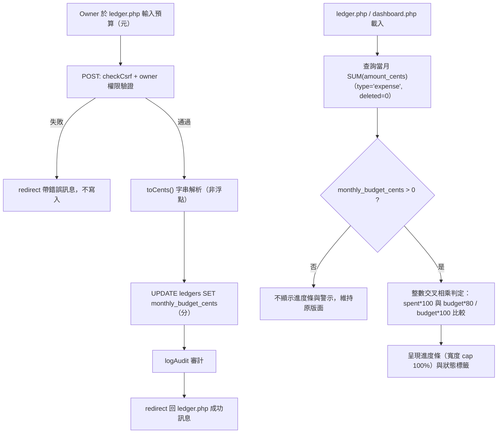

# Design & Implementation: 預算紅線與超支提醒

## 文件基本資訊

| 項目 | 內容 |
| --- | --- |
| 名稱 | 預算紅線與超支提醒設計 |
| 版本 | v1.1（設計審查後修訂） |
| 建立日期 | 2026-11-21 |
| 更新日期 | 2026-11-21 |
| 變更摘要 | v1.0 初稿送審，獨立審查判定「需修正」（3 阻塞、4 需修正）。v1.1 依審查與使用者決策修訂：權限定為僅帳本 Owner、補除零 guard、補 AC4 未設定預算行為、入口擇定、輸入改用 toCents()、邊界定為 ≥80%/≥100%、採納 migration 雙路徑、欄位更名、redirect 慣例、CSRF、審計紀錄、整數判定、超支呈現與當月語義 |

### 已確認決策（來源：使用者 2026-11-21 對話指示）

- 預算設定權限：**僅帳本 Owner**（`ledger_access.role='owner'`）。站台管理員（`users.role='admin'`）**不可**設定非其擁有之帳本的預算。此為對 Planning「Owner 或 Admin」用語的收斂，屬使用者決策，記錄於此，不改寫 Planning。
- 警戒線邊界：支出比例 **≥80% 顯示警告、≥100% 顯示危險**（恰好等於時即警示）。

## 1. 變更概述

允許帳本擁有者為帳本設定「每月總預算」，系統自動加總本月該帳本的支出金額，並在帳本詳情頁顯示預算進度、剩餘額度及超支警示（≥80% 黃色警告、≥100% 紅色危險）。

## 2. 資料庫與架構變更

- **Schema Migration（沿用專案雙路徑慣例）**：
  - 新庫：`db.php` 的 `CREATE TABLE IF NOT EXISTS ledgers` 直接內含欄位 `monthly_budget_cents`（INTEGER，以「分」為單位，DEFAULT 0 代表未設定）。
  - 舊庫：以 `PRAGMA table_info(ledgers)` 檢查欄位不存在時執行 `ALTER TABLE ledgers ADD COLUMN monthly_budget_cents INTEGER NOT NULL DEFAULT 0`（比照 `archived` 欄位先例）。
- **欄位命名**：採 `monthly_budget_cents`，名稱內嵌單位，與 `amount_cents` 慣例一致，避免誤以「元」寫入。

## 3. 設定入口與權限（SEC-04）

- **入口**：整合於 `ledger.php`（帳本詳情頁）側欄「這本帳」區塊，僅對 Owner 顯示設定表單；不新增獨立設定頁。
- **驗證路徑（後端強制）**：POST 處理時以 `ledger_access` INNER JOIN 查詢 `user_id` + `ledger_id`，僅 `role='owner'` 允許寫入；`member`/`viewer`/非成員一律 redirect 回原頁並帶錯誤訊息（沿用專案 redirect 慣例，不使用 403）。
- **CSRF**：設定表單含 `csrf_token`，POST 時執行 `checkCsrf`（比照 `add_entry.php`）。
- **審計**：成功設定時 `logAudit('ledger_budget_set', ...)`，內容含帳本 ID 與新預算金額（比照既有寫入動作慣例）。

## 4. 資料流與計算（Mermaid）

- **輸入解析**：預算輸入以「元」字串接收，沿用既有 `toCents()`（正則解析、非浮點），格式不符或負數即拒絕；**不使用乘 100 浮點轉換**。溢位評估：`toCents()` 上限約 1×10¹² 分，遠低於 PHP/SQLite 64-bit 整數上限，無溢位風險。
- **除零 guard**：僅當 `monthly_budget_cents > 0` 時才計算比例與顯示進度條；預算為 0（未設定）時**不顯示任何預算區塊，維持原有版面**（承接 Planning AC4）。
- **警戒判定**：以整數交叉相乘避免浮點誤差——警告：`$spentCents * 100 >= $monthlyBudgetCents * 80`；危險：`$spentCents * 100 >= $monthlyBudgetCents * 100`。顯示用百分比才取整（`floor`）。
- **超支呈現**：進度條寬度上限 100%；剩餘額度為負時顯示「已超支 X 元」（取絕對值），不顯示負數餘額。
- **當月語義**：警示僅對**當月（Asia/Taipei）**顯示。查閱歷史月份（`?ym=` 非當月）時不顯示預算警示，避免誤導。
- **儀表板**：`dashboard.php` 對使用者所屬且已設定預算的帳本，僅在達警告/危險門檻時於帳本卡片顯示小警示標籤；未達門檻不顯示。

## 5. 驗證與測試計畫

- **權限驗證（IDOR 攻擊面）**：
  - Owner 設定成功；Member 嘗試 POST 被拒（redirect + 錯誤訊息）；Viewer 被拒；**非成員（無 ledger_access 列）被拒**；未登入導向登入頁；站台 Admin 對非其擁有之帳本被拒（依已確認決策）。
  - CSRF token 錯誤時被拒。
- **計算準確性**：本月支出恰好 80% → 黃色警告；恰好 100% → 紅色危險；超過 100% → 紅色危險且顯示超支金額、進度條 cap 100%。
- **單位換算**：設定「5000」→ 資料庫儲存 500000 分；輸入「abc」「-5」被拒。
- **未設定預算**：新帳本（budget=0）載入 ledger.php 不顯示預算區塊，無錯誤、無除零。
- **當月限定**：以 `?ym=` 查閱歷史月份時不出現警示。

## 6. 設計審查紀錄

| 項目 | 內容 |
| --- | --- |
| 第 1 次審查（v1.0） | 2026-11-21，獨立子代理（Spec + Code + Security），結論：**需修正**。阻塞：2-1 權限組合自相矛盾且偏離 Planning、3-1 budget=0 除零、4-1 AC4 缺漏；需修正：2-2 入口留白、2-3 IDOR 測試面不足、3-2 浮點乘 100、4-2 邊界比較子矛盾。 |
| 修訂 | v1.1 依使用者決策（僅 Owner；≥80%/≥100%）與上述發現完成最小修正，並採納建議（migration 雙路徑、欄位更名、redirect 慣例、CSRF、審計、整數判定、超支呈現、當月語義）。 |
| 第 2 次複查 | 2026-11-21，獨立子代理（Step 5 Preview，Spec + Code + Security），範圍：確認前次阻塞關閉與新阻塞。結論：**通過**——3 項阻塞（2-1、3-1、4-1）與 4 項需修正（2-2、2-3、3-2、4-2）全數關閉，未引入新阻塞。附帶建議 2 條（非成員措辭、儀表板呈現形式），實作時依既有閘門行為與表格列標籤處理，不影響驗收。 |

## 7. 實作紀錄（2026-11-21）

### 實際變更

| 檔案 | 變更內容 |
| --- | --- |
| `db.php` | ① 新庫 `CREATE TABLE ledgers` 內含 `monthly_budget_cents INTEGER NOT NULL DEFAULT 0`；② 舊庫 migration：`PRAGMA table_info(ledgers)` 檢查後 `ALTER TABLE ... ADD COLUMN`（比照 `archived` 先例）。 |
| `ledger.php` | ① 存取驗證 SELECT 增加 `l.monthly_budget_cents`；② 新增 POST 處理器（`action=set_budget`）：`checkCsrf()` → Owner 權限（`ledger_access.role='owner'`）→ `toCents()` 解析（清空 = 取消預算設為 0）→ `UPDATE ledgers` → `logAudit('ledger_budget_set', ...)` → redirect 帶訊息；③ 決策記錄：清空欄位即取消預算（回復未設定狀態），為實作時補充的最小行為；④ 預算運算：僅當月（`$ym === $today->format('Y-m')`）且 `budget > 0` 時計算，整數交叉相乘判定（≥100% danger、≥80% warn），百分比 `floor` 僅供顯示；⑤ 顯示：`.plates` 後新增預算盒（進度條寬度 cap 100%、狀態標籤、剩餘/超支金額）；⑥ 側欄 Owner 專屬設定表單（含 CSRF）；⑦ alert 區塊支援 redirect 帶入的自訂訊息（`h()` 轉義）。 |
| `dashboard.php` | SELECT 增加 `l.monthly_budget_cents`；帳本列名稱後方在達門檻時顯示 `budget-chip`（warn=近上限、danger=已超支），整數判定，僅當月（儀表板本來就只算當月）。 |
| `assets/style.css` | 新增 `--amber`/`--amber-tint` token（與傳票紙墨設計語言一致的警告色）；預算盒（`.budget-box`/`.budget-bar`/`.budget-fill`）、狀態晶片（`.budget-chip.ok/warn/danger`）、側欄表單（`.budget-form*`，按鈕淺色覆寫避免與深色側欄糊化）、720px 手機版調整。 |

### 驗證與證據

| 項目 | 預期 | 實際 |
| --- | --- | --- |
| PHP 語法檢查 | `php -l` 全數通過 | 待驗證（見下方執行結果） |
| budget=0（未設定） | ledger.php 無預算區塊、無錯誤、無除零 | 待驗證（需執行環境） |
| Owner 設定 5000 元 | DB 儲存 500000 分、審計紀錄 `ledger_budget_set` | 待驗證（需執行環境） |
| member/viewer POST | redirect 帶錯誤訊息，不寫入 | 待驗證（需執行環境） |
| 恰好 80% / 100% | 警告 / 危險晶片正確顯示 | 待驗證（需執行環境） |
| 歷史月份（?ym=） | 不顯示預算警示 | 待驗證（需執行環境） |

> 環境限制：本機未確認 PHP 執行環境，功能驗證需於部署（cPanel）或本機 PHP 環境執行；上表待驗證項目已列明，不標示為已通過。
