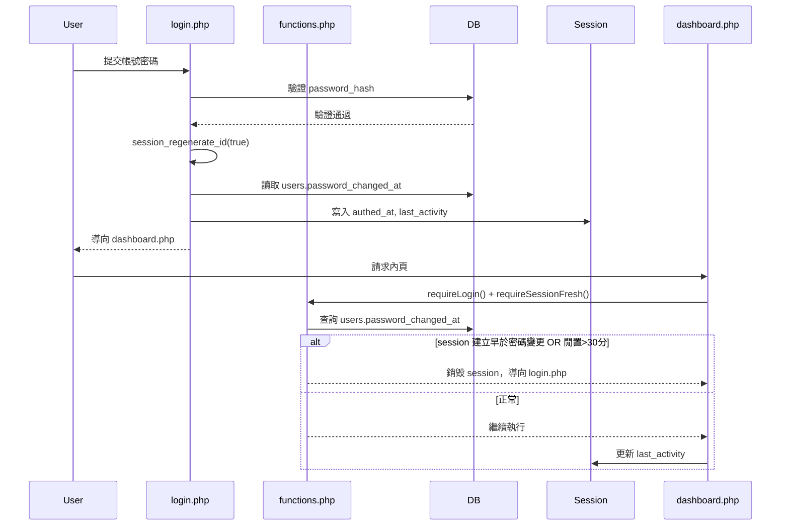
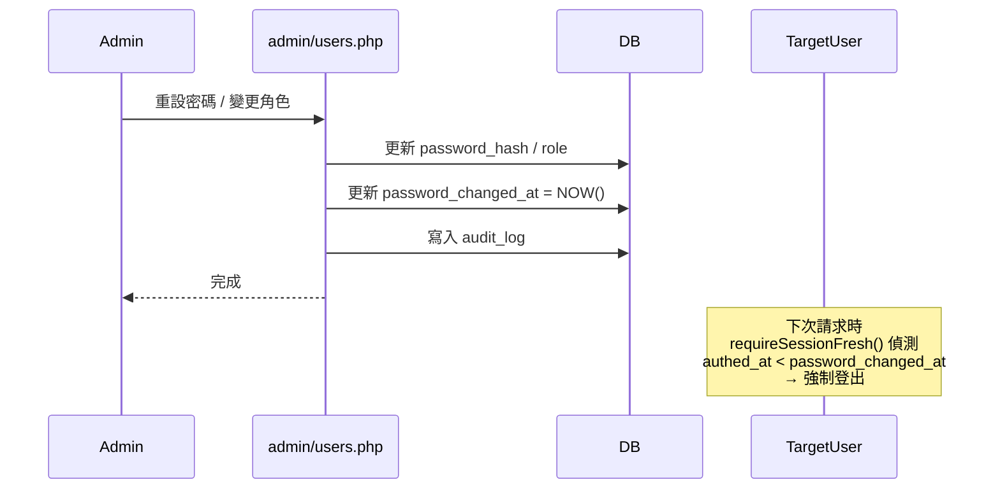
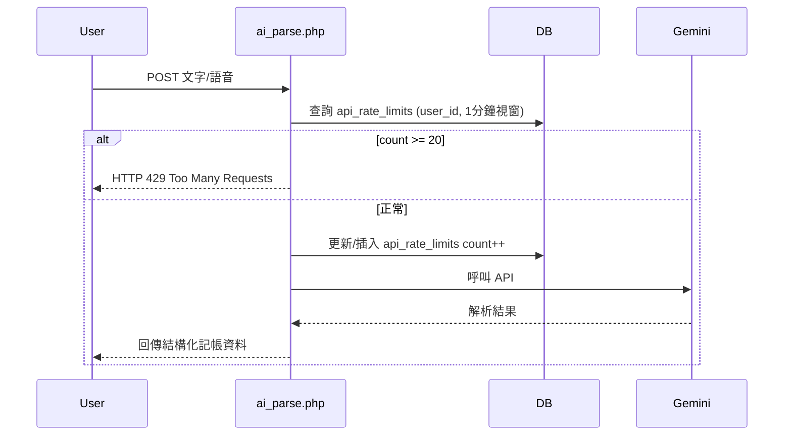

# Design & Implementation: 資安審查修復（FIND-010 ~ FIND-019）

## 1. 變更概述

依據第二輪資安審查報告（`docs/SECURITY_REVIEW_20261121.md`），修復系統中新發現的 10 個資安問題（FIND-010 ~ FIND-019），涵蓋 Session 安全、內容安全政策、密碼複雜度、管理員操作後 Session 失效、API 速率限制、安全標頭與程式細節。第一輪發現的 FIND-001 ~ FIND-009 已全數修復，本期不重複處理。

**修復目標**：將整體風險從 Medium 降低，消除 High 等級問題（FIND-017），並完成所有 Medium 與 Low 等級的修復；Informational 等級視為選擇性回填。

**範圍**：`config.php`、`change_password.php`、`admin/users.php`、`ai_parse.php`、`export_csv.php` 與所有 HTML 輸出頁面；不包含動態滲透測試、不包含新增資料庫表（除 Session 失效機制所需），不包含 cPanel 部署層級的基礎設施 hardening。

---

## 2. 架構決策與設計原則

| 原則 | 說明 |
|------|------|
| **最小權限** | 所有修復均不變更既有權限模型，僅強化既有控制點 |
| **深度防禦** | CSP、X-Frame-Options、Referrer-Policy 疊加防護 XSS 與點擊劫持 |
| **向下相容** | 現有弱密碼不自動失效，新設與重設適用新標準（FIND-018） |
| **效能可接受** | 速率限制每次呼叫一次資料庫查詢，SQLite WAL 模式不阻斷主流程 |
| **部署前提** | FIND-010 (`session.cookie_secure=1`) 依賴生產主機已啟用 HTTPS（用戶已確認） |

---

## 3. 詳細設計與實作路徑

### 3.1 FIND-017：弱密碼佔位符（Medium）

| 項目 | 內容 |
|------|------|
| **問題** | `.env.example` 的 `ADMIN_PASSWORD` 為可預測值 `change_me_before_deploy`，部署時易誤沿用 |
| **解決** | 改為明顯佔位符 `YOUR_STRONG_PASSWORD_HERE`；README 與 `.env.example` 皆強化部署警告 |
| **檔案** | `.env.example`、 `README.md` |
| **驗收** | 複製 `.env.example` 為 `.env` 但未變更密碼時，系統不應以預設弱密碼允許管理員登入 |

### 3.2 FIND-010：Session Cookie Secure 旗標（Medium）

| 項目 | 內容 |
|------|------|
| **問題** | Session Cookie 無 Secure 旗標，公共 Wi-Fi 易被竊取 |
| **解決** | `config.php` 新增 `ini_set('session.cookie_secure', '1');` |
| **檔案** | `config.php` |
| **前提** | 生產主機已啟用 HTTPS（用戶確認），否則登入會失敗 |
| **驗收** | 瀏覽器開發者工具確認 Session Cookie 具 Secure 旗標 |

### 3.3 FIND-011：Content Security Policy（Medium）

| 項目 | 內容 |
|------|------|
| **問題** | 缺乏 CSP，XSS 風險無深度防禦 |
| **解決** | `config.php` 統一輸出 CSP 標頭：`default-src 'self'; script-src 'self' 'unsafe-inline'; style-src 'self' 'unsafe-inline'; img-src 'self' data:; font-src 'self'; connect-src 'self'; frame-ancestors 'none'; base-uri 'self'; form-action 'self'` |
| **檔案** | `config.php` |
| **妥協** | 短期保留 `'unsafe-inline'`，因現有頁面大量內聯 `<script>`（字級切換、AI 語音）；長期建議移至外部 JS 並改用 nonce |
| **驗收** | 所有 HTML 頁面回應標頭包含 CSP；功能不中斷 |

### 3.4 FIND-012：X-Frame-Options（Low）

| 項目 | 內容 |
|------|------|
| **問題** | 缺乏點擊劫持防護 |
| **解決** | `config.php` 新增 `X-Frame-Options: DENY`（CSP `frame-ancestors 'none'` 同步生效） |
| **檔案** | `config.php` |
| **驗收** | 所有 HTML 頁面回應標頭包含 `X-Frame-Options: DENY` |

### 3.5 FIND-013：管理員操作後 Session 失效（Medium）

| 項目 | 內容 |
|------|------|
| **問題** | 管理員重設他人密碼或變更角色後，舊 Session 仍可存取系統 |
| **解決** | 採用「新增 `users.password_changed_at` 欄位比對」方案（改動較小、無需即時踢下線即可滿足需求） |
| **實作細節** | |
| 1. 資料庫 | `db.php`：`users` 表新增 `password_changed_at DATETIME DEFAULT CURRENT_TIMESTAMP`；舊資料庫執行 `ALTER TABLE` migration；`seedAdmin` 建立時寫入 |
| 2. 核心函數 | `functions.php` 新增 `requireSessionFresh()`：比對 `$_SESSION['authed_at']`（登入時寫入）與 `users.password_changed_at`，若 session 建立早於密碼變更 → 銷毀 session 並導向登入 |
| 3. 登入流程 | `login.php` 登入成功時寫入 `$_SESSION['authed_at'] = time()` |
| 4. 密碼變更/角色變更 | `change_password.php`、`admin/users.php` 更新密碼/角色後，同步更新 `users.password_changed_at = datetime('now','localtime')` |
| 5. 敏感頁面 | 所有內頁（`dashboard.php`、`ledger.php` 等）於 `requireLogin()` 後呼叫 `requireSessionFresh()` |
| **檔案** | `db.php`、 `functions.php`、 `login.php`、 `change_password.php`、 `admin/users.php`、所有內頁 |
| **驗收** | 管理員重設密碼後，該使用者以舊密碼登入的既有 Session 無法再執行敏感操作（導向重新登入）；變更角色後，舊 Session 權限不再立即生效 |

### 3.6 FIND-014：AI 解析 API 速率限制（Low）

| 項目 | 內容 |
|------|------|
| **問題** | `ai_parse.php` 無速率限制，單一使用者可濫用耗盡 Gemini API 配額 |
| **解決** | 單使用者（以 `user_id` 為鍵）最近 1 分鐘最多 20 次呼叫，超過回傳 HTTP 429 |
| **儲存** | 新增 `api_rate_limits` 資料表：`id, user_id, endpoint, request_count, window_start, created_at`；SQLite WAL 模式寫入不阻斷主流程 |
| **清理** | 每日清理超過 24 小時的舊紀錄（登入時順帶清理或獨立排程） |
| **檔案** | `ai_parse.php`、 `db.php`（建表） |
| **驗收** | 單一使用者 1 分鐘內超過 20 次呼叫回傳 HTTP 429；正常呼叫不受影響 |

### 3.7 FIND-015：Referrer-Policy（Low）

| 項目 | 內容 |
|------|------|
| **問題** | 參數可能洩漏至第三方網站 |
| **解決** | `config.php` 新增 `Referrer-Policy: strict-origin-when-cross-origin` |
| **檔案** | `config.php` |
| **驗收** | 所有 HTML 頁面回應標頭或 `<meta>` 包含該政策 |

### 3.8 FIND-016：Session 閒置過期控制（Low）

| 項目 | 內容 |
|------|------|
| **問題** | Session 無閒置過期，長時間未操作仍保持登入 |
| **解決** | 兩層防護：PHP 內建 + 應用層檢查 |
| **PHP 內建** | `config.php`：`session.gc_maxlifetime=1440`（24 分鐘）、`session.cookie_lifetime=0`（瀏覽器關閉即過期） |
| **應用層** | `functions.php` `requireSessionFresh()` 新增 30 分鐘閒置過期檢查：比對 `$_SESSION['last_activity']`，超過則銷毀 Session 並導向登入；`login.php` 登入成功時寫入 `$_SESSION['last_activity']`；每次請求更新該時間戳 |
| **檔案** | `config.php`、 `functions.php`、 `login.php` |
| **驗收** | 閒置超過 30 分鐘自動導向登出 |

### 3.9 FIND-018：密碼複雜度強化（Medium）

| 項目 | 內容 |
|------|------|
| **問題** | 密碼最小長度 6 字元，無複雜度要求，易遭字典攻擊 |
| **解決** | 新增 `validatePasswordStrength(string $pwd): array` 回傳 `[bool $ok, string $msg]` |
| **規則** | 長度 ≥ 10 字元；需包含大寫、小寫、數字、符號（`!@#$%^&*()_+-=[]{}|;:,.<>?`）中**至少三類** |
| **套用範圍** | `change_password.php`（使用者自行變更）、`admin/users.php`（建立使用者、重設他人密碼） |
| **現有密碼** | 不自動失效，避免家庭成員使用困擾；新設與重設皆適用新標準 |
| **檔案** | `functions.php`、 `change_password.php`、 `admin/users.php` |
| **驗收** | 長度 < 10 或未達複雜度門檻時拒絕並顯示具體原因 |

### 3.10 FIND-019：CSV 匯出整數運算（Informational）

| 項目 | 內容 |
|------|------|
| **問題** | `export_csv.php` 金額顯示使用 `/ 100` 浮點除法，違反「全程無 FLOAT」原則 |
| **解決** | 改用整數運算：`intdiv((int)$amount_cents, 100)` + 取餘數 `% 100`，格式化為 `元.分` |
| **檔案** | `export_csv.php` |
| **驗收** | 匯出 CSV 的金額顯示與前端 `formatCents()` 結果一致，無浮點誤差 |

---

## 4. 資料流（修復後）

### 4.1 Session 建立與驗證流程



### 4.2 密碼變更 / 角色變更流程



### 4.3 AI 解析 API 呼叫流程



### 4.4 頁面輸出安全標頭

所有 PHP 頁面透過 `require_once './config.php'` 載入，`config.php` 於輸出前統一發送：

```
Content-Security-Policy: default-src 'self'; script-src 'self' 'unsafe-inline'; style-src 'self' 'unsafe-inline'; img-src 'self' data:; font-src 'self'; connect-src 'self'; frame-ancestors 'none'; base-uri 'self'; form-action 'self'
X-Frame-Options: DENY
Referrer-Policy: strict-origin-when-cross-origin
Set-Cookie: PHPSESSID=...; Secure; HttpOnly; SameSite=Lax
```

---

## 5. 資料庫變更

| 表 | 變更 | 類型 |
|----|------|------|
| `users` | 新增 `password_changed_at DATETIME DEFAULT CURRENT_TIMESTAMP` | Schema migration（`ALTER TABLE`） |
| `api_rate_limits` | 新表：`id, user_id, endpoint, request_count, window_start, created_at` | 新建表 + 索引 `(user_id, endpoint, window_start)` |

> 其餘修復均為應用層邏輯與標頭輸出，無資料庫結構變更。

---

## 6. 驗證與測試計畫

| ID | 測試項目 | 預期結果 |
|----|----------|----------|
| FIND-017 | 複製 `.env.example` 為 `.env` 不改密碼嘗試登入 | 管理員登入失敗（密碼不符） |
| FIND-010 | HTTPS 部署後檢查 Session Cookie | 具 Secure 旗標 |
| FIND-011 | 瀏覽器開發者工具 Network 標籤檢查響應標頭 | 所有頁面含 CSP 標頭，功能正常 |
| FIND-012 | 同上檢查 `X-Frame-Options` | 所有頁面為 `DENY` |
| FIND-013 | 管理員重設使用者密碼 → 該使用者舊 Session 繼續操作 | 被導向登入頁 |
| FIND-014 | 同一使用者 1 分鐘內呼叫 `ai_parse.php` 21 次 | 第 21 次回傳 HTTP 429 |
| FIND-015 | 檢查響應標頭 `Referrer-Policy` | 為 `strict-origin-when-cross-origin` |
| FIND-016 | 登入後閒置 31 分鐘再操作 | 自動導向登入頁 |
| FIND-018 | 變更密碼輸入 9 字元 / 純小寫 / 無符號 | 拒絕並顯示具體錯誤訊息 |
| FIND-019 | 匯出 CSV 開啟 Excel 對照前端金額 | 完全一致，無浮點誤差 |

### 本機相容性驗證（2026-11-27）

以 `PHP_APACHE_IMAGE=php:8.1-apache python3 tests/apache_smoke.py` 在隔離的 Docker Apache／SQLite 上驗證 PHP 8.1.34，另以 PHP 8.4 重跑相同套件。兩版均通過 Apache 子目錄、Secure Cookie 標頭、匿名登入限制、私密檔案封鎖及主要帳務流程。測試使用本機 HTTP 與可拋棄帳號；不代表正式 cPanel HTTPS、瀏覽器的 Secure Cookie 傳送或全部 Session 邊界已驗收。

FIND-013 的密碼重設流程已加入 `tests/test_session_reset.py`：合成成員先登入並成功開啟儀表板；管理員以正常後台表單重設密碼後，該成員的原 Session 收到導回登入頁的 302；使用獨立 Cookie 容器以新密碼登入可再次開啟儀表板。此案例通過 Codex 的 Spec／Code／Security 靜態審查及獨立 PHP 8.4 本機 HTTP 實測；納入後 HTTP 套件共 13 案通過。這項測試不涵蓋變更角色、閒置逾時或正式 HTTPS。

FIND-013 的角色變更流程另由 `tests/test_session_role_change.py` 驗證：合成管理員先確認可開啟後台，另一位管理員透過正常表單將其降為 `member`，SQLite 確認角色已更新；原 Session 再開儀表板會導回登入頁；獨立 Cookie 容器以原密碼登入可看儀表板，但不能再開管理頁。獨立審查、PHP 8.4 本機實測及整合 HTTP 27 案通過；變更操作與舊登入分處不同秒，未驗證同秒邊界或正式 HTTPS。

FIND-016 的逾時分支加入 `tests/test_session_idle_timeout.py`：只在測試暫存副本將門檻縮至 3 秒，確認同一已登入用戶能開啟儀表板，閒置後收到 `302` 與 `Location: ./login.php`。通過獨立 Spec／Code／Security 複審、隔離 HTTP 與整合 28 案。專案門檻仍為 1800 秒，本次未以真實 30 分鐘或正式 cPanel HTTPS 驗證。

---

## 7. 部署檢查清單

- [ ] 生產主機已啟用 HTTPS（FIND-010 前提）
- [ ] 執行資料庫 migration：`ALTER TABLE users ADD COLUMN password_changed_at DATETIME DEFAULT CURRENT_TIMESTAMP;`
- [ ] 執行建表：`CREATE TABLE api_rate_limits (...)`（見 `db.php`）
- [ ] 確認 `.env` 中 `ADMIN_PASSWORD` 已替換為強密碼（非佔位符）
- [ ] 確認 `config.php` 中 CSP、`X-Frame-Options`、`Referrer-Policy`、`session.cookie_secure` 皆已生效
- [ ] 手動測試上述 9 項驗收標準

---

## 8. 總結

本次修復完成第二輪資安審查全部 10 項發現（FIND-010 ~ FIND-019），涵蓋：

- **傳輸層**：Secure Cookie（FIND-010）
- **應用層標頭**：CSP、X-Frame-Options、Referrer-Policy（FIND-011/012/015）
- **認證授權**：Session 失效機制、閒置過期、密碼強度（FIND-013/016/018）
- **API 防護**：速率限制（FIND-014）
- **程式細節**：整數運算、弱密碼佔位符（FIND-019/017）

部署驗收須以 §6 的實測範圍及 §7 的現場檢查為準；本機煙霧測試通過不等同正式環境安全驗收。