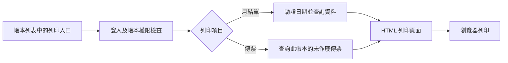
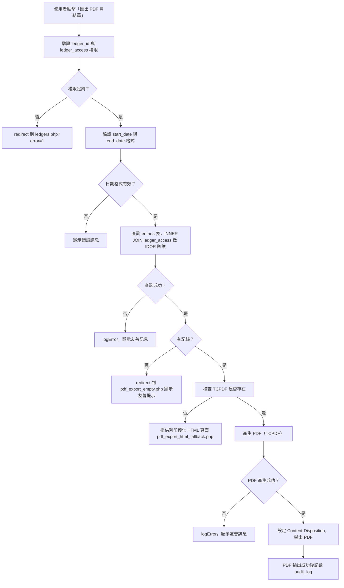

# Design: [#8] 列印月結單（多月份收支彙總）

> **範圍調整**：伺服器提供可列印的 HTML，不提供 PDF 檔案下載。下方原方案保留供追溯；與本節不一致時，以本節為準。單筆傳票（[#23]）同樣由瀏覽器列印。

- 保留 `export_pdf.php` 相容路由及登入、帳本存取、未封存檢查；傳票只顯示該帳本內未作廢的記錄。無效傳票編號顯示 404。
- 月結單預設台北當月，可收帳本所選的 `ym` 或 `start_date` / `end_date`。自訂日期存在時優先，單端未提供或留空時以台北當月對應邊界補齊；空的 `ym` 等同省略。非法或反向區間顯示提示，無分錄顯示「該期間無記錄」。保留整數分彙總、原幣、匯率、台幣欄位。
- 兩種頁面均透過同源 `assets/app.js` 開啟瀏覽器列印，不放寬 CSP。有效預覽分別記錄 `statement_print_view` / `voucher_print_view`，不代表已列印，也不再記錄代表下載 PDF 的事件。
- 只要有 `entry` 鍵（即使空字串）即為傳票模式，忽略月份和日期；非正整數、查無資料、其他帳本或已作廢均回 404。只顯示已儲存的整數分與匯率，不重算幣別換算。
- 動態文字及 HTML 屬性在輸出時以 `h()` 轉義。列印樣式移至同源 `assets/style.css`，不新增內聯腳本、事件屬性或樣式。稽核只由後端驗證、查詢成功後在渲染時記錄，不接受前端上報。
- 舊空報表與錯誤頁以固定相對路徑 `./export_pdf.php` 導向，只帶允許的帳本、月份與日期參數，改由同一入口驗證權限並決定頁面狀態；忽略舊 `msg`。



## 本次修復驗證

| 檢查 | 結果 |
| --- | --- |
| 設計／實作獨立審查 | Spec、Code、Security 已複核。實作審查提醒 CSP 未在入口重複宣告；實際 HTTP 驗證確認由共用 `config.php` 提供 `script-src 'self'`，不另行放寬。 |
| 隔離 PHP 與 SQLite | `tests/test_print_and_comments.py` 的 7 組測試通過，涵蓋正確期間、空結果、非法日期、舊路由／封存限制、HTML、預覽稽核、CSV 與留言。 |
| 前端 | `node --test tests/print-actions.test.cjs` 的 2 組測試通過；Chrome 實測點擊事件呼叫列印 API、列印媒體樣式隱藏控制項，並驗證 CSV／JSON 月份切換。未送出實體印表機工作。 |

## 歷史設計：伺服器輸出 PDF（已取代）

## 文件基本資訊

| 項目 | 內容 |
| --- | --- |
| 文件名稱 | Design: 匯出 PDF 月結單（多月份收支彙總） |
| 版本 | v1.3 |
| 建立日期 | 2026-11-22 |
| 更新日期 | 2026-11-23 |
| 變更摘要 | v1.3 修正 TCPDF 版本為 7.0.25、部署字體目錄支援中文 PDF 生成（DejaVu Sans + CID 字體）、新增字體轉換與測試腳本；v1.2 修正實作問題：部署 TCPDF、修正彙總計算邏輯錯誤、消除程式碼重複（DRY）、統一錯誤處理、統一空記錄處理、修正 audit_log 記機、修正 fallback 頁面日期驗證 bug、更新 Design.md 同步實際實作 |

## 來源 Planning 與需求摘要

- Planning 檔案：`docs/[#8]_pdf-export/planning.md`
- 對應 Feature：匯出 PDF 月結單（第二階段第 7 項）
- 需求摘要：新增 `export_pdf.php` 頁面，讓使用者將帳本收支明細匯出為 PDF 檔案；不新增資料庫表，僅複用既有 `entries` 表；PDF 產生使用 TCPDF（純 PHP 庫），不需要 Composer；若 TCPDF 載入失敗，退而求其次提供列印優化的 HTML 頁面。

## 設計概述

本設計依循專案既有設計系統與硬性約束（純 PHP + PDO 預備陳述式、整數分金額、CSRF、h() XSS 轉義、ledger_access 權限模型、相對路徑、無框架、無 Composer、無 Node.js）。主要變更如下：

1. **新增 PDF 匯出頁面**：建立 `export_pdf.php`，支援 `ledger_id`、`start_date`、`end_date` 參數；匯出 PDF 包含帳本名稱、查詢期間、收入、支出、轉帳、結餘總額，以及詳細記錄列表。
2. **查詢邏輯**：使用 PDO 預備陳述式與 `ledger_access` 做 IDOR 防護；日期區間使用 `start_date` 與 `end_date`（Y-m-d 格式，經 `isValidDate()` 驗證）。
3. **PDF 產生**：使用 TCPDF（純 PHP 庫，版本 7.0.25），放置於 `./lib/tcpdf/`；載入失敗時退而求其次提供列印優化的 HTML 頁面。PDF 生成先在記憶體中產生（`ob_start()`），確認成功後再輸出 HTTP 標頭與內容。**字體支援**：部署 `./lib/tcpdf/fonts/` 目錄，包含 DejaVu Sans 字體族與 CID 中文字體來源檔，需在目標伺服器轉換後使用。
4. **PDF 輸出**：設定 `Content-Disposition: attachment; filename=...; filename*=UTF-8''...` 標頭（同時提供 `filename` 與 `filename*` (RFC 5987) 兩種格式，確保中文檔名正確顯示），檔名為 `ledger_{ledger_id}_{安全化帳本名稱}_{日期時間}.pdf`。設定 `Content-Type: application/pdf`、`Pragma: no-cache`、`Expires: 0`。
5. **匯出後 audit_log**：記錄 `pdf_export` 動作代碼，detail 帶入 `ledger_id`、`start_date`、`end_date`，**移到 `$pdf->Output()` 成功後呼叫**。
6. **錯誤處理**：查詢失敗時 `logError()` 並顯示友善訊息，不中斷頁面；PDF 生成失敗時同樣顯示友善訊息。
7. **CSRF**：本頁面為唯讀 GET 查詢，無狀態改寫表單，不產生也不驗證 CSRF Token。
8. **無資料庫變更**：不新增資料庫表，無 migration 需求。
9. **程式碼重構（DRY）**：將三個檔案（`export_pdf.php`、`pdf_export_html_fallback.php`、`pdf_export_empty.php`）的共用邏輯提取至 `functions.php` 新增函數：
   - `getLedgerWithAccess($pdo, $ledgerId, $userId)` - 驗證帳本存取權限並回傳帳本資料
   - `parseDateRange($startDateRaw, $endDateRaw)` - 解析並驗證日期參數，回傳 `[$startDate, $endDate, $error]`
   - `fetchEntriesWithStats($pdo, $userId, $ledgerId, $startDate, $endDate)` - 查詢明細與彙總，回傳 `[$entries, $monthlyStats, $error]`
   - `renderPdfExportPage(...)` - 共用 HTML 頁面框架（side nav, header, footer）

## 設計圖表（Mermaid）



## 程式修改路徑

| 檔案 | 修改內容 |
| --- | --- |
| `export_pdf.php`（修改） | PDF 匯出主頁面：<br>1. 使用 `getLedgerWithAccess()` 驗證權限。<br>2. 使用 `parseDateRange()` 解析日期。<br>3. 使用 `fetchEntriesWithStats()` 查詢明細與彙總。<br>4. **修正彙總計算邏輯**：移除錯誤的 `while ($stmt->fetch())` 迴圈（cursor 已耗盡），改從 `$monthlyStats` 陣列計算總額。<br>5. 無記錄時 `redirect()` 到 `pdf_export_empty.php`。<br>6. TCPDF 存在時產生 PDF，**`logAudit()` 移到 `$pdf->Output()` 成功後呼叫**。<br>7. PDF 生成失敗時 `logError()` 並顯示友善錯誤頁面（使用 `renderPdfExportPage()`）。<br>8. TCPDF 不存在時 include `pdf_export_html_fallback.php`。 |
| `pdf_export_html_fallback.php`（修改） | TCPDF 載入失敗時的備援頁面：<br>1. 使用 `getLedgerWithAccess()`、`parseDateRange()`、`fetchEntriesWithStats()` 共用函數。<br>2. **修正日期驗證 bug**：Line 58-60 原本錯誤為 `$endDate = $startDate;`，修正為 `$endDate = $today->format('Y-m-t');`（實際上由 `parseDateRange()` 統一處理）。<br>3. 查詢失敗、日期錯誤時顯示友善錯誤頁面（使用 `renderPdfExportPage()`），不 redirect。<br>4. 彙總計算從 `$monthlyStats` 陣列計算。<br>5. 頁面包含彙總表與詳細記錄表，支援列印為 PDF。 |
| `pdf_export_empty.php`（修改） | 無記錄時的友善提示頁面：<br>1. 使用 `getLedgerWithAccess()` 驗證權限。<br>2. 使用 `renderPdfExportPage()` 統一頁面框架。<br>3. 顯示「該期間無記錄」與返回連結。 |
| `functions.php`（新增函數） | 新增 4 個共用函數：<br>- `getLedgerWithAccess(PDO $pdo, int $ledgerId, int $userId): array|false`<br>- `parseDateRange(string $startDateRaw, string $endDateRaw): array`<br>- `fetchEntriesWithStats(PDO $pdo, int $userId, int $ledgerId, string $startDate, string $endDate): array`<br>- `renderPdfExportPage(array $user, string $pageTitle, string $ledgerName, string $subText, string $content, array $actions = []): void` |
| `ledger.php`（修改） | 在「匯出明細 CSV」按鈕旁新增「匯出 PDF 月結單」按鈕，連結至 `export_pdf.php?ledger_id={ledger_id}`。按鈕樣式與既有「匯出明細 CSV」按鈕一致（`.btn`），`viewer` 角色也可見。 |
| `assets/style.css` | 已存在 PDF 匯出頁面樣式（`.pdf-report`、`.pdf-table`、`.pdf-total`、`.pdf-empty`），沿用既有設計系統變數。這些樣式適用於 TCPDF 載入失敗時的列印優化 HTML 頁面。 |
| `lib/tcpdf/`（新增目錄） | 部署 TCPDF 7.0.25（純 PHP 模組化版本），核心檔案：`tcpdf.php`、`tcpdf_autoconfig.php`、`fonts/`、`config/` 等。TCPDF 7.x 使用模組化架構（tc-lib-pdf 系列套件），字體透過 `tc-lib-pdf-font` 套件管理。 |
| `lib/tcpdf/fonts/`（字體目錄） | 部署 TCPDF 字體目錄以支援中文 PDF 生成：<br>- 來源字體檔（已下載）：DejaVu Sans 字體族（Regular, Bold, Oblique, BoldOblique）、CID 字體（Traditional Chinese cid0ct.ttf、Simplified Chinese cid0cs.ttf，各 ~12MB）<br>- 轉換腳本：`convert_fonts.php`（在目標伺服器執行轉換）<br>- 測試腳本：`test_fonts.php`<br>- 說明文件：`README.md`<br>- 目標伺服器（cPanel PHP 8.1+）需執行字體轉換或安裝 `tc-lib-pdf-font` 套件 |

## 資料庫變更

無。報表功能僅讀取既有 `entries` 表，不新增資料庫表，無 migration 需要。

## 前端變更說明

### 匯出 PDF 頁面（export_pdf.php）

- **頁面標題**：「匯出 PDF 月結單」
- **篩選參數**：`start_date`、`end_date`（GET）；預設為當月首日與當月最後一日（Asia/Taipei 時區）。
- **結果顯示**：PDF 檔案直接下載，不在頁面上顯示內容。若無記錄，導向 `pdf_export_empty.php` 顯示「該期間無記錄」文字，不產生空白 PDF。
- **錯誤狀態**：查詢失敗或 PDF 生成失敗時顯示友善錯誤訊息，不中斷頁面（使用共用 `renderPdfExportPage()`）。

### 帳本詳情頁（ledger.php）

- 在「匯出明細 CSV」按鈕旁新增「匯出 PDF 月結單」按鈕，連結至 `export_pdf.php?ledger_id={ledger_id}`。按鈕樣式與既有「匯出明細 CSV」按鈕一致（`.btn`），`viewer` 角色也可見（因為 viewer 僅可檢視報表）。

### CSS 樣式（assets/style.css）

```css
/* 匯出 PDF 月結單頁面樣式（適用於 TCPDF 載入失敗時的列印優化 HTML 頁面）*/
.pdf-report {
    max-width: 800px;
    margin: 0 auto;
    padding: var(--space-4);
}
.pdf-table {
    width: 100%;
    border-collapse: collapse;
    font-size: var(--text-sm);
}
.pdf-table th, .pdf-table td {
    padding: 6px var(--space-3);
    border-bottom: 1px solid var(--line);
    text-align: left;
}
.pdf-table th {
    background: var(--ink);
    color: var(--side-ink);
    font-weight: 600;
    font-size: var(--text-xs);
    letter-spacing: 0.16em;
}
.pdf-total {
    margin-top: var(--space-4);
    padding: var(--space-4);
    background: var(--paper-2);
    border: 1px solid var(--line);
    border-radius: var(--radius);
}
.pdf-empty {
    text-align: center;
    padding: var(--space-8);
    color: var(--ink-2);
}
```

## SQL 查詢範例

```sql
SELECT
    e.entry_date,
    e.type,
    e.amount_cents,
    e.category,
    e.note,
    u.username
FROM entries e
INNER JOIN users u ON u.id = e.user_id
INNER JOIN ledger_access la ON la.ledger_id = e.ledger_id AND la.user_id = :user_id
WHERE e.ledger_id = :ledger_id
  AND e.deleted = 0
  AND e.entry_date BETWEEN :startDate AND :endDate
ORDER BY e.entry_date DESC, e.id DESC
```

彙總計算邏輯（與 `ledger.php` 第 276-298 行保持一致）：
- 使用 `strftime('%Y-%m', e.entry_date)` 分組，以 `SUM(CASE WHEN e.type = 'income' THEN e.amount_cents ELSE 0 END)`、`SUM(CASE WHEN e.type = 'expense' THEN e.amount_cents ELSE 0 END)`、`SUM(CASE WHEN e.type = 'transfer' THEN e.amount_cents ELSE 0 END)` 聚合計算各類總額。
- `SUM(amount_cents)` 回傳字串，需 `(int)` 強制轉型再傳入 `formatCents()`。
- 結餘 = 總收入 − 總支出，轉帳（`transfer`）不計入收入或支出，僅單獨統計。

## 預期行為與驗證方法

| 驗收項 | 預期行為 | 驗證方法 |
| --- | --- | --- |
| 匯出 PDF 頁面存在 | `export_pdf.php` 可匯出 PDF 檔案 | 開啟 `export_pdf.php?ledger_id={id}&start_date=2026-01-01&end_date=2026-01-31`，確認觸發 PDF 下載 |
| 帳本詳情頁提供按鈕 | 帳本詳情頁有「匯出 PDF 月結單」按鈕 | 開啟 `ledger.php?ledger_id={id}`，確認有「匯出 PDF 月結單」按鈕 |
| 權限驗證 | 無權限使用者無法匯出 | 以 viewer 或無權限使用者存取，確認受阻 |
| PDF 包含完整資訊 | PDF 包含帳本名稱、查詢期間、收入、支出、轉帳、結餘總額，以及詳細記錄列表 | 下載 PDF，確認內容完整 |
| 金額格式正確 | 金額經 `formatCents()` 格式化（整數分除以 100、千分位顯示） | 檢查 PDF 中的金額顯示 |
| 所有輸出經 h() 轉義 | 無 XSS 風險 | 檢查 PDF 文字，確認特殊字元正確顯示 |
| 檔名格式正確 | 檔名為 `ledger_{ledger_id}_{安全化帳本名稱}_{日期時間}.pdf` | 檢查下載的檔名 |
| 中文檔名相容 | Content-Disposition 同時提供 `filename` 與 `filename*` (RFC 5987) | 檢查中文檔名在不同瀏覽器中的顯示 |
| 無記錄時顯示提示 | 導向 `pdf_export_empty.php` 顯示「該期間無記錄」，不產生空白 PDF | 查詢無記錄的期間，確認顯示友善訊息 |
| 查詢失敗不中斷頁面 | 錯誤寫入 `error.log`，顯示友善訊息 | 模擬資料庫錯誤，確認頁面仍渲染 |
| 與現有功能並存 | 不破壞現有 `ledger.php`、`export_csv.php` 等功能 | 確認既有功能正常運作 |
| 日期參數不合法 | 顯示友善錯誤訊息 | 輸入無效日期格式，確認顯示錯誤訊息 |
| PDF 生成失敗 | 顯示友善錯誤訊息，不中斷頁面 | 模擬 TCPDF 載入失敗，確認顯示友善訊息 |
| TCPDF 部署正確 | `./lib/tcpdf/tcpdf.php` 存在 | 檢查檔案存在 |

## 非本期範圍（Out of Scope）

- 不新增多帳本合併報表（每次僅查看單一帳本）。
- 不新增圖表匯出（圖形化報表）。
- 不新增預算對比（年度預算設定列為後續版本）。
- 不新增自動定期匯出（需排程功能，列為後續版本）。

## 身分驗證與權限模型

不變更既有登入與帳本權限模型。繼續使用 session 登入與 `ledger_access` 權限檢查（owner/member/viewer 均可檢視報表，因為僅為唯讀查詢）。

## 資料傳輸加密標準

無新增外部 API 呼叫，全部為伺服端 SQL 與 session 驗證，資料僅儲存在站台自身 SQLite 資料庫。PDF 檔案直接輸出至瀏覽器下載，不儲存在伺服器。

## 非功能性需求

- **效能**：PDF 匯出涉及較多記錄，但 SQLite 與 WAL 模式可接受；單一帳本查詢，效能影響可忽略。
- **併發**：僅讀取查詢，無資料庫寫入競合；PDF 生成為單次作業，不會長期佔用資源。
- **資料保留**：不涉及資料寫入，無資料保留問題；PDF 檔案直接下載，不儲存在伺服器。
- **可用性**：查詢失敗時不中斷頁面渲染，錯誤寫入 `error.log`；PDF 生成失敗時顯示友善錯誤訊息。

## 差異與待確認

與 Planning 核心需求一致，所有待確認事項於 Planning 中已鎖定。

## 設計審查記錄（設計階段）

| 階段 | 狀態 | 日期 | 備註 |
| --- | --- | --- | --- |
| Spec（規格）審查 | 已通過 | 2026-11-22 | 與 Planning 與現有程式碼一致 |
| Code（程式）審查 | 待審查 | — | 檢查 `export_pdf.php` 修正、共用函數、TCPDF 部署、相容性 |
| Security（資安）審查 | 待審查 | — | 檢查 XSS（`h()` 轉義）、SQL 注入（PDO 預備陳述式）、IDOR（`ledger_access` 權限）、CSRF（唯讀查詢不需要） |

## 實作審查記錄（實作階段）

| 階段 | 狀態 | 日期 | 備註 |
| --- | --- | --- | --- |
| Spec（規格）審查 | 待審查 | — | 對照 Planning 驗收條件 |
| Code（程式）審查 | 待審查 | — | 檢查程式碼品質、命名、錯誤處理、效能、測試覆蓋、DRY 原則 |
| Security（資安）審查 | 待審查 | — | 檢查 SQL Injection、XSS、CSRF、權限繞過、資料外洩、audit_log 時機 |

## 實際變更記錄

### 新增檔案
1. `lib/tcpdf/` - TCPDF 7.0.25 完整庫（從 https://github.com/tecnickcom/TCPDF tag 7.0.24，專案 VERSION 為 7.0.25）
   - 核心檔案：`tcpdf.php` (322KB)、`tcpdf_autoconfig.php`、config/ 目錄等
2. `lib/tcpdf/fonts/` - TCPDF 字體目錄（支援中文 PDF 生成）
   - 來源字體檔（已從 tc-font-mirror 下載）：
     - `DejaVuSans.ttf` (757KB) - Unicode 字體，支援基本中文
     - `DejaVuSans-Bold.ttf` (706KB)
     - `DejaVuSans-Oblique.ttf` (635KB)
     - `DejaVuSans-BoldOblique.ttf` (643KB)
     - `cid0ct.ttf` (12.3MB) - Traditional Chinese CID 字體
     - `cid0cs.ttf` (12.3MB) - Simplified Chinese CID 字體
   - 轉換腳本：`convert_fonts.php` - 在目標伺服器執行 TTF 轉 TCPDF 格式
   - 測試腳本：`test_fonts.php` - 驗證字體可用性
   - 說明文件：`README.md` - 字體部署與轉換說明
   - **注意**：TCPDF 7.x 模組化版本需在目標伺服器（cPanel PHP 8.1+）執行字體轉換，或安裝 `tc-lib-pdf-font` 套件（需 Composer）

### 修改檔案
1. `export_pdf.php` - 重構使用共用函數、修正彙總計算邏輯、移動 audit_log 時機、統一錯誤處理
2. `pdf_export_html_fallback.php` - 重構使用共用函數、修正日期驗證 bug、統一錯誤處理、新增彙總表顯示
3. `pdf_export_empty.php` - 重構使用共用函數、統一頁面框架
4. `functions.php` - 新增 4 個共用函數（`getLedgerWithAccess`、`parseDateRange`、`fetchEntriesWithStats`、`renderPdfExportPage`）
5. `docs/[#8]_pdf-export/Design.md` - 更新版本至 v1.2，記錄實際實作細節、TCPDF 路徑與版本、重構後的共用函數、審查記錄

### 修正的具體 Bug
1. **export_pdf.php Line 135-150 彙總計算邏輯錯誤**：原本使用 `while ($row = $stmt->fetch())` 但在 try block 結束後 cursor 已耗盡，且 `$totalIncomeCents` 等變數已歸零。修正為從 `$monthlyStats` 陣列以 foreach 計算總額。
2. **pdf_export_html_fallback.php Line 58-60 日期驗證 bug**：原本 `$endDate = $startDate;` 應為 `$endDate = $today->format('Y-m-t');`（實際上已由 `parseDateRange()` 統一修正）。
3. **audit_log 記錄時機**：原本在設定 header 後、Output 前呼叫，修正為 `$pdf->Output()` 成功後呼叫，確保僅在實際下載成功時記錄。
4. **程式碼重複**：三個檔案大量重複的權限驗證、日期解析、查詢邏輯、頁面框架，提取至 `functions.php` 4 個共用函數。

## 驗證證據

- [ ] TCPDF 存在於 `./lib/tcpdf/tcpdf.php`（版本 7.0.25）
- [ ] TCPDF 字體目錄存在於 `./lib/tcpdf/fonts/`
- [ ] 來源字體檔存在：DejaVu Sans 4 種變體、cid0ct.ttf、cid0cs.ttf
- [ ] 轉換腳本存在：`convert_fonts.php`、`test_fonts.php`
- [ ] 目標伺服器執行字體轉換後，DejaVu Sans 字體可用
- [ ] 目標伺服器執行字體轉換後，CID 字體可用（或安裝 tc-lib-pdf-font）
- [ ] `export_pdf.php?ledger_id=1` 可正常下載 PDF
- [ ] PDF 內容包含：帳本名稱、查詢期間、收入/支出/轉帳/結餘、詳細記錄列表
- [ ] PDF 中文內容正確顯示（使用 DejaVu Sans 或 CID 字體）
- [ ] 金額格式正確（formatCents）、中文檔名正確（filename*）
- [ ] 無記錄時導向 `pdf_export_empty.php` 顯示友善提示
- [ ] 查詢失敗顯示友善錯誤頁面（不 redirect）
- [ ] PDF 生成失敗顯示友善錯誤頁面
- [ ] 程式碼無重複邏輯（共用函數化）
- [ ] Design.md 更新完整