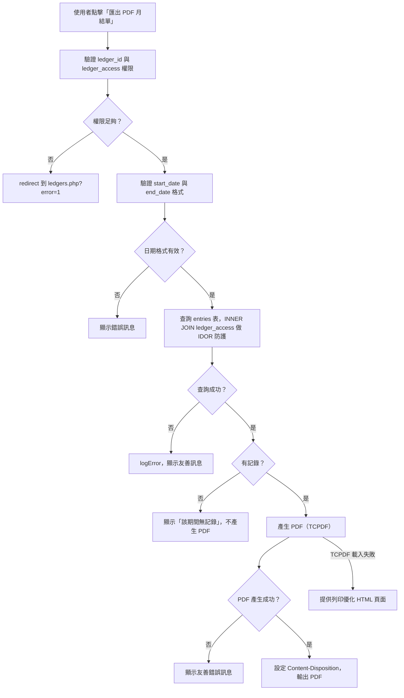

# Design: 匯出 PDF 月結單（多月份收支彙總）

## 文件基本資訊

| 項目 | 內容 |
| --- | --- |
| 文件名稱 | Design: 匯出 PDF 月結單（多月份收支彙總） |
| 版本 | v1.1 |
| 建立日期 | 2026-11-22 |
| 更新日期 | 2026-11-22 |
| 變更摘要 | v1.1 補充預算超支提醒、中文檔名 filename*、PDF 生成順序、TCPDF 載入偵測、無記錄處理、PDF 輸出標頭、彙總計算邏輯、ledger.php 按鈕細節、CSS 樣式使用場景、TCPDF 輸出時 XSS 轉義適用性 |

## 來源 Planning 與需求摘要

- Planning 檔案：`docs/pdf-export/planning.md`
- 對應 Feature：匯出 PDF 月結單（第二階段第 7 項）
- 需求摘要：新增 `export_pdf.php` 頁面，讓使用者將帳本收支明細匯出為 PDF 檔案；不新增資料庫表，僅複用既有 `entries` 表；PDF 產生使用 TCPDF（純 PHP 庫），不需要 Composer；若 TCPDF 載入失敗，退而求其次提供列印優化的 HTML 頁面。

## 設計概述

本設計依循專案既有設計系統與硬性約束（純 PHP + PDO 預備陳述式、整數分金額、CSRF、h() XSS 轉義、ledger_access 權限模型、相對路徑、無框架、無 Composer、無 Node.js）。主要變更如下：

1. **新增 PDF 匯出頁面**：建立 `export_pdf.php`，支援 `ledger_id`、`start_date`、`end_date` 參數；匯出 PDF 包含帳本名稱、查詢期間、收入、支出、轉帳、結餘總額，以及詳細記錄列表。
2. **查詢邏輯**：使用 PDO 預備陳述式與 `ledger_access` 做 IDOR 防護；日期區間使用 `start_date` 與 `end_date`（Y-m-d 格式，經 `isValidDate()` 驗證）。
3. **PDF 產生**：使用 TCPDF（純 PHP 庫），載入失敗時退而求其次提供列印優化的 HTML 頁面。PDF 生成先在記憶體中產生（`ob_start()` 或直接寫入字串變數），確認成功後再輸出 HTTP 標頭與內容。
4. **PDF 輸出**：設定 `Content-Disposition: attachment; filename=...; filename*=UTF-8''...` 標頭（同時提供 `filename` 與 `filename*` (RFC 5987) 兩種格式，確保中文檔名正確顯示），檔名為 `ledger_{ledger_id}_{安全化帳本名稱}_{日期時間}.pdf`。設定 `Content-Type: application/pdf`、`Pragma: no-cache`、`Expires: 0`。
5. **匯出後 audit_log**：記錄 `pdf_export` 動作代碼，detail 帶入 `ledger_id`、`start_date`、`end_date`。
6. **錯誤處理**：查詢失敗時 `logError()` 並顯示友善訊息，不中斷頁面；PDF 生成失敗時同樣顯示友善訊息。
7. **CSRF**：本頁面為唯讀 GET 查詢，無狀態改寫表單，不產生也不驗證 CSRF Token。
8. **無資料庫變更**：不新增資料庫表，無 migration 需求。

## 設計圖表（Mermaid）



## 程式修改路徑

| 檔案 | 修改內容 |
| --- | --- |
| `export_pdf.php`（新增） | PDF 匯出頁面：<br>1. 頁面頂端呼叫 `requireLogin()`，確保使用者已登入。<br>2. 讀取 `ledger_id`（GET），驗證為整數，透過 `ledger_access` 確認使用者有存取權；不合法時 `redirect('./ledgers.php?error=1')`。<br>3. 檢查帳本是否封存（`archived = 0`），若封存則顯示錯誤。<br>4. 讀取 `start_date` 與 `end_date`（GET），驗證為 Y-m-d 格式，經 `isValidDate()` 驗證；格式不符時顯示錯誤訊息；結束日期不得早於開始日期。<br>5. 預設日期：若未提供，使用當月首日與當月最後一日（Asia/Taipei 時區）。<br>6. 查詢 `entries` 表，加入 `INNER JOIN ledger_access la ON la.ledger_id = e.ledger_id AND la.user_id = :user_id` 做 IDOR 防護，`WHERE e.ledger_id = :ledger_id AND e.deleted = 0 AND e.entry_date BETWEEN :startDate AND :endDate`。<br>7. 使用 `strftime('%Y-%m', e.entry_date)` 分組，以 `SUM(CASE WHEN e.type = 'income' THEN e.amount_cents ELSE 0 END)`、`SUM(CASE WHEN e.type = 'expense' THEN e.amount_cents ELSE 0 END)`、`SUM(CASE WHEN e.type = 'transfer' THEN e.amount_cents ELSE 0 END)` 聚合計算各類總額；`SUM(amount_cents)` 需 `(int)` 強制轉型再傳入 `formatCents()`。<br>8. 使用 TCPDF 產生 PDF，包含標題、彙總表、詳細記錄表；金額經 `formatCents()` 格式化，所有輸出經 `h()` 轉義。<br>9. 設定 `Content-Disposition: attachment; filename="..."; filename*=UTF-8''...` 標頭（同時提供 `filename` 與 `filename*` (RFC 5987) 兩種格式，確保中文檔名正確顯示），檔名為 `ledger_{ledger_id}_{安全化帳本名稱}_{日期時間}.pdf`，帳本名稱經 `preg_replace('/[^\p{L}\p{N}_-]/u', '_', ...)` sanitize。<br>10. 匯出成功後，呼叫 `logAudit('pdf_export', 'ledger_id=' . $ledgerId . ' start_date=' . $startDate . ' end_date=' . $endDate)` 記錄至 audit_log。<br>11. 查詢或 PDF 生成失敗時，`logError()` 記錄並顯示友善訊息，不中斷頁面。 |
| `ledger.php`（修改） | 在「匯出明細 CSV」按鈕旁新增「匯出 PDF 月結單」按鈕，連結至 `export_pdf.php?ledger_id={ledger_id}`。按鈕樣式與既有「匯出明細 CSV」按鈕一致（`.btn`），`viewer` 角色也可見（因為 viewer 僅可檢視報表）。 |
| `assets/style.css`（修改） | 新增 PDF 匯出頁面樣式（`.pdf-report`、`.pdf-table`、`.pdf-total`、`.pdf-empty`），沿用既有設計系統變數。這些樣式適用於 TCPDF 載入失敗時的列印優化 HTML 頁面。 |
| `add_entry.php`、`edit_entry.php`、`delete_entry.php`、`dashboard.php` | 無需修改。 |
| `db.php` | 無需修改（不新增資料庫表，無 migration）。 |
| 無新增檔案 | 不新增 PHP 頁面以外的檔案，不新增資料庫表，不新增外部依賴。 |

## 資料庫變更

無。報表功能僅讀取既有 `entries` 表，不新增資料庫表，無 migration 需要。

## 前端變更說明

### 匯出 PDF 頁面（export_pdf.php）

- **頁面標題**：「匯出 PDF 月結單」
- **篩選表單**：年份、開始日期、結束日期；預設為當月首日與當月最後一日（Asia/Taipei 時區）。年份/開始日期/結束日期輸入框回填時必須經 `h()` 轉義。
- **結果顯示**：PDF 檔案直接下載，不在頁面上顯示內容。若無記錄，顯示「該期間無記錄」文字，不產生空白 PDF。
- **錯誤狀態**：查詢失敗或 PDF 生成失敗時顯示友善錯誤訊息，不中斷頁面。

### 帳本詳情頁（ledger.php）

- 在「匯出明細 CSV」按鈕旁新增「匯出 PDF 月結單」按鈕，連結至 `export_pdf.php?ledger_id={ledger_id}`。按鈕樣式與既有「匯出明細 CSV」按鈕一致（`.btn`），`viewer` 角色也可見（因為 viewer 僅可檢視報表）。

### CSS 樣式（assets/style.css）

```css
/* 匯出 PDF 月結單頁面樣式（適用於 TCPDF 載入失敗時的列印優化 HTML 頁面）*/
.pdf-report {
    max-width: 800px;
    margin: 0 auto;
    padding: var(--space-4);
}
.pdf-table {
    width: 100%;
    border-collapse: collapse;
    font-size: var(--text-sm);
}
.pdf-table th, .pdf-table td {
    padding: 6px var(--space-3);
    border-bottom: 1px solid var(--line);
    text-align: left;
}
.pdf-table th {
    background: var(--ink);
    color: var(--side-ink);
    font-weight: 600;
    font-size: var(--text-xs);
    letter-spacing: 0.16em;
}
.pdf-total {
    margin-top: var(--space-4);
    padding: var(--space-4);
    background: var(--paper-2);
    border: 1px solid var(--line);
    border-radius: var(--radius);
}
.pdf-empty {
    text-align: center;
    padding: var(--space-8);
    color: var(--ink-2);
}
/* 年度／季度報表列印樣式，參照 ledger.php */
@media print {
    .side, .nav, .ctr-actions, .quick, .font-size-toggle {
        display: none !important;
    }
    .main { margin: 0; padding: 0; }
    .sheet { width: 100%; max-width: 100%; }
    body { background: #fff; color: #000; }
    .plate { border: 1px solid #000; }
    .v { color: #000; }
    .report-table, .report-total { page-break-inside: avoid; }
}
```

## SQL 查詢範例

```sql
SELECT
    e.entry_date,
    e.type,
    e.amount_cents,
    e.category,
    e.note,
    u.username
FROM entries e
INNER JOIN users u ON u.id = e.user_id
INNER JOIN ledger_access la ON la.ledger_id = e.ledger_id AND la.user_id = :user_id
WHERE e.ledger_id = :ledger_id
  AND e.deleted = 0
  AND e.entry_date BETWEEN :startDate AND :endDate
ORDER BY e.entry_date DESC, e.id DESC
```

彙總計算邏輯（與 `ledger.php` 第 276-298 行保持一致）：
- 使用 `strftime('%Y-%m', e.entry_date)` 分組，以 `SUM(CASE WHEN e.type = 'income' THEN e.amount_cents ELSE 0 END)`、`SUM(CASE WHEN e.type = 'expense' THEN e.amount_cents ELSE 0 END)`、`SUM(CASE WHEN e.type = 'transfer' THEN e.amount_cents ELSE 0 END)` 聚合計算各類總額。
- `SUM(amount_cents)` 回傳字串，需 `(int)` 強制轉型再傳入 `formatCents()`。
- 結餘 = 總收入 − 總支出，轉帳（`transfer`）不計入收入或支出，僅單獨統計。

## 預期行為與驗證方法

| 驗收項 | 預期行為 | 驗證方法 |
| --- | --- | --- |
| 匯出 PDF 頁面存在 | `export_pdf.php` 可匯出 PDF 檔案 | 開啟 `export_pdf.php?ledger_id={id}&start_date=2026-01-01&end_date=2026-01-31`，確認觸發 PDF 下載 |
| 帳本詳情頁提供按鈕 | 帳本詳情頁有「匯出 PDF 月結單」按鈕 | 開啟 `ledger.php?ledger_id={id}`，確認有「匯出 PDF 月結單」按鈕 |
| 權限驗證 | 無權限使用者無法匯出 | 以 viewer 或無權限使用者存取，確認受阻 |
| PDF 包含完整資訊 | PDF 包含帳本名稱、查詢期間、收入、支出、轉帳、結餘總額，以及詳細記錄列表 | 下載 PDF，確認內容完整 |
| 金額格式正確 | 金額經 `formatCents()` 格式化（整數分除以 100、千分位顯示） | 檢查 PDF 中的金額顯示 |
| 所有輸出經 h() 轉義 | 無 XSS 風險 | 檢查 PDF 文字，確認特殊字元正確顯示 |
| 檔名格式正確 | 檔名為 `ledger_{ledger_id}_{安全化帳本名稱}_{日期時間}.pdf` | 檢查下載的檔名 |
| 中文檔名相容 | Content-Disposition 同時提供 `filename` 與 `filename*` (RFC 5987) | 檢查中文檔名在不同瀏覽器中的顯示 |
| 無記錄時顯示提示 | 顯示「該期間無記錄」文字，不產生空白 PDF | 查詢無記錄的期間，確認顯示友善訊息 |
| 查詢失敗不中斷頁面 | 錯誤寫入 `error.log`，顯示友善訊息 | 模擬資料庫錯誤，確認頁面仍渲染 |
| 與現有功能並存 | 不破壞現有 `ledger.php`、`export_csv.php` 等功能 | 確認既有功能正常運作 |
| 日期參數不合法 | 顯示友善錯誤訊息 | 輸入無效日期格式，確認顯示錯誤訊息 |
| PDF 生成失敗 | 顯示友善錯誤訊息，不中斷頁面 | 模擬 TCPDF 載入失敗，確認顯示友善訊息 |

## 非本期範圍（Out of Scope）

- 不新增多帳本合併報表（每次僅查看單一帳本）。
- 不新增圖表匯出（圖形化報表）。
- 不新增預算對比（年度預算設定列為後續版本）。
- 不新增自動定期匯出（需排程功能，列為後續版本）。

## 身分驗證與權限模型

不變更既有登入與帳本權限模型。繼續使用 session 登入與 `ledger_access` 權限檢查（owner/member/viewer 均可檢視報表，因為僅為唯讀查詢）。

## 資料傳輸加密標準

無新增外部 API 呼叫，全部為伺服端 SQL 與 session 驗證，資料僅儲存在站台自身 SQLite 資料庫。PDF 檔案直接輸出至瀏覽器下載，不儲存在伺服器。

## 非功能性需求

- **效能**：PDF 匯出涉及較多記錄，但 SQLite 與 WAL 模式可接受；單一帳本查詢，效能影響可忽略。
- **併發**：僅讀取查詢，無資料庫寫入競合；PDF 生成為單次作業，不會長期佔用資源。
- **資料保留**：不涉及資料寫入，無資料保留問題；PDF 檔案直接下載，不儲存在伺服器。
- **可用性**：查詢失敗時不中斷頁面渲染，錯誤寫入 `error.log`；PDF 生成失敗時顯示友善錯誤訊息。

## 差異與待確認

與 Planning 核心需求一致，所有待確認事項於 Planning 中已鎖定。

## 設計審查記錄（設計階段）

| 階段 | 狀態 | 日期 | 備註 |
| --- | --- | --- | --- |
| Spec（規格）審查 | 已通過 | 2026-11-22 | 與 Planning 與現有程式碼一致 |
| Code（程式）審查 | 待審查 | — | 檢查 `export_pdf.php` 新增頁面、查詢邏輯、相容性 |
| Security（資安）審查 | 待審查 | — | 檢查 XSS（`h()` 轉義）、SQL 注入（PDO 預備陳述式）、IDOR（`ledger_access` 權限）、CSRF（唯讀查詢不需要） |

實作階段完成後，需在同一份 Design.md 補上「實際變更」與「驗證證據」，並執行實作審查（Spec → Code → Security）。