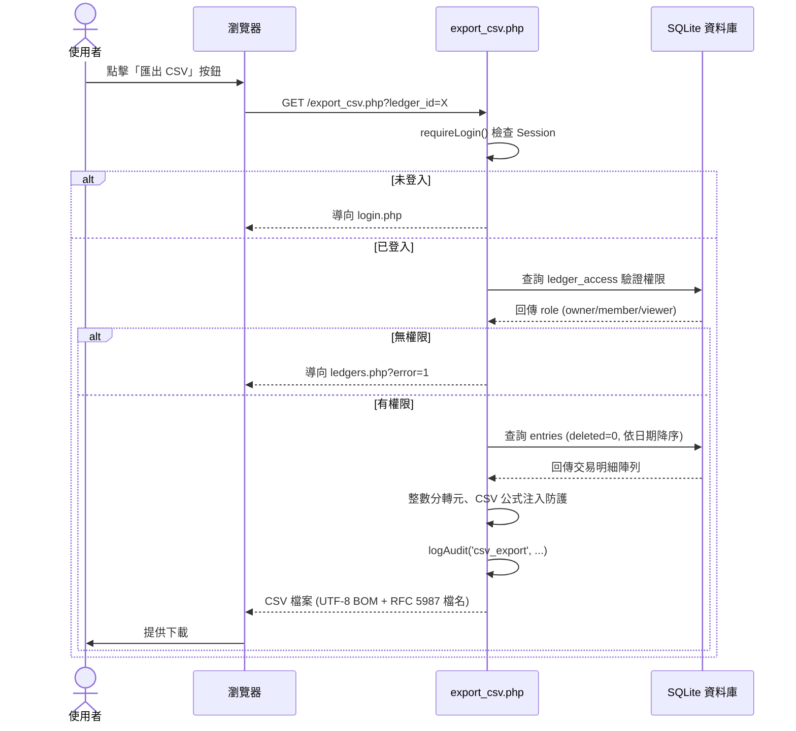

# Design & Implementation: 一鍵匯出 Excel (CSV)

## 1. 變更概述
實作帳本收支明細一鍵匯出為標準 CSV 檔案功能。包含：
- **安全防護**：落實帳本 IDOR 權限驗證（僅授權成員可匯出）與 CSV 公式注入防護（防範 `=`, `+`, `-`, `@` 開頭字元觸發 Excel 巨集）。
- **格式正確性**：採用 UTF-8 with BOM 編碼，確保微軟 Excel 開啟中文不會亂碼。
- **單位轉換**：金額由內部整數「分」轉換為「元」（保留 2 位小數）。

## 2. 資料流與實作路徑
1. **觸發**：在帳本詳情頁 (`ledger.php`) 頂端操作列增加「匯出 CSV」按鈕。
2. **處理 (`export_csv.php`)**：
   - 驗證使用者登入狀態（Session）。
   - 接收 `ledger_id`，查詢該帳本資料並驗證使用者是否具備該帳本存取權限（IDOR 檢查）。
   - 查詢該帳本所有非作廢 (`deleted = 0`) 的交易記錄，依日期降序排列。
   - 逐筆處理欄位：日期、收支類型 (收入/支出)、金額 (元)、分類、記錄者、備註。
   - **公式注入防護**：若備註或分類欄位內容開頭為 `=`, `+`, `-`, `@`，強制在前方加上單引號 `'`。
   - 輸出 CSV HTTP Headers (`Content-Type: text/csv; charset=utf-8`, `Content-Disposition: attachment; filename*=UTF-8''...`) 並寫入 UTF-8 BOM (`\xEF\xBB\xBF`)。
   - 寫入審計日誌 (`csv_export`)，記錄 `ledger_id` 與筆數。

## 2.1 資料流時序圖



## 2.2 權限檢查流程圖

```mermaid
flowchart TD
    A[開始: export_csv.php 接收請求] --> B{requireLogin()<br/>Session 有效?}
    B -->|否| C[導向 login.php]
    B -->|是| D[解析 ledger_id 參數]
    D --> E{ledger_id 為有效整數?}
    E -->|否| F[導向 ledgers.php?error=1]
    E -->|是| G[查詢 ledger_access<br/>WHERE ledger_id=? AND user_id=?]
    G --> H{找到記錄?}
    H -->|否| I[導向 ledgers.php?error=1&msg=無權存取]
    H -->|是| J[取得 role: owner/member/viewer]
    J --> K{role 允許匯出?}
    K -->|否| I
    K -->|是| L[查詢 entries 並輸出 CSV]
    L --> M[logAudit 記錄操作]
    M --> N[結束: 回傳 CSV 檔案]
    
    style C fill:#f8d7da,stroke:#f5c6cb
    style F fill:#f8d7da,stroke:#f5c6cb
    style I fill:#f8d7da,stroke:#f5c6cb
    style L fill:#d4edda,stroke:#c3e6cb
    style N fill:#d4edda,stroke:#c3e6cb
```

## 3. 驗證與測試計畫
- 使用者權限驗證：非授權帳本成員訪問匯出 API 應被拒絕 (403)。
- 亂碼驗證：以 Excel 開啟下載的 CSV，確認中文備註與分類正常顯示。
- 公式注入驗證：輸入開頭含 `=` 的備註，確認匯出後被正確跳脫（前面帶單引號）。
