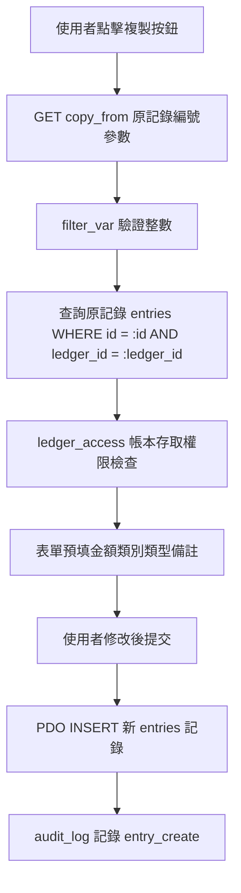

# 記錄複製 — planning.md

## 文件基本資訊

- 文件名稱：記錄複製功能規劃
- 版本：v1.0
- 建立日期：2026-11-22
- 更新日期：2026-11-22
- 章節變更摘要：
  - 功能描述：初版，說明複製按鈕與表單預填規則
  - 使用者故事：初版，描述複製類似記錄需求
  - 預期行為：初版，列出 copy_from 參數驗證與新記錄產生規則
  - 業務驗收條件：初版，定義可驗證的完成條件
  - 資料流：新增，說明參數輸入至新 entries 記錄的完整流向
  - 錯誤處理：新增，列出參數缺失、權限不足、寫入失敗行為
  - 身分驗證與權限：新增，說明登入保護與帳本存取權限
  - 非本期範圍：新增，獨立列出本期不實作項目
  - 非功能性需求：新增，說明效能與可用性設計

## 功能描述

在分錄列表的操作欄加入「複製」按鈕，預填到 add_entry.php（日期預設為今天，金額/類別/類型/備註帶入），使用者可微調後儲存為新記錄。

## 使用者故事

作為家庭成員，我想複製一筆類似的記帳記錄（例如每月固定水電費但不想設重複記錄），省去重新輸入金額與類別的步驟。

## 重現步驟

不適用（非 bug 類功能）。

## 預期行為

1. 分錄列表每行操作欄加入「複製」按鈕（僅擁有者/member 可見）。
2. 點擊後導向 add_entry.php?ledger_id=X&copy_from=Y，Y 為原記錄 id。
3. add_entry.php 驗證 Y 存在且屬於該帳本，使用者有讀取權限。
4. 表單預填：金額、類別、類型、備註；日期預設為今天（Asia/Taipei 時區）。
5. 使用者可修改欄位後儲存，產生新記錄（新 id），稽查記錄表（audit_log）記錄 entry_create。
6. 原記錄不受影響（非軟刪除，非編輯）。
7. 跨站請求偽造（CSRF）權杖與權限檢查照 add_entry.php 現行邏輯。
8. 所有輸出經輸出轉義輔助函式（h()）轉義。
9. 金額以整數分儲存，顯示除以 100。

## 資料流（Data Flow）

使用者於分錄列表點擊「複製」按鈕，以 GET 參數 copy_from（原記錄編號參數）傳遞原記錄 id；add_entry.php 驗證 copy_from 為整數（PHP 內建變數過濾函式 filter_var），查詢原記錄（SELECT ... FROM entries WHERE id = :id AND ledger_id = :ledger_id AND deleted = 0，以具名佔位符 :id 與 :ledger_id 綁定參數），執行帳本存取權限檢查機制（ledger_access）；表單預填原記錄的金額、類別、類型、備註，日期預設為今天；使用者提交後以 PHP 資料物件（PDO）預備陳述式 INSERT 新 entries 記錄，收據檔案路徑欄位（receipt_path）不複製；稽查記錄表（audit_log）記錄 entry_create，detail 包含來源記錄 id；所有輸出經輸出轉義輔助函式（h()）轉義。

## 業務驗收條件

- 在 ledger.php 分錄列表操作欄加入「複製」按鈕（條件：$canWrite）。
- 按鈕連結至 add_entry.php?ledger_id={$ledgerId}&copy_from={$entry['id']}。
- add_entry.php 接收 copy_from 參數，filter_var 驗證為整數。
- 查詢原記錄：SELECT ... FROM entries WHERE id = :id AND ledger_id = :ledger_id AND deleted = 0。
- 權限檢查：使用者對該帳本有 ledger_access（擁有者/member/檢視者）。
- 表單預填金額（金額分轉元格式化函式 formatCents() 反解為顯示格式）、類別、類型、備註。
- 日期欄位預設為今天，不帶入原記錄日期。
- 提交後建立新 entries 記錄，receipt_path 不複製（原收據不共用）。
- audit_log 記錄 entry_create，detail 包含來源記錄 id。

## 錯誤處理與邊界條件

- copy_from 參數不存在或非整數：導向錯誤頁面，顯示「無效的原記錄編號」。
- 原記錄不存在或不屬於該帳本：顯示「找不到該記錄或您沒有權限存取」。
- 使用者無讀取權限：顯示「您沒有該帳本的讀取權限」。
- CSRF 權杖驗證失敗：拒絕請求，顯示通用錯誤訊息。
- 資料庫寫入失敗：顯示通用錯誤頁，詳細錯誤寫入 private_data/error.log。

## 身分驗證與權限控管

- 身分驗證：依賴既有 session 登入機制，requireLogin() 檢查 $_SESSION['user_id']，未登入導向 login.php。
- 權限控管：使用帳本存取權限表 ledger_access，角色分為擁有者（owner）、成員（member）、檢視者（viewer），僅擁有者與成員可見「複製」按鈕。
- 資料傳輸加密：依賴既有 HTTPS Session Cookie 設定（secure、HttpOnly、SameSite=Lax）。

## 非本期範圍（Out of Scope）

- 批次複製：本期僅支援單筆複製，不支援一次選擇多筆記錄複製。
- 複製至另一帳本：本期僅在同一帳本內複製，不支援跨帳本複製。

## 其他內容

- 技術約束：純 PHP + PDO + SQLite，無框架、無 Node.js、無大型前端庫。
- 相對路徑以 ./ 開頭。
- 私密資料庫位於 private_data/，由 .htaccess 封鎖直接存取。
- 不複製 receipt_path，避免兩筆記錄指向同一收據檔案。

## 非功能性需求

- 預期效能：複製頁面載入時間不超過 2 秒（單筆查詢）。
- 併發處理量：查詢與寫入為單筆操作，SQLite 預寫日誌（WAL）模式支援多併發。
- 資料保留策略：複製不產生額外資料表，僅寫入新 entries 記錄與 audit_log。
- 系統可用性：原記錄查詢失敗時顯示錯誤訊息，不影響其他功能。

## 待開發者決定的事項

- copy_from 參數驗證失敗時的導向頁面與錯誤訊息文字。
- 權限不足時是回 403 頁面或導向登入/首頁。
- audit_log 的 detail 欄位格式與儲存欄位定義。
- 是否採用 HTTPS 傳輸加密，以及私密資料庫 private_data/ 的 .htaccess 封鎖規則是否已就緒。
- 「非本期範圍」中批次複製與跨帳本複製是否確定排除本期，或是否有優先順序調整的需求。
