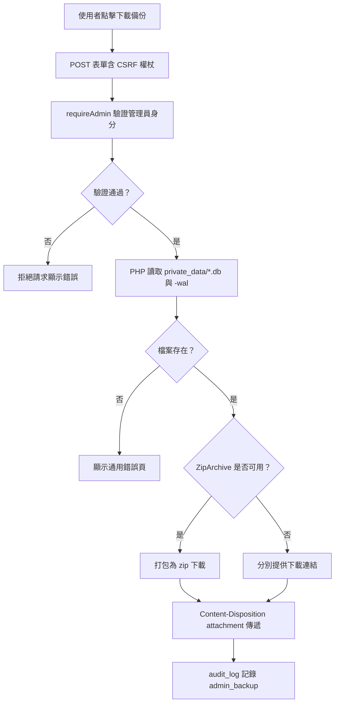

# 網頁端資料庫備份 — planning.md

## 文件基本資訊

- 文件名稱：網頁端資料庫備份功能規劃
- 版本：v1.0
- 建立日期：2026-11-22
- 更新日期：2026-11-22
- 章節變更摘要：
  - 功能描述：初版，說明備份下載按鈕與檔案轉發規則
  - 使用者故事：初版，描述管理員備份需求
  - 預期行為：初版，列出備份下載與 audit_log 記錄規則
  - 業務驗收條件：初版，定義可驗證的完成條件
  - 資料流：新增，說明伺服端讀取至下載輸出的完整流向
  - 錯誤處理：新增，列出檔案不存在、ZipArchive 未啟用等行為
  - 身分驗證與權限：新增，說明管理員保護與加密標準
  - 非本期範圍：新增，獨立列出本期不實作項目
  - 非功能性需求：新增，說明效能與可用性設計

## 功能描述

管理員後台加入「下載資料庫備份」按鈕，將 private_data/*.db 與 -wal 檔案以 PHP 伺服端讀取後轉發下載，避免使用者需透過 cPanel 檔案管理員手動備份。

## 專案函數與術語說明

- 要求管理員函數（requireAdmin()）：檢查 $_SESSION['role'] === 'admin'，非管理員導向登入頁。
- 輸出轉義函數（h()）：用於防護跨站腳本（XSS），所有使用者可控輸出皆經此函式。
- PHP 資料物件（PDO）：用於資料庫查詢的預備陳述式介面，選用理由為符合專案「純 PHP + PDO 預備陳述式」技術約束，防止 SQL 注入。
- Apache 伺服器目錄層級組態檔（.htaccess）：用於封鎖 private_data/ 目錄的直接瀏覽器存取。
- PHP 擴充類別（ZipArchive）：用於將多個檔案打包為 zip 壓縮檔。
- 超文字傳輸協定（HTTP）：網頁請求與回應傳輸協定。
- HTTP 回應標頭（Content-Disposition）：指示瀏覽器以附件形式下載檔案。
- 跨站請求偽造（CSRF）：防護網頁請求被偽造的機制。
- 稽查記錄表（audit_log）：記錄誰在何時做了什麼操作，僅新增不刪除。
- 超文字傳輸協定安全版（HTTPS）：用於資料傳輸加密，Session Cookie 設定為 secure、HttpOnly、SameSite=Lax。

## 使用者故事

作為管理員，我想從網頁介面直接下載資料庫備份檔，不需登入 cPanel 檔案管理員，降低備份門檻。

## 重現步驟

不適用（非 bug 類功能）。

## 預期行為

1. 後台新增 backup.php，以管理員保護機制 requireAdmin() 保護，僅管理員可存取。表單以 POST 提交並含跨站請求偽造（CSRF）權杖，以 hash_equals() 驗證。
2. 點擊下載按鈕後，PHP 讀取 private_data/cookies_xxxx.db 與 cookies_xxxx.db-wal（若存在）。
3. 以 Content-Disposition: attachment 傳遞檔案，瀏覽器彈出下載對話框。
4. 若只有一個 .db 檔，直接下載該檔；若有 -wal，將兩檔打包為 zip 下載（ZipArchive 擴充未啟用時退回分別提供下載連結）。
5. 備份動作寫入稽查記錄表（audit_log），action 為 admin_backup，detail 包含備份時間與檔案大小。
6. private_data/.htaccess 繼續封鎖直接瀏覽器存取，此頁由 PHP 伺服端讀取後轉發，不衝突。
7. 所有輸出經 h() 轉義，錯誤訊息不外洩路徑或堆疊。
8. 下載失敗時顯示通用錯誤頁，詳細錯誤寫入 private_data/error.log。

## 資料流（Data Flow）

使用者於後台點擊「下載資料庫備份」，以 POST 提交含跨站請求偽造（CSRF）權杖的表單請求 backup.php；伺服端以要求管理員函數（requireAdmin()）驗證管理員身分；PHP 伺服端讀取 private_data/cookies_xxxx.db 與 cookies_xxxx.db-wal（若存在）；若 PHP 資料物件（PDO）查詢或檔案讀取失敗，顯示通用錯誤頁並將詳細錯誤寫入 private_data/error.log；若 ZipArchive 擴充可用，將兩檔打包為 zip，否則分別提供下載連結；以 HTTP 回應標頭（Content-Disposition: attachment）傳遞檔案；備份動作寫入稽查記錄表（audit_log）；所有輸出經輸出轉義函數（h()）轉義，錯誤訊息不外洩路徑或堆疊。

## 業務驗收條件

- 在 `docs/features/05_web_backup/backup.php` 建立備份下載頁面。
- 頁面以管理員保護機制 requireAdmin() 保護。
- PHP 側讀取 private_data/cookies_xxxx.db 與 -wal 檔案。
- 使用 readfile() 或 fopen() 串流輸出，避免將大檔案載入記憶體。
- 設定 Content-Type: application/octet-stream 與 Content-Disposition: attachment。
- ZipArchive 可用時以 zip 格式打包兩檔下載，不可用時退回分別下載。
- 備份動作寫入 audit_log（action=admin_backup）。
- 錯誤時顯示通用錯誤頁，詳細錯誤寫入 error.log。

## 錯誤處理與邊界條件

- 檔案不存在：顯示「備份檔案不存在」，HTTP 回應 404。
- ZipArchive 擴充未啟用：退回分別提供下載連結，不顯示錯誤。
- 併發下載：串流輸出不鎖定資料庫，支援多併發下載。
- 磁碟空間不足：顯示通用錯誤頁，詳細錯誤寫入 private_data/error.log。
- 讀取失敗：顯示通用錯誤頁，詳細錯誤寫入 private_data/error.log，不外洩路徑與堆疊。

## 身分驗證與權限控管

- 身分驗證：依賴既有 session 登入機制，requireAdmin() 檢查 $_SESSION['role'] === 'admin'，非管理員導向登入頁。
- 權限控管：僅管理員（role=admin）可執行備份下載，一般成員與檢視者無此功能入口。
- 資料傳輸加密：依賴既有 HTTPS Session Cookie 設定（secure、HttpOnly、SameSite=Lax）。
- CSRF 防護：備份下載為管理員敏感操作，若採用 POST 則需含 CSRF 權杖並以 hash_equals() 驗證；若採用 GET 僅讀下載，則不適用 CSRF，待開發者確認請求方法。

## 非本期範圍（Out of Scope）

- 自動排程備份：本期僅支援手動下載，不支援定時自動備份。
- 雲端備份：本期僅下載至本地，不上傳至雲端儲存。
- 備份還原上傳：本期不支援從網頁上傳備份檔進行還原。

## 非功能性需求

- 預期效能：備份下載回應時間取決於資料庫檔案大小，串流輸出避免記憶體過載。
- 併發處理量：串流下載不阻塞其他請求，支援多併發下載。
- 資料保留策略：備份下載不產生額外資料，僅寫入 audit_log 一筆記錄。
- 系統可用性：下載失敗時顯示通用錯誤頁，不影響其他後台功能。

## 待開發者決定的事項

- 確認錯誤日誌寫入路徑（私密資料庫 private_data/error.log 是否適宜，或是否應改為 web 不可存取的其他位置）。
- 確認資料庫檔名實際命名模式（cookies_xxxx.db 中的 xxxx 對應何者）。
- 確認 audit_log 資料表結構與欄位定義是否已存在，或需新增。
