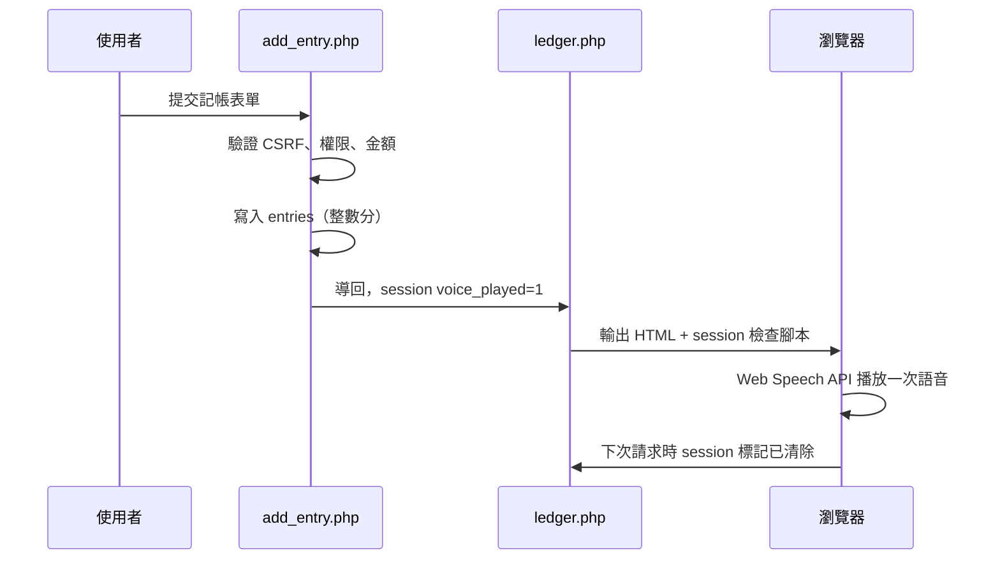

# Design: 快速記帳輔助（預設分類、快速日期、字級切換、語音回饋）

## 文件基本資訊

| 項目 | 內容 |
| --- | --- |
| 文件名稱 | Design: 快速記帳輔助 |
| 版本 | v1.0 |
| 建立日期 | 2026-11-21 |
| 更新日期 | 2026-11-21 |
| 變更摘要 | 初始設計，依 Planning 四項功能拆解為程式修改路徑與前端變更 |

## 來源 Planning 與需求摘要

- Planning 檔案：`docs/quick-entry-assist/planning.md`
- 對應 Feature：2（預設分類清單）、3（快速日期按鈕）、4（字級切換）、8（語音確認回饋）
- 需求摘要：在 `add_entry.php` 與 `edit_entry.php` 新增預設分類下拉選單＋自訂輸入、「今天／昨天」快速日期按鈕；全站加入字級切換開關（Cookie 儲存）；記錄儲存成功後透過 Web Speech API 播報一次語音回饋。

## 設計概述

本設計依循專案既有設計系統（`assets/style.css` 設計 token 與元件類別），不新增資料表、不變更既有權限模型、不破壞 CSRF 與整數分金額機制。四項功能分為：

1. **表單層變更**（`add_entry.php`、`edit_entry.php`）：類別欄位由純文字輸入改為「預設分類下拉選單＋自訂輸入」，日期欄位旁加入「今天／昨天」按鈕。
2. **前端樣式與腳本**（`assets/style.css`、頁面內嵌 `<script>`）：字級切換 CSS class 與 Cookie 讀寫；語音回饋 Web Speech API 播放邏輯。
3. **導回頁層變更**（`ledger.php`）：檢查 session `voice_played` 標記，若為 1 則以 `json_encode()` 轉義後輸出語音內容至 JavaScript `speechSynthesisUtterance`，隨即清除標記；語音內容僅由後端固定模板組合（收支類型＋金額），不納入使用者輸入，不經 URL 參數傳遞。

## 設計圖表（Mermaid）

### 功能整體流程圖

```mermaid
flowchart TD
    A[使用者開啟 add_entry.php / edit_entry.php] --> B[類別欄位顯示預設分類下拉選單]
    B --> C[日期欄位旁顯示「今天／昨天」按鈕]
    C --> D[填寫表單並提交 POST]
    D --> E[後端驗證 CSRF 與帳本權限]
    E --> F[寫入 entries 表，整數分金額]
    F --> G[導回 ledger.php，session 設定 voice_played=1]
    G --> H[ledger.php 檢查 session 標記]
    H -->|voice_played=1| I[Web Speech API 播放語音一次]
    H -->|無標記| J[不播放語音]
    I --> K[清除 session voice_played 標記]
    J --> K
    K --> L[顯示帳本詳情頁]

    subgraph 字級切換（獨立，全站）
    M[使用者點擊字級切換開關] --> N[切換 .font-large CSS class]
    N --> O[寫入 Cookie font_size，SameSite=Lax 90天，不設 HttpOnly]
    O --> P[下次頁面載入讀取 Cookie，套用字級]
    end
```

### 語音回饋時序圖



## 程式修改路徑

| 檔案 | 修改內容 |
| --- | --- |
| `add_entry.php` | 類別欄位由 `<input type="text">` 改為 `<select>`（預設分類 8 項）＋自訂輸入文字框；後端驗證 `category` 長度上限 50 字元；保留既有 `csrf_token` 隱藏欄位。 |
| `edit_entry.php` | 同上，類別欄位改為下拉選單＋自訂輸入，**編輯時預先選取現有 `category` 值**；所有回填至 HTML 的 `category` 值以 `h()` 轉義（屬性值與內文皆適用）；後端驗證 `category` 長度上限 50 字元；保留既有 `csrf_token` 隱藏欄位。 |
| `ledger.php` | 登記成功導回後檢查 `$_SESSION['voice_played']`，若為 1 則以 `json_encode()` 輸出語音內容至 JavaScript 播放腳本並隨即 `unset` 該標記；語音內容由 `add_entry.php` 透過 session 併帶（不經 URL 參數），僅包含收支類型與金額的固定模板組合。 |
| `assets/style.css` | 新增 `.font-large` CSS 類別（全站字級遞增，例如 `--text-lg` 提升至 `--text-2xl`，標籤與輸入框字級相應放大）；新增字級切換開關按鈕樣式。 |
| 各頁面 HTML（側欄或頁首） | 新增字級切換按鈕（`font-size-toggle`），點擊切換 `.font-large` class 並寫入 Cookie；需修改頁面：`add_entry.php`、`edit_entry.php`、`ledger.php`、`ledgers.php`、`dashboard.php`、`change_password.php`。 |
| 前端類別欄位行為 | 下拉選單與自訂輸入文字框並存；下拉選「自訂」時啟用自訂輸入框，否則自訂框禁用；後端優先取自訂輸入值（非空時），空值則取下拉選單值。 |

## 前端變更說明

### 字級切換（Cookie 機制）

- Cookie 名稱：`font_size`
- 屬性：`SameSite=Lax`、`Max-Age=7776000`（90 天，**不設 HttpOnly**，以便 JavaScript 讀取與寫入；非敏感資訊，無需 HttpOnly）
- 值：`normal`（預設）或 `large`
- 實作：PHP 伺服器端於每頁載入時讀取 `$_COOKIE['font_size']`，若為 `large` 則於 `<body>` 加上 `.font-large` class；頁面載入後 JavaScript 亦可讀取 Cookie 並切換 class；點擊切換按鈕時切換 class 並以 `document.cookie` 寫入 Cookie。
- `.font-large` CSS：全站標籤、輸入框、表格文字與按鈕字級遞增（例如 body 從 `1rem` 提升至 `1.25rem`，`--text-sm` 提升至 `1rem`），不影響版面結構。

### 語音回饋（Web Speech API）

- 僅於 `ledger.php` 導回後播放，不於 `add_entry.php` 提交即時播放，避免表單重複提交時重複播報。
- 執行順序：`ledger.php` 於 HTML 輸出前檢查 `$_SESSION['voice_played']`，若為 1 則以 `json_encode()` 輸出語音內容至 JavaScript 播放腳本，隨即 `unset` 該標記；若未設定標記，則不輸出播放腳本。
- 播放內容：由後端固定模板組合（收支類型＋金額），例如「支出 120 元已儲存」或「收入 5000 元已儲存」，**不納入使用者輸入內容（如分類、備註）**，不經 URL 參數傳遞，僅透過 session 併帶。
- 語音內容嵌入 JavaScript 前以 `json_encode()` 轉義，防止 XSS 注入；頁面若顯示語音文字亦以 `h()` 轉義。
- 播放後清除 session `voice_played` 標記，避免瀏覽器重新整理時重複播放。
- 若 `window.speechSynthesis` 不存在，不顯示語音相關 UI，不影響正常記帳流程。

## 資料庫變更

本主題**不新增資料表**，亦不變更既有 `entries.category` 欄位型別（仍為 `TEXT NOT NULL DEFAULT ''`）。後端於 PHP 應用層對 `category` 施加 50 字元上限驗證（`mb_strlen($category, 'UTF-8') > 50` 則拒絕），SQLite TEXT 不設資料庫層長度約束，屬常見做法，非安全阻塞。

超長輸入處理：若 `category` 超過 50 字元，後端拒絕寫入，以 `redirect('./add_entry.php?ledger_id=...&error=1&msg=' . urlencode('類別長度超過 50 字元限制。'))` 導回表單，並保留使用者已輸入的金額、日期、類型、備註欄位值，僅清除超長的類別欄位，避免使用者重新填寫所有欄位。

## 預期行為與驗證方法

| 驗收項 | 預期行為 | 驗證方法 |
| --- | --- | --- |
| 預設分類下拉選單 | 類別欄位顯示 8 個預設選項＋自訂輸入，選擇後正確儲存 | 開啟 `add_entry.php`，確認下拉選單存在；提交後檢查 `entries.category` 值 |
| 自訂分類長度上限 | 超過 50 字元的自訂分類被後端拒絕，顯示錯誤訊息 | 輸入超過 50 字元的分類並提交，確認回傳錯誤 |
| 快速日期按鈕 | 點擊「今天」填入本區 Y-m-d；點擊「昨天」填入昨日 Y-m-d | 點擊按鈕，確認 `<input type="date">` 值正確 |
| 字級切換 | 切換後全站字級遞增，關閉瀏覽器再開啟仍維持 | 切換後檢查 `.font-large` class；重新載入確認 Cookie 生效 |
| 編輯頁面類別回填 | 編輯表單類別欄位預先選取現有 `category` 值，且經 `h()` 轉義輸出 | 開啟 `edit_entry.php`，確認類別下拉選單預先選取現有分類；頁面原始碼中 `category` 值經轉義 |
| 語音回饋 | 儲存成功導回 `ledger.php` 後播放一次語音，刷新不重複播放 | 新增記錄後確認瀏覽器播放語音；按 F5 確認不再播放 |
| CSRF 與權限不受影響 | 所有表單仍含 `csrf_token`，viewer 無法新增記錄 | 提交無 token 表單應被拒絕；viewer 角色存取 `add_entry.php` 受阻 |

## 設計審查記錄（設計階段）

| 階段 | 狀態 | 日期 | 備註 |
| --- | --- | --- | --- |
| Spec（規格）審查 | 待審查 | — | 將本 Design 與 `planning.md` 並排核對範圍、驗收條件 |
| Code（程式）審查 | 待審查 | — | 檢查 `add_entry.php`、`edit_entry.php`、`ledger.php`、`assets/style.css` 修改路徑與相容性 |
| Security（資安）審查 | 待審查 | — | 檢查 CSRF、XSS（`h()` 轉義）、IDOR（ledger_access 權限）、Cookie 屬性 |

> 設計審查三階段皆通過後方可進入實作。實作階段完成後，需在同一份 Design.md 補上「實際變更」與「驗證證據」，並執行實作審查（Spec → Code → Security）。

## 非本期範圍（Out of Scope）

- 不新增自訂分類的後端管理頁面（自訂分類僅寫入 `entries.category` 欄位，不建立獨立分類資料表）。
- 不新增語音輸入（僅語音輸出回饋，既有 AI 一句話記帳已含語音輸入，不重複建置）。
- 不新增資料表，亦不變更既有 `entries.category` 資料庫欄位型別。

## 身分驗證與權限模型

不變更既有登入與帳本權限模型。繼續使用 session 登入與 `ledger_access` 權限檢查：

- `owner` / `member`：可新增、編輯記錄（類別欄位變更適用）。
- `viewer`：僅檢視，無法新增或編輯記錄。
- 所有表單皆保留 `csrf_token` 隱藏欄位，POST 時以 `hash_equals()` 常數時間比較驗證。

## 資料傳輸加密標準

無新增外部 API 呼叫。語音回饋僅使用瀏覽器本機 Web Speech API，不傳輸語音資料至外部伺服器。字級偏好以 Cookie 儲存，屬性為 `SameSite=Lax`、`Max-Age=7776000`（**不設 HttpOnly**，以便 JavaScript 讀取與寫入；非敏感資訊，無需 HttpOnly）。

## 非功能性需求

- **效能**：字級切換僅影響前端 CSS class，不影響頁面載入效能；語音回饋為瀏覽器本機 API，不耗用伺服器資源；預設分類為靜態清單，不增加資料庫查詢成本。
- **併發**：無資料庫寫入競合，本主題不新增資料表。
- **資料保留**：Cookie `font_size` 過期時間 90 天；語音 session 標記於單次頁面載入後即清除，不長期保留。
- **可用性**：瀏覽器不支援 Web Speech API 時，語音回饋降級為無（不顯示語音 UI），不影響正常記帳流程。

## 差異與待確認

與 Planning 核心需求一致，但有下列微小偏離，已於各章節列出：

- 語音內容：Planning 說「由後端於 session 設定 voice_played=1 並帶入語音內容」，Design 規定語音內容僅由後端固定模板組合（收支類型＋金額），不納入使用者輸入，不經 URL 參數傳遞，以避免 XSS 風險。
- Cookie 屬性：Planning 說「HttpOnly、SameSite=Lax」，Design 規定 **不設 HttpOnly**（保留 SameSite=Lax、Max-Age），以便 JavaScript 讀取與寫入字級偏好。
- 編輯頁面類別回填：Planning 未詳細說明，Design 補充「編輯時預先選取現有 category 值；所有回填以 h() 轉義」。

所有待確認事項於 Planning 中已鎖定：

- 字級偏好：以 Cookie 保留（名稱 `font_size`，SameSite=Lax，過期 90 天，**不設 HttpOnly**）。
- 語音回饋播報時機：`ledger.php` 導回後透過 session `voice_played=1` 播放一次並清除標記。