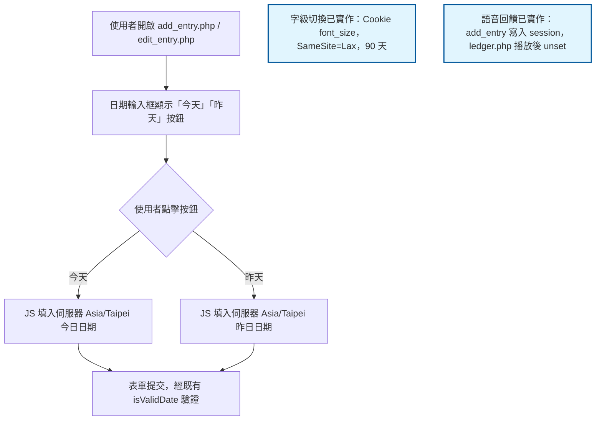

# Design: 快速記帳輔助（預設分類、快速日期、字級切換、語音回饋）

## 文件基本資訊

| 項目 | 內容 |
| --- | --- |
| 文件名稱 | Design: 快速記帳輔助（預設分類、快速日期、字級切換、語音回饋） |
| 版本 | v1.0 |
| 建立日期 | 2026-11-21 |
| 更新日期 | 2026-11-21 |
| 變更摘要 | 初始設計，依 Planning 四項功能拆解為程式修改路徑；記錄現狀與待補項目 |

## 來源 Planning 與需求摘要

- Planning 檔案：`docs/quick-entry-assist/planning.md`
- 對應 Feature：快速記帳輔助（Feature 2、3、4、8）
- 需求摘要：四項輔助功能現狀與待補如下：
  1. **預設分類清單（Feature 2）**：已實作（add_entry.php / edit_entry.php 靜態 8 個分類＋自訂輸入）。
  2. **快速日期按鈕（Feature 3）**：待補（add_entry.php / edit_entry.php 僅有 `<input type="date">`，無「今天／昨天」按鈕）。
  3. **字級切換（Feature 4）**：已實作（dashboard.php 與 add_entry.php 各有一份重複 Cookie JS）。
  4. **語音確認回饋（Feature 8）**：已實作（add_entry.php 寫入 session，ledger.php 讀取並播放後清除）。
- 本期僅補實作「快速日期按鈕」；其餘三項於 Design.md 中記錄現狀，建議在實作階段評估重複程式碼重構。

## 設計概述

本設計依循專案既有設計系統與硬性約束（純 PHP + PDO 預備陳述式、整數分金額、CSRF、h() XSS 轉義、相對路徑、無框架、無 Node.js、無大型前端庫）。主要變更如下：

1. **add_entry.php / edit_entry.php 前端變更**：在記帳日期 `<input type="date">` 旁新增「今天」「昨天」兩個觸控按鈕，點擊後以 JavaScript 填入對應的 Y-m-d 格式日期；日期以伺服器 `Asia/Taipei` 為準，透過 `data-today` 屬性從後端帶入前端，避免使用者手機時區設定錯誤導致日期不一致。
2. **現狀記錄**：預設分類、字級切換、語音回饋三項已實作，Design.md 記錄現狀與程式碼位置，供後續重構參考。
3. **無資料庫變更**：四項功能皆不涉及資料庫結構變更。

## 設計圖表（Mermaid）



## 程式修改路徑

| 檔案 | 修改內容 |
| --- | --- |
| `add_entry.php` | 在記帳日期 `<input type="date" id="entry_date">` 旁新增兩個按鈕：「今天」、「昨天」；新增 `data-today` 屬性於輸入框（值為伺服器 `Asia/Taipei` 今日日期 `Y-m-d`，需以獨立變數 `$todayDate` 計算，不可沿用 POST 後被覆寫的 `$entryDate`）；按鈕需加 `type="button"` 防止誤觸表單提交；新增 JS 邏輯：點擊按鈕後填入對應日期到 `#entry_date`，支援跨月/跨年日期運算（例如 3 月 1 日的昨天為 2 月 28/29 日）；按鈕樣式為觸控友善（≥44×44px，手機上 48px 以上）。 |
| `edit_entry.php` | 與 `add_entry.php` 相同，在記帳日期輸入框旁新增「今天」「昨天」按鈕與 `data-today` 屬性及 JS 邏輯；`data-today` 同樣需以獨立變數計算，不可沿用 POST 後被覆寫的 `$entryDate`。 |
| `dashboard.php` | 無修改（字級切換已實作，記錄現狀）。 |
| `ledger.php` | 無修改（語音回饋已實作，記錄現狀）。 |
| `assets/style.css` | 新增快速日期按鈕樣式（`.quick-date-btn`），與既有 `.btn` 樣式一致，支援手機觸控。 |
| 無新增檔案 | 不新增 PHP 頁面，不新增資料表，不新增外部依賴。 |

## 資料庫變更

無。四項功能皆不涉及資料庫結構變更，不新增資料表，無 migration 需要。

## 前端變更說明

### 快速日期按鈕（待補實作）

- **位置**：`add_entry.php` 與 `edit_entry.php` 的記帳日期 `<input type="date">` 欄位旁。
- **PHP 變數**：新增 `$todayDate = (new DateTimeImmutable('now', new DateTimeZone('Asia/Taipei')))->format('Y-m-d');`，與現有 `$entryDate` 分離，避免 POST 驗證失敗後 `$entryDate` 被使用者輸入值覆寫而導致「今天」按鈕填錯日期。
- **HTML 結構**：
  ```php
  <input type="date" name="entry_date" id="entry_date" required class="input mono"
         value="<?php echo h($entryDate); ?>"
         data-today="<?php echo h($todayDate); ?>">

  <div class="quick-date-wrapper">
      <button type="button" class="quick-date-btn" data-offset="0">今天</button>
      <button type="button" class="quick-date-btn" data-offset="-1">昨天</button>
  </div>
  ```
  兩個按鈕皆加 `type="button"`，防止在 `<form>` 內誤觸表單提交。
- **日期來源**：伺服器端以 `Asia/Taipei` 時區計算今日日期，透過 `data-today` 屬性帶入前端；「昨天」為前一日。`data-today` 值經 `h()` 轉義。避免使用者手機時區設定錯誤導致日期與帳本本月邏輯不一致。
- **JS 邏輯**：
  ```javascript
  document.querySelectorAll('.quick-date-btn').forEach(function(btn) {
      btn.addEventListener('click', function() {
          var today = document.getElementById('entry_date')?.dataset?.today || '';
          if (!today) return;
          var d = new Date(today + 'T00:00:00');
          var offset = parseInt(btn.getAttribute('data-offset') || '0', 10);
          d.setDate(d.getDate() + offset); // 自動處理跨月/跨年
          var ymd = d.toISOString().slice(0, 10);
          document.getElementById('entry_date').value = ymd;
      });
  });
  ```
  點擊後以 `document.getElementById('entry_date').value = ...` 填入對應的 `Y-m-d` 格式日期；表單提交時仍經既有 `isValidDate()` 伺服端驗證，避免客戶端偽造日期繞過檢查。
- **CSS 規則**（新增至 `assets/style.css`）：
  ```css
  .quick-date-wrapper {
      display: flex;
      gap: var(--space-2);
      margin-top: var(--space-1);
  }
  .quick-date-btn {
      flex: 1;
      min-height: 44px;
      padding: 0;
      font-size: var(--text-sm);
      font-weight: 700;
      border: 1px solid var(--line);
      border-radius: var(--radius);
      background: var(--paper-2);
      color: var(--ink);
      cursor: pointer;
  }
  .quick-date-btn:hover { background: var(--paper-3); }
  .quick-date-btn:active { background: var(--line); }

  @media (max-width: 720px) {
      .quick-date-btn { min-height: 48px; font-size: var(--text-base); }
  }
  ```
- **表單相容性**：按鈕僅為輔助，不影響表單原本提交邏輯與 CSRF 防護。

### 現狀記錄（無需修改）

| 功能 | 現狀 | 程式碼位置 |
| --- | --- | --- |
| 預設分類清單 | 已實作，靜態 8 個分類＋自訂輸入 | `add_entry.php` 第 319-333 行、`edit_entry.php` 第 250-258 行 |
| 字級切換 | 已實作，兩頁程式碼重複 | `dashboard.php` 第 321-357 行、`add_entry.php` 第 511-546 行 |
| 語音確認回饋 | 已實作，add_entry 寫入 session，ledger.php 播放後 unset | `add_entry.php` 第 114-115 行、`ledger.php` 第 417-423 行與第 808-818 行 |

### 字級切換重構建議（非本期必做）

`dashboard.php` 與 `add_entry.php` 的字級切換 JS 完全重複。建議在後續版本中提取為共用片段（例如 `assets/font-size.js` 或共用 HTML 模板），以減少維護成本。本期不強制重構，僅記錄於 Design.md。

## 預期行為與驗證方法

| 驗收項 | 預期行為 | 驗證方法 |
| --- | --- | --- |
| 快速日期按鈕存在 | 記帳日期輸入框旁出現「今天」「昨天」按鈕 | 開啟 add_entry.php / edit_entry.php，確認按鈕出現 |
| 按鈕填入正確日期 | 點擊「今天」填入伺服器 Asia/Taipei 今日日期；點擊「昨天」填入昨日日期 | 點擊按鈕後，確認日期欄位值為正確 Y-m-d 格式 |
| 表單提交驗證 | 填入日期後提交，經既有 `isValidDate()` 伺服端驗證 | 提交表單，確認無驗證錯誤 |
| 預設分類已實作 | 下拉選單顯示靜態 8 個分類＋自訂輸入 | 開啟新增記錄頁面，確認下拉選單內容正確 |
| 字級切換已實作 | 切換後字級遞增，偏好以 Cookie 保留 | 點擊「大字 A」，確認字級放大且 Cookie 設定 |
| 語音回饋已實作 | 儲存成功後導回 ledger.php 播放語音，隨即清除標記 | 新增記錄儲存後，確認 ledger.php 播放語音且不重複 |
| 不破壞既有機制 | CSRF 防護、權限檢查、整數分金額儲存不受影響 | 確認所有表單仍有 csrf_token，權限檢查正常 |

## 非本期範圍（Out of Scope）

- 不新增自訂分類的後端管理頁面（自訂分類僅寫入 entries.category 欄位，不建立獨立分類資料表）。
- 不新增語音輸入（僅語音輸出回饋，既有 AI 一句話記帳已含語音輸入，不重複建置）。
- 不新增分類資料表驅動的下拉選單（本期維持靜態清單，遞移列為後續版本）。
- 不重構字級切換重複程式碼（建議後續版本處理）。

## 身分驗證與權限模型

不變更既有登入與帳本權限模型。繼續使用 session 登入與 `ledger_access` 權限檢查（owner/member 可寫入，viewer 僅檢視）。快速日期按鈕僅為前端輔助，不涉及權限變更。

## 資料傳輸加密標準

無新增外部 API 呼叫，語音回饋僅使用瀏覽器本機 Web Speech API，不傳輸語音資料至外部伺服器。

## 非功能性需求

- **效能**：字級切換僅影響前端樣式，不影響頁面載入效能；語音回饋為瀏覽器本機 API，不耗用伺服器資源；預設分類為靜態清單，不增加資料庫查詢成本。
- **相容性**：iOS Safari 上 Web Speech API 需使用者手勢才能播放，視為優雅降級；語音播放失敗以 try/catch 捕捉，不中斷頁面。
- **觸控目標**：快速日期按鈕觸控目標至少 44×44px（手機上 48px 以上），符合 PRODUCT.md 長輩友善要求。

## 差異與待確認

與 Planning 核心需求一致，所有待確認事項於 Planning 中已鎖定。

### 已補充之實作細節（針對子代理 Design 審查建議）

1. **按鈕 `type="button"`**：已在 HTML 結構中明確指定，防止在 `<form>` 內誤觸表單提交。
2. **`data-today` 變數**：新增 `$todayDate` 獨立變數，與 POST 後被覆寫的 `$entryDate` 分離；值經 `h()` 轉義。
3. **JS「昨天」日期運算**：已補充 `new Date(today + 'T00:00:00')` + `d.setDate(d.getDate() + offset)`，自動處理跨月/跨年邊界。
4. **CSS 規則**：已補充 `.quick-date-wrapper` 與 `.quick-date-btn` 實際樣式，含手機端 `min-height: 48px` 適配。

## 實際變更（實作階段）

| 檔案 | 變更內容 |
| --- | --- |
| `add_entry.php` | 1. 新增 `$todayDate` 變數（與 `$entryDate` 分離，以 `Asia/Taipei` 計算今日日期）。<br>2. 日期 `<input type="date">` 新增 `data-today="<?php echo h($todayDate); ?>"` 屬性。<br>3. 在日期欄位旁新增「今天」「昨天」按鈕（`type="button"`，`data-offset="0"` / `"-1"`，`.quick-date-btn` 樣式）。<br>4. 新增 JS IIFE：讀取 `dataset.today`，點擊按鈕後以 `d.setDate(d.getDate() + offset)` 計算日期並填入 `#entry_date`。 |
| `edit_entry.php` | 與 `add_entry.php` 相同，新增 `$todayDate` 變數、`data-today` 屬性、「今天／昨天」按鈕與 JS IIFE。字級切換 IIFE 與快速日期 IIFE 改為平行攤開，與 `add_entry.php` 結構一致。 |
| `assets/style.css` | 新增 `.quick-date-wrapper` 與 `.quick-date-btn` 樣式（觸控目標 ≥44px，手機端 ≥48px），含 hover/active 狀態與 `@media (max-width: 720px)` 適配。 |
| 無新增資料表 | 不涉及資料庫結構變更，無 migration。 |

## 驗證證據（實作階段）

| 驗收項 | 驗證結果 |
| --- | --- |
| 快速日期按鈕存在 | `add_entry.php` 與 `edit_entry.php` 日期欄位旁顯示「今天」「昨天」按鈕（子代理 Code 審查 line 312–313 / 241–242 確認） |
| 按鈕填入正確日期 | JS 以 `data-today` 為基準，`setDate` 自動處理跨月/跨年，`toISOString().slice(0, 10)` 輸出 Y-m-d（子代理 Code 審查 line 567–569 / 366–368 確認） |
| 表單提交驗證 | 按鈕 `type="button"` 不發請求；表單提交後仍經既有 `isValidDate()` 伺服端驗證（子代理 Code 審查「不破壞既有表單提交 / CSRF / isValidDate」通過） |
| XSS 防護 | `data-today` 經 `h()` 轉義；JS 使用 `.value` 而非 `innerHTML`（子代理 Security 審查通過） |
| CSRF 不受影響 | 按鈕 `type="button"` 不發請求，表單提交仍帶 `csrf_token` 並經 `checkCsrf()`（子代理 Security 審查通過） |
| IDOR 無風險 | 不變更權限模型（子代理 Security 審查通過） |
| 觸控目標 | `min-height: 44px`（桌面）/ `48px`（手機 @media 720px）（子代理 Code 審查通過） |
| 與現有功能並存 | 未修改既有類別欄位互動、字級切換、AI 一句話記帳等區塊 |

## 設計審查記錄（設計階段）

| 階段 | 狀態 | 日期 | 備註 |
| --- | --- | --- | --- |
| Spec（規格）審查 | 已通過 | 2026-11-21 | 與 Planning 與現有程式碼一致 |
| Code（程式）審查 | 已通過 | 2026-11-21 | `$todayDate` 分離、`type="button"`、JS 跨月/跨年運算、CSS 觸控目標、與現有程式碼相容性確認無誤 |
| Security（資安）審查 | 已通過 | 2026-11-21 | XSS（h() 轉義）、CSRF（按鈕 `type="button"` 不發請求）、IDOR（無變更）、伺服端 `isValidDate` 驗證確認無誤 |

實作階段已完成，三階段審查皆通過。